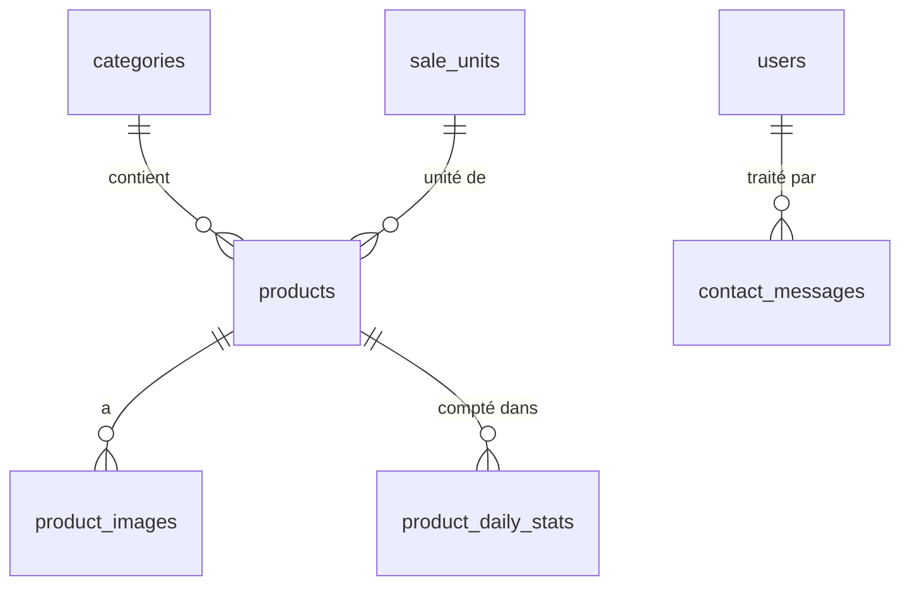

# LEGNA PREMIUM ITALIA — Dossier complet du projet pour Claude (VS Code)

> **Claude, lis d'abord la PARTIE 0 en entier.** Elle contient tes instructions de travail.
> PARTIE 1 : cahier des charges **original** d'ISI (textes italiens, palette, détail des sections).
> PARTIES 2 à 7 : documents de conception validés (ils font foi en cas de différence avec la PARTIE 1).
> PARTIES 8 à 21 : les sprints S0 à S13, chacun avec sa fiche ET son code (syntaxe PHP vérifiée, non exécuté : lance les tests et signale chaque correction).

---

# PARTIE 0 — Instructions de travail pour Claude

## 0.1 Contexte
- **Projet :** Legna Premium Italia — **site vitrine commercial** de bois de chauffage pour l'**Italie**.
- **Le site ne vend pas.** Il présente les produits ; le bouton **« Ordina »** ouvre un **e-mail prérempli** (`mailto:`) ; WhatsApp en canal secondaire. **Aucun panier, commande, paiement ni compte client** (CDC §28).
- **Tout le site est en italien** : site public **et** administration.
- **Stack :** PHP 8.2+ · Laravel · **Inertia.js + React + TypeScript** (kit de démarrage officiel) · **SSR** · MySQL 8 · Tailwind CSS · Vite.
- **Environnement d'ISI :** Windows, VS Code, PowerShell 7, WAMP (MySQL), Composer, Node.js, Git.
- **ISI apprend le développement web.** Il parle **français**.

## 0.2 Règles de travail (strictes)
1. **Parle à ISI en français**, simplement. Explique ce que tu fais et pourquoi.
2. **Un sprint à la fois.** Suis le fichier complet du sprint (PARTIES 8 à 21 ; la PARTIE 7 §6 en donne le résumé). **À la fin de chaque sprint : checklist, puis arrêt.** N'enchaîne jamais sans l'accord d'ISI.
3. **Les documents font foi.** Règles **R-…** (PARTIE 3), fonctionnalités **F-…** (PARTIE 4), tables (PARTIE 5), architecture (PARTIE 6). Si quelque chose est incohérent ou impossible avec la version installée, **signale-le et propose une correction avant de t'en écarter**.
4. **N'invente aucune donnée commerciale ou légale** : prix, tarifs, délais, zones, e-mail, téléphone, WhatsApp, Partita IVA, adresse, histoire, certifications, avis clients. Champs **vides** (masqués sur le site) ou contenus marqués **« [DEMO] »** / « provvisoria ».
5. **Ne jamais ajouter** de panier, checkout, paiement, commande en base, compte client, réservation.
6. **Textes visibles en italien, jamais en dur** : `lang/it/*.php` côté serveur, `t('…')` côté React. Les **contenus** sont en base et modifiables par l'admin.
7. **Commentaires du code en français**, avec la référence : `// R-ORDINA-05 : bouton masqué si e-mail vide`.
8. **Architecture en couches** (PARTIE 6) : contrôleurs minces, logique dans `app/Services`, validation dans les Form Requests, données envoyées à React **uniquement via les Resources**. Composants React < 200 lignes.
9. **Admin :** tous les champs de saisie et éditeurs ont **`translate="no"`** (ISI traduit l'admin avec son navigateur pour lire).
10. **Prix :** `DECIMAL` en base, jamais de `float` ; React reçoit des chaînes déjà formatées (`"€ 129,00"`).
11. **Tests à chaque sprint** ; avant de déclarer un sprint terminé : `php artisan test`, `npm run test`, `npm run lint`, `./vendor/bin/pint`.
12. **Git :** branche `develop`, commits `S{n} feat|fix|chore: …`. **Jamais de `.env` commité.**
13. **Demande avant toute commande destructrice** : `migrate:fresh`, suppression de fichiers/dossiers, `git reset`, `git push --force`, modification de `main`.
14. **Ne lance pas toi-même les commandes qui ne s'arrêtent jamais** (`composer run dev`, `php artisan serve`, `npm run dev`, `inertia:start-ssr`) : demande à ISI de les lancer dans un autre terminal.
15. **Adapte-toi à la version installée** du kit Laravel React (noms et emplacements des fichiers) ; dis à ISI ce que tu as adapté.
16. **Design = priorité absolue du CDC** : rendu premium, mobile soigné, animations légères. Fais valider visuellement par ISI aux sprints 3 et 7.

## 0.3 Ce qu'ISI fait lui-même
- Démarrer WAMP, créer les bases dans phpMyAdmin (si `mysql` n'est pas disponible dans le terminal).
- Créer le dépôt GitHub **privé** et te donner son URL.
- Lancer le site et vérifier dans le navigateur ; cocher la **checklist Ordina sur ses appareils** (sprint 6).
- Fournir les vraies données (liste A1→A9, PARTIE 7 §7).

## 0.4 Démarrage
Ce fichier est placé dans le dossier **parent** du futur projet (ex. `C:\wamp64\www\`).
1. Vérifie l'environnement : `php -v`, `composer -V`, `node -v`, `npm -v`, `git --version`.
2. Réalise le **sprint 0** (PARTIE 8), tâche par tâche (T1 → T12). Les sprints suivants sont les PARTIES 9 à 21, dans l'ordre.
3. Après la création du projet, **déplace ce fichier** dans `legna-premium-italia/docs/LEGNA-PREMIUM-ITALIA-PROJET-COMPLET.md` et propose à ISI d'ouvrir le dossier `legna-premium-italia` dans VS Code.
4. À la fin : checklist §15 du sprint 0, puis **arrêt**.

## 0.5 Points encore ouverts (ne pas inventer)
| Sujet | Nécessaire pour |
|-------|-----------------|
| Polices et logo à valider | S3 |
| Photos réelles | S4, S7 |
| Produits, catégories, unités, prix réels | S4 |
| E-mail de commande et WhatsApp réels | S6 |
| Textes Chi siamo / Consegna réels | S8 |
| Coordonnées légales (Partita IVA…) | S8 |
| Pages légales relues par un professionnel italien | S8, S13 |
| Relecture italienne native | S11 |
| Hébergeur avec Node.js + domaine | S13 |

## 0.6 Sommaire
| Partie | Document | Statut |
|--------|----------|--------|
| 1 | Cahier des charges original d'ISI | Référence détaillée |
| 2 | Étape 1 — Cahier des charges structuré | ✅ Validé |
| 3 | Étape 2 — Logique métier (R-…) | ✅ Validé |
| 4 | Étape 3 — Logique fonctionnelle (F-…) | ✅ Validé |
| 5 | Étape 4 — Base de données | ✅ Validé |
| 6 | Étape 5 — Architecture logicielle | ✅ Validé |
| 7 | Étapes 6 à 9 — Contrats, sécurité, feuille de route, **fiches S0 à S13** | ✅ Validé |
| 8 | Sprint 0 — Socle technique | ▶️ À réaliser en premier |
| 9 | Sprint 1 — Base de données, modèles, données de départ | À suivre |
| 10 | Sprint 2 — Administration : connexion, layout, comptes | À suivre |
| 11 | Sprint 3 — Charte graphique et layout public | À suivre (design à valider) |
| 12 | Sprint 4 — Admin catalogue | À suivre |
| 13 | Sprint 5 — Catalogue public et fiche produit | À suivre |
| 14 | Sprint 6 — ★ Bouton Ordina, WhatsApp, statistiques de clics | À suivre (checklist appareils) |
| 15 | Sprint 7 — Accueil final et administration des contenus | À suivre (design à valider) |
| 16 | Sprint 8 — Chi siamo, Consegna, FAQ, pages légales | À suivre |
| 17 | Sprint 9 — Contatti, formulaire, messages | À suivre |
| 18 | Sprint 10 — Tableau de bord, statistiques, alertes | À suivre |
| 19 | Sprint 11 — SEO, performance, accessibilité | À suivre |
| 20 | Sprint 12 — Tests et recette | À suivre (recette signée par ISI) |
| 21 | Sprint 13 — Déploiement | À suivre |


---
---

# PARTIE 1 — fichier d'origine : 00-cahier-des-charges-original.md

CAHIER DES CHARGES COMPLET

Création d’un site professionnel de vente de bois de chauffage en Italie

Nom provisoire du projet : Legna Premium Italia
Pays cible : Italie
Langue principale du site : Italien
Technologies : Laravel + React + PHP + MySQL
Type de site : Site vitrine commercial avec catalogue de produits et contact direct par e-mail
Objectif principal : Présenter les produits de manière attractive et permettre aux visiteurs de contacter directement le vendeur pour commander.

⸻

1. Présentation du projet

Le projet consiste à créer un site internet professionnel dédié à la vente de bois de chauffage en Italie.

Le site devra permettre aux visiteurs de découvrir les différentes catégories de bois, consulter les caractéristiques des produits, visualiser les prix lorsqu’ils sont disponibles et contacter directement le vendeur pour passer une commande.

Le site ne sera pas une boutique e-commerce avec paiement en ligne.

Il fonctionnera comme un catalogue commercial professionnel.

Le client découvrira un produit, cliquera sur le bouton « Commander » et sera automatiquement redirigé vers son application e-mail pour envoyer sa demande au vendeur.

L’entreprise traitera ensuite la demande directement par e-mail.

Vision du projet

Créer une plateforme commerciale qui inspire confiance et qui possède un design comparable à celui d’une entreprise professionnelle de vente de bois de chauffage en Italie.

Le site devra être :

* Moderne.
* Élégant.
* Naturel.
* Professionnel.
* Très esthétique.
* Facile à utiliser.
* Adapté aux clients italiens.
* Optimisé pour les smartphones.
* Conçu pour attirer et convertir les visiteurs en clients.

⸻

2. Objectifs principaux

Les objectifs du site sont les suivants :

1. Présenter l’entreprise et ses produits.
2. Attirer les clients italiens.
3. Mettre en valeur la qualité du bois de chauffage.
4. Permettre aux visiteurs de découvrir facilement les produits.
5. Faciliter les demandes de commande par e-mail.
6. Permettre aux clients de contacter l’entreprise par WhatsApp.
7. Présenter clairement les conditions de livraison.
8. Améliorer la visibilité de l’entreprise sur Google.
9. Servir de destination aux campagnes publicitaires Google Ads et Facebook Ads.
10. Permettre à l’administrateur de gérer les produits et le contenu du site.

⸻

3. Fonctionnement général du site

Le parcours du client devra être extrêmement simple.

Étape 1

Le visiteur arrive sur le site.

Étape 2

Il découvre les produits disponibles.

Étape 3

Il clique sur un produit pour consulter ses informations.

Étape 4

Il clique sur le bouton « Commander ».

Étape 5

Son application e-mail s’ouvre automatiquement avec un message prérempli.

Étape 6

Le client complète les informations manquantes et envoie son e-mail au vendeur.

Étape 7

Le vendeur reçoit la demande et répond directement au client.

Aucune commande ne sera enregistrée automatiquement sur le site.

Le site servira uniquement à présenter les produits et à faciliter les contacts commerciaux.

⸻

4. Identité visuelle et direction artistique

4.1 Style recherché

Créer un design haut de gamme, chaleureux, naturel et contemporain.

Le site devra évoquer :

* Le bois naturel.
* La chaleur d’une cheminée.
* Le confort d’une maison.
* La qualité des produits.
* Le sérieux d’une entreprise professionnelle.

Le rendu devra être comparable à celui d’une boutique spécialisée dans les produits naturels et premium.

Éviter absolument les designs génériques, trop simples ou visuellement dépassés.

4.2 Palette de couleurs

Utiliser les couleurs suivantes :

Couleur	Code	Utilisation
Brun foncé	#3B2418	Titres et éléments principaux
Brun bois	#75462B	Boutons et accents
Beige naturel	#F5EFE5	Arrière-plans
Blanc cassé	#FFFCF7	Sections principales
Vert forêt	#344B36	Éléments secondaires
Orange chaleureux	#C98245	Accents et détails

La palette devra rester harmonieuse et cohérente sur toutes les pages.

4.3 Typographie

Utiliser une typographie moderne et élégante.

Prévoir :

* Une police expressive pour les titres.
* Une police très lisible pour les paragraphes.
* Une hiérarchie claire entre les titres et les descriptions.

Les titres devront être suffisamment grands pour donner un caractère premium au site.

4.4 Design général

Respecter :

* Des espacements généreux.
* Des alignements précis.
* Des proportions équilibrées.
* Des images de haute qualité.
* Des boutons modernes.
* Des animations légères.
* Des transitions fluides.
* Des cartes produits élégantes.
* Des sections bien différenciées.

Le site devra être visuellement remarquable sans être excessivement chargé.

⸻

5. Header et navigation

Créer un header professionnel et moderne.

À gauche

Afficher le logo de l’entreprise.

Au centre ou à droite

Afficher les éléments suivants :

* Home.
* Prodotti.
* Chi siamo.
* Consegna.
* Contatti.

À droite

Ajouter :

* Un bouton de contact.
* Un éventuel bouton WhatsApp.

Ne pas afficher d’icône de panier.

Comportement du header

Le header devra :

* Être responsive.
* Être correctement aligné.
* Rester élégant sur ordinateur.
* Être compact sur mobile.
* Utiliser un menu hamburger sur smartphone.
* Proposer des animations discrètes.

Le menu devra être facile à utiliser.

⸻

6. Logo de l’entreprise

Créer une identité visuelle cohérente avec le secteur du bois de chauffage.

Le logo devra être :

* Moderne.
* Professionnel.
* Facilement reconnaissable.
* Adapté au secteur du bois.
* Lisible sur fond clair et foncé.

Il pourra utiliser un symbole évoquant :

* Une bûche.
* Un arbre.
* Une flamme.
* Une forêt.

Éviter les logos trop complexes.

Le logo devra être correctement intégré dans le header et le footer.

⸻

7. Page d’accueil

La page d’accueil est la page la plus importante du projet.

Elle devra être conçue pour impressionner les visiteurs dès leur arrivée.

7.1 Section Hero

Créer une grande section Hero moderne et élégante.

Image principale

Utiliser une photographie professionnelle de bois de chauffage.

L’image devra :

* Être réaliste.
* Être lumineuse.
* Montrer clairement le bois.
* Avoir une composition esthétique.
* Être adaptée au secteur du chauffage.
* Présenter une ambiance chaleureuse et naturelle.

L’image devra être suffisamment grande pour créer un impact visuel.

Éviter les images floues, artificielles ou trop sombres.

Texte principal

Titre :

« Legna da ardere di qualità per il tuo comfort quotidiano »

Sous-titre :

« Scopri la nostra selezione di legna da ardere e trova la soluzione ideale per riscaldare la tua casa. »

Bouton principal :

« Scopri i prodotti »

Bouton secondaire :

« Contattaci »

Le bouton principal devra rediriger vers la section produits.

Le bouton secondaire devra ouvrir la page contact ou l’application e-mail.

Design

Le Hero devra :

* Être visuellement impressionnant.
* Utiliser une belle composition.
* Présenter les textes clairement.
* Être adapté aux mobiles.
* Posséder des animations légères.
* Avoir un rendu premium.

⸻

8. Section de présentation de l’entreprise

Créer une section qui présente brièvement l’entreprise.

Titre :

« La nostra passione per la legna da ardere »

Description :

« Scopri la nostra selezione di legna da ardere e contattaci per ricevere informazioni sui prodotti e sulle modalità di consegna. »

Ajouter une photographie de bois ou d’un environnement naturel.

La section devra être élégante, bien espacée et visuellement équilibrée.

⸻

9. Section des produits

Créer une section présentant les produits disponibles.

Titre :

« Scopri i nostri prodotti »

Sous-titre :

« Una selezione di legna da ardere pensata per le tue esigenze. »

9.1 Cartes produits

Chaque carte devra contenir :

* Une photographie.
* Le nom du produit.
* Une description courte.
* Le prix si disponible.
* L’unité de vente.
* Un bouton « Scopri di più ».
* Un bouton « Ordina ».

9.2 Design des cartes

Les cartes devront :

* Avoir des coins légèrement arrondis.
* Utiliser des photographies de qualité.
* Posséder des ombres discrètes.
* Présenter les informations clairement.
* Être correctement alignées.
* Utiliser des effets de survol élégants.
* Être parfaitement adaptées aux mobiles.

Les images devront avoir les mêmes proportions.

9.3 Produits de démonstration

Les catégories suivantes peuvent servir d’exemples :

* Legna di faggio.
* Legna di quercia.
* Legna mista.
* Legna stagionata.

Les produits, prix et descriptions devront être modifiables depuis l’administration.

Ne pas inventer les prix réels.

⸻

10. Page catalogue

Créer une page dédiée à l’ensemble des produits.

Titre :

« Tutta la nostra legna da ardere »

La page devra comporter :

* Une bannière élégante.
* Une introduction.
* Une grille de produits.
* Des catégories.
* Une recherche de produits.
* Un filtre par catégorie.
* Un tri des produits.
* Une pagination si nécessaire.

Les visiteurs devront pouvoir consulter rapidement les produits disponibles.

Le catalogue devra rester esthétique même avec un grand nombre de produits.

⸻

11. Page détaillée d’un produit

Chaque produit devra disposer de sa propre page.

Informations à afficher

* Nom du produit.
* Galerie de photos.
* Description détaillée.
* Prix si renseigné.
* Unité de vente.
* Caractéristiques.
* Informations concernant la livraison.
* Bouton « Commander ».
* Bouton « Contattaci ».

Galerie de photos

Créer une galerie moderne avec :

* Une grande image principale.
* Plusieurs images secondaires.
* Un changement d’image fluide.
* Un affichage adapté aux mobiles.

Les images devront être de qualité professionnelle.

Caractéristiques

Les caractéristiques devront être configurables :

* Type de bois.
* Dimensions.
* Conditionnement.
* Disponibilité.
* Informations complémentaires.

N’afficher que les caractéristiques réellement renseignées.

⸻

12. Fonctionnement du bouton Commander

Cette fonctionnalité est la priorité absolue.

Le site ne doit pas proposer de commande directement sur la plateforme.

12.1 Fonctionnement

Lorsque le client clique sur le bouton « Commander », son application e-mail doit s’ouvrir automatiquement.

Utiliser un lien mailto:.

L’adresse e-mail du vendeur devra être configurable depuis l’administration.

12.2 Contenu de l’e-mail

Le message devra être prérempli avec :

* L’adresse e-mail du vendeur.
* L’objet du message.
* Le nom du produit.
* Un message de demande de commande.
* Un espace pour la quantité.
* Un espace pour l’adresse de livraison.

12.3 Exemple de message en italien

Objet :

« Richiesta di ordine - Legna da ardere »

Corps du message :

« Buongiorno,

Vorrei ordinare il seguente prodotto:

Prodotto: [Nome del prodotto]

Quantità desiderata: [Da compilare]

Indirizzo di consegna: [Da compilare]

CAP: [Da compilare]

Città: [Da compilare]

Vi prego di contattarmi per confermare la disponibilità, il prezzo e le modalità di consegna.

Cordiali saluti. »

Le message devra être prérempli automatiquement.

Le nom du produit devra être inséré dynamiquement selon la fiche consultée.

12.4 Exemple technique

Utiliser une structure similaire à :

<a href="mailto:info@votre-domaine.it?subject=Richiesta%20di%20ordine&body=Buongiorno...">
    Ordina
</a>

Ne pas utiliser cet exemple avec une adresse fictive en production.

L’adresse devra être remplacée par l’adresse réelle de l’entreprise.

Le contenu devra être correctement encodé pour éviter les problèmes avec les espaces, les accents et les caractères italiens.

12.5 Comportement important

Le bouton devra :

* Fonctionner sur ordinateur.
* Fonctionner sur smartphone.
* Ouvrir l’application e-mail configurée.
* Préremplir correctement le message.
* Être visible sur chaque fiche produit.
* Être présent sur les cartes produits lorsque cela est pertinent.

Le client devra pouvoir modifier le message avant de l’envoyer.

Important : le lien mailto: ne garantit pas l’envoi du message. Le client devra appuyer sur le bouton « Envoyer » dans son application e-mail.

Si aucune application e-mail n’est configurée, proposer une solution alternative permettant de copier l’adresse e-mail du vendeur.

⸻

13. Bouton WhatsApp

Ajouter un bouton WhatsApp facultatif.

Le bouton devra :

* Être visible sur les pages publiques.
* Être adapté aux smartphones.
* Être élégant.
* Ne pas gêner la navigation.
* Ouvrir une conversation WhatsApp avec l’entreprise.

Exemple de message prérempli :

« Buongiorno, vorrei ricevere maggiori informazioni sulla vostra legna da ardere. »

Le numéro devra être configurable depuis l’administration.

Le bouton WhatsApp devra être secondaire par rapport au bouton Commander.

⸻

14. Section Livraison

Créer une page dédiée à la livraison.

Titre :

« Consegna della legna da ardere »

La page devra expliquer :

* Les zones de livraison.
* Les modalités de livraison.
* Les frais de livraison.
* Les délais estimés.
* Les quantités minimales éventuelles.
* Les conditions de réception.

Les informations devront être modifiables depuis l’administration.

Ne pas inventer de tarifs ou de délais.

Si certaines zones bénéficient de la livraison gratuite, afficher cette information uniquement si elle est réellement applicable.

Le visiteur devra pouvoir contacter l’entreprise pour obtenir des précisions.

⸻

15. Section Pourquoi nous choisir ?

Créer une section élégante présentant les avantages réels de l’entreprise.

Exemples de blocs :

Qualità

« Una selezione di prodotti pensata per offrirti qualità. »

Affidabilità

« Informazioni chiare e un servizio attento alle esigenze dei clienti. »

Consegna

« Scopri le nostre modalità di consegna. »

Assistenza

« Contattaci per ricevere maggiori informazioni sui nostri prodotti. »

Ne présenter que les avantages réellement proposés par l’entreprise.

⸻

16. Page À propos

Créer une page :

« Chi siamo »

Elle devra présenter :

* L’entreprise.
* Son histoire.
* Sa mission.
* Ses valeurs.
* Son activité.
* Son engagement envers les clients.

Ajouter de belles photographies naturelles.

Le contenu devra être facilement modifiable depuis l’administration.

Ne pas inventer d’histoire ou de certifications.

⸻

17. Page Contact

Créer une page de contact professionnelle.

Elle devra afficher :

* Adresse e-mail.
* Numéro de téléphone.
* WhatsApp.
* Informations de contact.
* Horaires si disponibles.
* Zone de livraison.

Ajouter un bouton permettant d’ouvrir directement l’application e-mail.

Le formulaire de contact pourra être proposé en option, mais il ne devra pas être un formulaire de commande.

Si un formulaire de contact est ajouté, il devra simplement permettre au visiteur d’envoyer une demande de renseignements.

⸻

18. FAQ

Créer une section FAQ moderne.

Exemples de questions :

* Quali tipi di legna vendete?
* Come posso ordinare?
* Come posso contattarvi?
* Dove effettuate le consegne?
* Quanto costa la consegna?
* Come posso conoscere la disponibilità?
* Come posso ricevere informazioni sui prezzi?

Les questions et réponses devront être modifiables depuis l’administration.

Utiliser un système de questions dépliables.

⸻

19. Footer

Créer un pied de page élégant et professionnel.

Colonne 1

Logo et présentation de l’entreprise.

Colonne 2

Navigation :

* Home.
* Prodotti.
* Chi siamo.
* Consegna.
* Contatti.

Colonne 3

Informations :

* FAQ.
* Termini e condizioni.
* Privacy Policy.
* Cookie Policy.

Colonne 4

Coordonnées :

* E-mail.
* Téléphone.
* WhatsApp.

Le footer devra être parfaitement adapté aux mobiles.

⸻

20. Administration du site

Créer un tableau de bord administrateur professionnel.

L’administration devra permettre de gérer le contenu du site sans modifier directement le code.

20.1 Dashboard

Afficher :

* Nombre de produits.
* Produits actifs.
* Produits masqués.
* Derniers messages de contact.
* Statistiques de consultation si disponibles.

Ne pas afficher de statistiques de commandes si aucune commande n’est enregistrée sur le site.

20.2 Gestion des produits

L’administrateur devra pouvoir :

* Ajouter un produit.
* Modifier un produit.
* Supprimer un produit.
* Ajouter plusieurs photographies.
* Modifier le nom.
* Modifier la description.
* Modifier le prix.
* Modifier l’unité de vente.
* Modifier les caractéristiques.
* Modifier la catégorie.
* Activer ou désactiver un produit.
* Définir l’ordre d’affichage.

20.3 Gestion des catégories

Permettre :

* L’ajout de catégories.
* La modification.
* La suppression.
* L’ajout d’images.
* La modification des descriptions.

20.4 Gestion du contenu

L’administrateur devra pouvoir modifier :

* Le logo.
* Le Hero.
* Les images.
* Les textes.
* Les informations de livraison.
* Les coordonnées.
* L’adresse e-mail de commande.
* Le numéro WhatsApp.
* Les questions FAQ.
* Les informations légales.

20.5 Gestion des contacts

Si un formulaire de contact est intégré, permettre :

* La consultation des messages.
* La recherche.
* Le marquage des messages comme traités.
* La suppression des messages.

Ne pas transformer cette fonctionnalité en système de commande.

⸻

21. Technologies et architecture

Le projet devra respecter l’architecture existante.

Technologies principales :

* Laravel.
* React.
* PHP.
* MySQL.
* Tailwind CSS.
* Vite.

Utiliser les bonnes pratiques Laravel :

* Models.
* Controllers.
* Migrations.
* Middleware.
* Validation.
* Authentification sécurisée.
* Composants React réutilisables.

Le code devra être organisé proprement.

Éviter les fichiers gigantesques.

Ne pas dupliquer inutilement le code.

Respecter l’architecture déjà mise en place dans le projet.

⸻

22. Base de données

Prévoir les tables nécessaires.

users

Gestion des administrateurs.

products

Informations des produits.

categories

Catégories de produits.

product_images

Photographies des produits.

settings

Paramètres du site.

faqs

Questions et réponses.

contacts

Messages de contact, si un formulaire est utilisé.

Il n’est pas nécessaire de créer des tables de commandes, de paiements ou de panier pour la première version.

Les migrations devront être adaptées à la base de données existante.

Ne jamais supprimer la base de données existante.

⸻

23. Sécurité

Respecter les bonnes pratiques de sécurité.

Prévoir :

* Validation des données.
* Protection CSRF.
* Protection XSS.
* Protection contre les injections SQL.
* Authentification administrateur.
* Protection des routes d’administration.
* Validation des fichiers uploadés.
* Gestion sécurisée des mots de passe.
* Protection des informations de contact.
* Sauvegardes régulières.

Ne jamais exposer les identifiants de la base de données dans le frontend.

Ne pas afficher d’informations sensibles dans les pages publiques.

⸻

24. SEO et référencement Google Italie

Le site devra être optimisé pour les moteurs de recherche.

Prévoir :

* Titres SEO.
* Meta descriptions.
* URLs propres.
* Balises H1, H2 et H3.
* Images optimisées.
* Attributs ALT.
* Sitemap XML.
* Robots.txt.
* Données structurées adaptées.
* Optimisation des performances.
* Pages produits indexables.

Exemples de mots-clés :

* Legna da ardere.
* Vendita legna da ardere.
* Legna da ardere vicino a me.
* Legna da ardere con consegna a domicilio.
* Legna da ardere online.

Les mots-clés devront être adaptés aux zones réellement desservies.

Le site devra être entièrement en italien pour le marché italien.

⸻

25. Performance

Le site devra être rapide.

Prévoir :

* Optimisation des images.
* Formats WebP ou AVIF lorsque cela est pertinent.
* Chargement différé des images.
* Optimisation CSS.
* Optimisation JavaScript.
* Mise en cache.
* Réduction des requêtes inutiles.
* Optimisation mobile.

Éviter les animations trop lourdes.

La navigation devra être fluide même sur une connexion mobile moyenne.

⸻

26. Responsive design

Le site devra être parfaitement adapté à :

* Ordinateurs.
* Tablettes.
* Smartphones.

Sur mobile :

* Header compact.
* Menu facile à utiliser.
* Images bien cadrées.
* Boutons suffisamment grands.
* Textes lisibles.
* Bouton Commander accessible.
* WhatsApp accessible.
* Aucun débordement horizontal.

La version mobile devra être conçue avec autant de soin que la version ordinateur.

⸻

27. Pages légales

Prévoir les pages nécessaires à une activité commerciale en Italie.

Notamment :

* Conditions générales.
* Politique de confidentialité.
* Politique de cookies.
* Informations sur l’entreprise.
* Informations concernant la livraison.
* Informations concernant les réclamations.

Les informations devront être vérifiées par un professionnel compétent en droit italien.

Ne pas inventer :

* Numéro de TVA.
* Adresse commerciale.
* Identifiants fiscaux.
* Informations légales.
* Certifications.

Les documents devront correspondre à la situation réelle de l’entreprise.

⸻

28. Fonctionnalités à NE PAS développer

Cette partie est très importante.

Le site ne devra PAS comporter :

* Panier d’achat.
* Système de commande en ligne.
* Checkout.
* Paiement par carte.
* Paiement PayPal.
* Paiement bancaire intégré.
* Création de commandes dans une base de données.
* Compte client pour commander.
* Système de réservation de produits.
* Processus de paiement.
* Confirmation automatique de commande.

Le bouton « Commander » devra uniquement ouvrir l’application e-mail.

Ne pas développer ces fonctionnalités même si elles sont courantes dans les sites e-commerce.

⸻

29. Fonctionnalités futures possibles

Prévoir une architecture permettant d’ajouter plus tard :

* Plusieurs langues.
* Plusieurs zones de livraison.
* Avis clients authentiques.
* Newsletter.
* Notifications WhatsApp.
* Notifications e-mail.
* Paiement en ligne si l’entreprise le décide.
* Gestion avancée des produits.
* Suivi des demandes commerciales.

Ces fonctionnalités ne devront pas être développées dans la première version sans validation.

⸻

30. Critères de réussite

Le site sera considéré comme terminé lorsque :

* Toutes les pages principales seront fonctionnelles.
* Le design sera professionnel.
* Le site sera entièrement en italien.
* Le site sera responsive.
* Les produits seront administrables.
* Les images seront de bonne qualité.
* Les boutons Commander fonctionneront.
* Le bouton Commander ouvrira correctement l’application e-mail.
* Le nom du produit sera prérempli dans le message.
* L’adresse e-mail du vendeur sera configurable.
* WhatsApp fonctionnera.
* Le site sera sécurisé.
* Le site sera optimisé pour Google.
* Les performances seront satisfaisantes.
* Aucun panier ou paiement en ligne ne sera présent.

⸻

31. Instructions importantes pour Claude Code

Claude Code devra commencer par analyser l’intégralité du projet existant.

Règles impératives

1. Ne pas supprimer le projet existant.
2. Ne pas recréer le projet depuis zéro.
3. Ne pas supprimer la base de données.
4. Ne pas supprimer les fonctionnalités déjà présentes sans raison.
5. Ne pas modifier inutilement les fichiers existants.
6. Respecter l’architecture Laravel + React.
7. Ne pas inventer de données commerciales.
8. Ne pas inventer de coordonnées bancaires.
9. Ne pas inventer de tarifs.
10. Ne pas inventer d’avis clients.
11. Ne pas ajouter de panier.
12. Ne pas ajouter de paiement en ligne.
13. Ne pas ajouter de système de commande en ligne.

Méthode de travail

Phase 1 : Analyse

Analyser :

* L’architecture.
* Les fichiers.
* Les composants React.
* Les routes Laravel.
* Les controllers.
* Les modèles.
* Les migrations.
* Les styles.
* Les images.
* Les fonctionnalités existantes.

Présenter un rapport d’analyse.

Phase 2 : Planification

Proposer un plan de développement clair.

Identifier les éléments à améliorer.

Phase 3 : Design

Améliorer :

* Le Hero.
* Le header.
* Les cartes produits.
* La galerie.
* Les pages produits.
* Le footer.
* Les sections de confiance.

Phase 4 : Fonctionnalités

Développer :

* Le catalogue.
* Les pages produits.
* La gestion administrative.
* Le bouton Commander par e-mail.
* WhatsApp.
* Les pages de livraison et de contact.

Phase 5 : Vérification

Tester :

* La navigation.
* Les liens.
* Les boutons.
* Le responsive.
* L’application e-mail.
* Les fonctionnalités administratives.
* La sécurité.
* Les performances.

Corriger les erreurs avant de finaliser.

⸻

32. Résultat final attendu

Je veux obtenir un site de vente de bois de chauffage en Italie qui possède :

* Une identité visuelle exceptionnelle.
* Une page d’accueil magnifique.
* Des photographies professionnelles.
* Un catalogue élégant.
* Des fiches produits modernes.
* Une navigation fluide.
* Un bouton Commander simple et efficace.
* Une redirection vers l’application e-mail.
* Une interface mobile irréprochable.
* Une administration pratique.
* Une architecture Laravel + React propre.

Le résultat devra être comparable à un véritable site commercial professionnel.

Je veux que les visiteurs aient immédiatement confiance en l’entreprise et qu’ils puissent facilement découvrir les produits et contacter le vendeur.

Priorité absolue : un design exceptionnel, une expérience utilisateur agréable et un parcours de contact simple, sans commande ni paiement directement sur le site.

---
---

# PARTIE 2 — fichier d'origine : 01-cahier-des-charges.md

# Étape 1 — Cahier des charges
## Legna Premium Italia — Site vitrine commercial de bois de chauffage (Italie)

**Version :** 1.2 (finale)
**Statut :** ✅ Validé
**Source :** cahier des charges complet fourni par ISI (32 sections) — ce document le **structure** et liste les **points à clarifier**. Le texte complet d'origine reste la référence détaillée (textes italiens, palette, contenu des sections).

---

## 1. Fiche d'identité du projet

| Élément | Valeur |
|---------|--------|
| Nom | **Legna Premium Italia** (définitif) |
| Pays cible | Italie |
| Langue du site | **Italien** (100 %) |
| Type de site | **Site vitrine commercial + catalogue** — *pas* de boutique en ligne |
| Mode de commande | Bouton « Ordina » → **e-mail prérempli** (`mailto:`) ; WhatsApp en canal secondaire |
| Technologies | Laravel · React · PHP · MySQL · Tailwind CSS · Vite |
| Priorité absolue | **Design exceptionnel** + parcours de contact simple, sans commande ni paiement sur le site |

---

## 2. Objectifs

| N° | Objectif | Indicateur de réussite |
|----|----------|------------------------|
| O1 | Présenter l'entreprise et ses produits | Toutes les pages publiques en ligne |
| O2 | Inspirer confiance (image premium) | Design validé par ISI |
| O3 | Faciliter la demande de commande | Bouton « Ordina » fonctionnel sur ordinateur et mobile |
| O4 | Offrir un contact rapide | WhatsApp et page Contatti fonctionnels |
| O5 | Clarifier la livraison | Page Consegna complète, sans données inventées |
| O6 | Être visible sur Google Italie | SEO technique complet (sitemap, meta, données structurées) |
| O7 | Servir de destination publicitaire | Pages rapides, compatibles Google Ads / Facebook Ads |
| O8 | Être autonome sur le contenu | Tout le contenu modifiable depuis l'administration |

---

## 3. Utilisateurs

| Profil | Besoin |
|--------|--------|
| **Visiteur italien** (particulier, pro) | Découvrir les produits, comprendre la livraison, envoyer une demande facilement depuis son téléphone |
| **Administrateur** | Gérer produits, catégories, textes, images, FAQ, coordonnées, messages de contact |

Aucun compte client : les visiteurs ne se connectent jamais.

---

## 4. Périmètre fonctionnel

### 4.1 Partie publique
| Page / élément | Référence CDC |
|----------------|---------------|
| Header (logo, menu Home · Prodotti · Chi siamo · Consegna · Contatti, bouton contact, WhatsApp, menu hamburger mobile, **pas de panier**) | §5 |
| Accueil : Hero, présentation, produits phares, « Perché sceglierci », livraison, FAQ courte | §7, §8, §9, §15 |
| Catalogue `Prodotti` : bannière, catégories, recherche, filtre, tri, pagination | §10 |
| Fiche produit : galerie, description, prix si renseigné, unité, caractéristiques renseignées uniquement, infos livraison, **Ordina**, Contattaci | §11 |
| **Bouton Ordina (mailto prérempli, encodé, avec solution de repli « copier l'adresse »)** | §12 — **priorité n°1** |
| Bouton WhatsApp flottant (secondaire) | §13 |
| Page Consegna | §14 |
| Page Chi siamo | §16 |
| Page Contatti (+ formulaire de renseignements **optionnel**) | §17 |
| FAQ dépliable | §18 |
| Footer 4 colonnes | §19 |
| Pages légales : Termini e condizioni, Privacy, Cookie, informations entreprise, livraison, réclamations | §27 |

### 4.2 Administration
| Module | Référence CDC |
|--------|---------------|
| Tableau de bord (produits actifs/masqués, derniers messages, statistiques de consultation si disponibles — **jamais de statistiques de commandes**) | §20.1 |
| Produits (CRUD, photos multiples, prix, unité, caractéristiques, catégorie, activation, ordre) | §20.2 |
| Catégories (CRUD, image, description) | §20.3 |
| Contenu : logo, Hero, images, textes, livraison, coordonnées, **e-mail de commande**, **numéro WhatsApp**, FAQ, pages légales | §20.4 |
| Messages de contact (consulter, rechercher, marquer traité, supprimer) — si formulaire activé | §20.5 |

### 4.3 Hors périmètre V1 (interdit — §28)
Panier · checkout · paiement (carte, PayPal, virement intégré) · enregistrement de commandes · compte client · réservation · confirmation automatique de commande.

### 4.4 Évolutions futures possibles (§29, non développées sans validation)
Multilingue · zones de livraison multiples · avis clients authentiques · newsletter · notifications · paiement en ligne · suivi des demandes commerciales.

---

## 5. Identité visuelle (résumé §4 et §6)

| Élément | Décision |
|---------|----------|
| Style | Premium, chaleureux, naturel, contemporain ; espacements généreux, animations légères |
| Couleurs | Brun foncé `#3B2418` · Brun bois `#75462B` · Beige naturel `#F5EFE5` · Blanc cassé `#FFFCF7` · Vert forêt `#344B36` · Orange chaleureux `#C98245` |
| Typographie | Police expressive pour les titres + police très lisible pour le texte (choix à l'étape design) |
| Logo | Simple, moderne, symbole bûche / arbre / flamme / forêt, lisible sur fond clair et foncé |
| Photos | Haute qualité, lumineuses, réalistes (voir Q5) |

---

## 6. Contraintes

### 6.1 Données à ne jamais inventer
Prix réels · tarifs et délais de livraison · zones de livraison gratuite · histoire de l'entreprise · certifications · avis clients · numéro de TVA (*Partita IVA*) · adresse commerciale · identifiants fiscaux · coordonnées bancaires · coordonnées de contact.
→ En développement : valeurs **clairement marquées « TEST »** ou champs vides masqués.

### 6.2 Techniques
- Responsive irréprochable (mobile conçu avec autant de soin que l'ordinateur)
- Performances : images WebP/AVIF, chargement différé, cache, pas d'animation lourde
- SEO Google Italie (pages produits **indexables** — impacte le choix d'architecture React, voir Q3)
- Sécurité : CSRF, XSS, injections SQL, routes admin protégées, uploads validés, mots de passe hachés, sauvegardes

### 6.3 Légales (Italie)
- Pages légales vérifiées par un professionnel du droit italien
- Bandeau cookies conforme aux règles italiennes et européennes (RGPD) — impacte les statistiques de consultation (voir Q8)
- Le bouton `mailto:` n'envoie rien tout seul : le client doit appuyer sur « Envoyer » (à rappeler dans l'interface)

---

### 6.4 Point de départ (décision Q1)
**Nouveau projet.** Les règles du §31 du CDC d'origine qui concernent un projet existant (« analyser l'existant », « ne pas recréer », « adapter les migrations à la base existante ») ne s'appliquent pas. On garde l'esprit : ne jamais supprimer de données ni de fichiers sans accord, et respecter l'architecture choisie.

## 7. Livrables
1. Documents de conception (étapes 1 à 9), un fichier .md par étape
2. Code source Laravel + React, livré sprint par sprint
3. Base de données (migrations + données de démonstration marquées TEST)
4. Site déployé en production
5. Mini-guide de l'administration

---

## 8. Critères de réussite (§30)
Pages principales fonctionnelles · design professionnel · 100 % italien · responsive · produits administrables · **Ordina ouvre l'application e-mail avec le nom du produit prérempli** · e-mail vendeur configurable · WhatsApp fonctionnel · sécurisé · optimisé Google · performant · **aucun panier ni paiement**.

---

## 9. Décisions validées

| N° | Sujet | Décision |
|----|-------|----------|
| D1 | Point de départ | Nouveau projet, créé à partir de zéro |
| D2 | Nom | **Legna Premium Italia** (définitif) ; toutes les vraies données du vendeur (e-mail, WhatsApp, prix, photos, Partita IVA, zones) seront **saisies dans l'administration** — rien n'est codé en dur |
| D3 | Architecture React | **Laravel + Inertia.js + React**, rendu côté serveur (SSR) pour les pages publiques |
| D4 | Formulaire de contact | Oui, simple, renseignements uniquement (jamais une commande) |
| D5 | Photos | Photos réelles du vendeur ; en attendant, photos libres de droits marquées « provisoires » |
| D6 | Logo | Proposition d'un logo original simple (SVG) à valider |
| D7 | Prix absent | Affichage « Prezzo su richiesta » |
| D8 | Statistiques | Compteur de vues anonyme côté serveur, sans cookie |
| D9 | Zones de livraison | Fournies par le vendeur, saisies dans l'admin |
| D10 | Administrateurs | Un rôle admin unique, plusieurs comptes possibles |

---

*Fin de l'étape 1 — validée. Étape suivante : 2. Logique métier.*


---
---

# PARTIE 3 — fichier d'origine : 02-logique-metier.md

# Étape 2 — Logique métier
## Legna Premium Italia

**Version :** 1.2 (finale)
**Statut :** ✅ Validé
**Basé sur :** 01-cahier-des-charges.md (v1.2, validé)

> **Rôle de ce document :** décrire les **règles** et les **processus** de l'activité, indépendamment du code.
> Particularité de ce projet : **le site ne vend pas**. Il présente, il rassure et il **met en contact**. La vente se fait ensuite par e-mail ou WhatsApp, hors du site.
> Les valeurs marquées **[param]** sont modifiables par l'administrateur.

---

## 1. Les acteurs

| Acteur | Peut faire | Ne peut pas faire |
|--------|-----------|-------------------|
| **Visiteur** | Consulter toutes les pages publiques, chercher et filtrer les produits, ouvrir un e-mail de commande prérempli, ouvrir WhatsApp, envoyer un message de renseignement | Créer un compte, commander ou payer sur le site, voir un produit désactivé |
| **Administrateur** | Gérer produits, catégories, images, textes, FAQ, pages légales, paramètres, messages de contact ; voir le tableau de bord | Voir des commandes ou des paiements (il n'y en a pas) |

---

## 2. Règles sur les catégories

- **R-CAT-01** : une catégorie a un nom, un slug unique (URL), une description, une image facultative, un ordre d'affichage et un statut actif/inactif.
- **R-CAT-02** : un produit appartient à **une seule catégorie** (ou aucune).
- **R-CAT-03** : une catégorie **inactive** disparaît du filtre public, et **tous ses produits sont masqués** du site, même s'ils sont actifs.
- **R-CAT-04** : supprimer une catégorie qui contient des produits est **interdit** : il faut d'abord déplacer ou retirer ses produits. Une catégorie vide peut être supprimée.

---

## 3. Règles sur les produits

### 3.1 Contenu
- **R-PROD-01** : un produit a : nom, slug unique, catégorie, description courte (cartes), description détaillée (fiche), prix **facultatif**, unité de vente **facultative**, caractéristiques, photos, statut, ordre d'affichage, informations SEO.
- **R-PROD-02** : un produit ne peut être **activé** que s'il a au minimum : un nom, une description courte et **au moins une photo**.
- **R-PROD-03** : les produits **inactifs** n'apparaissent nulle part sur le site public (ni catalogue, ni accueil, ni sitemap) et leur URL renvoie une erreur 404.

### 3.2 Prix
- **R-PRIX-01** : le prix est **facultatif**. Aucun prix n'est inventé.
- **R-PRIX-02** : si un prix est renseigné, il est affiché en **euros, TVA incluse** (*IVA inclusa*), au format italien : `€ 129,00` + l'unité (ex. « / bancale », « / quintale », « / sacco »).
- **R-PRIX-03** : si aucun prix n'est renseigné, le site affiche **« Prezzo su richiesta »**.
- **R-PRIX-04** : un prix affiché est **indicatif** ; la mention « Prezzo indicativo, da confermare » peut être activée **[param]**. Le prix définitif est confirmé par e-mail par le vendeur.
- **R-PRIX-05** : un prix affiché est toujours accompagné de son **unité** (un prix sans unité est refusé à l'enregistrement).

### 3.3 Unités de vente
Unités proposées par défaut **[param — liste modifiable]** : *sacco* (sac), *bancale* (palette), *quintale* (100 kg), *metro stero* (stère), *pezzo* (pièce), *kg*.

### 3.4 Caractéristiques
- **R-CAR-01** : caractéristiques prévues : **tipo di legno**, **dimensioni**, **confezionamento**, **disponibilità**, **informazioni aggiuntive**.
- **R-CAR-02** : seules les caractéristiques **renseignées** sont affichées (§11 du CDC). Une caractéristique vide n'apparaît pas.
- **R-CAR-03** : la **disponibilité** est une valeur fixe : *Disponibile*, *Su ordinazione* (sur commande), *Esaurito* (épuisé). Pas de gestion de stock.
- **R-CAR-04** : un produit *Esaurito* reste visible, mais le bouton principal devient **« Chiedi disponibilità »** (demander la disponibilité) au lieu de « Ordina ».

### 3.5 Photos
- **R-IMG-01** : un produit peut avoir **plusieurs photos**, dont **une photo principale** (utilisée sur les cartes).
- **R-IMG-02** : formats acceptés : JPG, PNG, WebP ; taille max **8 Mo [param]** ; converties en WebP et redimensionnées automatiquement.
- **R-IMG-03** : chaque photo a un **texte alternatif** (ALT) en italien ; s'il est vide, on utilise le nom du produit.
- **R-IMG-04** : toutes les photos des cartes sont affichées dans les **mêmes proportions** (recadrage automatique 4:3).

### 3.6 Ordre d'affichage
- **R-ORD-01** : l'administrateur définit l'ordre des produits et des catégories. C'est l'ordre **par défaut** du catalogue.
- **R-ORD-02** : un produit peut être marqué **« in evidenza »** (mis en avant) pour apparaître sur la page d'accueil. Nombre max sur l'accueil : **4 [param]**. Si aucun n'est marqué, les 4 premiers actifs sont affichés.

---

## 4. Règle centrale : la demande de commande par e-mail

C'est **la priorité n°1** du projet.

### 4.1 Le bouton « Ordina »
- **R-ORDINA-01** : le bouton ouvre un lien **`mailto:`** vers l'**adresse e-mail de commande [param]**.
- **R-ORDINA-02** : l'objet et le corps du message sont **préremplis** et contiennent **le nom du produit** consulté, inséré automatiquement.
- **R-ORDINA-03** : tout le contenu est **encodé correctement** (espaces, accents, apostrophes, retours à la ligne, caractères italiens).
- **R-ORDINA-04** : **aucune donnée n'est enregistrée** sur le site lors du clic. Aucune commande n'existe dans la base.
- **R-ORDINA-05** : si l'adresse e-mail de commande **n'est pas configurée**, le bouton « Ordina » est **masqué** partout et remplacé par « Contattaci » (lien vers la page Contatti). On n'affiche jamais une adresse fictive.
- **R-ORDINA-06** : présent sur **chaque fiche produit** et sur **chaque carte produit**.

### 4.2 Modèles de message (modifiables [param])

**Objet :** `Richiesta di ordine - {nome_prodotto}`

**Corps :**
```
Buongiorno,

Vorrei ordinare il seguente prodotto:

Prodotto: {nome_prodotto}
Quantità desiderata:
Indirizzo di consegna:
CAP:
Città:
Telefono:

Vi prego di contattarmi per confermare la disponibilità, il prezzo e le modalità di consegna.

Cordiali saluti.
```

- **R-ORDINA-07** : les variables disponibles dans les modèles sont : `{nome_prodotto}`, `{categoria}`, `{prezzo}` (ou « su richiesta »), `{unita}`, `{url_prodotto}`. L'admin ne peut utiliser **que** ces variables.
- **R-ORDINA-08** : le corps complet encodé ne doit pas dépasser **≈ 1 800 caractères** (au-delà, certaines applications e-mail coupent le lien). L'admin est averti s'il dépasse.
- **R-ORDINA-09** : pour un produit *Esaurito*, un **second modèle** « Richiesta di disponibilità » est utilisé.

### 4.3 Solution de repli (si aucune application e-mail ne s'ouvre)
- **R-REPLI-01** : au clic sur « Ordina », une **petite fenêtre d'aide** s'affiche en plus de l'ouverture du `mailto:`. Elle propose :
  1. **Copier l'adresse e-mail** du vendeur (bouton « Copia indirizzo ») ;
  2. **Copier le message prérempli** (bouton « Copia messaggio ») ;
  3. **Écrire sur WhatsApp** (si un numéro est configuré).
- **R-REPLI-02** : la fenêtre rappelle que le message **n'est envoyé qu'après avoir appuyé sur « Invia »** dans l'application e-mail.
- **R-REPLI-03** : la fenêtre se ferme d'un clic ; elle ne bloque jamais l'ouverture de l'e-mail.

---

## 5. Règles WhatsApp

- **R-WA-01** : le bouton WhatsApp ouvre `https://wa.me/{numero}?text={message encodé}`.
- **R-WA-02** : le numéro **[param]** est stocké au format international **sans espace ni « + »** (ex. `393401234567`). L'admin peut le saisir avec espaces ou « + », le système le nettoie et vérifie qu'il commence par un indicatif valide.
- **R-WA-03** : message par défaut **[param]** : « Buongiorno, vorrei ricevere maggiori informazioni sulla vostra legna da ardere. » Sur une fiche produit, le message mentionne le **nom du produit**.
- **R-WA-04** : si aucun numéro n'est configuré, **tous** les boutons WhatsApp sont masqués.
- **R-WA-05** : le bouton WhatsApp est **toujours secondaire** visuellement par rapport à « Ordina ».

---

## 6. Règles du formulaire de contact

- **R-CONT-01** : le formulaire sert **uniquement** aux demandes de renseignements. Champs : nom, e-mail, téléphone (facultatif), sujet (liste : *Informazioni sui prodotti*, *Consegna*, *Prezzi*, *Altro*), message, case de consentement RGPD **obligatoire**.
- **R-CONT-02** : aucun champ « quantité », « produit à commander » ou « adresse de livraison » : ce n'est **pas** un formulaire de commande.
- **R-CONT-03** : chaque message est **enregistré** en base et **envoyé par e-mail** à l'adresse de contact **[param]**.
- **R-CONT-04** : statuts d'un message : `nuovo` (nouveau) → `letto` (lu) → `gestito` (traité). L'admin peut le supprimer.
- **R-CONT-05** : protection anti-spam : champ piège invisible + limite de **5 envois par heure et par IP [param]**.
- **R-CONT-06** : les messages sont conservés **24 mois [param]**, puis supprimés automatiquement (minimisation des données — RGPD).
- **R-CONT-07** : après envoi, le visiteur voit un message de confirmation en italien. Pas de réponse automatique par e-mail en V1.

---

## 7. Règles sur la livraison (contenu)

- **R-LIV-01** : la page Consegna est **du contenu éditable** : zones, modalités, frais, délais, quantités minimales, conditions de réception.
- **R-LIV-02** : **aucun calcul** de frais de livraison sur le site en V1.
- **R-LIV-03** : un bloc de section vide n'est **pas affiché** (ex. si aucune information sur la livraison gratuite n'est saisie, rien n'est affiché à ce sujet).
- **R-LIV-04** : un **résumé de la livraison [param]** (1 à 3 lignes) s'affiche sur chaque fiche produit.

---

## 8. Règles sur le contenu éditable

- **R-CONTENU-01** : tous les textes visibles des sections principales (Hero, présentation, « Perché sceglierci », titres des sections, Chi siamo, Consegna, pages légales) sont **modifiables depuis l'admin**, avec les textes du CDC comme valeurs de départ.
- **R-CONTENU-02** : la section « Perché sceglierci » contient **jusqu'à 4 blocs** ; chaque bloc peut être **désactivé** (on n'affiche que les avantages réels — CDC §15).
- **R-CONTENU-03** : les coordonnées (e-mail, téléphone, WhatsApp, horaires, adresse) n'apparaissent **que si elles sont renseignées**.
- **R-CONTENU-04** : le contenu riche saisi par l'admin est **nettoyé** à l'affichage (pas de code dangereux).

---

## 9. Règles sur les pages légales

- **R-LEG-01** : pages prévues : *Termini e condizioni*, *Privacy Policy*, *Cookie Policy*, *Informazioni sull'azienda*, *Reclami* (réclamations). La livraison est couverte par la page Consegna.
- **R-LEG-02** : une page légale **sans contenu** n'est pas publiée et n'apparaît pas dans le footer.
- **R-LEG-03** : le **pied de page** affiche les mentions légales obligatoires de l'entreprise italienne (raison sociale, siège, **Partita IVA**) **uniquement** quand elles sont saisies — jamais inventées.
- **R-LEG-04** : un **avertissement visible dans l'admin** rappelle tant que les mentions légales ne sont pas renseignées (le site ne devrait pas être mis en ligne sans elles).
- **R-LEG-05** : bandeau cookies : le site n'utilise **que des cookies techniques** en V1 (session admin, protection CSRF). Le bandeau informe et renvoie à la Cookie Policy ; aucun cookie marketing sans consentement explicite.

---

## 10. Règles sur les statistiques

- **R-STAT-01** : compteur de **vues par produit**, côté serveur, **sans cookie** et **sans stocker l'adresse IP** en clair.
- **R-STAT-02** : une même visite n'est comptée qu'une fois par produit et par **30 min [param]** (empreinte anonyme temporaire, non conservée).
- **R-STAT-03** : on compte aussi, de façon anonyme, les **clics sur « Ordina »** et sur **WhatsApp** par produit (un clic ≠ une commande : libellé « richieste avviate » / « demandes lancées »).
- **R-STAT-04** : les robots connus ne sont pas comptés.
- **R-STAT-05** : le tableau de bord n'affiche **jamais** de « commandes » ni de « chiffre d'affaires ».

---

## 11. Règles sur l'administration

- **R-ADM-01** : un seul rôle **admin** ; plusieurs comptes possibles. Les comptes sont créés par un admin existant (pas d'inscription publique).
- **R-ADM-02** : un admin ne peut pas supprimer **son propre compte** ni le **dernier** compte admin.
- **R-ADM-03** : connexion par e-mail + mot de passe ; **5 tentatives max par minute** ; mot de passe oublié par e-mail.
- **R-ADM-04** : **tout le site est en italien** : site public **et** administration. Pas de sélecteur de langue en V1. Les textes de l'interface sont rangés dans des fichiers de traduction (`lang/it/`), et **tous les contenus visibles par les visiteurs sont modifiables à tout moment par l'administrateur** (R-CONTENU-01).

---

## 12. Processus métier (scénarios réels)

### P1 — Un visiteur commande du bois de hêtre par e-mail
1. Il arrive depuis une publicité Google sur la fiche *Legna di faggio*.
2. Il voit les photos, le prix « € … / bancale » ou « Prezzo su richiesta », les caractéristiques et le résumé de livraison.
3. Il clique **Ordina** → son application e-mail s'ouvre, objet « Richiesta di ordine - Legna di faggio », corps prérempli. La fenêtre d'aide s'affiche en parallèle.
4. Il complète quantité, adresse, CAP, ville, téléphone et appuie sur **Invia**.
5. Le vendeur reçoit l'e-mail et répond au client. **Rien n'est enregistré sur le site**, sauf un clic anonyme compté.

### P2 — Un visiteur sur smartphone sans application e-mail configurée
1. Il clique **Ordina** : rien ne s'ouvre.
2. La fenêtre d'aide lui propose de **copier l'adresse** et le **message**, ou d'**écrire sur WhatsApp**.
3. Il choisit WhatsApp → conversation ouverte avec un message mentionnant le produit.

### P3 — Un visiteur demande un renseignement
1. Il remplit le formulaire de la page Contatti (sujet « Consegna »), coche le consentement.
2. Le message est enregistré (`nuovo`) et envoyé par e-mail au vendeur.
3. L'admin le lit (`letto`), répond par e-mail, puis le marque `gestito`.

### P4 — L'administrateur ajoute un produit
1. Il crée *Legna di quercia* dans la catégorie *Legna stagionata*, ajoute 4 photos, laisse le prix vide.
2. Il active le produit → vérification R-PROD-02 (nom, description courte, photo) ✅.
3. Le produit apparaît au catalogue avec « Prezzo su richiesta » et le bouton Ordina.

### P5 — Un produit épuisé
1. L'admin passe la disponibilité de *Legna mista* à *Esaurito*.
2. Le produit reste visible, le bouton devient **« Chiedi disponibilità »** avec le modèle d'e-mail dédié.

---

## 13. Paramètres modifiables (récapitulatif)

| Paramètre | Valeur de départ |
|-----------|------------------|
| E-mail de commande | *vide — à saisir par le vendeur* (Ordina masqué tant que vide) |
| E-mail de réception des messages de contact | *vide — à saisir* |
| Numéro WhatsApp | *vide — à saisir* (WhatsApp masqué tant que vide) |
| Message WhatsApp par défaut | Texte du CDC §13 |
| Modèles d'e-mail Ordina / disponibilité | Textes du §4.2 |
| Mention « prix indicatif » | Activée |
| Unités de vente | sacco, bancale, quintale, metro stero, pezzo, kg |
| Produits en évidence sur l'accueil | 4 |
| Taille max des photos | 8 Mo |
| Anti-spam contact | 5 envois / heure / IP |
| Conservation des messages | 24 mois |
| Fenêtre de comptage des vues | 30 min |
| Coordonnées, horaires, mentions légales | *vides — à saisir* |

---

## 14. Décisions validées

| N° | Sujet | Décision |
|----|-------|----------|
| D1 | Langue | **Tout le site en italien** (public + administration), pas de sélecteur de langue en V1 ; contenus modifiables à tout moment par l'admin |
| D2 | Catégorie | Une seule catégorie par produit |
| D3 | Produit épuisé | Visible, bouton « Chiedi disponibilità » |
| D4 | Fenêtre d'aide Ordina | Affichée à chaque clic |
| D5 | Prix | Affichés IVA inclusa — à confirmer avec le vendeur |
| D6 | Message prérempli | Champ « Telefono » ajouté |

---

*Fin de l'étape 2 — validée. Étape suivante : 3. Logique fonctionnelle.*


---
---

# PARTIE 4 — fichier d'origine : 03-logique-fonctionnelle.md

# Étape 3 — Logique fonctionnelle
## Legna Premium Italia

**Version :** 1.1 (finale)
**Statut :** ✅ Validé
**Basé sur :** 01-cahier-des-charges.md (v1.2) · 02-logique-metier.md (v1.2)

> **Rôle de ce document :** décrire **ce que fait le site**, page par page et action par action.
> L'étape 2 disait *« quelles sont les règles »* ; ici on dit *« comment le visiteur, l'admin et le système les appliquent »*.

---

## 0. Conventions

- Identifiant de chaque fonctionnalité : **F-[MODULE]-[N°]** (ex. `F-ORD-03`).
- Colonne **Règles** : renvoi aux règles de l'étape 2 (ex. `R-ORDINA-05`).
- **Priorité MoSCoW** : **M** = indispensable V1 · **S** = important · **C** = bonus · **W** = pas en V1.
- **Tout est en italien** (public et admin). Ce document décrit les écrans en français ; les libellés italiens sont donnés entre guillemets.

---

## 1. Carte des modules

| Code | Module | Utilisateur |
|------|--------|-------------|
| **LAY** | Header, footer, bouton WhatsApp flottant, bandeau cookies | Visiteur |
| **HOME** | Page d'accueil | Visiteur |
| **CAT** | Catalogue | Visiteur |
| **PROD** | Fiche produit + galerie | Visiteur |
| **ORD** | Bouton « Ordina » + fenêtre d'aide | Visiteur |
| **WA** | WhatsApp | Visiteur |
| **CONT** | Page Contatti + formulaire | Visiteur |
| **PAGE** | Chi siamo, Consegna, FAQ, pages légales | Visiteur |
| **SEO** | Référencement, sitemap, données structurées | Système |
| **STAT** | Compteur anonyme de vues et de clics | Système |
| **AUTH** | Connexion admin | Admin |
| **ADM-DASH** | Tableau de bord | Admin |
| **ADM-PROD** | Produits + photos | Admin |
| **ADM-CAT** | Catégories | Admin |
| **ADM-CONT** | Contenus des pages et sections | Admin |
| **ADM-FAQ** | FAQ | Admin |
| **ADM-SET** | Paramètres (coordonnées, e-mail, WhatsApp, modèles, légal) | Admin |
| **ADM-MSG** | Messages de contact | Admin |
| **ADM-USR** | Comptes administrateurs | Admin |
| **SYS** | Tâches automatiques | Système |

---

## 2. Plan du site

### 2.1 Partie publique (URLs en italien)
```
/                               Home
/prodotti                       Catalogue (filtres en paramètres : ?categoria=…&q=…&ordina=…&pagina=…)
/prodotti/categoria/{slug}      Catalogue filtré sur une catégorie (URL indexable pour Google)
/prodotti/{slug}                Fiche produit (ex. /prodotti/legna-di-faggio)
/chi-siamo                      Chi siamo
/consegna                       Consegna
/contatti                       Contatti
/faq                            FAQ
/termini-e-condizioni           Termini e condizioni
/privacy-policy                 Privacy Policy
/cookie-policy                  Cookie Policy
/informazioni-azienda           Informazioni sull'azienda
/reclami                        Reclami
/sitemap.xml  /robots.txt       SEO
```

### 2.2 Administration
```
/admin/accesso                  Connexion (« Accesso »)
/admin                          Tableau de bord (« Pannello »)
/admin/prodotti                 Produits
/admin/categorie                Catégories
/admin/contenuti                Contenus (Home, Chi siamo, Consegna…)
/admin/faq                      FAQ
/admin/pagine-legali            Pages légales
/admin/impostazioni             Paramètres
/admin/messaggi                 Messages de contact
/admin/utenti                   Comptes administrateurs
/admin/profilo                  Mon profil (mot de passe)
```

---

## 3. Éléments communs (LAY)

| ID | Fonction | Détail | Règles | Prio |
|----|----------|--------|--------|------|
| F-LAY-01 | Header ordinateur | Logo à gauche ; menu « Home · Prodotti · Chi siamo · Consegna · Contatti » ; à droite bouton « Contattaci » + bouton WhatsApp (si numéro). **Aucun panier**. Header qui devient compact (ombre, fond) au défilement | R-WA-04 | M |
| F-LAY-02 | Header mobile | Logo + bouton menu (hamburger) ; menu plein écran animé ; boutons Contattaci et WhatsApp en bas du menu ; fermeture au clic sur un lien ou sur Échap | — | M |
| F-LAY-03 | Lien actif | La page courante est mise en évidence dans le menu | — | S |
| F-LAY-04 | Footer 4 colonnes | (1) logo + présentation, (2) navigation, (3) FAQ + pages légales **publiées**, (4) coordonnées **renseignées** ; ligne de mentions légales (raison sociale, Partita IVA) **si saisies** ; année automatique | R-LEG-02/03, R-CONTENU-03 | M |
| F-LAY-05 | Bouton WhatsApp flottant | Petit bouton rond en bas à droite, toutes pages publiques ; ne masque jamais le bouton Ordina sur mobile (décalé au-dessus de la barre Ordina de la fiche produit) | R-WA-01→05 | M |
| F-LAY-06 | Bandeau cookies | Bandeau d'information discret (cookies techniques uniquement), lien vers Cookie Policy, bouton « Ho capito » ; choix mémorisé | R-LEG-05 | M |
| F-LAY-07 | Retour en haut | Bouton discret après un long défilement | — | C |
| F-LAY-08 | Pages d'erreur | 404 et 500 en italien, au design du site, avec liens vers Home et Prodotti | — | M |

---

## 4. Page d'accueil (HOME)

Ordre des sections ; chaque section a ses textes **modifiables** et peut être **masquée** par l'admin.

| ID | Section | Détail | Règles | Prio |
|----|---------|--------|--------|------|
| F-HOME-01 | Hero | Grande photo (modifiable), titre H1, sous-titre, bouton principal « Scopri i prodotti » (défile vers la section produits), bouton secondaire « Contattaci » (page Contatti) ; texte lisible sur la photo (voile dégradé) ; légère animation d'apparition | R-CONTENU-01 | M |
| F-HOME-02 | Présentation | « La nostra passione per la legna da ardere » + texte + photo | R-CONTENU-01 | M |
| F-HOME-03 | Produits en évidence | « Scopri i nostri prodotti » + sous-titre ; 4 cartes produits (F-CAT-05) ; bouton « Vedi tutti i prodotti » | R-ORD-02 | M |
| F-HOME-04 | Catégories | Cartes des catégories actives avec image → catalogue filtré | R-CAT-03 | S |
| F-HOME-05 | Perché sceglierci | Jusqu'à 4 blocs actifs (icône, titre, texte) | R-CONTENU-02 | M |
| F-HOME-06 | Livraison | Résumé de livraison + bouton « Scopri le modalità di consegna » | R-LIV-04 | M |
| F-HOME-07 | FAQ courte | 4 questions mises en avant (dépliables) + lien vers /faq | — | S |
| F-HOME-08 | Appel final | Bandeau « Hai domande? Contattaci » avec boutons e-mail et WhatsApp | — | S |

---

## 5. Catalogue (CAT)

| ID | Fonction | Détail | Règles | Prio |
|----|----------|--------|--------|------|
| F-CAT-01 | Bannière + intro | Titre « Tutta la nostra legna da ardere » + texte modifiable | R-CONTENU-01 | M |
| F-CAT-02 | Liste des produits | Seuls les produits **actifs** de catégories **actives** ; grille 1 colonne (mobile) / 2 (tablette) / 3 (ordinateur) | R-PROD-03, R-CAT-03 | M |
| F-CAT-03 | Filtre par catégorie | Pastilles cliquables (« Tutti » + catégories actives) ; URL `/prodotti/categoria/{slug}` | R-CAT-03 | M |
| F-CAT-04 | Recherche | Champ « Cerca un prodotto » : recherche dans nom, description courte et type de bois ; résultat après 300 ms sans recharger la page | — | M |
| F-CAT-05 | Carte produit | Photo principale (4:3, chargement différé), badge catégorie, badge disponibilité (*Su ordinazione*, *Esaurito*), nom, description courte (3 lignes max), prix + unité **ou** « Prezzo su richiesta », boutons « Scopri di più » et « Ordina » (ou « Chiedi disponibilità ») ; survol élégant (légère élévation, zoom de la photo) | R-PRIX-02/03, R-CAR-04, R-IMG-04, R-ORDINA-06 | M |
| F-CAT-06 | Tri | « In evidenza » (ordre admin, par défaut), « Nome A–Z », « Prezzo crescente », « Prezzo decrescente » (produits sans prix à la fin) | R-ORD-01 | M |
| F-CAT-07 | Pagination | 12 produits par page **[param]** ; pagination accessible et indexable | — | M |
| F-CAT-08 | Aucun résultat | Message « Nessun prodotto trovato » + bouton pour effacer les filtres + lien Contatti | — | M |
| F-CAT-09 | État dans l'URL | Filtre, recherche, tri et page dans l'URL (partageable, bouton Retour fonctionnel) | — | M |

---

## 6. Fiche produit (PROD)

| ID | Fonction | Détail | Règles | Prio |
|----|----------|--------|--------|------|
| F-PROD-01 | Fil d'Ariane | Home › Prodotti › Catégorie › Produit | — | S |
| F-PROD-02 | Galerie | Grande image + miniatures ; changement fluide ; flèches ; **balayage au doigt** sur mobile ; agrandissement plein écran au clic ; Échap pour fermer | R-IMG-01 | M |
| F-PROD-03 | Infos principales | H1 nom, catégorie, disponibilité, prix + unité ou « Prezzo su richiesta », mention « Prezzo indicativo, da confermare » si activée, description courte | R-PRIX-02→04 | M |
| F-PROD-04 | Actions | Bouton principal **« Ordina »** (ou « Chiedi disponibilità ») ; boutons secondaires « Contattaci » et WhatsApp | R-ORDINA-01→06, R-CAR-04, R-WA | M |
| F-PROD-05 | Barre d'action mobile | Sur mobile, barre fixe en bas de l'écran avec « Ordina » toujours accessible | — | M |
| F-PROD-06 | Caractéristiques | Tableau des caractéristiques **renseignées uniquement** | R-CAR-02 | M |
| F-PROD-07 | Description détaillée | Texte riche (titres, listes, gras) nettoyé | R-CONTENU-04 | M |
| F-PROD-08 | Bloc livraison | Résumé de livraison + lien « Consegna » | R-LIV-04 | M |
| F-PROD-09 | Produits similaires | 3 produits actifs de la même catégorie | — | S |
| F-PROD-10 | Comptage | Vue comptée de façon anonyme | R-STAT-01/02 | S |

---

## 7. Bouton « Ordina » (ORD) — priorité n°1

| ID | Fonction | Détail | Règles | Prio |
|----|----------|--------|--------|------|
| F-ORD-01 | Construction du lien | Le **serveur** prépare l'adresse, l'objet et le corps à partir des modèles et des variables du produit ; le front construit `mailto:{email}?subject={…}&body={…}` avec un **encodage URL strict** (`encodeURIComponent` : espaces en `%20`, retours à la ligne en `%0D%0A`, accents en UTF-8) | R-ORDINA-01→03, R-ORDINA-07 | M |
| F-ORD-02 | Clic | Ouvre le `mailto:` **et** affiche la fenêtre d'aide (F-ORD-03) ; enregistre un clic anonyme | R-ORDINA-04, R-STAT-03 | M |
| F-ORD-03 | Fenêtre d'aide | Titre « Stiamo aprendo la tua app di posta » ; rappel « Il messaggio verrà inviato solo dopo aver premuto Invia » ; boutons **« Copia indirizzo »**, **« Copia messaggio »** (objet + corps en texte clair), **« Scrivici su WhatsApp »** (si numéro) ; confirmation « Copiato! » ; fermeture par croix, clic extérieur ou Échap ; accessible au clavier | R-REPLI-01→03 | M |
| F-ORD-04 | Copie sans API moderne | Si le navigateur refuse la copie automatique, affichage du texte sélectionnable | R-REPLI-01 | M |
| F-ORD-05 | E-mail non configuré | Bouton « Ordina » **masqué** partout, remplacé par « Contattaci » | R-ORDINA-05 | M |
| F-ORD-06 | Produit épuisé | Libellé « Chiedi disponibilità » + modèle « disponibilité » | R-ORDINA-09, R-CAR-04 | M |
| F-ORD-07 | Lien Contatti | Le bouton « Contattaci » du Hero et de la page Contatti ouvre un `mailto:` général (objet « Richiesta di informazioni ») avec la même fenêtre d'aide | — | M |

**Exemple de résultat** (produit *Legna di faggio*) :
```
mailto:ordini@…?subject=Richiesta%20di%20ordine%20-%20Legna%20di%20faggio&body=Buongiorno%2C%0D%0A%0D%0AVorrei%20ordinare%20il%20seguente%20prodotto%3A%0D%0A%0D%0AProdotto%3A%20Legna%20di%20faggio%0D%0AQuantit%C3%A0%20desiderata%3A%20…
```

---

## 8. WhatsApp (WA)

| ID | Fonction | Détail | Règles | Prio |
|----|----------|--------|--------|------|
| F-WA-01 | Lien | `https://wa.me/{numero}?text={message encodé}` ; ouverture dans un nouvel onglet sur ordinateur | R-WA-01/02 | M |
| F-WA-02 | Message contextuel | Message général par défaut ; sur une fiche produit, message incluant le nom du produit | R-WA-03 | M |
| F-WA-03 | Masquage | Aucun bouton WhatsApp si le numéro est vide | R-WA-04 | M |
| F-WA-04 | Comptage | Clic anonyme enregistré | R-STAT-03 | S |

---

## 9. Contatti (CONT)

| ID | Fonction | Détail | Règles | Prio |
|----|----------|--------|--------|------|
| F-CONT-01 | Coordonnées | E-mail, téléphone (lien `tel:`), WhatsApp, horaires, adresse, zone de livraison — **chacun seulement si renseigné** | R-CONTENU-03 | M |
| F-CONT-02 | Bouton e-mail | « Scrivici un'email » → F-ORD-07 | — | M |
| F-CONT-03 | Formulaire | Nom, e-mail, téléphone (facultatif), sujet (liste), message (20 à 2 000 caractères), case consentement RGPD avec lien Privacy ; bouton « Invia richiesta » | R-CONT-01/02 | M |
| F-CONT-04 | Validation | Messages d'erreur en italien sous chaque champ ; les données saisies sont conservées en cas d'erreur | — | M |
| F-CONT-05 | Envoi | Enregistrement (`nuovo`) + e-mail à l'adresse de contact ; message « Grazie! Ti risponderemo al più presto. » | R-CONT-03/07 | M |
| F-CONT-06 | Anti-spam | Champ piège invisible + limite d'envois par IP ; envoi refusé poliment | R-CONT-05 | M |
| F-CONT-07 | Désactivation | Le formulaire est masqué si l'admin le désactive ou si aucune adresse de contact n'est configurée | — | S |

---

## 10. Pages de contenu (PAGE)

| ID | Fonction | Détail | Règles | Prio |
|----|----------|--------|--------|------|
| F-PAGE-01 | Chi siamo | Bannière, sections modifiables (l'entreprise, histoire, mission, valeurs, engagement) avec photos ; une section vide n'est pas affichée | R-CONTENU-01 | M |
| F-PAGE-02 | Consegna | Titre « Consegna della legna da ardere » ; blocs : zone, modalità, costi, tempi, quantità minime, condizioni di ricezione — **affichés seulement s'ils sont remplis** ; bloc contact en bas | R-LIV-01/03 | M |
| F-PAGE-03 | FAQ | Questions groupées par thème, dépliables (une à la fois ou plusieurs), accessibles au clavier ; données structurées FAQ pour Google | — | M |
| F-PAGE-04 | Pages légales | Contenu riche ; date « Ultimo aggiornamento » ; **non publiées si vides** | R-LEG-01/02 | M |

---

## 11. SEO et performance (SEO)

| ID | Fonction | Détail | Prio |
|----|----------|--------|------|
| F-SEO-01 | Rendu serveur | Toutes les pages publiques sont **rendues côté serveur** (Inertia SSR) : Google lit le contenu complet sans exécuter le JavaScript | M |
| F-SEO-02 | Balises | `<title>` et meta description par page (modifiables pour produits, catégories et pages ; valeurs automatiques sinon), URL canonique, `lang="it"`, Open Graph (partage Facebook/WhatsApp) | M |
| F-SEO-03 | Titres | Un seul H1 par page, hiérarchie H2/H3 | M |
| F-SEO-04 | Sitemap | `sitemap.xml` automatique : pages publiées, catégories et produits actifs | M |
| F-SEO-05 | robots.txt | Autorise le public, bloque `/admin` | M |
| F-SEO-06 | Données structurées | `Organization`/`LocalBusiness` (si coordonnées saisies), `Product` + `Offer` (**seulement si un prix est renseigné**), `BreadcrumbList`, `FAQPage` | M |
| F-SEO-07 | Images | WebP, tailles adaptées à l'écran (`srcset`), chargement différé sauf l'image du Hero, attribut ALT | M |
| F-SEO-08 | Paramètres de suivi publicitaire | Les URL avec paramètres de campagne (`utm_*`, `gclid`, `fbclid`) fonctionnent et pointent vers la même URL canonique | S |

---

## 12. Statistiques (STAT)

| ID | Fonction | Détail | Règles | Prio |
|----|----------|--------|--------|------|
| F-STAT-01 | Vues | +1 vue par produit et par visite (30 min), robots exclus, sans cookie ni IP stockée | R-STAT-01/02/04 | S |
| F-STAT-02 | Clics | Clics « Ordina » et WhatsApp par produit (« richieste avviate ») | R-STAT-03 | S |
| F-STAT-03 | Agrégation | Compteurs **par jour** (pas de journal individuel des visiteurs) | — | S |

---

## 13. Administration

### 13.0 Règles communes à tout l'admin
| ID | Fonction | Détail | Prio |
|----|----------|--------|------|
| F-ADM-00a | Langue | Interface en **italien** | M |
| F-ADM-00b | Protection contre la traduction du navigateur | Tous les champs de saisie et éditeurs de contenu ont `translate="no"` : le navigateur peut traduire les menus et libellés pour aider la lecture, **jamais** le contenu saisi | M |
| F-ADM-00c | Messages | Confirmations (« Salvato con successo ») et erreurs claires ; confirmation avant toute suppression | M |
| F-ADM-00d | Responsive | L'admin est utilisable sur tablette et téléphone | S |
| F-ADM-00e | Modifications non enregistrées | Avertissement si on quitte une page avec des modifications non enregistrées | S |

### 13.1 Connexion (AUTH)
| ID | Fonction | Détail | Règles | Prio |
|----|----------|--------|--------|------|
| F-AUTH-01 | Connexion | E-mail + mot de passe, « Ricordami » | R-ADM-03 | M |
| F-AUTH-02 | Limitation | 5 tentatives / minute, message générique | R-ADM-03 | M |
| F-AUTH-03 | Mot de passe oublié | Lien de réinitialisation par e-mail | R-ADM-03 | M |
| F-AUTH-04 | Mon profil | Changer nom, e-mail, mot de passe (ancien mot de passe exigé) | — | M |

### 13.2 Tableau de bord (ADM-DASH)
| ID | Fonction | Détail | Règles | Prio |
|----|----------|--------|--------|------|
| F-DASH-01 | Chiffres | Produits totaux / actifs / masqués ; messages non lus | R-STAT-05 | M |
| F-DASH-02 | Derniers messages | 5 derniers messages avec statut | — | M |
| F-DASH-03 | Statistiques | Vues et « richieste avviate » sur 7 / 30 jours ; top 5 produits | R-STAT | S |
| F-DASH-04 | Alertes de configuration | Liste des éléments manquants : e-mail de commande, WhatsApp, mentions légales, pages légales vides, produits sans photo | R-LEG-04, R-ORDINA-05 | M |

### 13.3 Produits (ADM-PROD)
| ID | Fonction | Détail | Règles | Prio |
|----|----------|--------|--------|------|
| F-APROD-01 | Liste | Recherche, filtre catégorie/statut, photo miniature, prix, disponibilité, statut, vues | — | M |
| F-APROD-02 | Créer / modifier | Nom, slug (auto, modifiable), catégorie, description courte, description détaillée (éditeur riche), prix (format italien `129,00`), unité, caractéristiques, disponibilité, « in evidenza », SEO, statut | R-PROD-01, R-PRIX-05, R-CAR | M |
| F-APROD-03 | Photos | Envoi multiple (glisser-déposer), aperçu, ordre par glisser-déposer, choix de la photo principale, texte ALT, suppression | R-IMG-01→03 | M |
| F-APROD-04 | Activation | Bouton actif/inactif ; refusé si R-PROD-02 n'est pas respectée, avec le motif | R-PROD-02 | M |
| F-APROD-05 | Ordre | Réordonner les produits par glisser-déposer | R-ORD-01 | M |
| F-APROD-06 | Dupliquer | Créer un nouveau produit à partir d'un existant (inactif, sans photos) | — | C |
| F-APROD-07 | Supprimer | Suppression avec confirmation (photos supprimées aussi) | — | M |
| F-APROD-08 | Aperçu | Bouton « Vedi sul sito » (aperçu même si inactif, réservé à l'admin) | — | S |

### 13.4 Catégories (ADM-CAT)
| ID | Fonction | Détail | Règles | Prio |
|----|----------|--------|--------|------|
| F-ACAT-01 | CRUD | Nom, slug, description, image, SEO, statut, ordre | R-CAT-01 | M |
| F-ACAT-02 | Suppression | Refusée si la catégorie contient des produits (message avec le nombre) | R-CAT-04 | M |

### 13.5 Contenus (ADM-CONT)
| ID | Fonction | Détail | Règles | Prio |
|----|----------|--------|--------|------|
| F-ACONT-01 | Home | Hero (photo, titre, sous-titre, boutons), présentation, titres des sections, blocs « Perché sceglierci », résumé livraison, appel final ; masquer/afficher chaque section | R-CONTENU-01/02 | M |
| F-ACONT-02 | Chi siamo | Sections avec texte et photo | R-CONTENU-01 | M |
| F-ACONT-03 | Consegna | Les 6 blocs + résumé affiché sur les fiches | R-LIV | M |
| F-ACONT-04 | Catalogue / Contatti | Textes d'introduction | R-CONTENU-01 | M |
| F-ACONT-05 | Identité | Logo (clair et foncé), favicon, image de partage par défaut | — | M |

### 13.6 FAQ (ADM-FAQ)
| ID | Fonction | Détail | Prio |
|----|----------|--------|------|
| F-AFAQ-01 | CRUD | Question, réponse (texte riche), thème, statut, ordre, « mostra in Home » | M |

### 13.7 Pages légales
| ID | Fonction | Détail | Règles | Prio |
|----|----------|--------|--------|------|
| F-ALEG-01 | Édition | Contenu riche, statut, date de dernière mise à jour automatique | R-LEG-01/02 | M |

### 13.8 Paramètres (ADM-SET)
| ID | Fonction | Détail | Règles | Prio |
|----|----------|--------|--------|------|
| F-ASET-01 | Coordonnées | Raison sociale, adresse, Partita IVA, codice fiscale, REA (facultatif), téléphone, horaires, zone de livraison | R-LEG-03 | M |
| F-ASET-02 | E-mails | E-mail de commande, e-mail de réception des messages | R-ORDINA-01, R-CONT-03 | M |
| F-ASET-03 | WhatsApp | Numéro (nettoyage et contrôle), message par défaut | R-WA-02/03 | M |
| F-ASET-04 | Modèles « Ordina » | Objet et corps (commande et disponibilité), liste des variables cliquables, **aperçu en direct** du message final, **compteur de longueur** avec alerte | R-ORDINA-07/08 | M |
| F-ASET-05 | Prix et catalogue | Mention « prix indicatif », unités de vente, produits par page, nombre en évidence | R-PRIX-04, §3.3 | M |
| F-ASET-06 | Formulaire | Activer/désactiver, limite anti-spam, durée de conservation | R-CONT | S |
| F-ASET-07 | Bouton de test | « Prova il pulsante Ordina » : ouvre réellement le `mailto:` pour vérifier | — | S |

### 13.9 Messages (ADM-MSG)
| ID | Fonction | Détail | Règles | Prio |
|----|----------|--------|--------|------|
| F-AMSG-01 | Liste | Recherche (nom, e-mail, texte), filtre statut et sujet, non lus en gras | R-CONT-04 | M |
| F-AMSG-02 | Détail | Ouvrir → `letto` ; bouton « Rispondi via email » (`mailto:` vers le visiteur) ; bouton « Segna come gestito » | R-CONT-04 | M |
| F-AMSG-03 | Suppression | Unitaire ou multiple, avec confirmation | R-CONT-04 | M |

### 13.10 Comptes administrateurs (ADM-USR)
| ID | Fonction | Détail | Règles | Prio |
|----|----------|--------|--------|------|
| F-AUSR-01 | Liste / création | Nom, e-mail ; un lien de création de mot de passe est envoyé au nouvel admin | R-ADM-01 | M |
| F-AUSR-02 | Suppression | Impossible pour soi-même et pour le dernier admin | R-ADM-02 | M |

---

## 14. Tâches automatiques (SYS)

| ID | Tâche | Fréquence | Règles | Prio |
|----|-------|-----------|--------|------|
| F-SYS-01 | Supprimer les messages de plus de 24 mois | 1×/jour | R-CONT-06 | M |
| F-SYS-02 | Purger les empreintes anonymes de comptage | Toutes les heures | R-STAT-02 | S |
| F-SYS-03 | Régénérer le sitemap | À chaque modification de produit/catégorie/page (ou 1×/jour) | — | M |
| F-SYS-04 | Sauvegarde base + images | 1×/jour (configurée au déploiement) | CDC §23 | M |

---

## 15. Matrice des droits

| Action | Visiteur | Admin |
|--------|:-:|:-:|
| Voir les pages publiques et produits actifs | ✅ | ✅ |
| Voir un produit inactif (aperçu) | ❌ | ✅ |
| Envoyer un message de contact | ✅ | — |
| Accéder à `/admin` | ❌ | ✅ |
| Gérer produits, catégories, contenus, FAQ, paramètres, messages | ❌ | ✅ |
| Gérer les comptes admin | ❌ | ✅ (sauf se supprimer / dernier admin) |
| Commander, payer, créer un compte client | ❌ (n'existe pas) | ❌ (n'existe pas) |

---

## 16. Messages types (italien)

| Situation | Message |
|-----------|---------|
| Prix absent | « Prezzo su richiesta » |
| Aide Ordina | « Stiamo aprendo la tua app di posta. Il messaggio verrà inviato solo dopo aver premuto **Invia**. » |
| Copie réussie | « Copiato! » |
| Aucun produit | « Nessun prodotto trovato. » |
| Contact envoyé | « Grazie! Ti risponderemo al più presto. » |
| Trop d'envois | « Hai inviato troppe richieste. Riprova più tardi. » |
| Consentement manquant | « Devi accettare l'informativa sulla privacy. » |
| Admin – enregistré | « Salvato con successo. » |
| Admin – activation refusée | « Per pubblicare il prodotto servono: nome, descrizione breve e almeno una foto. » |

> Les textes italiens seront **relus par une personne de langue maternelle italienne** avant la mise en ligne.

---

## 17. Résumé des priorités V1

- **Must** : tout le site public (layout, Home, catalogue, fiche, **Ordina + fenêtre d'aide**, WhatsApp, Contatti + formulaire, pages, FAQ, pages légales), SEO technique avec rendu serveur, toute l'administration de base, alertes de configuration, sauvegardes.
- **Should** : catégories sur l'accueil, FAQ courte, produits similaires, statistiques anonymes, aperçu admin, bouton de test Ordina.
- **Could** : duplication de produit, bouton retour en haut.
- **Won't (V1)** : panier, commande, paiement, compte client, multilingue, avis clients, newsletter.

---

## 18. Décisions validées

| N° | Sujet | Décision |
|----|-------|----------|
| D1 | URLs | `/prodotti/{slug}` et `/prodotti/categoria/{slug}` |
| D2 | Pagination | 12 produits par page (modifiable) |
| D3 | Mobile | Fenêtre d'aide + barre « Ordina » fixe en bas |
| D4 | Éditeur | Éditeur de texte riche simple et sûr |
| D5 | Champs légaux | Partita IVA, codice fiscale, REA dans les paramètres |

---

*Fin de l'étape 3 — validée. Étape suivante : 4. Architecture de la base de données.*


---
---

# PARTIE 5 — fichier d'origine : 04-architecture-base-de-donnees.md

# Étape 4 — Architecture de la base de données
## Legna Premium Italia

**Version :** 1.1 (finale)
**Statut :** ✅ Validé
**Basé sur :** 01 (v1.2) · 02 (v1.2) · 03 (v1.1)
**SGBD :** MySQL 8 · **Framework :** Laravel (migrations + Eloquent)

> **Rôle de ce document :** définir les tables, leurs colonnes, leurs relations et leurs contraintes.
> Particularité : **aucune table de commande, de panier, de paiement ni de client** (CDC §22 et §28). La base sert à **présenter** et à **administrer**.

---

## 0. Conventions

| Sujet | Convention |
|-------|-----------|
| Noms de tables et colonnes | **Anglais**, `snake_case`, tables au pluriel (convention Laravel) |
| Valeurs des statuts | Anglais court en base (`new`, `read`, `handled`) → **libellé italien** à l'affichage via les traductions |
| Contenus visibles | En **italien**, saisis par l'admin |
| Clé primaire | `id` BIGINT UNSIGNED AUTO_INCREMENT |
| Clé étrangère | `{table_singulier}_id` |
| Dates | `created_at`, `updated_at` |
| **Prix** | `DECIMAL(10,2)` en euros, **jamais** `FLOAT` |
| Encodage | `utf8mb4` / `utf8mb4_unicode_ci` |
| Moteur | InnoDB |
| Textes riches | `LONGTEXT` contenant du HTML **nettoyé à l'enregistrement** (liste blanche de balises) |

---

## 1. Vue d'ensemble : 11 tables métier (+ tables Laravel standards)

| Groupe | Tables |
|--------|--------|
| **A. Administration** | `users` |
| **B. Catalogue** | `categories`, `products`, `product_images`, `sale_units` |
| **C. Contenu** | `content_sections`, `pages`, `faqs` |
| **D. Configuration** | `settings` |
| **E. Contacts** | `contact_messages` |
| **F. Statistiques** | `product_daily_stats` |
| **Laravel standards** | `password_reset_tokens`, `sessions`, `cache`, `cache_locks`, `jobs`, `job_batches`, `failed_jobs` |

> Le CDC §22 nommait la table des messages `contacts`. On l'appelle **`contact_messages`** pour éviter la confusion avec les coordonnées de l'entreprise (stockées dans `settings`).

---

## 2. Diagramme des relations



Le reste des tables (`content_sections`, `pages`, `faqs`, `settings`) est **indépendant** : ce sont des contenus et paramètres lus par les pages.

---

## 3. Groupe A — Administration

### 3.1 `users`
Uniquement des **administrateurs** (R-ADM-01). Pas de visiteurs inscrits.

| Colonne | Type | Contraintes | Note |
|---------|------|-------------|------|
| id | BIGINT UNSIGNED | PK | |
| name | VARCHAR(100) | NOT NULL | |
| email | VARCHAR(191) | NOT NULL, **UNIQUE** | |
| password | VARCHAR(255) | NOT NULL | Haché (bcrypt) |
| is_active | BOOLEAN | défaut TRUE | Désactiver sans supprimer |
| last_login_at | TIMESTAMP | NULL | |
| remember_token | VARCHAR(100) | NULL | |
| created_at / updated_at | TIMESTAMP | | |

Règle applicative : impossible de supprimer ou désactiver **soi-même** ou le **dernier** admin actif (R-ADM-02).

---

## 4. Groupe B — Catalogue

### 4.1 `categories`
| Colonne | Type | Contraintes | Note |
|---------|------|-------------|------|
| id | BIGINT UNSIGNED | PK | |
| name | VARCHAR(120) | NOT NULL | Ex. « Legna di faggio » |
| slug | VARCHAR(140) | NOT NULL, **UNIQUE** | `/prodotti/categoria/{slug}` |
| description | TEXT | NULL | |
| image_path | VARCHAR(255) | NULL | |
| meta_title | VARCHAR(191) | NULL | |
| meta_description | VARCHAR(255) | NULL | |
| is_active | BOOLEAN | défaut TRUE | R-CAT-03 |
| sort_order | INT UNSIGNED | défaut 0, INDEX | |

### 4.2 `sale_units`
Unités de vente modifiables (étape 2 §3.3).

| Colonne | Type | Contraintes | Note |
|---------|------|-------------|------|
| id | BIGINT UNSIGNED | PK | |
| name | VARCHAR(50) | NOT NULL, **UNIQUE** | « bancale », « quintale »… (affiché « € 129,00 / bancale ») |
| sort_order | INT UNSIGNED | défaut 0 | |

Valeurs de départ : *sacco, bancale, quintale, metro stero, pezzo, kg*.

### 4.3 `products`
| Colonne | Type | Contraintes | Note |
|---------|------|-------------|------|
| id | BIGINT UNSIGNED | PK | |
| category_id | BIGINT UNSIGNED | FK → categories.id, NULL, ON DELETE **RESTRICT**, INDEX | R-CAT-02/04 |
| name | VARCHAR(150) | NOT NULL | |
| slug | VARCHAR(170) | NOT NULL, **UNIQUE** | `/prodotti/{slug}` |
| short_description | VARCHAR(300) | NULL | Cartes ; obligatoire pour activer |
| description | LONGTEXT | NULL | HTML nettoyé |
| price | DECIMAL(10,2) | NULL, CHECK (price IS NULL OR price > 0) | € IVA inclusa ; NULL = « Prezzo su richiesta » |
| sale_unit_id | BIGINT UNSIGNED | FK → sale_units.id, NULL, ON DELETE RESTRICT | Obligatoire si prix (R-PRIX-05) |
| wood_type | VARCHAR(100) | NULL | *Tipo di legno* |
| dimensions | VARCHAR(150) | NULL | *Dimensioni* (ex. « 33 cm ») |
| packaging | VARCHAR(150) | NULL | *Confezionamento* |
| availability | ENUM('available','on_order','out_of_stock') | NOT NULL, défaut 'available' | R-CAR-03 → *Disponibile / Su ordinazione / Esaurito* |
| extra_info | TEXT | NULL | *Informazioni aggiuntive* |
| is_featured | BOOLEAN | défaut FALSE, INDEX | « In evidenza » (R-ORD-02) |
| is_active | BOOLEAN | défaut FALSE, INDEX | Inactif à la création |
| sort_order | INT UNSIGNED | défaut 0, INDEX | R-ORD-01 |
| meta_title | VARCHAR(191) | NULL | |
| meta_description | VARCHAR(255) | NULL | |
| created_at / updated_at | TIMESTAMP | | |

**Contraintes**
- `CHECK (price IS NULL OR sale_unit_id IS NOT NULL)` → un prix a toujours une unité (R-PRIX-05).
- Règle **applicative** (R-PROD-02) : activation refusée sans nom, description courte et au moins une photo.
- Index pour le catalogue : `(is_active, category_id, sort_order)`.
- Recherche (F-CAT-04) : index **FULLTEXT** `(name, short_description, wood_type)`.

> Les 5 caractéristiques du CDC §11 sont des **colonnes fixes**, plus simples qu'un système de caractéristiques libres. Seules les colonnes remplies sont affichées (R-CAR-02).

### 4.4 `product_images`
| Colonne | Type | Contraintes | Note |
|---------|------|-------------|------|
| id | BIGINT UNSIGNED | PK | |
| product_id | BIGINT UNSIGNED | FK → products.id, ON DELETE **CASCADE**, INDEX | |
| path | VARCHAR(255) | NOT NULL | Image WebP principale (taille max) |
| variants | JSON | NULL | Chemins des tailles générées (ex. `{"400": "...", "800": "...", "1600": "..."}`) pour `srcset` |
| width / height | SMALLINT UNSIGNED | NULL | Dimensions d'origine (évite les sauts de mise en page) |
| alt_text | VARCHAR(191) | NULL | R-IMG-03 |
| is_main | BOOLEAN | défaut FALSE | R-IMG-01 |
| sort_order | INT UNSIGNED | défaut 0 | |

Règle applicative : **une seule** photo `is_main = TRUE` par produit (gérée en transaction ; si aucune, la première par `sort_order` sert de principale). Supprimer un produit supprime aussi les **fichiers**.

---

## 5. Groupe C — Contenu

### 5.1 `content_sections`
Les textes et images des pages construites (Home, Chi siamo, Consegna, introductions du catalogue et de Contatti). **Une ligne = une section** (R-CONTENU-01).

| Colonne | Type | Contraintes | Note |
|---------|------|-------------|------|
| id | BIGINT UNSIGNED | PK | |
| page | VARCHAR(50) | NOT NULL | `home`, `chi_siamo`, `consegna`, `prodotti`, `contatti` |
| key | VARCHAR(50) | NOT NULL | `hero`, `presentazione`, `perche_sceglierci`, `zone`, `costi`… |
| content | JSON | NOT NULL | Champs de la section (voir ci-dessous) |
| is_visible | BOOLEAN | défaut TRUE | Section masquable |
| sort_order | INT UNSIGNED | défaut 0 | |

`UNIQUE (page, key)`.

**Exemples de `content`**
```json
// home / hero
{ "title": "Legna da ardere di qualità per il tuo comfort quotidiano",
  "subtitle": "Scopri la nostra selezione…",
  "primary_label": "Scopri i prodotti", "secondary_label": "Contattaci",
  "image": "content/hero-xxxx.webp", "image_alt": "Legna da ardere accatastata" }

// home / perche_sceglierci
{ "title": "Perché sceglierci",
  "items": [ { "icon": "quality", "title": "Qualità", "text": "…", "visible": true },
             { "icon": "trust", "title": "Affidabilità", "text": "…", "visible": true } ] }

// consegna / costi
{ "title": "Costi di consegna", "body": "<p>…</p>" }
```
Le **format attendu** de chaque section (quels champs, lesquels obligatoires) est défini dans le code (étape 5), et l'admin affiche un formulaire adapté. Un bloc vide n'est pas affiché (R-LIV-03).

> Pourquoi du JSON ? Chaque section a des champs différents. Créer une table par section ferait 15 tables presque vides ; une colonne JSON validée par le code reste simple et flexible.

### 5.2 `pages`
Pages légales (R-LEG-01).

| Colonne | Type | Contraintes | Note |
|---------|------|-------------|------|
| id | BIGINT UNSIGNED | PK | |
| slug | VARCHAR(100) | NOT NULL, **UNIQUE** | `termini-e-condizioni`, `privacy-policy`, `cookie-policy`, `informazioni-azienda`, `reclami` |
| title | VARCHAR(191) | NOT NULL | |
| content | LONGTEXT | NULL | HTML nettoyé ; vide = non publiée (R-LEG-02) |
| is_published | BOOLEAN | défaut FALSE | |
| meta_description | VARCHAR(255) | NULL | |
| content_updated_at | TIMESTAMP | NULL | « Ultimo aggiornamento » |

Les 5 pages sont **créées vides** par le seeder ; l'admin ne crée pas de nouvelles pages légales en V1 (seulement les éditer).

### 5.3 `faqs`
| Colonne | Type | Contraintes | Note |
|---------|------|-------------|------|
| id | BIGINT UNSIGNED | PK | |
| question | VARCHAR(255) | NOT NULL | |
| answer | TEXT | NOT NULL | HTML nettoyé (liens, gras, listes) |
| topic | VARCHAR(80) | NULL | Thème (« Ordini », « Consegna »…) pour grouper |
| show_on_home | BOOLEAN | défaut FALSE | F-HOME-07 |
| is_active | BOOLEAN | défaut TRUE | |
| sort_order | INT UNSIGNED | défaut 0 | |

---

## 6. Groupe D — Configuration

### 6.1 `settings`
Tous les **[param]** de l'étape 2 et les coordonnées, sous forme clé → valeur.

| Colonne | Type | Contraintes |
|---------|------|-------------|
| id | BIGINT UNSIGNED | PK |
| key | VARCHAR(100) | NOT NULL, **UNIQUE** |
| value | TEXT | NULL |
| type | ENUM('string','text','int','bool','json','email','phone') | NOT NULL |
| group | VARCHAR(50) | NOT NULL, INDEX |

**Clés prévues**

| Groupe | Clé | Valeur de départ |
|--------|-----|------------------|
| `azienda` | `company_name`, `company_address`, `company_vat` (Partita IVA), `company_tax_code` (codice fiscale), `company_rea`, `company_phone`, `company_hours`, `delivery_area` | *vides* |
| `contatti` | `order_email` | *vide* (Ordina masqué — R-ORDINA-05) |
| | `contact_email` | *vide* |
| | `whatsapp_number` | *vide* (WhatsApp masqué — R-WA-04) |
| | `whatsapp_message` | Texte du CDC §13 |
| | `whatsapp_product_message` | « Buongiorno, vorrei ricevere informazioni su: {nome_prodotto} » |
| `ordina` | `order_subject_template`, `order_body_template` | Modèles de l'étape 2 §4.2 |
| | `availability_subject_template`, `availability_body_template` | Modèle « Richiesta di disponibilità » |
| | `general_subject_template`, `general_body_template` | Modèle « Richiesta di informazioni » (F-ORD-07) |
| `catalogo` | `show_indicative_price_notice` | true |
| | `products_per_page` | 12 |
| | `featured_count` | 4 |
| | `delivery_summary` | *vide* |
| `modulo` | `contact_form_enabled` | true |
| | `contact_rate_limit_per_hour` | 5 |
| | `contact_retention_months` | 24 |
| `immagini` | `image_max_mb` | 8 |
| `statistiche` | `view_dedup_minutes` | 30 |
| `identita` | `logo_light`, `logo_dark`, `favicon`, `default_share_image` | *vides* |

Lecture via un service avec **cache**, vidé à chaque modification (étape 5).

---

## 7. Groupe E — Contacts

### 7.1 `contact_messages`
Demandes de renseignements uniquement (R-CONT-01/02).

| Colonne | Type | Contraintes | Note |
|---------|------|-------------|------|
| id | BIGINT UNSIGNED | PK | |
| name | VARCHAR(100) | NOT NULL | |
| email | VARCHAR(191) | NOT NULL, INDEX | |
| phone | VARCHAR(30) | NULL | |
| subject | ENUM('products','delivery','prices','other') | NOT NULL | → *Informazioni sui prodotti / Consegna / Prezzi / Altro* |
| message | TEXT | NOT NULL | Texte brut (jamais interprété comme HTML) |
| privacy_accepted_at | TIMESTAMP | NOT NULL | Preuve du consentement RGPD |
| status | ENUM('new','read','handled') | NOT NULL, défaut 'new', INDEX | R-CONT-04 |
| handled_by | BIGINT UNSIGNED | FK → users.id, NULL, ON DELETE SET NULL | |
| handled_at | TIMESTAMP | NULL | |
| created_at / updated_at | TIMESTAMP | INDEX sur created_at | Purge à 24 mois (F-SYS-01) |

> **Pas d'adresse IP stockée.** La limite anti-spam par IP (R-CONT-05) utilise le **limiteur de Laravel** (cache, expiration 1 heure), pas la base. Moins de données personnelles conservées = plus simple pour le RGPD.

---

## 8. Groupe F — Statistiques

### 8.1 `product_daily_stats`
Compteurs **agrégés par jour**, sans aucune donnée personnelle (R-STAT, F-STAT-03).

| Colonne | Type | Contraintes | Note |
|---------|------|-------------|------|
| id | BIGINT UNSIGNED | PK | |
| product_id | BIGINT UNSIGNED | FK → products.id, ON DELETE CASCADE | |
| date | DATE | NOT NULL | |
| views | INT UNSIGNED | défaut 0 | |
| order_clicks | INT UNSIGNED | défaut 0 | Clics « Ordina » / « Chiedi disponibilità » |
| whatsapp_clicks | INT UNSIGNED | défaut 0 | |

`UNIQUE (product_id, date)` → incrémentation par `INSERT … ON DUPLICATE KEY UPDATE`.

**Anti-doublon des vues (R-STAT-02)** : une empreinte anonyme temporaire (hachage de *IP + navigateur + produit + jour*, avec un sel secret) est gardée **dans le cache 30 minutes**, jamais en base. Elle ne permet pas de retrouver l'IP.

---

## 9. Tables Laravel standards

| Table | Usage |
|-------|-------|
| `password_reset_tokens` | Mot de passe oublié des admins |
| `sessions` | Sessions (admin) |
| `cache`, `cache_locks` | Cache des paramètres, limiteur anti-spam, empreintes de comptage |
| `jobs`, `job_batches`, `failed_jobs` | File d'attente : envoi d'e-mails, traitement des images |

---

## 10. Règles transverses

### 10.1 Suppressions
| Comportement | Cas |
|-------------|-----|
| **CASCADE** | `product_images` et `product_daily_stats` quand un produit est supprimé |
| **RESTRICT** | Catégorie contenant des produits (R-CAT-04) ; unité de vente utilisée par un produit |
| **SET NULL** | `contact_messages.handled_by` si un admin est supprimé |
| **Fichiers** | La suppression d'un produit, d'une photo, d'une catégorie ou d'une image de contenu supprime aussi les fichiers du disque |

### 10.2 Opérations en transaction
1. **Changer la photo principale** : remettre toutes les autres à `is_main = false`, puis mettre la nouvelle à `true`.
2. **Réordonner** produits, catégories, photos, FAQ : mise à jour de tous les `sort_order` en une fois.
3. **Activer un produit** : vérification R-PROD-02 puis changement de statut.

### 10.3 Données de démonstration
Le seeder crée :
- 1 admin (identifiants lus dans `.env`, jamais en dur) ;
- les 6 unités de vente ;
- 4 catégories d'exemple (*Legna di faggio, Legna di quercia, Legna mista, Legna stagionata*) ;
- quelques produits d'exemple **sans prix** (« Prezzo su richiesta ») et marqués **« [DEMO] »** dans le nom, à supprimer avant la mise en ligne ;
- toutes les `content_sections` avec les textes du CDC ;
- les 5 pages légales **vides et non publiées** ;
- quelques FAQ avec les questions du CDC §18 et une **réponse provisoire à compléter** ;
- tous les `settings`, avec les coordonnées **vides**.

Aucune donnée commerciale réelle n'est inventée (CDC §31).

### 10.4 Index principaux
| Table | Index |
|-------|-------|
| `products` | `slug` (unique), `(is_active, category_id, sort_order)`, `is_featured`, FULLTEXT `(name, short_description, wood_type)` |
| `categories` | `slug` (unique), `(is_active, sort_order)` |
| `product_images` | `(product_id, sort_order)` |
| `content_sections` | `(page, key)` (unique) |
| `contact_messages` | `status`, `created_at` |
| `product_daily_stats` | `(product_id, date)` (unique), `date` |

---

## 11. Correspondance avec l'étape 3

| Module étape 3 | Tables |
|----------------|--------|
| HOME, PAGE (Chi siamo, Consegna), ADM-CONT | content_sections, settings |
| CAT, PROD, ADM-PROD, ADM-CAT | categories, products, product_images, sale_units |
| ORD, WA, ADM-SET | settings |
| CONT, ADM-MSG | contact_messages, settings |
| PAGE (FAQ), ADM-FAQ | faqs |
| PAGE (légal) | pages |
| STAT, ADM-DASH | product_daily_stats |
| AUTH, ADM-USR | users, password_reset_tokens, sessions |
| SYS | jobs, cache |

✅ Chaque module a ses tables. **Aucune table de commande, panier, paiement ou client.**

---

## 12. Décisions validées

| N° | Sujet | Décision |
|----|-------|----------|
| D1 | Caractéristiques | 5 colonnes fixes |
| D2 | Contenus des sections | JSON, une ligne par section |
| D3 | Unités de vente | Table `sale_units` modifiable |
| D4 | Données personnelles | Aucune IP stockée |
| D5 | Démonstration | Produits « [DEMO] » sans prix |

---

*Fin de l'étape 4 — validée. Étape suivante : 5. Architecture logicielle et arborescence.*


---
---

# PARTIE 6 — fichier d'origine : 05-architecture-logicielle.md

# Étape 5 — Architecture logicielle et arborescence
## Legna Premium Italia

**Version :** 1.1 (finale)
**Statut :** ✅ Validé
**Basé sur :** 01 (v1.2) · 02 (v1.2) · 03 (v1.1) · 04 (v1.1)

> **Rôle de ce document :** définir comment le code est organisé : les couches, les dossiers, les fichiers principaux, les conventions et les outils.
> Objectif : chaque fonctionnalité de l'étape 3 a **une place évidente** dans le projet.

---

## 1. Choix techniques

| Élément | Choix | Pourquoi |
|---------|-------|----------|
| Langage serveur | **PHP 8.2+** | Requis par Laravel récent |
| Framework | **Laravel** (dernière version stable) | Imposé par le CDC |
| Base de données | **MySQL 8** | Imposé ; `CHECK`, `JSON`, `FULLTEXT` (étape 4) |
| Lien Laravel ↔ React | **Inertia.js** | React sans API séparée : Laravel garde les routes, la validation, la sécurité ; React affiche les pages (décision étape 1, D3) |
| Rendu | **SSR Inertia** (rendu côté serveur) pour le site public | Google lit tout le contenu (F-SEO-01) |
| Interface | **React** + **TypeScript** (voir Q1) | Composants réutilisables (CDC §21) |
| Point de départ | **Kit de démarrage officiel Laravel React** | Inertia + React + TypeScript + Tailwind + Vite + connexion déjà configurés ; on retire l'inscription publique |
| CSS | **Tailwind CSS** | Imposé ; palette du CDC en variables |
| Composants d'admin | Composants du kit (basés sur shadcn/ui) | Formulaires, tableaux, fenêtres propres et accessibles |
| Éditeur de texte riche | **Tiptap** (React) | Gras, titres, listes, liens ; produit du HTML simple |
| Nettoyage du HTML | **symfony/html-sanitizer** | Liste blanche de balises à l'enregistrement (protection XSS) |
| Images | **intervention/image** | Redimensionnement + conversion WebP + tailles multiples |
| Animations | **CSS + Tailwind** (+ `motion` uniquement si nécessaire) | Légères, performantes (CDC §25) |
| Glisser-déposer (ordre) | **@dnd-kit** | Réordonner produits, photos, FAQ |
| Sitemap | Contrôleur maison (XML) | Simple, pas de dépendance |
| Tests | **PHPUnit** (serveur) + **Vitest** (fonctions JS clés) | Le constructeur du lien Ordina est testé des deux côtés |
| Qualité | **Laravel Pint** (PHP), **ESLint + Prettier** (JS/TS) | Inclus dans le kit |
| Versionnement | **Git + GitHub privé** | |

### Pourquoi pas une SPA React séparée + API ?
Avec une SPA, Google reçoit une page presque vide et le SEO des fiches produits (CDC §24) devient difficile. Il faudrait aussi une API complète et une double sécurité. **Inertia + SSR** donne React côté visiteur **et** du HTML complet pour Google, avec un seul projet Laravel.

---

## 2. Architecture en couches

```
 Navigateur (visiteur / admin)
        │  requête HTTP
        ▼
 ┌────────────────────────────────────────────────────────┐
 │ 1. ROUTES            routes/web.php, routes/admin.php  │
 ├────────────────────────────────────────────────────────┤
 │ 2. MIDDLEWARE        auth, admin actif, partage Inertia│
 ├────────────────────────────────────────────────────────┤
 │ 3. FORM REQUESTS     validation (messages en italien)  │
 ├────────────────────────────────────────────────────────┤
 │ 4. CONTRÔLEURS       minces → Inertia::render(...)     │
 ├────────────────────────────────────────────────────────┤
 │ 5. SERVICES          logique métier (étape 2)          │
 ├────────────────────────────────────────────────────────┤
 │ 6. RESOURCES         données envoyées à React          │
 │    (API Resources)   (jamais le modèle brut)           │
 ├────────────────────────────────────────────────────────┤
 │ 7. MODÈLES           Eloquent (étape 4)                │
 ├────────────────────────────────────────────────────────┤
 │ 8. MySQL                                               │
 └────────────────────────────────────────────────────────┘
        │  props JSON
        ▼
 ┌────────────────────────────────────────────────────────┐
 │ REACT  resources/js/pages/*  (rendu SSR puis hydraté)  │
 │        composants, layouts, hooks, utilitaires         │
 └────────────────────────────────────────────────────────┘
```

| Couche | Fait | Ne fait jamais |
|--------|------|----------------|
| Contrôleur | Appelle un service, renvoie `Inertia::render('Page', $props)` | Calculer, nettoyer du HTML, gérer des fichiers |
| Service | Applique les règles R-… (activation produit, lien Ordina, images, statistiques) | Renvoyer une vue |
| Resource | Choisit **exactement** les champs envoyés à React (prix formaté, URLs d'images…) | Exposer des colonnes internes |
| Page React | Affiche, gère l'interactivité (galerie, fenêtre d'aide, filtres) | Contenir une règle métier importante (elle vient du serveur) |

> **Règle de sécurité Inertia :** tout ce qui est passé en props est **visible dans le code source de la page**. On n'envoie donc jamais d'informations sensibles (étape 7).

---

## 3. Les 2 espaces de l'application

| Espace | Préfixe | Fichier de routes | Contrôleurs | Pages React | Layout | SSR |
|--------|---------|-------------------|-------------|-------------|--------|-----|
| **Public** | `/` (URLs italiennes) | `routes/web.php` | `Http/Controllers/Public/` | `resources/js/pages/public/` | `PublicLayout` | ✅ |
| **Admin** | `/admin` | `routes/admin.php` | `Http/Controllers/Admin/` | `resources/js/pages/admin/` | `AdminLayout` | ❌ (inutile, non indexé) |

---

## 4. Arborescence du projet

```
legna-premium-italia/
├── app/
│   ├── Enums/
│   │   ├── Availability.php            available | on_order | out_of_stock (+ label italien)
│   │   ├── ContactSubject.php          products | delivery | prices | other
│   │   └── ContactStatus.php           new | read | handled
│   │
│   ├── Models/
│   │   ├── User.php  Category.php  Product.php  ProductImage.php  SaleUnit.php
│   │   ├── ContentSection.php  Page.php  Faq.php  Setting.php
│   │   └── ContactMessage.php  ProductDailyStat.php
│   │
│   ├── Services/                       ← ★ LOGIQUE MÉTIER (étape 2)
│   │   ├── Settings/SettingsService.php        lecture/écriture des [param] avec cache
│   │   ├── Catalog/
│   │   │   ├── CatalogQuery.php                filtres, recherche FULLTEXT, tri, pagination (F-CAT)
│   │   │   └── ProductPublisher.php            activation (R-PROD-02), réordonnancement
│   │   ├── Ordering/
│   │   │   ├── OrderLinkBuilder.php            ★ objet + corps du mailto à partir des modèles (R-ORDINA)
│   │   │   ├── TemplateRenderer.php            remplace {nome_prodotto}, {prezzo}… (variables autorisées seulement)
│   │   │   └── WhatsAppLinkBuilder.php         numéro nettoyé + message (R-WA)
│   │   ├── Media/
│   │   │   └── ImageProcessor.php              WebP, tailles 400/800/1600, dimensions, suppression
│   │   ├── Content/
│   │   │   ├── ContentSectionRegistry.php      format attendu de chaque section (champs, obligatoires)
│   │   │   └── HtmlSanitizer.php               liste blanche des balises (R-CONTENU-04)
│   │   ├── Contact/ContactService.php          enregistrement + e-mail + anti-spam (R-CONT)
│   │   ├── Stats/StatsRecorder.php             vues et clics, anti-doublon en cache (R-STAT)
│   │   ├── Seo/
│   │   │   ├── SeoData.php                     title, description, canonical, Open Graph
│   │   │   └── StructuredData.php              JSON-LD Organization, Product, Breadcrumb, FAQ
│   │   └── Admin/ConfigurationChecker.php      alertes du tableau de bord (F-DASH-04)
│   │
│   ├── Http/
│   │   ├── Controllers/
│   │   │   ├── Public/
│   │   │   │   ├── HomeController.php          /
│   │   │   │   ├── ProductController.php       /prodotti, /prodotti/categoria/{slug}, /prodotti/{slug}
│   │   │   │   ├── ContentPageController.php   /chi-siamo, /consegna
│   │   │   │   ├── FaqController.php           /faq
│   │   │   │   ├── LegalPageController.php     /termini-e-condizioni, /privacy-policy…
│   │   │   │   ├── ContactController.php       /contatti (+ envoi)
│   │   │   │   ├── StatsController.php         POST /statistiche/clic (clics Ordina / WhatsApp)
│   │   │   │   └── SitemapController.php       /sitemap.xml
│   │   │   └── Admin/
│   │   │       ├── DashboardController.php
│   │   │       ├── ProductController.php  ProductImageController.php  ProductOrderController.php
│   │   │       ├── CategoryController.php  SaleUnitController.php
│   │   │       ├── ContentSectionController.php
│   │   │       ├── FaqController.php  LegalPageController.php
│   │   │       ├── SettingController.php       (+ aperçu des modèles Ordina)
│   │   │       ├── ContactMessageController.php
│   │   │       ├── UserController.php  ProfileController.php
│   │   │       └── UploadController.php        images insérées dans l'éditeur riche
│   │   ├── Middleware/
│   │   │   ├── HandleInertiaRequests.php       données partagées (voir §6)
│   │   │   ├── EnsureAdminIsActive.php
│   │   │   └── SecurityHeaders.php             en-têtes de sécurité (étape 7)
│   │   ├── Requests/
│   │   │   ├── Public/ContactRequest.php
│   │   │   └── Admin/ ProductRequest, CategoryRequest, ImageUploadRequest, ContentSectionRequest,
│   │   │              FaqRequest, LegalPageRequest, SettingsRequest, UserRequest…
│   │   └── Resources/                          ← données envoyées à React
│   │       ├── ProductCardResource.php         carte (photo principale, prix formaté, lien Ordina)
│   │       ├── ProductDetailResource.php       fiche complète
│   │       ├── CategoryResource.php  FaqResource.php  ContentSectionResource.php
│   │       └── Admin/…                         versions admin (champs bruts pour formulaires)
│   │
│   ├── Mail/ContactMessageReceived.php         e-mail au vendeur (F-CONT-05)
│   ├── Rules/ItalianPhone.php  WhatsAppNumber.php
│   ├── Support/Money.php                       format italien € 1.234,56 (bcmath, jamais float)
│   └── Console/Commands/
│       ├── PurgeOldContactMessages.php         F-SYS-01
│       └── GenerateSitemap.php                 F-SYS-03 (si mis en cache)
│
├── database/
│   ├── migrations/                             1 migration par table (étape 4)
│   ├── factories/
│   └── seeders/
│       ├── DatabaseSeeder.php  AdminUserSeeder.php (identifiants depuis .env)
│       ├── SaleUnitSeeder.php  SettingSeeder.php  ContentSectionSeeder.php (textes du CDC)
│       ├── LegalPageSeeder.php (vides)  FaqSeeder.php (réponses provisoires)
│       └── DemoCatalogSeeder.php            catégories + produits « [DEMO] » sans prix
│
├── lang/it/                                    ★ textes d'interface en italien
│   ├── validation.php  auth.php  passwords.php  pagination.php
│   ├── public.php      libellés du site (boutons, messages, aide Ordina…)
│   ├── admin.php       libellés de l'administration
│   └── enums.php       Disponibile / Su ordinazione / Esaurito…
│
├── resources/
│   ├── css/app.css                             Tailwind + palette du CDC + polices
│   └── js/
│       ├── app.tsx                             démarrage côté navigateur
│       ├── ssr.tsx                             démarrage côté serveur (SSR)
│       ├── types/                              types TypeScript (Product, Category, Settings…)
│       ├── lib/
│       │   ├── mailto.ts                       ★ construit l'URL mailto (encodeURIComponent, \r\n)
│       │   ├── clipboard.ts                    copie + solution de repli (F-ORD-04)
│       │   ├── stats.ts                        envoi des clics (navigator.sendBeacon)
│       │   └── i18n.ts                         fonction t('public.ordina') sur les traductions partagées
│       ├── layouts/
│       │   ├── PublicLayout.tsx                Header + Footer + WhatsApp flottant + bandeau cookies
│       │   └── AdminLayout.tsx                 menu latéral + en-tête admin
│       ├── components/
│       │   ├── public/
│       │   │   ├── Header.tsx  MobileMenu.tsx  Footer.tsx  Logo.tsx
│       │   │   ├── Hero.tsx  SectionTitle.tsx  WhyChooseUs.tsx  DeliverySummary.tsx
│       │   │   ├── ProductCard.tsx  ProductGrid.tsx  CategoryPills.tsx  CatalogToolbar.tsx
│       │   │   ├── ProductGallery.tsx  Lightbox.tsx  ProductSpecs.tsx  MobileOrderBar.tsx
│       │   │   ├── OrderButton.tsx             ★ bouton Ordina / Chiedi disponibilità
│       │   │   ├── OrderHelpDialog.tsx         ★ fenêtre d'aide (copier, WhatsApp)
│       │   │   ├── WhatsAppButton.tsx  WhatsAppFloating.tsx
│       │   │   ├── FaqAccordion.tsx  ContactForm.tsx  CookieBanner.tsx
│       │   │   ├── ResponsiveImage.tsx         srcset + lazy + dimensions
│       │   │   ├── RichText.tsx                affiche le HTML déjà nettoyé par le serveur
│       │   │   └── Seo.tsx                     <Head> Inertia : title, meta, JSON-LD
│       │   ├── admin/
│       │   │   ├── RichTextEditor.tsx          Tiptap (translate="no")
│       │   │   ├── ImageUploader.tsx  SortableList.tsx  PriceInput.tsx
│       │   │   ├── TemplateEditor.tsx          modèle Ordina + variables + aperçu + compteur
│       │   │   ├── ConfigAlerts.tsx  StatsChart.tsx  DataTable.tsx  ConfirmDialog.tsx
│       │   │   └── fields/                     champs de formulaire avec translate="no"
│       │   └── ui/                             composants de base du kit (boutons, inputs, dialog…)
│       └── pages/
│           ├── public/
│           │   ├── Home.tsx  Catalog.tsx  ProductShow.tsx
│           │   ├── ChiSiamo.tsx  Consegna.tsx  Contatti.tsx  Faq.tsx  LegalPage.tsx
│           │   └── errors/NotFound.tsx  ServerError.tsx
│           └── admin/
│               ├── Dashboard.tsx  auth/Login.tsx  auth/ForgotPassword.tsx  auth/ResetPassword.tsx
│               ├── products/Index.tsx  Form.tsx
│               ├── categories/Index.tsx  Form.tsx
│               ├── content/Index.tsx  SectionForm.tsx
│               ├── faq/Index.tsx  Form.tsx   legal/Index.tsx  Form.tsx
│               ├── settings/Index.tsx  messages/Index.tsx  Show.tsx
│               └── users/Index.tsx  Form.tsx   profile/Edit.tsx
│
├── routes/
│   ├── web.php        public (URLs italiennes)
│   ├── admin.php      administration /admin
│   └── console.php    tâches planifiées
│
├── public/
│   ├── fonts/         polices hébergées localement (performance + RGPD)
│   └── robots.txt
├── storage/app/public/   images (produits, catégories, contenus) — servies via storage:link
├── tests/
│   ├── Unit/          OrderLinkBuilder, TemplateRenderer, WhatsAppLinkBuilder, Money, HtmlSanitizer…
│   └── Feature/       pages publiques, SEO, contact, admin, sécurité
├── resources/js/**/*.test.ts                   tests Vitest (mailto.ts, clipboard.ts)
└── .env.example
```

---

## 5. ★ Le bouton « Ordina » de bout en bout

La règle importante (modèles, variables, e-mail configuré ou non) reste **côté serveur** ; React ne fait que l'**encodage** et l'**ouverture**.

```
Serveur (PHP)                                           Navigateur (React)
─────────────                                           ──────────────────
ProductController@show
  └─ OrderLinkBuilder::forProduct($product)
        ├─ email = Settings('order_email')  ── vide ? ──► props.order = null → OrderButton affiche « Contattaci »
        ├─ modèle = disponibilité si Esaurito, sinon commande
        └─ TemplateRenderer : remplace {nome_prodotto}…
  → props.order = { email, subject, body, label }   ──►  OrderButton
                                                          ├─ mailto.ts : buildMailto(email, subject, body)
                                                          │    encodeURIComponent + \n → \r\n
                                                          ├─ clic : window.location.href = mailto
                                                          ├─ ouvre OrderHelpDialog (copier adresse / message, WhatsApp)
                                                          └─ stats.ts : sendBeacon('/statistiche/clic')
```

### `resources/js/lib/mailto.ts` (contrat)
```ts
/** Construit un lien mailto correctement encodé (R-ORDINA-03). */
export function buildMailto(email: string, subject: string, body: string): string {
  const crlf = body.replace(/\r?\n/g, '\r\n'); // retours à la ligne compris par tous les clients e-mail
  return `mailto:${email}?subject=${encodeURIComponent(subject)}&body=${encodeURIComponent(crlf)}`;
}
```
Tests Vitest : accents (`Quantità` → `Quantit%C3%A0`), apostrophes, `&` et `?` dans le nom du produit, retours à la ligne, longueur (R-ORDINA-08).

---

## 6. Données partagées avec toutes les pages (Inertia)

`HandleInertiaRequests::share()` envoie à **chaque page** :

| Clé | Contenu | Public | Admin |
|-----|---------|:-:|:-:|
| `site` | nom, logos, favicon, coordonnées **publiques renseignées**, navigation, pages légales publiées | ✅ | ✅ |
| `contact` | e-mail de commande présent ?, lien WhatsApp général (ou `null`) | ✅ | ✅ |
| `translations` | textes du fichier `lang/it/public.php` (ou `admin.php` dans l'admin) | ✅ | ✅ |
| `auth.user` | nom et e-mail de l'admin connecté | ❌ | ✅ |
| `flash` | messages « Salvato con successo », erreurs | ✅ | ✅ |

**Jamais partagé :** mots de passe, jetons, clés, paramètres internes, adresses e-mail des autres admins, messages de contact (sauf dans leur page admin).

---

## 7. Traductions et langue

- `APP_LOCALE=it`, `APP_FALLBACK_LOCALE=it`, `APP_FAKER_LOCALE=it_IT`, fuseau `Europe/Rome`.
- **Textes de l'interface** (boutons, messages, libellés) → `lang/it/*.php`, transmis à React via `translations` et lus avec `t('public.ordina')`.
- **Contenus** (Hero, produits, FAQ, pages) → base de données, modifiables par l'admin.
- Admin : **tous les champs de saisie et l'éditeur** ont `translate="no"` (F-ADM-00b), via les composants `components/admin/fields/*` — impossible de l'oublier.
- `<html lang="it">` sur toutes les pages.

---

## 8. Design system (CDC §4)

```css
/* resources/css/app.css — extrait */
@theme {
  --color-legno-900: #3B2418;   /* Brun foncé : titres, éléments principaux */
  --color-legno-700: #75462B;   /* Brun bois : boutons, accents */
  --color-crema-100: #F5EFE5;   /* Beige naturel : arrière-plans */
  --color-crema-50:  #FFFCF7;   /* Blanc cassé : sections */
  --color-bosco-700: #344B36;   /* Vert forêt : éléments secondaires */
  --color-brace-500: #C98245;   /* Orange chaleureux : détails */

  --font-display: 'Fraunces', Georgia, serif;          /* titres expressifs */
  --font-sans: 'Inter', system-ui, sans-serif;         /* texte très lisible */
}
```
- Polices **hébergées localement** dans `public/fonts` (pas d'appel à Google Fonts : plus rapide et conforme RGPD).
- Le choix exact des polices et le logo seront validés au sprint design.
- Contraste vérifié : texte brun foncé sur beige/blanc cassé, texte blanc sur brun bois.

---

## 9. Conventions de code

| Sujet | Convention |
|-------|-----------|
| Classes PHP | `PascalCase` ; méthodes et variables `camelCase` |
| Composants React | `PascalCase.tsx`, **un composant par fichier**, < 200 lignes (sinon découper) |
| Utilitaires JS | `camelCase.ts` dans `lib/` |
| Routes | Noms en anglais (`products.show`), URLs en italien (`/prodotti/{slug}`) |
| Commentaires | En **français**, avec la référence de la règle : `// R-ORDINA-05 : bouton masqué si e-mail vide` |
| Textes visibles | Jamais en dur : `t('…')` côté React, `__('…')` côté PHP |
| Prix | `DECIMAL` en base, `Money::format()` côté serveur ; React reçoit **la chaîne déjà formatée** (`"€ 129,00"`) |
| Formatage | `./vendor/bin/pint` et `npm run lint` / `npm run format` avant chaque commit |
| Git | Branches `main` (production), `develop` (travail) ; commits `S{n} feat|fix|chore: …` |

---

## 10. Environnements

| Environnement | Où | Commandes |
|---------------|-----|-----------|
| Local | PC Windows, VS Code, WAMP (MySQL) | `composer run dev` (serveur + Vite + file) ; pour tester le SSR : `npm run build:ssr` puis `php artisan inertia:start-ssr` |
| Production | Hébergeur européen (étape 12) | PHP 8.2+, **Node.js** (pour le serveur SSR), SSH, Composer, cron |

### Variables `.env` principales
```
APP_NAME="Legna Premium Italia"
APP_LOCALE=it
APP_FALLBACK_LOCALE=it
APP_TIMEZONE=Europe/Rome

DB_CONNECTION=mysql
DB_DATABASE=legna_premium_italia

QUEUE_CONNECTION=database
MAIL_MAILER=log                 # en local : e-mails dans storage/logs

ADMIN_EMAIL=                    # premier compte admin (seeder)
ADMIN_PASSWORD=

STATS_HASH_SALT=                # sel secret pour l'anonymisation des vues
```

> ⚠️ **Hébergement :** le SSR demande que **Node.js** tourne sur le serveur. Il faudra un hébergeur qui le permet (VPS ou hébergement Laravel managé). Si ce n'est pas possible, le site fonctionne quand même sans SSR, mais le référencement sera moins bon. Les hébergements gratuits ne conviennent pas.

---

## 11. Correspondance avec l'étape 3

| Module étape 3 | Contrôleur | Service | Page / composant React |
|----------------|-----------|---------|------------------------|
| LAY | — | SettingsService | PublicLayout, Header, Footer, WhatsAppFloating, CookieBanner |
| HOME | Public/HomeController | CatalogQuery, ContentSection | pages/public/Home |
| CAT | Public/ProductController@index | CatalogQuery | Catalog, ProductCard, CatalogToolbar |
| PROD | Public/ProductController@show | OrderLinkBuilder, StructuredData | ProductShow, ProductGallery, ProductSpecs |
| ORD | (via props) | OrderLinkBuilder, TemplateRenderer | OrderButton, OrderHelpDialog, lib/mailto |
| WA | (via props) | WhatsAppLinkBuilder | WhatsAppButton, WhatsAppFloating |
| CONT | Public/ContactController | ContactService | Contatti, ContactForm |
| PAGE | ContentPage, Faq, LegalPage | HtmlSanitizer | ChiSiamo, Consegna, Faq, LegalPage |
| SEO | SitemapController | SeoData, StructuredData | Seo |
| STAT | Public/StatsController | StatsRecorder | lib/stats |
| ADM-* | Admin/* | services correspondants | pages/admin/* |
| SYS | Console/Commands | ContactService, Sitemap | — |

✅ Chaque module de l'étape 3 a sa place.

---

## 12. Décisions validées

| N° | Sujet | Décision |
|----|-------|----------|
| D1 | Langage front | TypeScript (`.tsx`) |
| D2 | Point de départ | Kit de démarrage officiel Laravel React, inscription publique retirée |
| D3 | Polices | Hébergées localement, choix final au sprint design |
| D4 | Hébergement | Hébergeur avec Node.js pour le SSR (étape 12) |

---

*Fin de l'étape 5 — validée. Étape suivante : feuille de route et plan des sprints (étapes 8 et 9).*


---
---

# PARTIE 7 — fichier d'origine : 08-09-feuille-de-route-et-sprints.md

# Étapes 6 à 9 — Feuille de route, contrats, sécurité et plan des sprints
## Legna Premium Italia

**Version :** 1.1 (finale)
**Statut :** ✅ Validé
**Basé sur :** 01 (v1.2) · 02 (v1.2) · 03 (v1.1) · 04 (v1.1) · 05 (v1.1)

> **Rôle de ce document :**
> - **Étape 6 (contrats API)** et **étape 7 (sécurité)** : résumées en §2 et §3, puis détaillées dans les sprints concernés.
> - **Étape 8 (feuille de route)** : l'ordre de construction, en phases et jalons.
> - **Étape 9 (sprints)** : la fiche de chaque sprint.
>
> **Pas de dates** : les sprints s'enchaînent selon ta disponibilité. Chaque sprint se termine par une **checklist** et un **arrêt** en attendant ton accord.

---

## 1. Principes de découpage

1. **Socle → administration → vitrine.** Il faut pouvoir saisir des produits avant de les afficher.
2. **La priorité n°1 (bouton Ordina) a son propre sprint**, avec ses tests.
3. **Le design a deux passes** : la charte et le layout tôt (S3), puis la finition de l'accueil (S7). Le CDC fait du design la priorité absolue.
4. **Chaque sprint est testable** dans le navigateur ou par `php artisan test`.

---

## 2. Étape 6 — Contrats (résumé)

Le site n'a **pas d'API publique** : Inertia échange les données directement entre Laravel et React. Il n'existe que **deux points d'entrée** appelés hors navigation normale :

| Méthode | URL | Usage | Entrée | Réponse | Sprint |
|---------|-----|-------|--------|---------|--------|
| POST | `/statistiche/clic` | Compter un clic Ordina / WhatsApp (R-STAT-03) | `{ "product_id": 12, "type": "order" \| "whatsapp" }` + jeton CSRF | **204** sans contenu ; **422** si type ou produit invalide ; **429** si abus | S6 |
| POST | `/contatti` | Envoyer un message de renseignement (R-CONT) | `name`, `email`, `phone?`, `subject`, `message`, `privacy` (= true), `website` (champ piège, doit rester vide) | Redirection Inertia + message flash ; **422** erreurs par champ (en italien) ; **429** trop d'envois | S9 |

**Props Inertia** (données envoyées à chaque page React) : définies par les **Resources** (étape 5 §2 et §6). Exemple `ProductCardResource` :
```json
{ "id": 12, "name": "Legna di faggio", "slug": "legna-di-faggio", "url": "/prodotti/legna-di-faggio",
  "short_description": "…", "category": { "name": "Legna stagionata", "slug": "legna-stagionata" },
  "price_label": "€ 129,00", "unit": "bancale", "price_on_request": false,
  "availability": { "value": "available", "label": "Disponibile" },
  "image": { "src": "…800.webp", "srcset": "…400.webp 400w, …800.webp 800w", "width": 1600, "height": 1200, "alt": "…" },
  "order": { "email": "…", "subject": "…", "body": "…", "label": "Ordina" } }
```
`order` vaut **`null`** si l'e-mail de commande n'est pas configuré (R-ORDINA-05).

---

## 3. Étape 7 — Sécurité et permissions (résumé)

| Sujet | Mesure | Sprint |
|-------|--------|--------|
| Rôles | Un seul rôle **admin** ; aucune inscription publique (route supprimée) ; comptes créés par un admin | S2 |
| Connexion | Mots de passe hachés (bcrypt), règle de complexité, **5 tentatives/minute**, régénération de session, messages génériques | S2 |
| Routes admin | Middleware `auth` + `EnsureAdminIsActive` sur tout `/admin` ; `/admin` exclu du sitemap et de `robots.txt` | S2 |
| CSRF | Protection Laravel sur tous les formulaires et sur `/statistiche/clic` | S2, S6 |
| XSS | HTML des contenus **nettoyé à l'enregistrement** (liste blanche) ; messages de contact affichés en **texte brut** ; React échappe tout le reste ; `dangerouslySetInnerHTML` utilisé **uniquement** dans `RichText.tsx` | S4, S8, S9 |
| Injections SQL | Eloquent / requêtes préparées uniquement ; recherche FULLTEXT avec paramètres liés | S5 |
| Uploads | Types vérifiés par le **contenu** (pas l'extension), taille max, **renommage aléatoire**, ré-encodage en WebP (supprime tout code caché) | S4 |
| Données exposées | Props Inertia limitées par les Resources ; jamais de secret, jeton ou paramètre interne | S1→ |
| Anti-spam | Champ piège + limiteur Laravel par IP (en cache, pas en base) | S9 |
| RGPD | Consentement horodaté, aucune IP stockée, purge à 24 mois, cookies techniques uniquement | S6, S9 |
| En-têtes HTTP | HSTS, `X-Content-Type-Options`, `X-Frame-Options`, `Referrer-Policy`, `Permissions-Policy` | S11, S13 |
| Production | `APP_DEBUG=false`, HTTPS forcé, cookies `secure`, `.env` hors du dossier public, sauvegardes quotidiennes | S13 |

---

## 4. Étape 8 — Feuille de route en 5 phases

```
 PHASE 1           PHASE 2            PHASE 3                 PHASE 4              PHASE 5
 Fondations   →    Administration →   Vitrine & contact   →   Contenus &       →   Qualité &
 (S0–S2)           du catalogue       (S5–S7)                 pilotage             mise en ligne
                   (S3–S4)                                    (S8–S10)             (S11–S13)
     │                  │                   │                      │                    │
     J1                 J2                  J3                     J4                   J5
```

| Jalon | Fin de | On peut… |
|-------|--------|----------|
| **J1 — Socle sécurisé** | S2 | Créer la base en une commande, se connecter à `/admin` en italien |
| **J2 — Catalogue administrable** | S4 | Voir la charte appliquée ; créer catégories et produits avec photos |
| **J3 — Vitrine fonctionnelle** | S7 | Parcourir le catalogue et les fiches, **commander par e-mail**, écrire sur WhatsApp, voir l'accueil final |
| **J4 — Site complet** | S10 | Toutes les pages, le formulaire de contact, le tableau de bord et les alertes |
| **J5 — En ligne** | S13 | Le site est en production, optimisé et testé |

---

## 5. Étape 9 — Plan des sprints

| Sprint | Titre | Phase | Taille |
|--------|-------|-------|--------|
| **S0** | Socle technique | 1 | M |
| **S1** | Base de données, modèles, données de départ | 1 | G |
| **S2** | Administration : connexion, layout, comptes | 1 | M |
| **S3** | Charte graphique et layout public | 2 | G |
| **S4** | Admin catalogue : catégories, unités, produits, photos | 2 | G |
| **S5** | Catalogue public et fiche produit | 3 | G |
| **S6** | ★ Bouton Ordina, fenêtre d'aide, WhatsApp, statistiques de clics | 3 | M |
| **S7** | Page d'accueil finale + admin des contenus | 3 | G |
| **S8** | Chi siamo, Consegna, FAQ, pages légales | 4 | M |
| **S9** | Contatti, formulaire, messages admin | 4 | M |
| **S10** | Tableau de bord, statistiques, alertes de configuration | 4 | M |
| **S11** | SEO, performance, accessibilité, relecture italienne | 5 | M |
| **S12** | Tests et recette | 5 | M |
| **S13** | Déploiement | 5 | G |

**Total : 14 sprints.**

---

## 6. Fiches des sprints

> Gabarit : **Objectif** · **Prérequis** · **Tâches** · **Sécurité / contrat** (si concerné) · **Tests** · **Terminé quand…**
> Références : **R-…** (étape 2), **F-…** (étape 3), tables (étape 4), fichiers (étape 5).
> Chaque sprint finit par : `php artisan test` et `npm run lint` verts, `./vendor/bin/pint`, commit sur `develop`, checklist présentée à ISI, **arrêt**.

---

### S0 — Socle technique

**Objectif :** un projet Laravel + Inertia + React + TypeScript qui tourne en local, en italien, versionné.
**Prérequis :** PHP 8.2+, Composer, Node.js, Git, WAMP (MySQL).

**Tâches**
1. Créer le projet avec le **kit de démarrage officiel Laravel React** (installateur Laravel ou `composer create-project`) dans `legna-premium-italia`.
2. Créer la base `legna_premium_italia` (utf8mb4) et `legna_premium_italia_test` ; configurer `.env` (MySQL, `APP_LOCALE=it`, fuseau `Europe/Rome`, `MAIL_MAILER=log`, `QUEUE_CONNECTION=database`) ; `php artisan migrate`.
3. **Retirer l'inscription publique** du kit (routes, pages, tests associés). Garder connexion et mot de passe oublié.
4. Installer les traductions italiennes de Laravel (`lang/it/`) et créer `public.php`, `admin.php`, `enums.php` vides.
5. Déplacer les routes et pages du kit sous `/admin` (connexion `/admin/accesso`, tableau de bord `/admin`) ; route `/` avec une page publique provisoire.
6. Créer l'arborescence de l'étape 5 (dossiers `Services/…`, `pages/public`, `pages/admin`, `components/public`, `components/admin`, `lib`).
7. Ajouter la palette du CDC dans `app.css` (étape 5 §8).
8. Vérifier le **SSR** : `npm run build:ssr` puis `php artisan inertia:start-ssr` ; la page `/` affichée avec JavaScript désactivé montre son texte.
9. Installer **Vitest** et écrire un premier test ; `phpunit.xml` pointé sur la base de test MySQL.
10. Git : `main` + `develop`, dépôt GitHub **privé**, `.env` jamais commité.

**Terminé quand…** `/` s'affiche (même sans JavaScript), `/admin/accesso` est en italien, aucune page d'inscription n'existe, tests verts, code sur GitHub.

---

### S1 — Base de données, modèles, données de départ

**Objectif :** les 11 tables, leurs modèles et un contenu de départ fidèle au CDC.
**Prérequis :** S0.

**Tâches**
1. Enums `Availability`, `ContactSubject`, `ContactStatus` avec `label()` italien (`lang/it/enums.php`).
2. Migrations de l'étape 4, dans l'ordre : `users` (adapter celle du kit : `is_active`, `last_login_at`), `sale_units`, `categories`, `products`, `product_images`, `content_sections`, `pages`, `faqs`, `settings`, `contact_messages`, `product_daily_stats` — avec **toutes** les contraintes (`UNIQUE`, `CHECK`, `FULLTEXT`, `ON DELETE`).
3. Modèles avec `$fillable`, `casts()`, relations, scopes (`active()`, `ordered()`, `featured()`).
4. **`SettingsService`** : `get()`, `set()`, `group()`, cast par type, cache vidé à chaque écriture.
5. **`ContentSectionRegistry`** : déclare chaque section (page, clé, champs, obligatoires) — sert au seeder et au formulaire admin (S7).
6. Seeders de l'étape 4 §10.3 : admin (depuis `.env`), unités, settings (coordonnées **vides**), sections avec les **textes du CDC**, pages légales **vides**, FAQ avec réponses **provisoires**, `DemoCatalogSeeder` (4 catégories + produits « [DEMO] » **sans prix**).
7. `Support/Money.php` : format `€ 1.234,56` avec bcmath.

**Tests :** contraintes (prix sans unité refusé), relations, `SettingsService` (cache, casts), `Money::format`, seeders (aucun prix, aucune coordonnée remplie).

**Terminé quand…** `php artisan migrate:fresh --seed` (avec accord d'ISI) remplit la base ; **aucune donnée commerciale inventée**.

---

### S2 — Administration : connexion, layout, comptes

**Objectif :** un espace admin sécurisé, en italien, prêt à recevoir les écrans.
**Prérequis :** S1.

**Tâches**
1. Connexion, déconnexion, mot de passe oublié en italien (F-AUTH-01→03) ; limitation 5/min ; refus d'un compte inactif ; `last_login_at`.
2. Middleware `EnsureAdminIsActive` sur tout `routes/admin.php`.
3. `AdminLayout` : menu latéral italien (*Pannello, Prodotti, Categorie, Contenuti, FAQ, Pagine legali, Impostazioni, Messaggi, Utenti*), en-tête avec nom de l'admin, responsive.
4. Composants de champs `components/admin/fields/*` avec **`translate="no"`** (F-ADM-00b), `ConfirmDialog`, messages flash, avertissement de modifications non enregistrées.
5. Comptes administrateurs (F-AUSR-01/02) : liste, création avec lien de définition du mot de passe, désactivation ; impossible pour soi-même et le dernier admin.
6. Mon profil (F-AUTH-04).
7. `HandleInertiaRequests::share()` (étape 5 §6) : `site`, `contact`, `translations`, `auth.user`, `flash`.

**Sécurité :** voir §3 (rôles, connexion, routes admin, CSRF). Vérifier qu'aucune prop ne contient de donnée sensible.

**Tests :** invité sur `/admin` → connexion ; compte inactif refusé ; 6ᵉ tentative bloquée ; suppression de soi-même ou du dernier admin refusée ; route d'inscription inexistante (404).

**Terminé quand…** **Jalon J1.**

---

### S3 — Charte graphique et layout public

**Objectif :** l'identité visuelle premium appliquée au squelette du site.
**Prérequis :** S2. **À valider avec ISI :** polices, logo proposé.

**Tâches**
1. **Charte** : polices hébergées localement (titres expressifs + texte lisible), échelle typographique, espacements, ombres, rayons, boutons (principal brun bois, secondaire contour, WhatsApp vert discret), états de survol et de focus visibles.
2. **Logo** : proposition d'un logo **original** en SVG (symbole simple bûche/flamme/forêt + nom), versions claire et foncée, à valider par ISI ; remplaçable depuis l'admin.
3. `PublicLayout` : **Header** (F-LAY-01/02/03 : compact au défilement, menu hamburger plein écran, Échap, lien actif, **aucun panier**), **Footer** 4 colonnes (F-LAY-04, n'affiche que les données renseignées), **WhatsAppFloating** (F-LAY-05), **CookieBanner** (F-LAY-06).
4. Composants de base : `SectionTitle`, `ResponsiveImage`, `RichText`, `Seo`.
5. Pages d'erreur 404 / 500 au design du site (F-LAY-08).
6. Page `/` provisoire montrant le Hero et les sections avec les textes du seeder.
7. Animations d'apparition légères (CSS), respect de `prefers-reduced-motion`.

**Tests :** footer sans coordonnées → colonnes masquées ; WhatsApp absent si numéro vide ; 404 en italien.

**Terminé quand…** le header, le footer et l'accueil provisoire sont validés visuellement par ISI sur ordinateur **et** téléphone.

---

### S4 — Admin catalogue

**Objectif :** ISI gère catégories, unités, produits et photos.
**Prérequis :** S3.

**Tâches**
1. **`ImageProcessor`** : vérification du type réel, taille max (setting), ré-encodage **WebP** en 400/800/1600 px, enregistrement des dimensions, noms aléatoires, suppression des fichiers.
2. **`HtmlSanitizer`** (liste blanche : `p, br, strong, em, h2, h3, ul, ol, li, a[href]`, liens `http(s)` et `mailto` uniquement) + `RichTextEditor` (Tiptap).
3. Catégories (F-ACAT-01/02) : CRUD, image, SEO, ordre par glisser-déposer, suppression refusée si produits.
4. Unités de vente : CRUD, suppression refusée si utilisée.
5. Produits (F-APROD-01→08) : liste filtrable, formulaire complet, `PriceInput` (saisie `129,00`), prix ⇒ unité obligatoire, caractéristiques, disponibilité, « in evidenza », SEO, aperçu.
6. **`ProductPublisher`** : activation refusée si R-PROD-02 non respectée (message italien) ; réordonnancement en transaction.
7. Photos (F-APROD-03) : envoi multiple glisser-déposer, ordre, **photo principale unique** (transaction), ALT, suppression.

**Sécurité :** uploads (§3), HTML nettoyé à l'enregistrement.

**Tests :** fichier non image refusé ; image > taille max refusée ; script dans la description supprimé ; activation sans photo refusée ; une seule photo principale ; suppression d'une catégorie non vide refusée.

**Terminé quand…** **Jalon J2** : ISI crée « Legna di faggio » avec 4 photos et l'active.

---

### S5 — Catalogue public et fiche produit

**Objectif :** le visiteur découvre les produits.
**Prérequis :** S4.

**Tâches**
1. **`CatalogQuery`** : produits actifs de catégories actives, filtre catégorie, recherche FULLTEXT (avec repli `LIKE` pour les mots courts), tri (F-CAT-06, produits sans prix à la fin), pagination.
2. Resources `ProductCardResource`, `ProductDetailResource`, `CategoryResource` (prix formaté, « Prezzo su richiesta », images `srcset`).
3. Page `/prodotti` et `/prodotti/categoria/{slug}` (F-CAT-01→09) : bannière, `CategoryPills`, `CatalogToolbar` (recherche avec délai 300 ms, tri), grille, état vide, état dans l'URL.
4. `ProductCard` (F-CAT-05) : photo 4:3, badges, prix ou « Prezzo su richiesta », boutons « Scopri di più » et **emplacement** du bouton Ordina (branché au S6).
5. Page `/prodotti/{slug}` (F-PROD-01→09) : fil d'Ariane, **`ProductGallery`** (miniatures, flèches, balayage au doigt, `Lightbox` plein écran), infos, `ProductSpecs` (caractéristiques remplies seulement), description riche, bloc livraison, produits similaires.
6. Produit inactif ou catégorie inactive → 404 (aperçu possible pour un admin connecté).
7. `Seo` : title, description, canonical, Open Graph sur ces pages.

**Tests :** produit inactif invisible ; recherche avec accents ; tri prix ; pagination ; caractéristique vide non affichée ; HTML de la fiche présent sans JavaScript (SSR).

**Terminé quand…** ISI parcourt le catalogue et une fiche produit sur téléphone.

---

### S6 — ★ Bouton Ordina, fenêtre d'aide, WhatsApp, clics

**Objectif :** la priorité n°1 du projet, testée sur tous les appareils.
**Prérequis :** S5.

**Tâches**
1. **`TemplateRenderer`** : remplace uniquement `{nome_prodotto}`, `{categoria}`, `{prezzo}`, `{unita}`, `{url_prodotto}` ; laisse intacte toute autre accolade.
2. **`OrderLinkBuilder`** : e-mail (ou `null`), modèle commande ou disponibilité (Esaurito), objet, corps, libellé ; modèle général pour « Contattaci » (F-ORD-07).
3. **`WhatsAppLinkBuilder`** + règle `WhatsAppNumber` (nettoyage, indicatif) ; message général ou produit.
4. **`lib/mailto.ts`** (étape 5 §5) et **`lib/clipboard.ts`** (API presse-papiers + repli texte sélectionnable).
5. **`OrderButton`** + **`OrderHelpDialog`** (F-ORD-02→04) : ouverture du mailto, fenêtre d'aide (copier adresse, copier message, WhatsApp, rappel « Invia »), accessible au clavier, focus piégé, Échap.
6. **`MobileOrderBar`** (F-PROD-05) et décalage du bouton WhatsApp flottant.
7. Branchement sur les cartes, la fiche, le Hero et Contatti ; bouton masqué → « Contattaci » si e-mail vide (R-ORDINA-05).
8. **Statistiques de clics** : `StatsRecorder`, route `POST /statistiche/clic` (contrat §2), `lib/stats.ts` avec `sendBeacon`, limiteur.
9. Admin **Impostazioni** (partie contacts + modèles) : e-mail de commande, WhatsApp, `TemplateEditor` (variables cliquables, **aperçu en direct**, **compteur** de longueur), bouton **« Prova il pulsante Ordina »** (F-ASET-02/03/04/07).

**Contrat :** `POST /statistiche/clic` (§2).

**Tests :** PHPUnit — modèle avec produit `Legna "Premium" & Co.` ; Esaurito → modèle disponibilité ; e-mail vide → `order: null` ; numéro WhatsApp `+39 340 123 4567` → `393401234567`. Vitest — `buildMailto` (accents, `&`, `?`, retours à la ligne). Feature — endpoint clic 204/422.

**Vérification manuelle obligatoire (checklist à cocher par ISI) :**

| Appareil / application | Ordina ouvre l'e-mail | Nom du produit prérempli | Accents corrects | Fenêtre d'aide OK |
|------------------------|:-:|:-:|:-:|:-:|
| Windows + Outlook / application Courrier | ☐ | ☐ | ☐ | ☐ |
| Windows + Gmail (navigateur, gestionnaire mailto) | ☐ | ☐ | ☐ | ☐ |
| Android + Gmail | ☐ | ☐ | ☐ | ☐ |
| iPhone + Mail (si disponible) | ☐ | ☐ | ☐ | ☐ |
| Téléphone **sans** application e-mail → copie / WhatsApp | ☐ | — | — | ☐ |

**Terminé quand…** la checklist est cochée.

---

### S7 — Page d'accueil finale + admin des contenus

**Objectif :** une page d'accueil qui impressionne, entièrement modifiable.
**Prérequis :** S6. **À fournir par ISI (ou provisoire) :** photos du Hero et de la présentation.

**Tâches**
1. Accueil complet (F-HOME-01→08) : Hero plein écran avec voile, présentation, produits en évidence, catégories, « Perché sceglierci », livraison, FAQ courte, appel final ; chaque section masquable.
2. Finition design : rythme des sections (alternance blanc cassé / beige), animations légères, mobile soigné.
3. Admin **Contenuti** (F-ACONT-01→05) : liste des sections par page, formulaire généré depuis `ContentSectionRegistry`, upload d'images, aperçu, masquer/afficher, identité (logos, favicon, image de partage).
4. Photos provisoires **libres de droits**, marquées « provvisoria » dans l'admin.

**Tests :** section masquée absente ; bloc « Perché sceglierci » désactivé absent ; modification d'un titre visible sur l'accueil.

**Terminé quand…** **Jalon J3** : ISI valide l'accueil sur ordinateur et téléphone.

---

### S8 — Chi siamo, Consegna, FAQ, pages légales

**Objectif :** toutes les pages de contenu.
**Prérequis :** S7.

**Tâches**
1. `/chi-siamo` (F-PAGE-01) et `/consegna` (F-PAGE-02) : sections depuis `content_sections`, blocs vides masqués ; résumé de livraison réutilisé sur les fiches.
2. `/faq` (F-PAGE-03) : `FaqAccordion` accessible, groupé par thème ; admin FAQ (F-AFAQ-01) avec ordre glisser-déposer et « mostra in Home ».
3. Pages légales (F-PAGE-04, F-ALEG-01) : 5 pages, non publiées si vides, date « Ultimo aggiornamento » ; footer mis à jour automatiquement.
4. Mentions légales dans le footer (R-LEG-03) depuis les paramètres « azienda » ; écran **Impostazioni › Azienda** (F-ASET-01).

**Tests :** page légale vide → 404 et absente du footer ; FAQ inactive invisible ; mentions légales absentes tant que non saisies.

**Terminé quand…** toutes les pages existent et sont modifiables.

---

### S9 — Contatti, formulaire, messages admin

**Objectif :** demandes de renseignements, sans jamais de commande.
**Prérequis :** S8.

**Tâches**
1. Page `/contatti` (F-CONT-01/02) : coordonnées renseignées seulement, bouton e-mail (modèle général + fenêtre d'aide).
2. `ContactForm` + `ContactRequest` (F-CONT-03/04) : messages d'erreur italiens, consentement obligatoire.
3. **`ContactService`** : champ piège, limiteur par IP (cache), enregistrement `new`, e-mail `ContactMessageReceived` en file d'attente vers `contact_email`.
4. Admin **Messaggi** (F-AMSG-01→03) : liste, recherche, filtres, détail (passe en `read`), « Rispondi via email », « Segna come gestito », suppression multiple ; message affiché en **texte brut**.
5. Commande planifiée `PurgeOldContactMessages` (F-SYS-01).
6. Paramètres du formulaire (F-ASET-06).

**Contrat :** `POST /contatti` (§2). **Sécurité :** anti-spam, XSS (texte brut), aucune IP stockée.

**Tests :** envoi valide → enregistré + e-mail en file ; champ piège rempli → ignoré ; 6ᵉ envoi → 429 ; consentement manquant → 422 ; `<script>` affiché comme texte ; purge après 24 mois (`travelTo`).

**Terminé quand…** ISI envoie un message et le traite dans l'admin.

---

### S10 — Tableau de bord, statistiques, alertes

**Objectif :** piloter le site sans jamais parler de « commandes ».
**Prérequis :** S9.

**Tâches**
1. Comptage des **vues** (F-STAT-01) dans `ProductController@show` : empreinte hachée avec sel, en cache 30 min, robots exclus.
2. Tableau de bord (F-DASH-01→04) : produits totaux/actifs/masqués, messages non lus, 5 derniers messages, vues et « richieste avviate » sur 7/30 jours, top 5 produits (graphique léger).
3. **`ConfigurationChecker`** : e-mail de commande, e-mail de contact, WhatsApp, mentions légales, pages légales vides, produits sans photo, produits « [DEMO] » encore présents, photos provisoires.
4. Reste de **Impostazioni** (catalogue, mention prix indicatif, unités, images).

**Tests :** une vue comptée une seule fois en 30 min ; robot non compté ; alertes présentes/absentes selon la configuration ; aucun mot « ordini » ni « fatturato » dans le tableau de bord.

**Terminé quand…** **Jalon J4.**

---

### S11 — SEO, performance, accessibilité, relecture

**Objectif :** un site rapide, bien référencé et sans faute.
**Prérequis :** S10.

**Tâches**
1. `sitemap.xml` (F-SEO-04) et `robots.txt` (F-SEO-05).
2. Données structurées JSON-LD (F-SEO-06) : `Organization`/`LocalBusiness` si coordonnées, `Product` + `Offer` **seulement avec prix**, `BreadcrumbList`, `FAQPage`.
3. Canonical avec paramètres publicitaires (F-SEO-08).
4. Performance : image du Hero préchargée, autres en différé, `srcset`, polices `preload` + `font-display: swap`, découpage du JavaScript par page, cache des paramètres et des requêtes catalogue, `php artisan optimize`.
5. Accessibilité : contrastes, focus visibles, libellés, navigation au clavier (menu, galerie, fenêtre d'aide, FAQ), textes alternatifs.
6. En-têtes de sécurité (`SecurityHeaders`).
7. **Liste de tous les textes italiens** (`lang/it` + contenus de départ) remise à ISI pour **relecture par une personne de langue maternelle italienne**.

**Terminé quand…** audit de performance et d'accessibilité satisfaisant sur mobile ; sitemap valide ; textes relus.

---

### S12 — Tests et recette

**Objectif :** prouver que tout fonctionne avant la mise en ligne.
**Prérequis :** S11.

**Tâches**
1. Compléter les tests (services, sécurité, pages publiques).
2. Scénarios P1 → P5 de l'étape 2 testés de bout en bout.
3. **Cahier de recette** pour ISI : navigation, chaque bouton, Ordina sur plusieurs appareils (checklist S6), WhatsApp, formulaire, admin complet, responsive (320 px → grand écran), **aucun panier ni paiement** présent.
4. Vérifier les critères de réussite du CDC §30, un par un.
5. Corriger les anomalies.

**Terminé quand…** tous les tests verts et la recette validée par ISI.

---

### S13 — Déploiement

**Objectif :** Legna Premium Italia en ligne.
**Prérequis :** S12. **À fournir par ISI :** hébergeur, nom de domaine `.it`, **vraies données** (e-mail de commande, WhatsApp, coordonnées, Partita IVA, pages légales relues par un professionnel, photos réelles).

**Tâches**
1. Hébergement européen compatible : PHP 8.2+, MySQL 8, **Node.js** (SSR), SSH, Composer, cron.
2. Domaine + HTTPS.
3. Déploiement : `composer install --no-dev -o`, `npm ci && npm run build:ssr`, `.env` de production, `migrate --force`, seeders **de production uniquement** (unités, settings, sections, pages légales — **pas** `DemoCatalogSeeder`), `storage:link`, `optimize`.
4. Processus permanents : **serveur SSR** (`inertia:start-ssr`) et **file d'attente** supervisés ; **cron** `schedule:run`.
5. E-mails : SMTP transactionnel, SPF/DKIM du domaine (les e-mails du formulaire ne doivent pas arriver en spam).
6. Sauvegardes quotidiennes (base + `storage/app/public`), surveillance des erreurs.
7. Vérifications finales : `ConfigurationChecker` sans alerte, checklist Ordina refaite **en production**, Google Search Console + envoi du sitemap.

**Sécurité :** §3 (production).

**Terminé quand…** **Jalon J5** : le site est en ligne, Ordina fonctionne en production, aucune alerte de configuration.

---

## 7. Ce que tu dois préparer en parallèle (hors code)

| N° | À préparer | Nécessaire pour |
|----|-----------|-----------------|
| A1 | Valider les polices et le logo proposés | S3 |
| A2 | Photos réelles (produits, bois, entreprise) | S4, S7 |
| A3 | Liste réelle des produits, catégories, unités, prix (ou « su richiesta ») | S4 |
| A4 | E-mail de commande et numéro WhatsApp **réels** | S6 |
| A5 | Textes Chi siamo et Consegna (zones, frais, délais) **réels** | S8 |
| A6 | Coordonnées légales (raison sociale, Partita IVA, adresse…) | S8 |
| A7 | Pages légales rédigées ou relues par un professionnel du droit italien | S8, S13 |
| A8 | Relecteur de langue maternelle italienne | S11 |
| A9 | Hébergeur avec Node.js + nom de domaine | S13 |

---

## 8. Décisions validées

| N° | Sujet | Décision |
|----|-------|----------|
| D1 | Plan | 14 sprints dans cet ordre |
| D2 | Étapes 6 et 7 | Résumées ici, détaillées dans les sprints |
| D3 | Suite | Sprint 0 complet + fichier unique pour Claude dans VS Code |

---

*Fin des étapes 6 à 9 — validées.*


---
---

# PARTIE 8 — fichier d'origine : sprint-00-socle-technique.md

# Sprint 0 — Socle technique
## Legna Premium Italia

**Basé sur :** 05-architecture-logicielle.md (v1.1) · 08-09 (v1.1)
**Statut :** À réaliser

---

## 1. Fiche du sprint

### 🎯 Objectif
Un projet **Laravel + Inertia + React + TypeScript** qui tourne en local, **en italien**, avec la palette du CDC, le rendu serveur (SSR) vérifié, **sans inscription publique**, versionné sur GitHub.

### ✅ Tâches
| N° | Tâche |
|----|-------|
| T1 | Créer le projet à partir du kit de démarrage officiel Laravel React |
| T2 | Créer les bases MySQL (principale + test) |
| T3 | Configurer `.env` et le fuseau horaire |
| T4 | Installer les traductions italiennes |
| T5 | Retirer l'inscription publique |
| T6 | Déplacer l'espace connecté sous `/admin` (connexion `/admin/accesso`) |
| T7 | Créer la page publique provisoire `/` |
| T8 | Créer l'arborescence de l'étape 5 |
| T9 | Ajouter la palette du CDC dans Tailwind |
| T10 | Vérifier le SSR |
| T11 | Tests : base de test MySQL, Vitest, premiers tests |
| T12 | Git + GitHub privé |

### ❌ Exclus
Tables métier, administration réelle, design final, logo (sprints suivants).

### 🏁 Terminé quand
La checklist §15 est entièrement cochée.

> **Pour Claude (VS Code) :** le kit officiel évolue d'une version de Laravel à l'autre (noms de fichiers, emplacement des routes). **Lis d'abord les fichiers réellement installés** et adapte les instructions ci-dessous. Signale à ISI toute différence importante.

---

## 2. T1 — Créer le projet

Dans PowerShell, dans le dossier des projets (ex. `C:\wamp64\www`) :

**Option A — installateur Laravel** (si la commande `laravel` existe) :
```powershell
laravel new legna-premium-italia
```
Choisir : kit **React**, authentification **Laravel** (intégrée), tests **PHPUnit**, base **MySQL**. Ne pas lancer les migrations tout de suite si la base n'existe pas encore.

**Option B — Composer** :
```powershell
composer create-project laravel/react-starter-kit legna-premium-italia
```

Puis :
```powershell
cd legna-premium-italia
npm install
php artisan --version
```

---

## 3. T2 — Bases de données

Dans **phpMyAdmin** (WAMP), onglet SQL :
```sql
CREATE DATABASE legna_premium_italia CHARACTER SET utf8mb4 COLLATE utf8mb4_unicode_ci;
CREATE DATABASE legna_premium_italia_test CHARACTER SET utf8mb4 COLLATE utf8mb4_unicode_ci;
```

---

## 4. T3 — `.env` et fuseau horaire

```env
APP_NAME="Legna Premium Italia"
APP_ENV=local
APP_DEBUG=true
APP_URL=http://127.0.0.1:8000

APP_LOCALE=it
APP_FALLBACK_LOCALE=it
APP_FAKER_LOCALE=it_IT

DB_CONNECTION=mysql
DB_HOST=127.0.0.1
DB_PORT=3306
DB_DATABASE=legna_premium_italia
DB_USERNAME=root
DB_PASSWORD=

SESSION_DRIVER=database
CACHE_STORE=database
QUEUE_CONNECTION=database

MAIL_MAILER=log
MAIL_FROM_ADDRESS="noreply@legna-premium-italia.test"
MAIL_FROM_NAME="${APP_NAME}"

# Premier administrateur (utilisé par le seeder au sprint 1)
ADMIN_EMAIL=
ADMIN_PASSWORD=

# Sel secret pour l'anonymisation des statistiques (sprint 10)
STATS_HASH_SALT=
```
- Si le kit a créé `DB_CONNECTION=sqlite`, le **remplacer** ; décommenter les lignes `DB_*`.
- Ajouter `ADMIN_EMAIL`, `ADMIN_PASSWORD`, `STATS_HASH_SALT` **sans valeur** dans `.env.example`.
- `config/app.php` : `'timezone' => 'Europe/Rome',`

Puis :
```powershell
php artisan key:generate
php artisan migrate
```

---

## 5. T4 — Traductions italiennes

```powershell
composer require laravel-lang/common --dev
php artisan lang:add it
php artisan lang:update
```
Vérifier `lang/it/validation.php`, `auth.php`, `passwords.php`, `pagination.php`.

Créer les fichiers du projet (contenu minimal) :

**`lang/it/public.php`**
```php
<?php

// Textes d'interface du site public (jamais de texte en dur dans React)
return [
    'nav' => [
        'home' => 'Home',
        'products' => 'Prodotti',
        'about' => 'Chi siamo',
        'delivery' => 'Consegna',
        'contact' => 'Contatti',
        'menu' => 'Menu',
        'close' => 'Chiudi',
    ],
    'actions' => [
        'contact_us' => 'Contattaci',
        'discover_products' => 'Scopri i prodotti',
    ],
    'placeholder' => [
        'title' => 'Sito in costruzione',
        'text' => 'Stiamo preparando il nostro catalogo di legna da ardere.',
    ],
];
```

**`lang/it/admin.php`**
```php
<?php

// Textes d'interface de l'administration (tout en italien — étape 2, R-ADM-04)
return [
    'dashboard' => 'Pannello',
    'logout' => 'Esci',
    'saved' => 'Salvato con successo.',
];
```

**`lang/it/enums.php`**
```php
<?php

// Libellés italiens des valeurs fixes (complétés au sprint 1)
return [];
```

Si `laravel-lang` échoue, noter l'erreur pour ISI : les fichiers pourront être ajoutés au sprint 1, **ça ne bloque pas le sprint 0**.

---

## 6. T5 — Retirer l'inscription publique

L'étape 2 (R-ADM-01) interdit toute inscription publique.

1. Dans les routes d'authentification du kit (souvent `routes/auth.php`), **supprimer** les routes `register` (GET et POST).
2. Supprimer la page React d'inscription (souvent `resources/js/pages/auth/register.tsx`) et le contrôleur d'inscription (souvent `app/Http/Controllers/Auth/RegisteredUserController.php`).
3. Retirer les liens « Register » / « Sign up » des pages de connexion et d'accueil du kit.
4. Supprimer ou adapter les tests du kit liés à l'inscription ; **ajouter** un test qui vérifie que `/register` renvoie 404.

Garder : connexion, déconnexion, mot de passe oublié, réinitialisation, confirmation du mot de passe. La **vérification d'e-mail** et les pages de paramètres du kit peuvent rester pour l'instant ; elles seront revues au sprint 2.

---

## 7. T6 — Espace connecté sous `/admin`

But : toutes les pages réservées sont sous `/admin`, avec des URLs italiennes.

1. Créer `routes/admin.php` et l'enregistrer dans `bootstrap/app.php` avec le préfixe `admin`, le nom `admin.` et le middleware `web` :
```php
->withRouting(
    web: __DIR__.'/../routes/web.php',
    commands: __DIR__.'/../routes/console.php',
    health: '/up',
    then: function () {
        // Administration : /admin/... (noms de routes : admin.*)
        Route::middleware('web')
            ->prefix('admin')
            ->name('admin.')
            ->group(base_path('routes/admin.php'));
    },
)
```
2. Déplacer le **tableau de bord** du kit vers `GET /admin` (nom `admin.dashboard`), protégé par `auth`.
3. Changer l'URL de connexion : **`/admin/accesso`** (garder le nom de route `login` pour que la redirection automatique de Laravel fonctionne). Mot de passe oublié : `/admin/password-dimenticata`, réinitialisation : `/admin/reimposta-password/{token}`.
4. Après connexion → redirection vers `/admin`. Après déconnexion → `/admin/accesso`.
5. Traduire en italien les textes visibles des pages de connexion du kit (« Accedi », « Email », « Password », « Ricordami », « Password dimenticata? »).

> Le menu et le layout définitifs de l'admin arrivent au sprint 2. Ici, on change seulement les adresses et la langue.

---

## 8. T7 — Page publique provisoire `/`

**Contrôleur `app/Http/Controllers/Public/HomeController.php`**
```php
<?php

namespace App\Http\Controllers\Public;

use App\Http\Controllers\Controller;
use Inertia\Inertia;
use Inertia\Response;

class HomeController extends Controller
{
    /**
     * Page d'accueil (F-HOME). Version provisoire du sprint 0 :
     * le contenu réel arrive aux sprints 3 et 7.
     */
    public function __invoke(): Response
    {
        return Inertia::render('public/home', [
            'title' => __('public.placeholder.title'),
            'text' => __('public.placeholder.text'),
        ]);
    }
}
```

**`routes/web.php`** — remplacer la route d'accueil du kit :
```php
use App\Http\Controllers\Public\HomeController;

Route::get('/', HomeController::class)->name('home');
```

**Page `resources/js/pages/public/home.tsx`**
> Adapter la casse du nom de fichier à celle utilisée par le kit (souvent en minuscules).
```tsx
import { Head } from '@inertiajs/react';

type Props = {
    title: string;
    text: string;
};

// Page d'accueil provisoire (sprint 0) — vérifie le rendu serveur et la palette
export default function Home({ title, text }: Props) {
    return (
        <>
            <Head title={title} />
            <main className="flex min-h-screen items-center justify-center bg-crema-100 px-4">
                <div className="max-w-xl text-center">
                    <p className="text-sm font-semibold uppercase tracking-widest text-brace-500">
                        Legna Premium Italia
                    </p>
                    <h1 className="mt-3 font-display text-4xl font-bold text-legno-900 md:text-5xl">
                        {title}
                    </h1>
                    <p className="mt-4 text-lg text-legno-700">{text}</p>
                    <span className="mt-8 inline-block rounded-full bg-bosco-700 px-5 py-2 text-sm text-crema-50">
                        Laravel + Inertia + React
                    </span>
                </div>
            </main>
        </>
    );
}
```

**Langue de la page :** vérifier que la vue racine (souvent `resources/views/app.blade.php`) contient :
```blade
<html lang="{{ str_replace('_', '-', app()->getLocale()) }}">
```

---

## 9. T8 — Arborescence (étape 5 §4)

```powershell
$dirs = @(
  "app/Enums", "app/Support", "app/Rules", "app/Mail", "app/Console/Commands",
  "app/Services/Settings", "app/Services/Catalog", "app/Services/Ordering",
  "app/Services/Media", "app/Services/Content", "app/Services/Contact",
  "app/Services/Stats", "app/Services/Seo", "app/Services/Admin",
  "app/Http/Controllers/Public", "app/Http/Controllers/Admin",
  "app/Http/Requests/Public", "app/Http/Requests/Admin",
  "app/Http/Resources/Admin",
  "resources/js/pages/public", "resources/js/pages/public/errors", "resources/js/pages/admin",
  "resources/js/components/public", "resources/js/components/admin", "resources/js/components/admin/fields",
  "resources/js/lib", "resources/js/types",
  "public/fonts",
  "tests/Unit", "tests/Feature"
)
foreach ($d in $dirs) {
  New-Item -ItemType Directory -Force -Path $d | Out-Null
  if (-not (Get-ChildItem -Path $d -Force | Where-Object { $_.Name -ne ".gitkeep" })) {
    New-Item -ItemType File -Force -Path "$d/.gitkeep" | Out-Null
  }
}
Write-Host "Arborescence Legna Premium Italia creata."
```
Puis :
```powershell
php artisan storage:link
```
> Si le kit utilise déjà `resources/js/lib`, `components` ou `types`, on **garde** ses fichiers et on ajoute nos sous-dossiers.

---

## 10. T9 — Palette du CDC dans Tailwind

Dans `resources/css/app.css`, **ajouter** (sans supprimer les variables du kit) :
```css
/* Palette Legna Premium Italia (CDC §4.2) */
@theme {
    --color-legno-900: #3B2418; /* Brun foncé : titres, éléments principaux */
    --color-legno-700: #75462B; /* Brun bois : boutons, accents */
    --color-crema-100: #F5EFE5; /* Beige naturel : arrière-plans */
    --color-crema-50: #FFFCF7;  /* Blanc cassé : sections principales */
    --color-bosco-700: #344B36; /* Vert forêt : éléments secondaires */
    --color-brace-500: #C98245; /* Orange chaleureux : accents, détails */

    /* Polices provisoires : le choix définitif et l'hébergement local se font au sprint 3 */
    --font-display: Georgia, 'Times New Roman', serif;
}
```
> Si le kit définit déjà `--font-display` ou un `@theme`, fusionner proprement.

---

## 11. T10 — Vérifier le rendu serveur (SSR)

```powershell
npm run build:ssr
php artisan inertia:start-ssr
```
Dans un **deuxième terminal** :
```powershell
php artisan serve
```
Vérification : ouvrir `http://127.0.0.1:8000`, faire **clic droit → Afficher le code source de la page** : le texte « Sito in costruzione » doit apparaître **dans le HTML**. C'est la preuve que Google pourra lire les pages.

Arrêter ensuite le serveur SSR (Ctrl + C). En développement normal, on utilise :
```powershell
composer run dev
```
> Si `build:ssr` ou `inertia:start-ssr` n'existent pas dans la version installée, Claude vérifie `package.json` et la documentation du kit, puis l'indique à ISI.

---

## 12. T11 — Tests

### 12.1 Base de test MySQL
Dans `phpunit.xml`, section `<php>` :
```xml
<env name="DB_CONNECTION" value="mysql"/>
<env name="DB_DATABASE" value="legna_premium_italia_test"/>
```
(supprimer ou commenter les lignes `sqlite` / `:memory:` si présentes).

### 12.2 Test PHP `tests/Feature/PublicHomeTest.php`
```php
<?php

namespace Tests\Feature;

use Illuminate\Foundation\Testing\RefreshDatabase;
use Tests\TestCase;

class PublicHomeTest extends TestCase
{
    use RefreshDatabase;

    public function test_la_page_d_accueil_s_affiche_en_italien(): void
    {
        $this->withoutVite();

        $this->get('/')
            ->assertOk()
            ->assertSee('lang="it"', false)
            ->assertInertia(fn ($page) => $page
                ->component('public/home')
                ->where('title', 'Sito in costruzione'));
    }

    public function test_l_inscription_publique_n_existe_pas(): void
    {
        $this->get('/register')->assertNotFound();
    }

    public function test_l_admin_redirige_vers_la_connexion(): void
    {
        $this->get('/admin')->assertRedirect('/admin/accesso');
    }

    public function test_la_page_de_connexion_admin_s_affiche(): void
    {
        $this->withoutVite();

        $this->get('/admin/accesso')->assertOk();
    }
}
```
> Adapter `component('public/home')` à la casse réelle du fichier.

### 12.3 Vitest
```powershell
npm install -D vitest
```
Ajouter dans `package.json` → `scripts` : `"test": "vitest run"`.

**`resources/js/lib/hello.test.ts`** (test de mise en place, supprimé au sprint 6 quand les vrais tests de `mailto.ts` arriveront)
```ts
import { describe, expect, it } from 'vitest';

describe('mise en place de Vitest', () => {
    it('fonctionne', () => {
        expect(encodeURIComponent('Quantità')).toBe('Quantit%C3%A0');
    });
});
```

### 12.4 Lancer tous les contrôles
```powershell
php artisan test
npm run test
npm run lint
./vendor/bin/pint
```

---

## 13. T12 — Git et GitHub

```powershell
git init
git branch -M main
git status --ignored     # .env doit être dans les fichiers ignorés
git add .
git commit -m "S0 chore: socle technique Laravel + Inertia + React"
```
Sur github.com : nouveau dépôt **`legna-premium-italia`**, **Private**, sans README ni .gitignore. Puis :
```powershell
git remote add origin https://github.com/TON-COMPTE/legna-premium-italia.git
git push -u origin main
git checkout -b develop
git push -u origin develop
```

---

## 14. En cas de problème

| Problème | Solution |
|----------|----------|
| `could not find driver` | Activer `extension=pdo_mysql` dans le `php.ini` de la ligne de commande (`php --ini`) |
| `Access denied for user 'root'` | Vérifier `DB_USERNAME` / `DB_PASSWORD` |
| `Unknown database` | Créer les bases (§3) |
| `Vite manifest not found` | Lancer `npm run dev` (ou `composer run dev`) |
| Couleurs absentes | Vérifier le bloc `@theme` (§10) et que Vite tourne |
| Texte « public.placeholder.title » affiché | `lang/it/public.php` absent ou `APP_LOCALE` ≠ `it` ; puis `php artisan config:clear` |
| Le texte n'apparaît pas dans le code source | Le SSR n'est pas lancé (§11) |
| Erreur après modification du `.env` | `php artisan config:clear` |

---

## 15. Checklist de validation

| ✔ | Vérification |
|---|--------------|
| ☐ | `php artisan --version` affiche une version de Laravel |
| ☐ | Bases `legna_premium_italia` et `legna_premium_italia_test` créées, `php artisan migrate` réussi |
| ☐ | `.env` : `APP_LOCALE=it`, `DB_CONNECTION=mysql` ; fuseau `Europe/Rome` |
| ☐ | `lang/it/` contient les fichiers Laravel + `public.php`, `admin.php`, `enums.php` |
| ☐ | `/` affiche « Sito in costruzione » avec les couleurs du CDC |
| ☐ | Le texte apparaît dans le **code source** de la page (SSR vérifié) |
| ☐ | `/register` → 404 ; aucun lien d'inscription visible |
| ☐ | `/admin` → redirection vers `/admin/accesso` (page en italien) |
| ☐ | Arborescence de l'étape 5 créée |
| ☐ | `php artisan test`, `npm run test`, `npm run lint` : verts |
| ☐ | Code sur GitHub (dépôt **privé**), branches `main` et `develop`, sans `.env` |

---

## 16. Après le sprint 0

Envoyer à ISI la checklist cochée, la version de Laravel installée et les différences éventuelles avec ce document. **Ne pas commencer le sprint 1 sans son accord.**

*Fin du sprint 0.*


---
---

# PARTIE 9 — fichier d'origine : sprint-01-base-de-donnees.md

# Sprint 1 — Base de données, modèles, données de départ
## Legna Premium Italia

**Basé sur :** 02 (v1.2) · 04 (v1.1) · 05 (v1.1) · 08-09 (v1.1, fiche S1)
**Prérequis :** sprint 0 validé
**Statut :** À réaliser

---

## 1. Fiche du sprint

### 🎯 Objectif
Créer les **11 tables** de l'étape 4 avec toutes leurs contraintes, les **modèles** Eloquent, les **enums**, le service des **paramètres**, le **registre des sections** de contenu et des **données de départ** fidèles au CDC — **sans aucune donnée commerciale inventée**.

### ✅ Tâches
| N° | Tâche | Section |
|----|-------|---------|
| T1 | Fichier de configuration `config/legna.php` | §2 |
| T2 | Enums + libellés italiens | §3 |
| T3 | Migrations (11 tables + colonnes admin sur `users`) | §4 |
| T4 | Modèles Eloquent | §5 |
| T5 | `Money` (format italien du prix) | §6 |
| T6 | `SettingsService` | §7 |
| T7 | `ContentSectionRegistry` | §8 |
| T8 | Factories | §9 |
| T9 | Seeders | §10 |
| T10 | Tests | §11 |
| T11 | Exécution, vérification, commit | §12 |

### 🏁 Terminé quand
`php artisan migrate:fresh --seed` remplit la base sans erreur, tous les tests sont verts, la checklist §13 est cochée.

> **Pour Claude (VS Code) :**
> - Ce code n'a **pas pu être exécuté** dans l'environnement où il a été rédigé (seule la syntaxe PHP a été vérifiée). **Lance les tests, corrige ce qui ne passe pas, et signale à ISI chaque correction.**
> - **Ne modifie pas** la migration `users` du kit : on ajoute une migration séparée (§4.1).
> - `migrate:fresh` **supprime toutes les tables** : demande l'accord d'ISI avant de le lancer.

---

## 2. T1 — `config/legna.php`

Les seeders et services ne lisent **jamais** `env()` directement (sinon ils cassent quand la configuration est mise en cache en production).

```php
<?php

// Configuration propre au projet Legna Premium Italia
return [

    // Premier compte administrateur (AdminUserSeeder) — valeurs dans .env, jamais dans le code
    'admin' => [
        'name' => env('ADMIN_NAME', 'Amministratore'),
        'email' => env('ADMIN_EMAIL'),
        'password' => env('ADMIN_PASSWORD'),
    ],

    // Sel secret pour anonymiser le comptage des vues (R-STAT-02, sprint 10)
    'stats_hash_salt' => env('STATS_HASH_SALT'),

    // Clé de cache des paramètres (SettingsService)
    'settings_cache_key' => 'legna.settings',
];
```

Ajouter `ADMIN_NAME=` dans `.env.example` (à côté de `ADMIN_EMAIL` et `ADMIN_PASSWORD`).

---

## 3. T2 — Enums

### `app/Enums/Availability.php`
```php
<?php

namespace App\Enums;

// R-CAR-03 : disponibilité d'un produit (pas de gestion de stock)
enum Availability: string
{
    case Available = 'available';
    case OnOrder = 'on_order';
    case OutOfStock = 'out_of_stock';

    /** Libellé italien affiché sur le site et dans l'admin. */
    public function label(): string
    {
        return __('enums.availability.'.$this->value);
    }

    /** Liste des valeurs (utilisée par les migrations et la validation). */
    public static function values(): array
    {
        return array_column(self::cases(), 'value');
    }
}
```

### `app/Enums/ContactSubject.php`
```php
<?php

namespace App\Enums;

// R-CONT-01 : sujets du formulaire de contact (renseignements uniquement)
enum ContactSubject: string
{
    case Products = 'products';
    case Delivery = 'delivery';
    case Prices = 'prices';
    case Other = 'other';

    public function label(): string
    {
        return __('enums.contact_subject.'.$this->value);
    }

    public static function values(): array
    {
        return array_column(self::cases(), 'value');
    }
}
```

### `app/Enums/ContactStatus.php`
```php
<?php

namespace App\Enums;

// R-CONT-04 : nouveau → lu → traité
enum ContactStatus: string
{
    case New = 'new';
    case Read = 'read';
    case Handled = 'handled';

    public function label(): string
    {
        return __('enums.contact_status.'.$this->value);
    }

    public static function values(): array
    {
        return array_column(self::cases(), 'value');
    }
}
```

### `lang/it/enums.php` (remplace le fichier vide du sprint 0)
```php
<?php

// Libellés italiens des valeurs fixes
return [
    'availability' => [
        'available' => 'Disponibile',
        'on_order' => 'Su ordinazione',
        'out_of_stock' => 'Esaurito',
    ],
    'contact_subject' => [
        'products' => 'Informazioni sui prodotti',
        'delivery' => 'Consegna',
        'prices' => 'Prezzi',
        'other' => 'Altro',
    ],
    'contact_status' => [
        'new' => 'Nuovo',
        'read' => 'Letto',
        'handled' => 'Gestito',
    ],
];
```

---

## 4. T3 — Migrations

Créer les fichiers dans `database/migrations/`, **dans cet ordre** (le préfixe de date garantit l'ordre). Adapter la date si besoin, mais **garder l'ordre**.

> Les contraintes `CHECK` et l'index `FULLTEXT` sont spécifiques à MySQL : ils ne sont ajoutés que si la base est MySQL (la base de test est MySQL depuis le sprint 0).

### 4.1 `2026_11_08_000001_add_admin_fields_to_users_table.php`
```php
<?php

use Illuminate\Database\Migrations\Migration;
use Illuminate\Database\Schema\Blueprint;
use Illuminate\Support\Facades\Schema;

// Étape 4 §3.1 : la table users ne contient que des administrateurs (R-ADM-01)
return new class extends Migration
{
    public function up(): void
    {
        Schema::table('users', function (Blueprint $table) {
            $table->boolean('is_active')->default(true)->after('password');
            $table->timestamp('last_login_at')->nullable()->after('is_active');
        });
    }

    public function down(): void
    {
        Schema::table('users', function (Blueprint $table) {
            $table->dropColumn(['is_active', 'last_login_at']);
        });
    }
};
```

### 4.2 `2026_11_08_000002_create_sale_units_table.php`
```php
<?php

use Illuminate\Database\Migrations\Migration;
use Illuminate\Database\Schema\Blueprint;
use Illuminate\Support\Facades\Schema;

// Étape 4 §4.2 : unités de vente modifiables (bancale, quintale…)
return new class extends Migration
{
    public function up(): void
    {
        Schema::create('sale_units', function (Blueprint $table) {
            $table->id();
            $table->string('name', 50)->unique();
            $table->unsignedInteger('sort_order')->default(0);
            $table->timestamps();
        });
    }

    public function down(): void
    {
        Schema::dropIfExists('sale_units');
    }
};
```

### 4.3 `2026_11_08_000003_create_categories_table.php`
```php
<?php

use Illuminate\Database\Migrations\Migration;
use Illuminate\Database\Schema\Blueprint;
use Illuminate\Support\Facades\Schema;

// Étape 4 §4.1
return new class extends Migration
{
    public function up(): void
    {
        Schema::create('categories', function (Blueprint $table) {
            $table->id();
            $table->string('name', 120);
            $table->string('slug', 140)->unique();
            $table->text('description')->nullable();
            $table->string('image_path')->nullable();
            $table->string('meta_title', 191)->nullable();
            $table->string('meta_description')->nullable();
            $table->boolean('is_active')->default(true);
            $table->unsignedInteger('sort_order')->default(0);
            $table->timestamps();

            $table->index(['is_active', 'sort_order']);
        });
    }

    public function down(): void
    {
        Schema::dropIfExists('categories');
    }
};
```

### 4.4 `2026_11_08_000004_create_products_table.php`
```php
<?php

use App\Enums\Availability;
use Illuminate\Database\Migrations\Migration;
use Illuminate\Database\Schema\Blueprint;
use Illuminate\Support\Facades\DB;
use Illuminate\Support\Facades\Schema;

// Étape 4 §4.3
return new class extends Migration
{
    public function up(): void
    {
        Schema::create('products', function (Blueprint $table) {
            $table->id();
            // R-CAT-04 : on ne supprime pas une catégorie qui contient des produits
            $table->foreignId('category_id')->nullable()->constrained()->restrictOnDelete();
            $table->string('name', 150);
            $table->string('slug', 170)->unique();
            $table->string('short_description', 300)->nullable();
            $table->longText('description')->nullable();
            // R-PRIX-01 : prix facultatif, en euros IVA inclusa, jamais FLOAT
            $table->decimal('price', 10, 2)->nullable();
            $table->foreignId('sale_unit_id')->nullable()->constrained()->restrictOnDelete();
            // R-CAR-01 : caractéristiques en colonnes fixes
            $table->string('wood_type', 100)->nullable();
            $table->string('dimensions', 150)->nullable();
            $table->string('packaging', 150)->nullable();
            $table->enum('availability', Availability::values())->default(Availability::Available->value);
            $table->text('extra_info')->nullable();
            $table->boolean('is_featured')->default(false)->index();
            // Inactif à la création : activation contrôlée par R-PROD-02 (sprint 4)
            $table->boolean('is_active')->default(false);
            $table->unsignedInteger('sort_order')->default(0);
            $table->string('meta_title', 191)->nullable();
            $table->string('meta_description')->nullable();
            $table->timestamps();

            $table->index(['is_active', 'category_id', 'sort_order']);
        });

        if (DB::getDriverName() === 'mysql') {
            // R-PRIX-05 : un prix a toujours une unité ; un prix est strictement positif
            DB::statement('ALTER TABLE products ADD CONSTRAINT products_price_positive CHECK (price IS NULL OR price > 0)');
            DB::statement('ALTER TABLE products ADD CONSTRAINT products_price_needs_unit CHECK (price IS NULL OR sale_unit_id IS NOT NULL)');
            // F-CAT-04 : recherche dans le catalogue
            DB::statement('ALTER TABLE products ADD FULLTEXT products_search_fulltext (name, short_description, wood_type)');
        }
    }

    public function down(): void
    {
        Schema::dropIfExists('products');
    }
};
```

### 4.5 `2026_11_08_000005_create_product_images_table.php`
```php
<?php

use Illuminate\Database\Migrations\Migration;
use Illuminate\Database\Schema\Blueprint;
use Illuminate\Support\Facades\Schema;

// Étape 4 §4.4
return new class extends Migration
{
    public function up(): void
    {
        Schema::create('product_images', function (Blueprint $table) {
            $table->id();
            $table->foreignId('product_id')->constrained()->cascadeOnDelete();
            $table->string('path');
            $table->json('variants')->nullable();
            $table->unsignedSmallInteger('width')->nullable();
            $table->unsignedSmallInteger('height')->nullable();
            $table->string('alt_text', 191)->nullable();
            // R-IMG-01 : une seule photo principale par produit (contrôlé dans le code, sprint 4)
            $table->boolean('is_main')->default(false);
            $table->unsignedInteger('sort_order')->default(0);
            $table->timestamps();

            $table->index(['product_id', 'sort_order']);
        });
    }

    public function down(): void
    {
        Schema::dropIfExists('product_images');
    }
};
```

### 4.6 `2026_11_08_000006_create_content_sections_table.php`
```php
<?php

use Illuminate\Database\Migrations\Migration;
use Illuminate\Database\Schema\Blueprint;
use Illuminate\Support\Facades\Schema;

// Étape 4 §5.1 : une ligne = une section de page modifiable (R-CONTENU-01)
return new class extends Migration
{
    public function up(): void
    {
        Schema::create('content_sections', function (Blueprint $table) {
            $table->id();
            $table->string('page', 50);
            $table->string('key', 50);
            $table->json('content');
            $table->boolean('is_visible')->default(true);
            $table->unsignedInteger('sort_order')->default(0);
            $table->timestamps();

            $table->unique(['page', 'key']);
        });
    }

    public function down(): void
    {
        Schema::dropIfExists('content_sections');
    }
};
```

### 4.7 `2026_11_08_000007_create_pages_table.php`
```php
<?php

use Illuminate\Database\Migrations\Migration;
use Illuminate\Database\Schema\Blueprint;
use Illuminate\Support\Facades\Schema;

// Étape 4 §5.2 : pages légales (R-LEG-01/02)
return new class extends Migration
{
    public function up(): void
    {
        Schema::create('pages', function (Blueprint $table) {
            $table->id();
            $table->string('slug', 100)->unique();
            $table->string('title', 191);
            $table->longText('content')->nullable();
            $table->boolean('is_published')->default(false);
            $table->string('meta_description')->nullable();
            $table->timestamp('content_updated_at')->nullable();
            $table->timestamps();
        });
    }

    public function down(): void
    {
        Schema::dropIfExists('pages');
    }
};
```

### 4.8 `2026_11_08_000008_create_faqs_table.php`
```php
<?php

use Illuminate\Database\Migrations\Migration;
use Illuminate\Database\Schema\Blueprint;
use Illuminate\Support\Facades\Schema;

// Étape 4 §5.3
return new class extends Migration
{
    public function up(): void
    {
        Schema::create('faqs', function (Blueprint $table) {
            $table->id();
            $table->string('question');
            $table->text('answer');
            $table->string('topic', 80)->nullable();
            $table->boolean('show_on_home')->default(false);
            $table->boolean('is_active')->default(true);
            $table->unsignedInteger('sort_order')->default(0);
            $table->timestamps();

            $table->index(['is_active', 'sort_order']);
        });
    }

    public function down(): void
    {
        Schema::dropIfExists('faqs');
    }
};
```

### 4.9 `2026_11_08_000009_create_settings_table.php`
```php
<?php

use Illuminate\Database\Migrations\Migration;
use Illuminate\Database\Schema\Blueprint;
use Illuminate\Support\Facades\Schema;

// Étape 4 §6.1 : paramètres clé → valeur
return new class extends Migration
{
    public function up(): void
    {
        Schema::create('settings', function (Blueprint $table) {
            $table->id();
            $table->string('key', 100)->unique();
            $table->text('value')->nullable();
            $table->enum('type', ['string', 'text', 'int', 'bool', 'json', 'email', 'phone']);
            $table->string('group', 50)->index();
            $table->timestamps();
        });
    }

    public function down(): void
    {
        Schema::dropIfExists('settings');
    }
};
```

### 4.10 `2026_11_08_000010_create_contact_messages_table.php`
```php
<?php

use App\Enums\ContactStatus;
use App\Enums\ContactSubject;
use Illuminate\Database\Migrations\Migration;
use Illuminate\Database\Schema\Blueprint;
use Illuminate\Support\Facades\Schema;

// Étape 4 §7.1 : demandes de renseignements uniquement (R-CONT-01/02) — aucune IP stockée
return new class extends Migration
{
    public function up(): void
    {
        Schema::create('contact_messages', function (Blueprint $table) {
            $table->id();
            $table->string('name', 100);
            $table->string('email', 191)->index();
            $table->string('phone', 30)->nullable();
            $table->enum('subject', ContactSubject::values());
            $table->text('message');
            $table->timestamp('privacy_accepted_at');
            $table->enum('status', ContactStatus::values())->default(ContactStatus::New->value)->index();
            $table->foreignId('handled_by')->nullable()->constrained('users')->nullOnDelete();
            $table->timestamp('handled_at')->nullable();
            $table->timestamps();

            $table->index('created_at');
        });
    }

    public function down(): void
    {
        Schema::dropIfExists('contact_messages');
    }
};
```

### 4.11 `2026_11_08_000011_create_product_daily_stats_table.php`
```php
<?php

use Illuminate\Database\Migrations\Migration;
use Illuminate\Database\Schema\Blueprint;
use Illuminate\Support\Facades\Schema;

// Étape 4 §8.1 : compteurs agrégés par jour, sans donnée personnelle (R-STAT)
return new class extends Migration
{
    public function up(): void
    {
        Schema::create('product_daily_stats', function (Blueprint $table) {
            $table->id();
            $table->foreignId('product_id')->constrained()->cascadeOnDelete();
            $table->date('date')->index();
            $table->unsignedInteger('views')->default(0);
            $table->unsignedInteger('order_clicks')->default(0);
            $table->unsignedInteger('whatsapp_clicks')->default(0);
            $table->timestamps();

            $table->unique(['product_id', 'date']);
        });
    }

    public function down(): void
    {
        Schema::dropIfExists('product_daily_stats');
    }
};
```

---

## 5. T4 — Modèles

### 5.1 `app/Models/User.php` — **modifier** le modèle du kit
Ajouter dans `$fillable` : `'is_active'`, `'last_login_at'`. Dans `casts()` : `'is_active' => 'boolean'`, `'last_login_at' => 'datetime'`. Ajouter la relation et le scope :
```php
    /** Messages de contact traités par cet administrateur. */
    public function handledMessages(): \Illuminate\Database\Eloquent\Relations\HasMany
    {
        return $this->hasMany(ContactMessage::class, 'handled_by');
    }

    /** Administrateurs actifs (R-ADM-02 : on ne désactive jamais le dernier). */
    public function scopeActive(\Illuminate\Database\Eloquent\Builder $query): void
    {
        $query->where('is_active', true);
    }
```
> Ne pas toucher au reste du modèle du kit.

### 5.2 `app/Models/SaleUnit.php`
```php
<?php

namespace App\Models;

use Illuminate\Database\Eloquent\Builder;
use Illuminate\Database\Eloquent\Factories\HasFactory;
use Illuminate\Database\Eloquent\Model;
use Illuminate\Database\Eloquent\Relations\HasMany;

class SaleUnit extends Model
{
    use HasFactory;

    protected $fillable = ['name', 'sort_order'];

    public function products(): HasMany
    {
        return $this->hasMany(Product::class);
    }

    public function scopeOrdered(Builder $query): void
    {
        $query->orderBy('sort_order')->orderBy('name');
    }
}
```

### 5.3 `app/Models/Category.php`
```php
<?php

namespace App\Models;

use Illuminate\Database\Eloquent\Builder;
use Illuminate\Database\Eloquent\Factories\HasFactory;
use Illuminate\Database\Eloquent\Model;
use Illuminate\Database\Eloquent\Relations\HasMany;

class Category extends Model
{
    use HasFactory;

    protected $fillable = [
        'name', 'slug', 'description', 'image_path',
        'meta_title', 'meta_description', 'is_active', 'sort_order',
    ];

    protected function casts(): array
    {
        return [
            'is_active' => 'boolean',
            'sort_order' => 'integer',
        ];
    }

    public function products(): HasMany
    {
        return $this->hasMany(Product::class);
    }

    /** R-CAT-03 : seules les catégories actives sont visibles. */
    public function scopeActive(Builder $query): void
    {
        $query->where('is_active', true);
    }

    /** R-ORD-01 : ordre défini par l'admin. */
    public function scopeOrdered(Builder $query): void
    {
        $query->orderBy('sort_order')->orderBy('id');
    }

    public function getRouteKeyName(): string
    {
        return 'slug';
    }
}
```

### 5.4 `app/Models/Product.php`
```php
<?php

namespace App\Models;

use App\Enums\Availability;
use Illuminate\Database\Eloquent\Builder;
use Illuminate\Database\Eloquent\Factories\HasFactory;
use Illuminate\Database\Eloquent\Model;
use Illuminate\Database\Eloquent\Relations\BelongsTo;
use Illuminate\Database\Eloquent\Relations\HasMany;
use Illuminate\Database\Eloquent\Relations\HasOne;

class Product extends Model
{
    use HasFactory;

    protected $fillable = [
        'category_id', 'name', 'slug', 'short_description', 'description',
        'price', 'sale_unit_id', 'wood_type', 'dimensions', 'packaging',
        'availability', 'extra_info', 'is_featured', 'is_active', 'sort_order',
        'meta_title', 'meta_description',
    ];

    protected function casts(): array
    {
        return [
            // 'decimal:2' renvoie une chaîne ("129.00") : jamais de float pour un prix
            'price' => 'decimal:2',
            'availability' => Availability::class,
            'is_featured' => 'boolean',
            'is_active' => 'boolean',
            'sort_order' => 'integer',
        ];
    }

    public function category(): BelongsTo
    {
        return $this->belongsTo(Category::class);
    }

    public function saleUnit(): BelongsTo
    {
        return $this->belongsTo(SaleUnit::class);
    }

    public function images(): HasMany
    {
        return $this->hasMany(ProductImage::class)->orderBy('sort_order')->orderBy('id');
    }

    /** R-IMG-01 : photo principale (si aucune n'est marquée, voir mainImage()). */
    public function mainImageRelation(): HasOne
    {
        return $this->hasOne(ProductImage::class)->where('is_main', true);
    }

    public function dailyStats(): HasMany
    {
        return $this->hasMany(ProductDailyStat::class);
    }

    /** Photo principale, ou la première par ordre si aucune n'est marquée (étape 4 §4.4). */
    public function mainImage(): ?ProductImage
    {
        return $this->mainImageRelation ?? $this->images->first();
    }

    /** R-PRIX-03 : vrai si le site doit afficher « Prezzo su richiesta ». */
    public function isPriceOnRequest(): bool
    {
        return $this->price === null;
    }

    /** R-CAR-04 : un produit épuisé reste visible avec « Chiedi disponibilità ». */
    public function isOutOfStock(): bool
    {
        return $this->availability === Availability::OutOfStock;
    }

    /** R-PROD-03 + R-CAT-03 : produit actif, sans catégorie ou dans une catégorie active. */
    public function scopeVisible(Builder $query): void
    {
        $query->where('is_active', true)
            ->where(function (Builder $q) {
                $q->whereNull('category_id')
                    ->orWhereHas('category', fn (Builder $c) => $c->where('is_active', true));
            });
    }

    /** R-ORD-02 : produits mis en avant sur l'accueil. */
    public function scopeFeatured(Builder $query): void
    {
        $query->where('is_featured', true);
    }

    /** R-ORD-01 : ordre défini par l'admin. */
    public function scopeOrdered(Builder $query): void
    {
        $query->orderBy('sort_order')->orderBy('id');
    }

    public function getRouteKeyName(): string
    {
        return 'slug';
    }
}
```

### 5.5 `app/Models/ProductImage.php`
```php
<?php

namespace App\Models;

use Illuminate\Database\Eloquent\Factories\HasFactory;
use Illuminate\Database\Eloquent\Model;
use Illuminate\Database\Eloquent\Relations\BelongsTo;

class ProductImage extends Model
{
    use HasFactory;

    protected $fillable = [
        'product_id', 'path', 'variants', 'width', 'height',
        'alt_text', 'is_main', 'sort_order',
    ];

    protected function casts(): array
    {
        return [
            'variants' => 'array',
            'width' => 'integer',
            'height' => 'integer',
            'is_main' => 'boolean',
            'sort_order' => 'integer',
        ];
    }

    public function product(): BelongsTo
    {
        return $this->belongsTo(Product::class);
    }
}
```

### 5.6 `app/Models/ContentSection.php`
```php
<?php

namespace App\Models;

use Illuminate\Database\Eloquent\Builder;
use Illuminate\Database\Eloquent\Model;

class ContentSection extends Model
{
    protected $fillable = ['page', 'key', 'content', 'is_visible', 'sort_order'];

    protected function casts(): array
    {
        return [
            'content' => 'array',
            'is_visible' => 'boolean',
            'sort_order' => 'integer',
        ];
    }

    public function scopeForPage(Builder $query, string $page): void
    {
        $query->where('page', $page)->orderBy('sort_order')->orderBy('id');
    }

    public function scopeVisible(Builder $query): void
    {
        $query->where('is_visible', true);
    }
}
```

### 5.7 `app/Models/Page.php`
```php
<?php

namespace App\Models;

use Illuminate\Database\Eloquent\Builder;
use Illuminate\Database\Eloquent\Model;

class Page extends Model
{
    protected $fillable = [
        'slug', 'title', 'content', 'is_published', 'meta_description', 'content_updated_at',
    ];

    protected function casts(): array
    {
        return [
            'is_published' => 'boolean',
            'content_updated_at' => 'datetime',
        ];
    }

    /** R-LEG-02 : une page n'est visible que publiée ET non vide. */
    public function scopePublished(Builder $query): void
    {
        $query->where('is_published', true)
            ->whereNotNull('content')
            ->where('content', '!=', '');
    }

    public function getRouteKeyName(): string
    {
        return 'slug';
    }
}
```

### 5.8 `app/Models/Faq.php`
```php
<?php

namespace App\Models;

use Illuminate\Database\Eloquent\Builder;
use Illuminate\Database\Eloquent\Factories\HasFactory;
use Illuminate\Database\Eloquent\Model;

class Faq extends Model
{
    use HasFactory;

    protected $fillable = ['question', 'answer', 'topic', 'show_on_home', 'is_active', 'sort_order'];

    protected function casts(): array
    {
        return [
            'show_on_home' => 'boolean',
            'is_active' => 'boolean',
            'sort_order' => 'integer',
        ];
    }

    public function scopeActive(Builder $query): void
    {
        $query->where('is_active', true);
    }

    public function scopeOrdered(Builder $query): void
    {
        $query->orderBy('sort_order')->orderBy('id');
    }
}
```

### 5.9 `app/Models/Setting.php`
```php
<?php

namespace App\Models;

use Illuminate\Database\Eloquent\Model;

// Lecture/écriture : passer par App\Services\Settings\SettingsService (cache + conversion des types)
class Setting extends Model
{
    protected $fillable = ['key', 'value', 'type', 'group'];
}
```

### 5.10 `app/Models/ContactMessage.php`
```php
<?php

namespace App\Models;

use App\Enums\ContactStatus;
use App\Enums\ContactSubject;
use Illuminate\Database\Eloquent\Builder;
use Illuminate\Database\Eloquent\Factories\HasFactory;
use Illuminate\Database\Eloquent\Model;
use Illuminate\Database\Eloquent\Relations\BelongsTo;

class ContactMessage extends Model
{
    use HasFactory;

    protected $fillable = [
        'name', 'email', 'phone', 'subject', 'message',
        'privacy_accepted_at', 'status', 'handled_by', 'handled_at',
    ];

    protected function casts(): array
    {
        return [
            'subject' => ContactSubject::class,
            'status' => ContactStatus::class,
            'privacy_accepted_at' => 'datetime',
            'handled_at' => 'datetime',
        ];
    }

    public function handler(): BelongsTo
    {
        return $this->belongsTo(User::class, 'handled_by');
    }

    public function scopeUnread(Builder $query): void
    {
        $query->where('status', ContactStatus::New->value);
    }
}
```

### 5.11 `app/Models/ProductDailyStat.php`
```php
<?php

namespace App\Models;

use Illuminate\Database\Eloquent\Model;
use Illuminate\Database\Eloquent\Relations\BelongsTo;

class ProductDailyStat extends Model
{
    protected $fillable = ['product_id', 'date', 'views', 'order_clicks', 'whatsapp_clicks'];

    protected function casts(): array
    {
        return [
            'date' => 'date',
            'views' => 'integer',
            'order_clicks' => 'integer',
            'whatsapp_clicks' => 'integer',
        ];
    }

    public function product(): BelongsTo
    {
        return $this->belongsTo(Product::class);
    }
}
```

---

## 6. T5 — `app/Support/Money.php`

Pas de `float`, pas d'extension `bcmath` nécessaire : on travaille sur la **chaîne** renvoyée par MySQL (`"1234.50"`).

```php
<?php

namespace App\Support;

use InvalidArgumentException;

// R-PRIX-02 : prix affichés en euros, au format italien (€ 1.234,56)
final class Money
{
    /** "1234.5" → "€ 1.234,50" ; null → null (le site affichera « Prezzo su richiesta »). */
    public static function format(?string $amount): ?string
    {
        if ($amount === null || $amount === '') {
            return null;
        }

        $normalized = self::normalize($amount);
        [$integer, $decimals] = explode('.', $normalized);
        $integer = preg_replace('/\B(?=(\d{3})+(?!\d))/', '.', $integer);

        return '€ '.$integer.','.$decimals;
    }

    /**
     * Saisie italienne de l'admin → valeur pour la base.
     * "1.234,56" → "1234.56" ; "129" → "129.00" ; "129,5" → "129.50" ; "" → null.
     */
    public static function parse(?string $input): ?string
    {
        if ($input === null || trim($input) === '') {
            return null;
        }

        $value = str_replace([' ', '€', '.'], '', trim($input));
        $value = str_replace(',', '.', $value);

        if (! preg_match('/^\d+(\.\d{1,2})?$/', $value)) {
            throw new InvalidArgumentException("Prezzo non valido: {$input}");
        }

        return self::normalize($value);
    }

    /** "129" → "129.00" ; "129.5" → "129.50" (sans passer par un float). */
    private static function normalize(string $amount): string
    {
        if (! preg_match('/^\d+(\.\d+)?$/', $amount)) {
            throw new InvalidArgumentException("Importo non valido: {$amount}");
        }

        [$integer, $decimals] = array_pad(explode('.', $amount, 2), 2, '');
        $integer = ltrim($integer, '0') ?: '0';

        // On tronque au-delà de 2 décimales : la base n'en stocke jamais plus (DECIMAL(10,2))
        return $integer.'.'.str_pad(substr($decimals, 0, 2), 2, '0');
    }
}
```

---

## 7. T6 — `app/Services/Settings/SettingsService.php`

```php
<?php

namespace App\Services\Settings;

use App\Models\Setting;
use Illuminate\Support\Facades\Cache;
use InvalidArgumentException;

// Lecture/écriture des paramètres [param] de l'étape 2, avec cache (étape 4 §6.1)
class SettingsService
{
    /** Valeur d'un paramètre, convertie selon son type. */
    public function get(string $key, mixed $default = null): mixed
    {
        $all = $this->all();

        if (! array_key_exists($key, $all)) {
            return $default;
        }

        $value = $this->cast($all[$key]['value'], $all[$key]['type']);

        return $value ?? $default;
    }

    /** Vrai si le paramètre existe ET n'est pas vide (ex. e-mail de commande — R-ORDINA-05). */
    public function filled(string $key): bool
    {
        $value = $this->get($key);

        return ! ($value === null || $value === '' || $value === []);
    }

    /** Tous les paramètres d'un groupe : ['clé' => valeur]. */
    public function group(string $group): array
    {
        return collect($this->all())
            ->filter(fn (array $setting) => $setting['group'] === $group)
            ->map(fn (array $setting) => $this->cast($setting['value'], $setting['type']))
            ->all();
    }

    /**
     * Modifie un paramètre EXISTANT (créé par le seeder).
     * Refuse une clé inconnue : évite les fautes de frappe silencieuses.
     */
    public function set(string $key, mixed $value): void
    {
        $setting = Setting::where('key', $key)->first();

        if (! $setting) {
            throw new InvalidArgumentException("Parametro sconosciuto: {$key}");
        }

        $setting->update(['value' => $this->serialize($value, $setting->type)]);
        $this->flush();
    }

    /** Modifie plusieurs paramètres d'un coup (écran Impostazioni). */
    public function setMany(array $values): void
    {
        foreach ($values as $key => $value) {
            $this->set($key, $value);
        }
    }

    public function flush(): void
    {
        Cache::forget(config('legna.settings_cache_key'));
    }

    /** @return array<string, array{value: ?string, type: string, group: string}> */
    private function all(): array
    {
        return Cache::rememberForever(config('legna.settings_cache_key'), function () {
            return Setting::query()
                ->get(['key', 'value', 'type', 'group'])
                ->mapWithKeys(fn (Setting $s) => [$s->key => [
                    'value' => $s->value,
                    'type' => $s->type,
                    'group' => $s->group,
                ]])
                ->all();
        });
    }

    private function cast(?string $value, string $type): mixed
    {
        if ($value === null) {
            return null;
        }

        return match ($type) {
            'int' => (int) $value,
            'bool' => $value === '1',
            'json' => json_decode($value, true),
            default => $value, // string, text, email, phone
        };
    }

    private function serialize(mixed $value, string $type): ?string
    {
        if ($value === null || $value === '') {
            return null;
        }

        return match ($type) {
            'bool' => filter_var($value, FILTER_VALIDATE_BOOLEAN) ? '1' : '0',
            'json' => json_encode($value, JSON_UNESCAPED_UNICODE | JSON_UNESCAPED_SLASHES),
            'int' => (string) (int) $value,
            default => trim((string) $value),
        };
    }
}
```

Enregistrer le service comme **singleton** dans `app/Providers/AppServiceProvider.php`, méthode `register()` :
```php
$this->app->singleton(\App\Services\Settings\SettingsService::class);
```

---

## 8. T7 — `app/Services/Content/ContentSectionRegistry.php`

Déclare **chaque section** de chaque page : champs, champs obligatoires et **textes de départ du CDC**. Il sert au seeder (maintenant) et au formulaire d'administration (sprint 7).

> Les sections dont le contenu relève de l'entreprise (histoire, zones, frais, délais…) démarrent **vides** : elles ne s'affichent pas tant que l'admin ne les a pas remplies (R-LIV-03, CDC §16 « ne pas inventer d'histoire »).

```php
<?php

namespace App\Services\Content;

use InvalidArgumentException;

/**
 * Catalogue des sections de contenu modifiables (R-CONTENU-01, étape 4 §5.1).
 *
 * Types de champs : text (une ligne), textarea (plusieurs lignes), richtext (éditeur),
 * image (fichier), items (liste de blocs — utilisé par « Perché sceglierci »).
 */
class ContentSectionRegistry
{
    /** @return array<string, array<string, array{label: string, fields: array<string,string>, required: string[], defaults: array}>> */
    public function all(): array
    {
        return [
            'home' => [
                'hero' => [
                    'label' => 'Sezione principale (Hero)',
                    'fields' => [
                        'title' => 'text', 'subtitle' => 'textarea',
                        'primary_label' => 'text', 'secondary_label' => 'text',
                        'image' => 'image', 'image_alt' => 'text',
                    ],
                    'required' => ['title', 'primary_label'],
                    'defaults' => [
                        'title' => 'Legna da ardere di qualità per il tuo comfort quotidiano',
                        'subtitle' => 'Scopri la nostra selezione di legna da ardere e trova la soluzione ideale per riscaldare la tua casa.',
                        'primary_label' => 'Scopri i prodotti',
                        'secondary_label' => 'Contattaci',
                        'image' => null,
                        'image_alt' => 'Legna da ardere',
                    ],
                ],
                'presentazione' => [
                    'label' => 'Presentazione',
                    'fields' => ['title' => 'text', 'text' => 'richtext', 'image' => 'image', 'image_alt' => 'text'],
                    'required' => ['title'],
                    'defaults' => [
                        'title' => 'La nostra passione per la legna da ardere',
                        'text' => '<p>Scopri la nostra selezione di legna da ardere e contattaci per ricevere informazioni sui prodotti e sulle modalità di consegna.</p>',
                        'image' => null,
                        'image_alt' => null,
                    ],
                ],
                'prodotti' => [
                    'label' => 'Prodotti in evidenza',
                    'fields' => ['title' => 'text', 'subtitle' => 'text', 'button_label' => 'text'],
                    'required' => ['title'],
                    'defaults' => [
                        'title' => 'Scopri i nostri prodotti',
                        'subtitle' => 'Una selezione di legna da ardere pensata per le tue esigenze.',
                        'button_label' => 'Vedi tutti i prodotti',
                    ],
                ],
                'categorie' => [
                    'label' => 'Categorie',
                    'fields' => ['title' => 'text', 'subtitle' => 'text'],
                    'required' => ['title'],
                    'defaults' => ['title' => 'Le nostre categorie', 'subtitle' => null],
                ],
                'perche_sceglierci' => [
                    'label' => 'Perché sceglierci',
                    'fields' => ['title' => 'text', 'items' => 'items'],
                    'required' => ['title'],
                    'defaults' => [
                        'title' => 'Perché sceglierci',
                        // R-CONTENU-02 : max 4 blocs, chacun désactivable (seuls les avantages réels)
                        'items' => [
                            ['icon' => 'quality', 'title' => 'Qualità', 'text' => 'Una selezione di prodotti pensata per offrirti qualità.', 'visible' => true],
                            ['icon' => 'trust', 'title' => 'Affidabilità', 'text' => 'Informazioni chiare e un servizio attento alle esigenze dei clienti.', 'visible' => true],
                            ['icon' => 'delivery', 'title' => 'Consegna', 'text' => 'Scopri le nostre modalità di consegna.', 'visible' => true],
                            ['icon' => 'support', 'title' => 'Assistenza', 'text' => 'Contattaci per ricevere maggiori informazioni sui nostri prodotti.', 'visible' => true],
                        ],
                    ],
                ],
                'consegna' => [
                    'label' => 'Consegna (riepilogo)',
                    'fields' => ['title' => 'text', 'button_label' => 'text'],
                    'required' => ['title'],
                    // Le texte du résumé vient du paramètre « delivery_summary » (R-LIV-04)
                    'defaults' => ['title' => 'Consegna della legna da ardere', 'button_label' => 'Scopri le modalità di consegna'],
                ],
                'faq' => [
                    'label' => 'Domande frequenti',
                    'fields' => ['title' => 'text', 'button_label' => 'text'],
                    'required' => ['title'],
                    'defaults' => ['title' => 'Domande frequenti', 'button_label' => 'Tutte le domande'],
                ],
                'cta_finale' => [
                    'label' => 'Invito finale',
                    'fields' => ['title' => 'text', 'text' => 'textarea'],
                    'required' => ['title'],
                    'defaults' => [
                        'title' => 'Hai domande?',
                        'text' => 'Contattaci per ricevere maggiori informazioni sui nostri prodotti.',
                    ],
                ],
            ],

            'prodotti' => [
                'intro' => [
                    'label' => 'Introduzione del catalogo',
                    'fields' => ['title' => 'text', 'text' => 'textarea', 'image' => 'image'],
                    'required' => ['title'],
                    'defaults' => ['title' => 'Tutta la nostra legna da ardere', 'text' => null, 'image' => null],
                ],
            ],

            'chi_siamo' => [
                'intro' => [
                    'label' => 'Introduzione',
                    'fields' => ['title' => 'text', 'text' => 'richtext', 'image' => 'image'],
                    'required' => ['title'],
                    'defaults' => ['title' => 'Chi siamo', 'text' => null, 'image' => null],
                ],
                'storia' => $this->textBlock('La nostra storia'),
                'missione' => $this->textBlock('La nostra missione'),
                'valori' => $this->textBlock('I nostri valori'),
                'impegno' => $this->textBlock('Il nostro impegno verso i clienti'),
            ],

            'consegna' => [
                'intro' => [
                    'label' => 'Introduzione',
                    'fields' => ['title' => 'text', 'text' => 'richtext', 'image' => 'image'],
                    'required' => ['title'],
                    'defaults' => ['title' => 'Consegna della legna da ardere', 'text' => null, 'image' => null],
                ],
                'zone' => $this->textBlock('Zone di consegna'),
                'modalita' => $this->textBlock('Modalità di consegna'),
                'costi' => $this->textBlock('Costi di consegna'),
                'tempi' => $this->textBlock('Tempi di consegna'),
                'quantita_minime' => $this->textBlock('Quantità minime'),
                'ricezione' => $this->textBlock('Condizioni di ricezione'),
            ],

            'contatti' => [
                'intro' => [
                    'label' => 'Introduzione',
                    'fields' => ['title' => 'text', 'text' => 'textarea'],
                    'required' => ['title'],
                    'defaults' => [
                        'title' => 'Contatti',
                        'text' => 'Scrivici per ricevere informazioni sui nostri prodotti e sulle modalità di consegna.',
                    ],
                ],
            ],
        ];
    }

    /** Définition d'une section précise. */
    public function get(string $page, string $key): array
    {
        $definition = $this->all()[$page][$key] ?? null;

        if ($definition === null) {
            throw new InvalidArgumentException("Sezione sconosciuta: {$page}.{$key}");
        }

        return $definition;
    }

    /** Liste des pages qui ont des sections. */
    public function pages(): array
    {
        return array_keys($this->all());
    }

    /** Bloc « titre + texte riche » dont le texte démarre vide (contenu propre à l'entreprise). */
    private function textBlock(string $title): array
    {
        return [
            'label' => $title,
            'fields' => ['title' => 'text', 'body' => 'richtext', 'image' => 'image'],
            'required' => ['title'],
            'defaults' => ['title' => $title, 'body' => null, 'image' => null],
        ];
    }
}
```

---

## 9. T8 — Factories

### `database/factories/SaleUnitFactory.php`
```php
<?php

namespace Database\Factories;

use App\Models\SaleUnit;
use Illuminate\Database\Eloquent\Factories\Factory;

/** @extends Factory<SaleUnit> */
class SaleUnitFactory extends Factory
{
    public function definition(): array
    {
        return [
            'name' => fake()->unique()->word(),
            'sort_order' => 0,
        ];
    }
}
```

### `database/factories/CategoryFactory.php`
```php
<?php

namespace Database\Factories;

use App\Models\Category;
use Illuminate\Database\Eloquent\Factories\Factory;
use Illuminate\Support\Str;

/** @extends Factory<Category> */
class CategoryFactory extends Factory
{
    public function definition(): array
    {
        $name = 'Categoria '.fake()->unique()->word();

        return [
            'name' => $name,
            'slug' => Str::slug($name),
            'description' => fake()->sentence(),
            'is_active' => true,
            'sort_order' => 0,
        ];
    }

    public function inactive(): static
    {
        return $this->state(['is_active' => false]);
    }
}
```

### `database/factories/ProductFactory.php`
```php
<?php

namespace Database\Factories;

use App\Enums\Availability;
use App\Models\Category;
use App\Models\Product;
use App\Models\SaleUnit;
use Illuminate\Database\Eloquent\Factories\Factory;
use Illuminate\Support\Str;

/** @extends Factory<Product> */
class ProductFactory extends Factory
{
    public function definition(): array
    {
        $name = 'Prodotto '.fake()->unique()->words(2, true);

        return [
            'category_id' => Category::factory(),
            'name' => $name,
            'slug' => Str::slug($name),
            'short_description' => fake()->sentence(),
            'description' => '<p>'.fake()->paragraph().'</p>',
            'price' => null, // « Prezzo su richiesta » par défaut
            'sale_unit_id' => null,
            'availability' => Availability::Available,
            'is_featured' => false,
            'is_active' => false,
            'sort_order' => 0,
        ];
    }

    public function active(): static
    {
        return $this->state(['is_active' => true]);
    }

    /** Prix de TEST uniquement (jamais utilisé par les seeders). */
    public function withPrice(string $price = '100.00'): static
    {
        return $this->state(fn () => [
            'price' => $price,
            'sale_unit_id' => SaleUnit::factory(),
        ]);
    }

    public function outOfStock(): static
    {
        return $this->state(['availability' => Availability::OutOfStock]);
    }
}
```

### `database/factories/ProductImageFactory.php`
```php
<?php

namespace Database\Factories;

use App\Models\Product;
use App\Models\ProductImage;
use Illuminate\Database\Eloquent\Factories\Factory;

/** @extends Factory<ProductImage> */
class ProductImageFactory extends Factory
{
    public function definition(): array
    {
        return [
            'product_id' => Product::factory(),
            'path' => 'products/test/'.fake()->uuid().'.webp',
            'variants' => null,
            'width' => 1600,
            'height' => 1200,
            'alt_text' => null,
            'is_main' => false,
            'sort_order' => 0,
        ];
    }

    public function main(): static
    {
        return $this->state(['is_main' => true]);
    }
}
```

### `database/factories/FaqFactory.php`
```php
<?php

namespace Database\Factories;

use App\Models\Faq;
use Illuminate\Database\Eloquent\Factories\Factory;

/** @extends Factory<Faq> */
class FaqFactory extends Factory
{
    public function definition(): array
    {
        return [
            'question' => fake()->sentence().'?',
            'answer' => '<p>'.fake()->paragraph().'</p>',
            'topic' => null,
            'show_on_home' => false,
            'is_active' => true,
            'sort_order' => 0,
        ];
    }
}
```

### `database/factories/ContactMessageFactory.php`
```php
<?php

namespace Database\Factories;

use App\Enums\ContactStatus;
use App\Enums\ContactSubject;
use App\Models\ContactMessage;
use Illuminate\Database\Eloquent\Factories\Factory;

/** @extends Factory<ContactMessage> */
class ContactMessageFactory extends Factory
{
    public function definition(): array
    {
        return [
            'name' => fake()->name(),
            'email' => fake()->safeEmail(),
            'phone' => null,
            'subject' => fake()->randomElement(ContactSubject::cases()),
            'message' => fake()->paragraph(),
            'privacy_accepted_at' => now(),
            'status' => ContactStatus::New,
        ];
    }
}
```

### `database/factories/UserFactory.php` — **ajouter** un état au fichier du kit
```php
    /** Administrateur désactivé (R-ADM-02). */
    public function inactive(): static
    {
        return $this->state(['is_active' => false]);
    }
```

---

## 10. T9 — Seeders

### 10.1 `database/seeders/DatabaseSeeder.php` (remplace celui du kit)
```php
<?php

namespace Database\Seeders;

use Illuminate\Database\Seeder;

class DatabaseSeeder extends Seeder
{
    /**
     * Données de départ du site. Aucune donnée commerciale inventée (CDC §31).
     * DemoCatalogSeeder n'est appelé qu'en environnement local (jamais en production — sprint 13).
     */
    public function run(): void
    {
        $this->call([
            AdminUserSeeder::class,
            SaleUnitSeeder::class,
            SettingSeeder::class,
            ContentSectionSeeder::class,
            LegalPageSeeder::class,
            FaqSeeder::class,
        ]);

        if (app()->environment('local')) {
            $this->call(DemoCatalogSeeder::class);
        }
    }
}
```

### 10.2 `database/seeders/AdminUserSeeder.php`
```php
<?php

namespace Database\Seeders;

use App\Models\User;
use Illuminate\Database\Seeder;
use Illuminate\Support\Facades\Hash;

// Premier administrateur : identifiants lus dans .env via config/legna.php (jamais dans le code)
class AdminUserSeeder extends Seeder
{
    public function run(): void
    {
        $email = config('legna.admin.email');
        $password = config('legna.admin.password');

        if (blank($email) || blank($password)) {
            $this->command?->warn('ADMIN_EMAIL / ADMIN_PASSWORD assenti nel .env: nessun amministratore creato.');

            return;
        }

        User::updateOrCreate(
            ['email' => $email],
            [
                'name' => config('legna.admin.name'),
                'password' => Hash::make($password),
                'is_active' => true,
                'email_verified_at' => now(),
            ],
        );
    }
}
```

### 10.3 `database/seeders/SaleUnitSeeder.php`
```php
<?php

namespace Database\Seeders;

use App\Models\SaleUnit;
use Illuminate\Database\Seeder;

// Étape 2 §3.3 : unités par défaut, modifiables par l'admin
class SaleUnitSeeder extends Seeder
{
    public function run(): void
    {
        $units = ['sacco', 'bancale', 'quintale', 'metro stero', 'pezzo', 'kg'];

        foreach ($units as $order => $name) {
            SaleUnit::updateOrCreate(['name' => $name], ['sort_order' => $order]);
        }
    }
}
```

### 10.4 `database/seeders/SettingSeeder.php`
```php
<?php

namespace Database\Seeders;

use App\Models\Setting;
use App\Services\Settings\SettingsService;
use Illuminate\Database\Seeder;

/**
 * Paramètres de l'étape 4 §6.1.
 * Coordonnées, e-mails et WhatsApp démarrent VIDES : les boutons correspondants sont masqués
 * tant que l'admin ne les a pas saisis (R-ORDINA-05, R-WA-04).
 * Un paramètre déjà modifié par l'admin n'est JAMAIS écrasé (firstOrCreate).
 */
class SettingSeeder extends Seeder
{
    public function run(): void
    {
        foreach ($this->definitions() as [$group, $key, $type, $value]) {
            Setting::firstOrCreate(
                ['key' => $key],
                [
                    'group' => $group,
                    'type' => $type,
                    'value' => match (true) {
                        $value === null => null,
                        $type === 'json' => json_encode($value, JSON_UNESCAPED_UNICODE),
                        $type === 'bool' => $value ? '1' : '0',
                        default => (string) $value,
                    },
                ],
            );
        }

        app(SettingsService::class)->flush();
    }

    /** @return array<int, array{0: string, 1: string, 2: string, 3: mixed}> [groupe, clé, type, valeur] */
    private function definitions(): array
    {
        $orderBody = <<<'TXT'
Buongiorno,

Vorrei ordinare il seguente prodotto:

Prodotto: {nome_prodotto}
Quantità desiderata:
Indirizzo di consegna:
CAP:
Città:
Telefono:

Vi prego di contattarmi per confermare la disponibilità, il prezzo e le modalità di consegna.

Cordiali saluti.
TXT;

        $availabilityBody = <<<'TXT'
Buongiorno,

Vorrei sapere quando sarà di nuovo disponibile il seguente prodotto:

Prodotto: {nome_prodotto}
Quantità desiderata:
CAP:
Città:
Telefono:

Grazie, resto in attesa di una vostra risposta.

Cordiali saluti.
TXT;

        $generalBody = <<<'TXT'
Buongiorno,

Vorrei ricevere maggiori informazioni sulla vostra legna da ardere.

Nome:
Telefono:
Città:

Cordiali saluti.
TXT;

        return [
            // Entreprise (R-LEG-03) — à remplir par le vendeur, jamais inventé
            ['azienda', 'company_name', 'string', null],
            ['azienda', 'company_address', 'text', null],
            ['azienda', 'company_vat', 'string', null],
            ['azienda', 'company_tax_code', 'string', null],
            ['azienda', 'company_rea', 'string', null],
            ['azienda', 'company_phone', 'phone', null],
            ['azienda', 'company_hours', 'text', null],
            ['azienda', 'delivery_area', 'text', null],

            // Contacts (R-ORDINA-01, R-CONT-03, R-WA)
            ['contatti', 'order_email', 'email', null],
            ['contatti', 'contact_email', 'email', null],
            ['contatti', 'whatsapp_number', 'phone', null],
            ['contatti', 'whatsapp_message', 'text', 'Buongiorno, vorrei ricevere maggiori informazioni sulla vostra legna da ardere.'],
            ['contatti', 'whatsapp_product_message', 'text', 'Buongiorno, vorrei ricevere informazioni su: {nome_prodotto}'],

            // Modèles « Ordina » (R-ORDINA-07/09, F-ORD-07)
            ['ordina', 'order_subject_template', 'string', 'Richiesta di ordine - {nome_prodotto}'],
            ['ordina', 'order_body_template', 'text', $orderBody],
            ['ordina', 'availability_subject_template', 'string', 'Richiesta di disponibilità - {nome_prodotto}'],
            ['ordina', 'availability_body_template', 'text', $availabilityBody],
            ['ordina', 'general_subject_template', 'string', 'Richiesta di informazioni - Legna da ardere'],
            ['ordina', 'general_body_template', 'text', $generalBody],

            // Catalogue (R-PRIX-04, R-ORD-02, R-LIV-04)
            ['catalogo', 'show_indicative_price_notice', 'bool', true],
            ['catalogo', 'products_per_page', 'int', 12],
            ['catalogo', 'featured_count', 'int', 4],
            ['catalogo', 'delivery_summary', 'text', null],

            // Formulaire de contact (R-CONT-05/06)
            ['modulo', 'contact_form_enabled', 'bool', true],
            ['modulo', 'contact_rate_limit_per_hour', 'int', 5],
            ['modulo', 'contact_retention_months', 'int', 24],

            // Images (R-IMG-02) et statistiques (R-STAT-02)
            ['immagini', 'image_max_mb', 'int', 8],
            ['statistiche', 'view_dedup_minutes', 'int', 30],

            // Identité visuelle (F-ACONT-05)
            ['identita', 'logo_light', 'string', null],
            ['identita', 'logo_dark', 'string', null],
            ['identita', 'favicon', 'string', null],
            ['identita', 'default_share_image', 'string', null],
        ];
    }
}
```

### 10.5 `database/seeders/ContentSectionSeeder.php`
```php
<?php

namespace Database\Seeders;

use App\Models\ContentSection;
use App\Services\Content\ContentSectionRegistry;
use Illuminate\Database\Seeder;

// Crée toutes les sections avec les textes du CDC ; ne remplace JAMAIS une section déjà modifiée
class ContentSectionSeeder extends Seeder
{
    public function run(ContentSectionRegistry $registry): void
    {
        foreach ($registry->all() as $page => $sections) {
            $order = 0;

            foreach ($sections as $key => $definition) {
                ContentSection::firstOrCreate(
                    ['page' => $page, 'key' => $key],
                    [
                        'content' => $definition['defaults'],
                        'is_visible' => true,
                        'sort_order' => $order++,
                    ],
                );
            }
        }
    }
}
```

### 10.6 `database/seeders/LegalPageSeeder.php`
```php
<?php

namespace Database\Seeders;

use App\Models\Page;
use Illuminate\Database\Seeder;

// R-LEG-01/02 : 5 pages légales créées VIDES et NON publiées (contenu à fournir, relu par un professionnel)
class LegalPageSeeder extends Seeder
{
    public function run(): void
    {
        $pages = [
            'termini-e-condizioni' => 'Termini e condizioni',
            'privacy-policy' => 'Privacy Policy',
            'cookie-policy' => 'Cookie Policy',
            'informazioni-azienda' => "Informazioni sull'azienda",
            'reclami' => 'Reclami',
        ];

        foreach ($pages as $slug => $title) {
            Page::firstOrCreate(
                ['slug' => $slug],
                ['title' => $title, 'content' => null, 'is_published' => false],
            );
        }
    }
}
```

### 10.7 `database/seeders/FaqSeeder.php`
```php
<?php

namespace Database\Seeders;

use App\Models\Faq;
use Illuminate\Database\Seeder;

/**
 * Questions du CDC §18.
 * Seule « Come posso ordinare? » a une réponse (elle décrit le fonctionnement du site, pas une donnée commerciale).
 * Les autres sont INACTIVES avec « [DA COMPLETARE] » : l'admin les complète puis les active.
 */
class FaqSeeder extends Seeder
{
    public function run(): void
    {
        if (Faq::query()->exists()) {
            return; // ne jamais écraser les FAQ déjà saisies
        }

        $orderAnswer = '<p>Scegli il prodotto che ti interessa e premi il pulsante <strong>«Ordina»</strong>: '
            .'si aprirà la tua app di posta con un messaggio già compilato. Completa quantità e indirizzo di consegna, '
            .'poi premi <strong>«Invia»</strong>. Ti risponderemo per confermare disponibilità, prezzo e consegna.</p>';

        $faqs = [
            ['Ordini', 'Come posso ordinare?', $orderAnswer, true, true],
            ['Prodotti', 'Quali tipi di legna vendete?', null, true, false],
            ['Contatti', 'Come posso contattarvi?', null, false, false],
            ['Consegna', 'Dove effettuate le consegne?', null, true, false],
            ['Consegna', 'Quanto costa la consegna?', null, false, false],
            ['Prodotti', 'Come posso conoscere la disponibilità?', null, false, false],
            ['Prezzi', 'Come posso ricevere informazioni sui prezzi?', null, true, false],
        ];

        foreach ($faqs as $order => [$topic, $question, $answer, $onHome, $active]) {
            Faq::create([
                'topic' => $topic,
                'question' => $question,
                'answer' => $answer ?? '<p>[DA COMPLETARE]</p>',
                'show_on_home' => $onHome,
                'is_active' => $active,
                'sort_order' => $order,
            ]);
        }
    }
}
```

### 10.8 `database/seeders/DemoCatalogSeeder.php`
```php
<?php

namespace Database\Seeders;

use App\Models\Category;
use App\Models\Product;
use Illuminate\Database\Seeder;
use Illuminate\Support\Str;

/**
 * Catalogue de DÉMONSTRATION (environnement local uniquement — jamais en production).
 * - Catégories : exemples du CDC §9.3.
 * - Produits : marqués « [DEMO] », SANS prix (« Prezzo su richiesta »), INACTIFS
 *   car ils n'ont pas encore de photo (R-PROD-02). Les photos de démonstration arrivent au sprint 4/5.
 */
class DemoCatalogSeeder extends Seeder
{
    public function run(): void
    {
        $categories = ['Legna di faggio', 'Legna di quercia', 'Legna mista', 'Legna stagionata'];

        foreach ($categories as $order => $name) {
            $category = Category::firstOrCreate(
                ['slug' => Str::slug($name)],
                ['name' => $name, 'is_active' => true, 'sort_order' => $order],
            );

            $productName = '[DEMO] '.$name;

            Product::firstOrCreate(
                ['slug' => Str::slug('demo '.$name)],
                [
                    'category_id' => $category->id,
                    'name' => $productName,
                    'short_description' => '[DEMO] Prodotto di esempio da sostituire con un prodotto reale.',
                    'description' => '<p>[DEMO] Descrizione di esempio. Sostituire con la descrizione reale del prodotto.</p>',
                    'price' => null,
                    'sale_unit_id' => null,
                    'is_active' => false,
                    'is_featured' => $order < 4,
                    'sort_order' => $order,
                ],
            );
        }
    }
}
```

---

## 11. T10 — Tests

### 11.1 `tests/Unit/MoneyTest.php`
```php
<?php

namespace Tests\Unit;

use App\Support\Money;
use InvalidArgumentException;
use PHPUnit\Framework\TestCase;

class MoneyTest extends TestCase
{
    public function test_format_italien(): void
    {
        $this->assertSame('€ 129,00', Money::format('129.00'));
        $this->assertSame('€ 1.234,50', Money::format('1234.5'));
        $this->assertSame('€ 1.234.567,89', Money::format('1234567.89'));
        $this->assertSame('€ 0,99', Money::format('0.99'));
    }

    public function test_prix_absent_renvoie_null(): void
    {
        $this->assertNull(Money::format(null));
        $this->assertNull(Money::format(''));
    }

    public function test_parse_saisie_italienne(): void
    {
        $this->assertSame('1234.56', Money::parse('1.234,56'));
        $this->assertSame('129.00', Money::parse('129'));
        $this->assertSame('129.50', Money::parse('129,5'));
        $this->assertSame('129.00', Money::parse('€ 129,00'));
        $this->assertNull(Money::parse(''));
        $this->assertNull(Money::parse(null));
    }

    public function test_parse_refuse_une_saisie_invalide(): void
    {
        $this->expectException(InvalidArgumentException::class);
        Money::parse('dodici euro');
    }
}
```

### 11.2 `tests/Feature/Settings/SettingsServiceTest.php`
```php
<?php

namespace Tests\Feature\Settings;

use App\Models\Setting;
use App\Services\Settings\SettingsService;
use Illuminate\Foundation\Testing\RefreshDatabase;
use InvalidArgumentException;
use Tests\TestCase;

class SettingsServiceTest extends TestCase
{
    use RefreshDatabase;

    private SettingsService $settings;

    protected function setUp(): void
    {
        parent::setUp();

        Setting::create(['key' => 'products_per_page', 'value' => '12', 'type' => 'int', 'group' => 'catalogo']);
        Setting::create(['key' => 'show_notice', 'value' => '1', 'type' => 'bool', 'group' => 'catalogo']);
        Setting::create(['key' => 'order_email', 'value' => null, 'type' => 'email', 'group' => 'contatti']);
        Setting::create(['key' => 'items', 'value' => '["a","b"]', 'type' => 'json', 'group' => 'test']);

        $this->settings = app(SettingsService::class);
        $this->settings->flush();
    }

    public function test_les_types_sont_convertis(): void
    {
        $this->assertSame(12, $this->settings->get('products_per_page'));
        $this->assertTrue($this->settings->get('show_notice'));
        $this->assertSame(['a', 'b'], $this->settings->get('items'));
    }

    public function test_valeur_par_defaut_si_absent_ou_vide(): void
    {
        $this->assertSame('x', $this->settings->get('cle_inconnue', 'x'));
        $this->assertSame('defaut', $this->settings->get('order_email', 'defaut'));
        $this->assertFalse($this->settings->filled('order_email'));
    }

    public function test_set_met_a_jour_et_vide_le_cache(): void
    {
        $this->assertSame(12, $this->settings->get('products_per_page')); // met en cache

        $this->settings->set('products_per_page', 24);
        $this->settings->set('order_email', '  ordini@example.test  ');

        $this->assertSame(24, $this->settings->get('products_per_page'));
        $this->assertSame('ordini@example.test', $this->settings->get('order_email'));
        $this->assertTrue($this->settings->filled('order_email'));
    }

    public function test_set_refuse_une_cle_inconnue(): void
    {
        $this->expectException(InvalidArgumentException::class);
        $this->settings->set('faute_de_frappe', 'x');
    }

    public function test_group_renvoie_les_valeurs_d_un_groupe(): void
    {
        $this->assertSame(['products_per_page' => 12, 'show_notice' => true], $this->settings->group('catalogo'));
    }
}
```

### 11.3 `tests/Feature/Database/SchemaTest.php`
```php
<?php

namespace Tests\Feature\Database;

use App\Enums\Availability;
use App\Models\Category;
use App\Models\Product;
use App\Models\ProductImage;
use Illuminate\Database\QueryException;
use Illuminate\Foundation\Testing\RefreshDatabase;
use Illuminate\Support\Facades\Schema;
use Tests\TestCase;

class SchemaTest extends TestCase
{
    use RefreshDatabase;

    public function test_les_onze_tables_existent(): void
    {
        foreach ([
            'users', 'sale_units', 'categories', 'products', 'product_images', 'content_sections',
            'pages', 'faqs', 'settings', 'contact_messages', 'product_daily_stats',
        ] as $table) {
            $this->assertTrue(Schema::hasTable($table), "Table manquante : {$table}");
        }
    }

    public function test_aucune_table_de_commande_ou_de_paiement(): void
    {
        // CDC §28 : le site ne vend pas
        foreach (['orders', 'carts', 'cart_items', 'payments', 'customers'] as $table) {
            $this->assertFalse(Schema::hasTable($table), "Table interdite : {$table}");
        }
    }

    public function test_un_prix_sans_unite_est_refuse_par_la_base(): void
    {
        // R-PRIX-05 (contrainte CHECK MySQL)
        $this->expectException(QueryException::class);

        Product::factory()->create(['price' => '100.00', 'sale_unit_id' => null]);
    }

    public function test_le_prix_reste_une_chaine_et_la_disponibilite_un_enum(): void
    {
        $product = Product::factory()->withPrice('129.50')->create()->fresh();

        $this->assertSame('129.50', $product->price);
        $this->assertSame(Availability::Available, $product->availability);
        $this->assertFalse($product->isPriceOnRequest());
    }

    public function test_supprimer_une_categorie_avec_produits_est_refuse(): void
    {
        // R-CAT-04 (ON DELETE RESTRICT)
        $category = Category::factory()->create();
        Product::factory()->for($category)->create();

        $this->expectException(QueryException::class);

        $category->delete();
    }

    public function test_les_photos_sont_supprimees_avec_le_produit(): void
    {
        $product = Product::factory()->create();
        ProductImage::factory()->count(2)->for($product)->create();

        $product->delete();

        $this->assertSame(0, ProductImage::count());
    }
}
```

### 11.4 `tests/Feature/Models/ProductTest.php`
```php
<?php

namespace Tests\Feature\Models;

use App\Models\Category;
use App\Models\Product;
use App\Models\ProductImage;
use Illuminate\Foundation\Testing\RefreshDatabase;
use Tests\TestCase;

class ProductTest extends TestCase
{
    use RefreshDatabase;

    public function test_seuls_les_produits_actifs_de_categories_actives_sont_visibles(): void
    {
        $visible = Product::factory()->active()->create();
        Product::factory()->create(); // inactif
        Product::factory()->active()->for(Category::factory()->inactive())->create(); // catégorie inactive
        $sansCategorie = Product::factory()->active()->create(['category_id' => null]);

        $ids = Product::visible()->pluck('id')->all();

        $this->assertEqualsCanonicalizing([$visible->id, $sansCategorie->id], $ids);
    }

    public function test_photo_principale_ou_premiere_photo(): void
    {
        $product = Product::factory()->create();
        $first = ProductImage::factory()->for($product)->create(['sort_order' => 0]);
        ProductImage::factory()->for($product)->create(['sort_order' => 1]);

        $this->assertTrue($product->fresh()->mainImage()->is($first));

        $main = ProductImage::factory()->for($product)->main()->create(['sort_order' => 2]);

        $this->assertTrue($product->fresh()->mainImage()->is($main));
    }

    public function test_produit_epuise(): void
    {
        $this->assertTrue(Product::factory()->outOfStock()->make()->isOutOfStock());
        $this->assertTrue(Product::factory()->make()->isPriceOnRequest());
    }
}
```

### 11.5 `tests/Feature/Database/SeedersTest.php`
```php
<?php

namespace Tests\Feature\Database;

use App\Models\ContentSection;
use App\Models\Faq;
use App\Models\Page;
use App\Models\Product;
use App\Models\SaleUnit;
use App\Models\User;
use App\Services\Content\ContentSectionRegistry;
use App\Services\Settings\SettingsService;
use Database\Seeders\DatabaseSeeder;
use Database\Seeders\DemoCatalogSeeder;
use Illuminate\Foundation\Testing\RefreshDatabase;
use Tests\TestCase;

class SeedersTest extends TestCase
{
    use RefreshDatabase;

    protected function setUp(): void
    {
        parent::setUp();

        config([
            'legna.admin.email' => 'admin@example.test',
            'legna.admin.password' => 'password-di-test-123',
        ]);

        $this->seed(DatabaseSeeder::class);
        $this->seed(DemoCatalogSeeder::class); // en test, l'environnement n'est pas « local »
    }

    public function test_un_administrateur_est_cree_depuis_la_configuration(): void
    {
        $this->assertTrue(User::where('email', 'admin@example.test')->where('is_active', true)->exists());
    }

    public function test_aucune_donnee_commerciale_n_est_inventee(): void
    {
        $settings = app(SettingsService::class);

        foreach (['order_email', 'contact_email', 'whatsapp_number', 'company_name', 'company_vat', 'company_address'] as $key) {
            $this->assertFalse($settings->filled($key), "Paramètre inventé : {$key}");
        }

        $this->assertSame(0, Product::whereNotNull('price')->count(), 'Aucun prix ne doit être inventé');
        $this->assertSame(0, Product::where('is_active', true)->count(), 'Les produits de démo restent inactifs');
        $this->assertSame(0, Product::where('name', 'not like', '[DEMO]%')->count(), 'Tous les produits sont marqués [DEMO]');
    }

    public function test_les_pages_legales_sont_vides_et_non_publiees(): void
    {
        $this->assertSame(5, Page::count());
        $this->assertSame(0, Page::published()->count());
    }

    public function test_toutes_les_sections_du_registre_existent(): void
    {
        $expected = collect(app(ContentSectionRegistry::class)->all())
            ->map(fn (array $sections) => count($sections))
            ->sum();

        $this->assertSame($expected, ContentSection::count());

        $hero = ContentSection::where('page', 'home')->where('key', 'hero')->first();
        $this->assertSame('Legna da ardere di qualità per il tuo comfort quotidiano', $hero->content['title']);
    }

    public function test_unites_et_faq(): void
    {
        $this->assertSame(6, SaleUnit::count());
        $this->assertSame(7, Faq::count());
        $this->assertSame(1, Faq::active()->count()); // seule « Come posso ordinare? » est complète
    }

    public function test_relancer_les_seeders_n_ecrase_pas_les_modifications(): void
    {
        app(SettingsService::class)->set('order_email', 'ordini@example.test');

        $this->seed(DatabaseSeeder::class);

        $this->assertSame('ordini@example.test', app(SettingsService::class)->get('order_email'));
        $this->assertSame(7, Faq::count());
    }
}
```

---

## 12. T11 — Exécution

1. **Compléter `.env`** (ISI) : `ADMIN_NAME`, `ADMIN_EMAIL`, `ADMIN_PASSWORD` (mot de passe d'au moins 12 caractères), puis :
```powershell
php artisan config:clear
```
2. **Recréer la base** — ⚠️ supprime toutes les tables, **demander l'accord d'ISI** :
```powershell
php artisan migrate:fresh --seed
```
3. **Tests et qualité** :
```powershell
php artisan test
npm run test
npm run lint
./vendor/bin/pint
```
4. **Vérification visuelle** dans phpMyAdmin : 11 tables métier ; `products` contient 4 lignes « [DEMO] » sans prix ; `settings` a ses e-mails et WhatsApp vides ; `content_sections` contient le texte du Hero.
5. **Commit** :
```powershell
git add .
git commit -m "S1 feat: base de données, modèles, paramètres et données de départ"
git push
```

---

## 13. Checklist de validation

| ✔ | Vérification |
|---|--------------|
| ☐ | `config/legna.php` créé ; `ADMIN_*` dans `.env` (et vides dans `.env.example`) |
| ☐ | 3 enums + `lang/it/enums.php` |
| ☐ | `migrate:fresh --seed` sans erreur |
| ☐ | 11 tables métier ; **aucune** table `orders`, `carts`, `payments` |
| ☐ | Contraintes : prix sans unité refusé, catégorie non vide non supprimable |
| ☐ | Modèles avec relations, casts et scopes |
| ☐ | `Money::format('1234.5')` → `€ 1.234,50` |
| ☐ | `SettingsService` : types convertis, cache vidé après modification |
| ☐ | Registre des sections : textes du CDC dans `content_sections` |
| ☐ | Données de départ : admin créé, 6 unités, 5 pages légales vides, 7 FAQ (1 active), 4 catégories, 4 produits « [DEMO] » inactifs sans prix |
| ☐ | Aucune coordonnée, e-mail, WhatsApp, Partita IVA ni prix inventé |
| ☐ | `php artisan test`, `npm run test`, `npm run lint` verts |
| ☐ | Commit poussé sur `develop` |

---

## 14. Après le sprint 1

Envoyer à ISI la checklist et **la liste des corrections faites** par rapport à ce document (s'il y en a). **Ne pas commencer le sprint 2 sans son accord.**

*Fin du sprint 1.*


---
---

# PARTIE 10 — fichier d'origine : sprint-02-administration.md

# Sprint 2 — Administration : connexion, layout, comptes
## Legna Premium Italia

**Basé sur :** 02 (R-ADM) · 03 (§13.0, §13.1, §13.10) · 05 (§2, §6, §7) · 08-09 (fiche S2, §3 sécurité)
**Prérequis :** sprint 1 validé
**Statut :** À réaliser

---

## 1. Fiche du sprint

### 🎯 Objectif
Un espace `/admin` **sécurisé**, **entièrement en italien**, avec son menu, la gestion des comptes administrateurs, le profil, les composants de formulaire protégés contre la traduction du navigateur, et les données partagées avec React.

### ✅ Tâches
| N° | Tâche | Section |
|----|-------|---------|
| T1 | Traductions `lang/it/admin.php` et `public.php` | §2 |
| T2 | Données partagées Inertia + fonction `t()` côté React | §3 |
| T3 | Sécurité de la connexion (compte inactif, dernière connexion, limitation) | §4 |
| T4 | Middleware `EnsureAdminIsActive` + routes admin | §5 |
| T5 | Menu et layout de l'admin | §6 |
| T6 | Composants de formulaire `translate="no"`, confirmation, messages, modifications non enregistrées | §7 |
| T7 | Comptes administrateurs | §8 |
| T8 | Mon profil | §9 |
| T9 | Pages provisoires des sections suivantes | §10 |
| T10 | Tests | §11 |
| T11 | Vérification et commit | §12 |

### 🏁 Terminé quand
**Jalon J1** : `/admin` n'est accessible qu'aux administrateurs actifs, tout est en italien, un admin peut créer/désactiver un autre admin, la checklist §13 est cochée.

> **Pour Claude (VS Code) :**
> - Le kit officiel a déjà une connexion, une réinitialisation de mot de passe, des pages de paramètres et un layout avec menu latéral. **On adapte l'existant**, on ne le réécrit pas. Les noms de fichiers du kit cités ici sont les plus courants : **vérifie ceux réellement installés** et adapte.
> - Les imports `@/components/ui/...` et `@/components/input-error` sont ceux du kit : adapte-les si les chemins diffèrent.
> - Liens dans React : utilise le système de routes du kit (Wayfinder ou `route()`) **s'il est en place** ; sinon les URLs écrites ici fonctionnent telles quelles.
> - Ce code n'a pas pu être exécuté là où il a été rédigé (syntaxe PHP vérifiée uniquement) : **lance les tests et signale à ISI chaque correction.**

---

## 2. T1 — Traductions

### `lang/it/admin.php` (remplace le fichier du sprint 0)
```php
<?php

// Textes de l'interface d'administration (tout en italien — R-ADM-04)
return [
    'app_name' => 'Legna Premium Italia',
    'area' => 'Area amministrazione',

    'nav' => [
        'dashboard' => 'Pannello',
        'products' => 'Prodotti',
        'categories' => 'Categorie',
        'content' => 'Contenuti',
        'faq' => 'FAQ',
        'legal' => 'Pagine legali',
        'settings' => 'Impostazioni',
        'messages' => 'Messaggi',
        'users' => 'Utenti',
        'profile' => 'Profilo',
        'view_site' => 'Vedi il sito',
        'logout' => 'Esci',
    ],

    'actions' => [
        'save' => 'Salva',
        'cancel' => 'Annulla',
        'create' => 'Crea',
        'edit' => 'Modifica',
        'delete' => 'Elimina',
        'confirm' => 'Conferma',
        'back' => 'Indietro',
        'activate' => 'Attiva',
        'deactivate' => 'Disattiva',
    ],

    'messages' => [
        'saved' => 'Salvato con successo.',
        'deleted' => 'Eliminato con successo.',
        'confirm_delete' => 'Sei sicuro di voler eliminare questo elemento? L\'operazione non può essere annullata.',
        'unsaved_changes' => 'Ci sono modifiche non salvate. Vuoi davvero lasciare la pagina?',
        'coming_soon' => 'Questa sezione sarà disponibile a breve.',
    ],

    'auth' => [
        'login_title' => 'Accedi all\'area amministrazione',
        'email' => 'Email',
        'password' => 'Password',
        'remember' => 'Ricordami',
        'login' => 'Accedi',
        'forgot' => 'Password dimenticata?',
        'inactive' => 'Questo account è disattivato. Contatta un altro amministratore.',
    ],

    'users' => [
        'title' => 'Utenti amministratori',
        'new' => 'Nuovo amministratore',
        'name' => 'Nome',
        'email' => 'Email',
        'status' => 'Stato',
        'active' => 'Attivo',
        'inactive' => 'Disattivato',
        'last_login' => 'Ultimo accesso',
        'never' => 'Mai',
        'you' => '(tu)',
        'created' => 'Amministratore creato. Gli abbiamo inviato un\'email per scegliere la password.',
        'cannot_change_self' => 'Non puoi disattivare o eliminare il tuo account.',
        'cannot_remove_last' => 'Deve rimanere almeno un amministratore attivo.',
    ],

    'profile' => [
        'title' => 'Il mio profilo',
        'current_password' => 'Password attuale',
        'new_password' => 'Nuova password',
        'confirm_password' => 'Conferma password',
        'password_section' => 'Cambia password',
    ],
];
```

`lang/it/public.php` : aucun changement à ce sprint (garder le fichier du sprint 0).

---

## 3. T2 — Données partagées et traductions côté React

### 3.1 `app/Http/Middleware/HandleInertiaRequests.php` — **modifier** la méthode `share()` du kit
```php
    /**
     * Données envoyées à TOUTES les pages (étape 5 §6).
     * ⚠️ Tout ce qui est ici est visible dans le code source de la page : jamais de secret.
     */
    public function share(Request $request): array
    {
        $settings = app(\App\Services\Settings\SettingsService::class);
        $isAdmin = $request->routeIs('admin.*') || $request->is('admin', 'admin/*');

        return [
            ...parent::share($request),

            'site' => [
                'name' => config('app.name'),
                // Coordonnées publiques : seulement si renseignées (R-CONTENU-03) — complété au sprint 3
            ],

            // Textes d'interface de l'espace courant (lang/it/admin.php ou public.php)
            'translations' => fn () => trans($isAdmin ? 'admin' : 'public'),

            // Uniquement les champs nécessaires de l'admin connecté
            'auth' => [
                'user' => fn () => $request->user()?->only(['id', 'name', 'email']),
            ],

            'flash' => [
                'success' => fn () => $request->session()->get('success'),
                'error' => fn () => $request->session()->get('error'),
            ],
        ];
    }
```
> Si le kit partage déjà d'autres clés (ex. `name`, `quote`, `sidebarOpen`, `ziggy`), **garder celles utiles au layout** (`sidebarOpen`, `ziggy`) et retirer les autres (ex. la citation `quote`).
> `$settings` sera utilisé au sprint 3 (`site.contacts`) et au sprint 6 (`contact`).

### 3.2 `resources/js/lib/i18n.ts`
```ts
import { usePage } from '@inertiajs/react';

type Translations = Record<string, unknown>;

/** Lit une clé « a.b.c » dans l'objet de traductions. */
function lookup(translations: Translations, key: string): string | undefined {
    const value = key.split('.').reduce<unknown>((node, part) => {
        if (node && typeof node === 'object' && part in (node as Translations)) {
            return (node as Translations)[part];
        }
        return undefined;
    }, translations);

    return typeof value === 'string' ? value : undefined;
}

/** Remplace « :name » par la valeur donnée (même syntaxe que Laravel). */
function interpolate(text: string, params: Record<string, string | number>): string {
    return Object.entries(params).reduce(
        (result, [name, value]) => result.replaceAll(`:${name}`, String(value)),
        text,
    );
}

/**
 * Traductions de l'espace courant (étape 5 §7). Les clés n'incluent pas le nom du fichier :
 * t('nav.products') dans l'admin lit lang/it/admin.php → nav.products.
 * Clé introuvable → la clé elle-même s'affiche (visible tout de suite pendant le développement).
 */
export function useTranslations() {
    const { translations } = usePage<{ translations: Translations }>().props;

    return function t(key: string, params: Record<string, string | number> = {}): string {
        const text = lookup(translations ?? {}, key) ?? key;
        return interpolate(text, params);
    };
}
```

### 3.3 `resources/js/lib/i18n.test.ts`
```ts
import { describe, expect, it, vi } from 'vitest';

vi.mock('@inertiajs/react', () => ({
    usePage: () => ({
        props: { translations: { nav: { products: 'Prodotti' }, hello: 'Ciao :name' } },
    }),
}));

import { useTranslations } from './i18n';

describe('useTranslations', () => {
    const t = useTranslations();

    it('lit une clé imbriquée', () => {
        expect(t('nav.products')).toBe('Prodotti');
    });

    it('remplace les paramètres', () => {
        expect(t('hello', { name: 'Marco' })).toBe('Ciao Marco');
    });

    it('renvoie la clé si elle est introuvable', () => {
        expect(t('nav.inconnu')).toBe('nav.inconnu');
    });
});
```
Supprimer `resources/js/lib/hello.test.ts` du sprint 0 (remplacé par ce test réel).

---

## 4. T3 — Sécurité de la connexion

### 4.1 Ce qu'on vérifie dans le kit
| Point | Attendu | Où regarder |
|-------|---------|-------------|
| Limitation | **5 tentatives par minute** (clé e-mail + IP), message générique | Le `LoginRequest` du kit (méthode de limitation) ou la configuration Fortify si le kit l'utilise |
| Session | `regenerate()` à la connexion, `invalidate()` + `regenerateToken()` à la déconnexion | Contrôleur de session du kit |
| Messages | Génériques, en italien (`lang/it/auth.php` installé au sprint 0) | — |
| Inscription | Supprimée au sprint 0 | `/register` → 404 |

Si la limite du kit n'est pas 5, **la mettre à 5**.

### 4.2 Refuser un compte désactivé à la connexion
Dans la méthode qui authentifie l'utilisateur (souvent `LoginRequest::authenticate()`), **après** la vérification réussie du mot de passe :
```php
        // R-ADM-02 : un administrateur désactivé ne peut pas se connecter
        if (! $this->user()?->is_active) {
            \Illuminate\Support\Facades\Auth::logout();

            throw \Illuminate\Validation\ValidationException::withMessages([
                'email' => __('admin.auth.inactive'),
            ]);
        }
```
> Si le kit utilise Fortify, faire la même vérification dans `Fortify::authenticateUsing(...)` (dans `FortifyServiceProvider`) en refusant l'utilisateur dont `is_active` est faux.
> De toute façon, le middleware du §5 déconnecte aussi un compte désactivé **pendant** sa session.

### 4.3 Enregistrer la dernière connexion — `app/Listeners/RecordAdminLogin.php`
Fonctionne quel que soit le système de connexion du kit (événement Laravel standard).
```php
<?php

namespace App\Listeners;

use Illuminate\Auth\Events\Login;

// F-AUSR-01 : date du dernier accès affichée dans la liste des administrateurs
class RecordAdminLogin
{
    public function handle(Login $event): void
    {
        $event->user->forceFill(['last_login_at' => now()])->saveQuietly();
    }
}
```
Laravel détecte automatiquement les listeners dans `app/Listeners`. Si ce n'est pas le cas dans la version installée, l'enregistrer dans `AppServiceProvider::boot()` :
```php
\Illuminate\Support\Facades\Event::listen(\Illuminate\Auth\Events\Login::class, \App\Listeners\RecordAdminLogin::class);
```

---

## 5. T4 — Middleware et routes admin

### 5.1 `app/Http/Middleware/EnsureAdminIsActive.php`
```php
<?php

namespace App\Http\Middleware;

use Closure;
use Illuminate\Http\Request;
use Illuminate\Support\Facades\Auth;
use Symfony\Component\HttpFoundation\Response;

// R-ADM-02 : un administrateur désactivé est déconnecté immédiatement, même en pleine session
class EnsureAdminIsActive
{
    public function handle(Request $request, Closure $next): Response
    {
        $user = $request->user();

        if ($user && ! $user->is_active) {
            Auth::guard('web')->logout();
            $request->session()->invalidate();
            $request->session()->regenerateToken();

            return redirect('/admin/accesso')->withErrors(['email' => __('admin.auth.inactive')]);
        }

        return $next($request);
    }
}
```

### 5.2 Enregistrement dans `bootstrap/app.php`
Dans `->withMiddleware(...)` :
```php
        $middleware->alias([
            'admin.active' => \App\Http\Middleware\EnsureAdminIsActive::class,
        ]);
```

### 5.3 `routes/admin.php`
Organiser le fichier ainsi (les routes de connexion du kit restent où elles sont, avec les URLs `/admin/accesso`… définies au sprint 0) :
```php
<?php

use App\Http\Controllers\Admin\DashboardController;
use App\Http\Controllers\Admin\PlaceholderController;
use App\Http\Controllers\Admin\ProfileController;
use App\Http\Controllers\Admin\UserController;
use Illuminate\Support\Facades\Route;

/*
| Administration — préfixe /admin, noms « admin.* » (étape 3 §2.2)
| Tout est réservé aux administrateurs connectés ET actifs.
*/
Route::middleware(['auth', 'admin.active'])->group(function () {

    Route::get('/', DashboardController::class)->name('dashboard');

    // Comptes administrateurs (F-AUSR-01/02)
    Route::get('/utenti', [UserController::class, 'index'])->name('users.index');
    Route::get('/utenti/nuovo', [UserController::class, 'create'])->name('users.create');
    Route::post('/utenti', [UserController::class, 'store'])->name('users.store');
    Route::patch('/utenti/{user}/stato', [UserController::class, 'toggleActive'])->name('users.toggle');
    Route::delete('/utenti/{user}', [UserController::class, 'destroy'])->name('users.destroy');

    // Mon profil (F-AUTH-04)
    Route::get('/profilo', [ProfileController::class, 'edit'])->name('profile.edit');
    Route::patch('/profilo', [ProfileController::class, 'update'])->name('profile.update');
    Route::put('/profilo/password', [ProfileController::class, 'updatePassword'])->name('profile.password');

    // Sections des sprints suivants : page provisoire (remplacée au fur et à mesure)
    foreach ([
        'prodotti' => 'products', 'categorie' => 'categories', 'contenuti' => 'content',
        'faq' => 'faq', 'pagine-legali' => 'legal', 'impostazioni' => 'settings', 'messaggi' => 'messages',
    ] as $uri => $name) {
        Route::get("/{$uri}", PlaceholderController::class)->name("{$name}.index")->defaults('section', $name);
    }
});
```

### 5.4 Pages de paramètres du kit
Le kit a souvent des pages `settings/profile`, `settings/password`, `settings/appearance` (fichier `routes/settings.php`). Elles sont **remplacées** par `/admin/profilo` (§9) :
- retirer l'inclusion de `routes/settings.php` (et ses liens dans le menu du kit) ;
- supprimer les pages et contrôleurs de paramètres du kit **après accord d'ISI** (suppression de fichiers).
- La page « apparence » (thème clair/sombre) n'est pas utile en V1 : l'admin reste en thème clair.

### 5.5 Tableau de bord provisoire — `app/Http/Controllers/Admin/DashboardController.php`
```php
<?php

namespace App\Http\Controllers\Admin;

use App\Http\Controllers\Controller;
use Inertia\Inertia;
use Inertia\Response;

// F-DASH : version provisoire, complétée au sprint 10
class DashboardController extends Controller
{
    public function __invoke(): Response
    {
        return Inertia::render('admin/dashboard');
    }
}
```

### 5.6 `app/Http/Controllers/Admin/PlaceholderController.php`
```php
<?php

namespace App\Http\Controllers\Admin;

use App\Http\Controllers\Controller;
use Illuminate\Http\Request;
use Inertia\Inertia;
use Inertia\Response;

// Page « bientôt disponible » pour les sections des sprints suivants
class PlaceholderController extends Controller
{
    public function __invoke(Request $request): Response
    {
        return Inertia::render('admin/placeholder', [
            'section' => $request->route()->defaults['section'] ?? null,
        ]);
    }
}
```

---

## 6. T5 — Menu et layout de l'admin

Le kit fournit un layout avec menu latéral (souvent `layouts/app-layout.tsx` + `components/app-sidebar.tsx`). On le **réutilise** comme `AdminLayout`, en remplaçant les liens du menu.

### 6.1 `resources/js/config/admin-navigation.ts`
```ts
import {
    FileText,
    FolderTree,
    HelpCircle,
    LayoutDashboard,
    Mail,
    Package,
    Scale,
    Settings,
    Users,
    type LucideIcon,
} from 'lucide-react';

export type AdminNavItem = {
    /** Clé de traduction dans lang/it/admin.php (nav.*) */
    labelKey: string;
    href: string;
    icon: LucideIcon;
};

// Menu de l'administration (étape 3 §2.2) — URLs en italien
export const adminNavigation: AdminNavItem[] = [
    { labelKey: 'nav.dashboard', href: '/admin', icon: LayoutDashboard },
    { labelKey: 'nav.products', href: '/admin/prodotti', icon: Package },
    { labelKey: 'nav.categories', href: '/admin/categorie', icon: FolderTree },
    { labelKey: 'nav.content', href: '/admin/contenuti', icon: FileText },
    { labelKey: 'nav.faq', href: '/admin/faq', icon: HelpCircle },
    { labelKey: 'nav.legal', href: '/admin/pagine-legali', icon: Scale },
    { labelKey: 'nav.settings', href: '/admin/impostazioni', icon: Settings },
    { labelKey: 'nav.messages', href: '/admin/messaggi', icon: Mail },
    { labelKey: 'nav.users', href: '/admin/utenti', icon: Users },
];
```

### 6.2 Adapter le menu latéral du kit
Dans le composant du menu (souvent `components/app-sidebar.tsx`) :
1. Remplacer la liste de liens par `adminNavigation`, avec `title: t(item.labelKey)`.
2. Remplacer le logo/nom du kit par « Legna Premium Italia » (texte, le logo arrive au sprint 3).
3. Retirer les liens du kit vers sa documentation ou son dépôt GitHub.
4. Dans le menu utilisateur (bas du menu) : « Profilo » → `/admin/profilo`, « Esci » → déconnexion ; ajouter « Vedi il sito » → `/` (nouvel onglet).
5. Lien actif : celui dont `href` correspond au début de l'URL courante (sauf `/admin`, actif seulement sur `/admin` exact).

### 6.3 Messages flash — `resources/js/components/admin/flash-messages.tsx`
```tsx
import { usePage } from '@inertiajs/react';
import { CheckCircle2, XCircle } from 'lucide-react';
import { useEffect, useState } from 'react';

type Flash = { success?: string | null; error?: string | null };

// Affiche « Salvato con successo » ou une erreur après une action (F-ADM-00c)
export function FlashMessages() {
    const { flash } = usePage<{ flash: Flash }>().props;
    const [visible, setVisible] = useState(true);

    useEffect(() => {
        setVisible(true);
        const timer = setTimeout(() => setVisible(false), 5000);
        return () => clearTimeout(timer);
    }, [flash]);

    const message = flash?.success ?? flash?.error;
    if (!message || !visible) return null;

    const isError = !flash?.success;

    return (
        <div
            role="status"
            className={`fixed right-4 bottom-4 z-50 flex max-w-sm items-start gap-3 rounded-lg border px-4 py-3 shadow-lg ${
                isError ? 'border-red-200 bg-red-50 text-red-800' : 'border-green-200 bg-green-50 text-green-800'
            }`}
        >
            {isError ? <XCircle className="mt-0.5 size-5 shrink-0" /> : <CheckCircle2 className="mt-0.5 size-5 shrink-0" />}
            <p className="text-sm">{message}</p>
        </div>
    );
}
```
Ajouter `<FlashMessages />` dans le layout de l'admin.

### 6.4 Page provisoire — `resources/js/pages/admin/placeholder.tsx`
```tsx
import { Head } from '@inertiajs/react';
import { Construction } from 'lucide-react';
import AppLayout from '@/layouts/app-layout';
import { useTranslations } from '@/lib/i18n';

// Sections des sprints suivants
export default function Placeholder({ section }: { section: string | null }) {
    const t = useTranslations();
    const title = section ? t(`nav.${section}`) : t('area');

    return (
        <AppLayout>
            <Head title={title} />
            <div className="flex flex-1 flex-col items-center justify-center gap-3 p-8 text-center">
                <Construction className="size-10 text-muted-foreground" />
                <h1 className="text-xl font-semibold">{title}</h1>
                <p className="text-muted-foreground">{t('messages.coming_soon')}</p>
            </div>
        </AppLayout>
    );
}
```
> `AppLayout` : layout du kit avec menu latéral. Adapter le nom et les props (certains kits demandent `breadcrumbs`).

### 6.5 Tableau de bord provisoire — `resources/js/pages/admin/dashboard.tsx`
Reprendre la page tableau de bord du kit, remplacer son contenu par le titre `t('nav.dashboard')` et le message `t('messages.coming_soon')`. Elle sera complétée au sprint 10.

---

## 7. T6 — Composants de formulaire de l'admin

**Règle F-ADM-00b :** tous les champs de saisie ont `translate="no"`. ISI peut traduire l'admin avec son navigateur **pour lire**, sans jamais enregistrer de texte traduit. En passant **toujours** par ces composants, impossible d'oublier.

### 7.1 `resources/js/components/admin/fields/text-field.tsx`
```tsx
import type { InputHTMLAttributes } from 'react';
import InputError from '@/components/input-error';
import { Input } from '@/components/ui/input';
import { Label } from '@/components/ui/label';

type Props = InputHTMLAttributes<HTMLInputElement> & {
    id: string;
    label: string;
    error?: string;
    hint?: string;
};

// Champ texte de l'admin — translate="no" obligatoire (F-ADM-00b)
export function TextField({ id, label, error, hint, className, ...props }: Props) {
    return (
        <div className="grid gap-2">
            <Label htmlFor={id}>{label}</Label>
            <Input id={id} name={id} translate="no" aria-invalid={!!error} className={className} {...props} />
            {hint && !error && <p className="text-sm text-muted-foreground">{hint}</p>}
            <InputError message={error} />
        </div>
    );
}
```

### 7.2 `resources/js/components/admin/fields/textarea-field.tsx`
```tsx
import type { TextareaHTMLAttributes } from 'react';
import InputError from '@/components/input-error';
import { Label } from '@/components/ui/label';

type Props = TextareaHTMLAttributes<HTMLTextAreaElement> & {
    id: string;
    label: string;
    error?: string;
    hint?: string;
};

// Zone de texte de l'admin — translate="no" obligatoire (F-ADM-00b)
export function TextareaField({ id, label, error, hint, rows = 4, ...props }: Props) {
    return (
        <div className="grid gap-2">
            <Label htmlFor={id}>{label}</Label>
            <textarea
                id={id}
                name={id}
                rows={rows}
                translate="no"
                aria-invalid={!!error}
                className="flex w-full rounded-md border border-input bg-transparent px-3 py-2 text-sm shadow-xs placeholder:text-muted-foreground focus-visible:ring-2 focus-visible:ring-ring focus-visible:outline-none aria-invalid:border-red-500"
                {...props}
            />
            {hint && !error && <p className="text-sm text-muted-foreground">{hint}</p>}
            <InputError message={error} />
        </div>
    );
}
```

### 7.3 `resources/js/components/admin/fields/checkbox-field.tsx`
```tsx
import InputError from '@/components/input-error';

type Props = {
    id: string;
    label: string;
    checked: boolean;
    onChange: (checked: boolean) => void;
    error?: string;
    hint?: string;
};

// Case à cocher de l'admin (libellé traduisible, valeur jamais traduite)
export function CheckboxField({ id, label, checked, onChange, error, hint }: Props) {
    return (
        <div className="grid gap-1">
            <label htmlFor={id} className="flex items-center gap-2 text-sm font-medium">
                <input
                    id={id}
                    name={id}
                    type="checkbox"
                    checked={checked}
                    onChange={(event) => onChange(event.target.checked)}
                    className="size-4 rounded border-input"
                />
                {label}
            </label>
            {hint && !error && <p className="text-sm text-muted-foreground">{hint}</p>}
            <InputError message={error} />
        </div>
    );
}
```

### 7.4 `resources/js/components/admin/fields/select-field.tsx`
```tsx
import type { SelectHTMLAttributes } from 'react';
import InputError from '@/components/input-error';
import { Label } from '@/components/ui/label';

type Option = { value: string | number; label: string };

type Props = SelectHTMLAttributes<HTMLSelectElement> & {
    id: string;
    label: string;
    options: Option[];
    placeholder?: string;
    error?: string;
};

// Liste déroulante de l'admin — translate="no" sur les valeurs (F-ADM-00b)
export function SelectField({ id, label, options, placeholder, error, ...props }: Props) {
    return (
        <div className="grid gap-2">
            <Label htmlFor={id}>{label}</Label>
            <select
                id={id}
                name={id}
                translate="no"
                aria-invalid={!!error}
                className="h-9 w-full rounded-md border border-input bg-transparent px-3 text-sm shadow-xs focus-visible:ring-2 focus-visible:ring-ring focus-visible:outline-none"
                {...props}
            >
                {placeholder !== undefined && <option value="">{placeholder}</option>}
                {options.map((option) => (
                    <option key={option.value} value={option.value}>
                        {option.label}
                    </option>
                ))}
            </select>
            <InputError message={error} />
        </div>
    );
}
```

### 7.5 `resources/js/components/admin/fields/index.ts`
```ts
export { CheckboxField } from './checkbox-field';
export { SelectField } from './select-field';
export { TextareaField } from './textarea-field';
export { TextField } from './text-field';
```

### 7.6 Confirmation — `resources/js/components/admin/confirm-dialog.tsx`
```tsx
import { useState, type ReactNode } from 'react';
import { Button } from '@/components/ui/button';
import {
    Dialog,
    DialogClose,
    DialogContent,
    DialogDescription,
    DialogFooter,
    DialogTitle,
    DialogTrigger,
} from '@/components/ui/dialog';
import { useTranslations } from '@/lib/i18n';

type Props = {
    trigger: ReactNode;
    title: string;
    description?: string;
    confirmLabel?: string;
    onConfirm: () => void;
    destructive?: boolean;
};

// Confirmation obligatoire avant toute suppression (F-ADM-00c)
export function ConfirmDialog({ trigger, title, description, confirmLabel, onConfirm, destructive = true }: Props) {
    const t = useTranslations();
    const [open, setOpen] = useState(false);

    return (
        <Dialog open={open} onOpenChange={setOpen}>
            <DialogTrigger asChild>{trigger}</DialogTrigger>
            <DialogContent>
                <DialogTitle>{title}</DialogTitle>
                <DialogDescription>{description ?? t('messages.confirm_delete')}</DialogDescription>
                <DialogFooter className="gap-2">
                    <DialogClose asChild>
                        <Button variant="secondary">{t('actions.cancel')}</Button>
                    </DialogClose>
                    <Button
                        variant={destructive ? 'destructive' : 'default'}
                        onClick={() => {
                            setOpen(false);
                            onConfirm();
                        }}
                    >
                        {confirmLabel ?? t('actions.confirm')}
                    </Button>
                </DialogFooter>
            </DialogContent>
        </Dialog>
    );
}
```

### 7.7 Modifications non enregistrées — `resources/js/hooks/use-unsaved-changes-warning.ts`
```ts
import { router } from '@inertiajs/react';
import { useEffect } from 'react';
import { useTranslations } from '@/lib/i18n';

/**
 * Prévient avant de quitter une page avec des modifications non enregistrées (F-ADM-00e).
 * Utilisation : useUnsavedChangesWarning(form.isDirty && !form.processing)
 */
export function useUnsavedChangesWarning(isDirty: boolean) {
    const t = useTranslations();

    useEffect(() => {
        if (!isDirty) return;

        // Navigation Inertia (clic sur un lien du menu)
        const removeListener = router.on('before', (event) => {
            const method = event.detail.visit.method;
            // Les envois du formulaire (POST/PUT/PATCH/DELETE) ne déclenchent pas l'alerte
            if (method === 'get' && !window.confirm(t('messages.unsaved_changes'))) {
                event.preventDefault();
            }
        });

        // Fermeture de l'onglet ou rechargement
        const onBeforeUnload = (event: BeforeUnloadEvent) => {
            event.preventDefault();
        };
        window.addEventListener('beforeunload', onBeforeUnload);

        return () => {
            removeListener();
            window.removeEventListener('beforeunload', onBeforeUnload);
        };
    }, [isDirty, t]);
}
```

---

## 8. T7 — Comptes administrateurs (F-AUSR-01/02)

### 8.1 `app/Services/Admin/AdminUserService.php`
```php
<?php

namespace App\Services\Admin;

use App\Models\User;
use Illuminate\Support\Facades\DB;
use Illuminate\Support\Facades\Hash;
use Illuminate\Support\Facades\Password;
use Illuminate\Support\Str;
use Illuminate\Validation\ValidationException;

// R-ADM-01/02 : comptes administrateurs
class AdminUserService
{
    /**
     * Crée un administrateur avec un mot de passe aléatoire inconnu de tous,
     * puis lui envoie un lien pour choisir son propre mot de passe.
     */
    public function create(string $name, string $email): User
    {
        $user = User::create([
            'name' => $name,
            'email' => $email,
            'password' => Hash::make(Str::random(64)),
            'is_active' => true,
        ]);

        // Créé par un admin : l'adresse est considérée comme vérifiée
        $user->forceFill(['email_verified_at' => now()])->save();

        Password::sendResetLink(['email' => $user->email]);

        return $user;
    }

    /** Active / désactive un compte (jamais soi-même, jamais le dernier actif). */
    public function toggleActive(User $target, User $actor): void
    {
        DB::transaction(function () use ($target, $actor) {
            if ($target->is_active) {
                $this->ensureCanRemove($target, $actor);
            }

            $target->update(['is_active' => ! $target->is_active]);
        });
    }

    public function delete(User $target, User $actor): void
    {
        DB::transaction(function () use ($target, $actor) {
            $this->ensureCanRemove($target, $actor);
            $target->delete();
        });
    }

    /** R-ADM-02 */
    private function ensureCanRemove(User $target, User $actor): void
    {
        if ($target->is($actor)) {
            throw ValidationException::withMessages(['user' => __('admin.users.cannot_change_self')]);
        }

        // Verrou : deux admins ne peuvent pas se désactiver mutuellement en même temps
        $activeCount = User::query()->where('is_active', true)->lockForUpdate()->count();

        if ($target->is_active && $activeCount <= 1) {
            throw ValidationException::withMessages(['user' => __('admin.users.cannot_remove_last')]);
        }
    }
}
```

### 8.2 `app/Http/Requests/Admin/StoreUserRequest.php`
```php
<?php

namespace App\Http\Requests\Admin;

use Illuminate\Foundation\Http\FormRequest;

class StoreUserRequest extends FormRequest
{
    public function authorize(): bool
    {
        return $this->user() !== null; // la route est déjà réservée aux admins actifs
    }

    public function rules(): array
    {
        return [
            'name' => ['required', 'string', 'max:100'],
            'email' => ['required', 'string', 'lowercase', 'email', 'max:191', 'unique:users,email'],
        ];
    }

    public function attributes(): array
    {
        return [
            'name' => __('admin.users.name'),
            'email' => __('admin.users.email'),
        ];
    }
}
```

### 8.3 `app/Http/Controllers/Admin/UserController.php`
```php
<?php

namespace App\Http\Controllers\Admin;

use App\Http\Controllers\Controller;
use App\Http\Requests\Admin\StoreUserRequest;
use App\Models\User;
use App\Services\Admin\AdminUserService;
use Illuminate\Http\RedirectResponse;
use Illuminate\Http\Request;
use Inertia\Inertia;
use Inertia\Response;

// F-AUSR-01/02 : comptes administrateurs
class UserController extends Controller
{
    public function __construct(private readonly AdminUserService $users) {}

    public function index(Request $request): Response
    {
        return Inertia::render('admin/users/index', [
            'users' => User::query()
                ->orderBy('name')
                ->get(['id', 'name', 'email', 'is_active', 'last_login_at'])
                ->map(fn (User $user) => [
                    'id' => $user->id,
                    'name' => $user->name,
                    'email' => $user->email,
                    'is_active' => $user->is_active,
                    'last_login_at' => $user->last_login_at?->format('d/m/Y H:i'),
                    'is_current' => $user->is($request->user()),
                ]),
        ]);
    }

    public function create(): Response
    {
        return Inertia::render('admin/users/create');
    }

    public function store(StoreUserRequest $request): RedirectResponse
    {
        $this->users->create($request->validated('name'), $request->validated('email'));

        return to_route('admin.users.index')->with('success', __('admin.users.created'));
    }

    public function toggleActive(Request $request, User $user): RedirectResponse
    {
        $this->users->toggleActive($user, $request->user());

        return back()->with('success', __('admin.messages.saved'));
    }

    public function destroy(Request $request, User $user): RedirectResponse
    {
        $this->users->delete($user, $request->user());

        return back()->with('success', __('admin.messages.deleted'));
    }
}
```

### 8.4 `resources/js/pages/admin/users/index.tsx`
```tsx
import { Head, Link, router, usePage } from '@inertiajs/react';
import { Plus } from 'lucide-react';
import { ConfirmDialog } from '@/components/admin/confirm-dialog';
import InputError from '@/components/input-error';
import { Button } from '@/components/ui/button';
import AppLayout from '@/layouts/app-layout';
import { useTranslations } from '@/lib/i18n';

type AdminUser = {
    id: number;
    name: string;
    email: string;
    is_active: boolean;
    last_login_at: string | null;
    is_current: boolean;
};

export default function UsersIndex({ users }: { users: AdminUser[] }) {
    const t = useTranslations();
    const { errors } = usePage<{ errors: Record<string, string> }>().props;

    return (
        <AppLayout>
            <Head title={t('users.title')} />
            <div className="flex flex-col gap-6 p-4 md:p-8">
                <div className="flex flex-wrap items-center justify-between gap-4">
                    <h1 className="text-2xl font-semibold">{t('users.title')}</h1>
                    <Button asChild>
                        <Link href="/admin/utenti/nuovo">
                            <Plus className="size-4" /> {t('users.new')}
                        </Link>
                    </Button>
                </div>

                <InputError message={errors.user} />

                <div className="overflow-x-auto rounded-lg border">
                    <table className="w-full text-left text-sm">
                        <thead className="bg-muted/50 text-muted-foreground">
                            <tr>
                                <th className="px-4 py-3 font-medium">{t('users.name')}</th>
                                <th className="px-4 py-3 font-medium">{t('users.email')}</th>
                                <th className="px-4 py-3 font-medium">{t('users.status')}</th>
                                <th className="px-4 py-3 font-medium">{t('users.last_login')}</th>
                                <th className="px-4 py-3" />
                            </tr>
                        </thead>
                        <tbody>
                            {users.map((user) => (
                                <tr key={user.id} className="border-t">
                                    <td className="px-4 py-3" translate="no">
                                        {user.name} {user.is_current && <span className="text-muted-foreground">{t('users.you')}</span>}
                                    </td>
                                    <td className="px-4 py-3" translate="no">{user.email}</td>
                                    <td className="px-4 py-3">
                                        <span className={user.is_active ? 'text-green-700' : 'text-muted-foreground'}>
                                            {user.is_active ? t('users.active') : t('users.inactive')}
                                        </span>
                                    </td>
                                    <td className="px-4 py-3">{user.last_login_at ?? t('users.never')}</td>
                                    <td className="px-4 py-3">
                                        {!user.is_current && (
                                            <div className="flex justify-end gap-2">
                                                <Button
                                                    variant="secondary"
                                                    size="sm"
                                                    onClick={() => router.patch(`/admin/utenti/${user.id}/stato`, {}, { preserveScroll: true })}
                                                >
                                                    {user.is_active ? t('actions.deactivate') : t('actions.activate')}
                                                </Button>
                                                <ConfirmDialog
                                                    title={t('actions.delete')}
                                                    trigger={<Button variant="destructive" size="sm">{t('actions.delete')}</Button>}
                                                    onConfirm={() => router.delete(`/admin/utenti/${user.id}`, { preserveScroll: true })}
                                                />
                                            </div>
                                        )}
                                    </td>
                                </tr>
                            ))}
                        </tbody>
                    </table>
                </div>
            </div>
        </AppLayout>
    );
}
```

### 8.5 `resources/js/pages/admin/users/create.tsx`
```tsx
import { Head, Link, useForm } from '@inertiajs/react';
import type { FormEvent } from 'react';
import { TextField } from '@/components/admin/fields';
import { Button } from '@/components/ui/button';
import { useUnsavedChangesWarning } from '@/hooks/use-unsaved-changes-warning';
import AppLayout from '@/layouts/app-layout';
import { useTranslations } from '@/lib/i18n';

export default function UsersCreate() {
    const t = useTranslations();
    const form = useForm({ name: '', email: '' });

    useUnsavedChangesWarning(form.isDirty && !form.processing);

    const submit = (event: FormEvent) => {
        event.preventDefault();
        form.post('/admin/utenti');
    };

    return (
        <AppLayout>
            <Head title={t('users.new')} />
            <form onSubmit={submit} className="flex max-w-xl flex-col gap-6 p-4 md:p-8">
                <h1 className="text-2xl font-semibold">{t('users.new')}</h1>

                <TextField
                    id="name"
                    label={t('users.name')}
                    value={form.data.name}
                    onChange={(e) => form.setData('name', e.target.value)}
                    error={form.errors.name}
                    required
                    autoFocus
                />
                <TextField
                    id="email"
                    type="email"
                    label={t('users.email')}
                    value={form.data.email}
                    onChange={(e) => form.setData('email', e.target.value)}
                    error={form.errors.email}
                    required
                />

                <div className="flex gap-3">
                    <Button type="submit" disabled={form.processing}>{t('actions.create')}</Button>
                    <Button variant="secondary" asChild>
                        <Link href="/admin/utenti">{t('actions.cancel')}</Link>
                    </Button>
                </div>
            </form>
        </AppLayout>
    );
}
```

### 8.6 E-mail de définition du mot de passe
Le lien envoyé par `Password::sendResetLink()` utilise la notification standard de Laravel. Vérifier :
- que le lien pointe bien vers `/admin/reimposta-password/{token}` (défini au sprint 0) ;
- que l'e-mail est **en italien** (traductions installées au sprint 0). Si une partie reste en anglais, la publier/traduire (`lang/it.json` ou notification personnalisée).

---

## 9. T8 — Mon profil (F-AUTH-04)

### 9.1 `app/Http/Requests/Admin/UpdateProfileRequest.php`
```php
<?php

namespace App\Http\Requests\Admin;

use Illuminate\Foundation\Http\FormRequest;
use Illuminate\Validation\Rule;

class UpdateProfileRequest extends FormRequest
{
    public function authorize(): bool
    {
        return $this->user() !== null;
    }

    public function rules(): array
    {
        return [
            'name' => ['required', 'string', 'max:100'],
            'email' => [
                'required', 'string', 'lowercase', 'email', 'max:191',
                Rule::unique('users', 'email')->ignore($this->user()->id),
            ],
        ];
    }
}
```

### 9.2 `app/Http/Requests/Admin/UpdatePasswordRequest.php`
```php
<?php

namespace App\Http\Requests\Admin;

use Illuminate\Foundation\Http\FormRequest;
use Illuminate\Validation\Rules\Password;

class UpdatePasswordRequest extends FormRequest
{
    public function authorize(): bool
    {
        return $this->user() !== null;
    }

    public function rules(): array
    {
        return [
            // F-AUTH-04 : l'ancien mot de passe est exigé
            'current_password' => ['required', 'current_password'],
            // Étape 7 : 12 caractères minimum, lettres et chiffres
            'password' => ['required', 'confirmed', Password::min(12)->letters()->numbers()],
        ];
    }

    public function attributes(): array
    {
        return [
            'current_password' => __('admin.profile.current_password'),
            'password' => __('admin.profile.new_password'),
        ];
    }
}
```

### 9.3 `app/Http/Controllers/Admin/ProfileController.php`
```php
<?php

namespace App\Http\Controllers\Admin;

use App\Http\Controllers\Controller;
use App\Http\Requests\Admin\UpdatePasswordRequest;
use App\Http\Requests\Admin\UpdateProfileRequest;
use Illuminate\Http\RedirectResponse;
use Illuminate\Http\Request;
use Illuminate\Support\Facades\Hash;
use Inertia\Inertia;
use Inertia\Response;

// F-AUTH-04 : nom, e-mail et mot de passe de l'admin connecté
class ProfileController extends Controller
{
    public function edit(Request $request): Response
    {
        return Inertia::render('admin/profile/edit', [
            'profile' => $request->user()->only(['name', 'email']),
        ]);
    }

    public function update(UpdateProfileRequest $request): RedirectResponse
    {
        $request->user()->update($request->validated());

        return back()->with('success', __('admin.messages.saved'));
    }

    public function updatePassword(UpdatePasswordRequest $request): RedirectResponse
    {
        $request->user()->update([
            'password' => Hash::make($request->validated('password')),
        ]);

        return back()->with('success', __('admin.messages.saved'));
    }
}
```

### 9.4 `resources/js/pages/admin/profile/edit.tsx`
```tsx
import { Head, useForm } from '@inertiajs/react';
import type { FormEvent } from 'react';
import { TextField } from '@/components/admin/fields';
import { Button } from '@/components/ui/button';
import { useUnsavedChangesWarning } from '@/hooks/use-unsaved-changes-warning';
import AppLayout from '@/layouts/app-layout';
import { useTranslations } from '@/lib/i18n';

type Props = { profile: { name: string; email: string } };

export default function ProfileEdit({ profile }: Props) {
    const t = useTranslations();
    const info = useForm(profile);
    const password = useForm({ current_password: '', password: '', password_confirmation: '' });

    useUnsavedChangesWarning(info.isDirty && !info.processing);

    const saveInfo = (event: FormEvent) => {
        event.preventDefault();
        info.patch('/admin/profilo', { preserveScroll: true });
    };

    const savePassword = (event: FormEvent) => {
        event.preventDefault();
        password.put('/admin/profilo/password', {
            preserveScroll: true,
            onSuccess: () => password.reset(),
        });
    };

    return (
        <AppLayout>
            <Head title={t('profile.title')} />
            <div className="flex max-w-xl flex-col gap-10 p-4 md:p-8">
                <form onSubmit={saveInfo} className="flex flex-col gap-6">
                    <h1 className="text-2xl font-semibold">{t('profile.title')}</h1>
                    <TextField id="name" label={t('users.name')} value={info.data.name}
                        onChange={(e) => info.setData('name', e.target.value)} error={info.errors.name} required />
                    <TextField id="email" type="email" label={t('users.email')} value={info.data.email}
                        onChange={(e) => info.setData('email', e.target.value)} error={info.errors.email} required />
                    <Button type="submit" className="self-start" disabled={info.processing}>{t('actions.save')}</Button>
                </form>

                <form onSubmit={savePassword} className="flex flex-col gap-6 border-t pt-8">
                    <h2 className="text-lg font-semibold">{t('profile.password_section')}</h2>
                    <TextField id="current_password" type="password" autoComplete="current-password"
                        label={t('profile.current_password')} value={password.data.current_password}
                        onChange={(e) => password.setData('current_password', e.target.value)}
                        error={password.errors.current_password} required />
                    <TextField id="password" type="password" autoComplete="new-password"
                        label={t('profile.new_password')} value={password.data.password}
                        onChange={(e) => password.setData('password', e.target.value)}
                        error={password.errors.password} required />
                    <TextField id="password_confirmation" type="password" autoComplete="new-password"
                        label={t('profile.confirm_password')} value={password.data.password_confirmation}
                        onChange={(e) => password.setData('password_confirmation', e.target.value)} required />
                    <Button type="submit" className="self-start" disabled={password.processing}>{t('actions.save')}</Button>
                </form>
            </div>
        </AppLayout>
    );
}
```

---

## 10. T9 — Pages de connexion en italien

Dans les pages d'authentification du kit (`pages/auth/login.tsx`, `forgot-password.tsx`, `reset-password.tsx`…) :
- remplacer les textes anglais par `t('auth.…')` (fichier `lang/it/admin.php`) ;
- titre « Accedi all'area amministrazione », nom « Legna Premium Italia » ;
- ajouter `translate="no"` sur les champs e-mail et mot de passe (ou utiliser `TextField`) ;
- vérifier qu'il ne reste **aucun lien vers l'inscription**.

> Les pages de connexion sont hors de `/admin` « connecté » mais sous `/admin/…` : `HandleInertiaRequests` leur envoie bien les traductions de `admin.php` (test `is('admin/*')`).

---

## 11. T10 — Tests

### 11.1 `tests/Feature/Admin/AdminAccessTest.php`
```php
<?php

namespace Tests\Feature\Admin;

use App\Models\User;
use Illuminate\Foundation\Testing\RefreshDatabase;
use Tests\TestCase;

class AdminAccessTest extends TestCase
{
    use RefreshDatabase;

    protected function setUp(): void
    {
        parent::setUp();
        $this->withoutVite();
    }

    public function test_un_invite_est_redirige_vers_la_connexion(): void
    {
        $this->get('/admin')->assertRedirect('/admin/accesso');
        $this->get('/admin/utenti')->assertRedirect('/admin/accesso');
    }

    public function test_un_admin_actif_accede_au_pannello(): void
    {
        $this->actingAs(User::factory()->create())
            ->get('/admin')
            ->assertOk();
    }

    public function test_un_admin_desactive_est_deconnecte(): void
    {
        $this->actingAs(User::factory()->inactive()->create())
            ->get('/admin')
            ->assertRedirect('/admin/accesso');

        $this->assertGuest();
    }

    public function test_les_traductions_admin_sont_partagees(): void
    {
        $this->actingAs(User::factory()->create())
            ->get('/admin')
            ->assertInertia(fn ($page) => $page->where('translations.nav.products', 'Prodotti'));
    }

    public function test_aucune_donnee_sensible_n_est_partagee(): void
    {
        $user = User::factory()->create();

        $this->actingAs($user)
            ->get('/admin')
            ->assertInertia(fn ($page) => $page
                ->where('auth.user', ['id' => $user->id, 'name' => $user->name, 'email' => $user->email]));
    }

    public function test_les_sections_futures_affichent_la_page_provisoire(): void
    {
        $this->actingAs(User::factory()->create())
            ->get('/admin/prodotti')
            ->assertInertia(fn ($page) => $page->component('admin/placeholder')->where('section', 'products'));
    }
}
```

### 11.2 `tests/Feature/Admin/LoginTest.php`
```php
<?php

namespace Tests\Feature\Admin;

use App\Models\User;
use Illuminate\Foundation\Testing\RefreshDatabase;
use Tests\TestCase;

class LoginTest extends TestCase
{
    use RefreshDatabase;

    public function test_connexion_reussie_et_derniere_connexion_enregistree(): void
    {
        $user = User::factory()->create(['password' => bcrypt('password-di-test-123')]);

        $this->post('/admin/accesso', ['email' => $user->email, 'password' => 'password-di-test-123'])
            ->assertRedirect('/admin');

        $this->assertAuthenticatedAs($user);
        $this->assertNotNull($user->fresh()->last_login_at);
    }

    public function test_un_compte_desactive_ne_peut_pas_se_connecter(): void
    {
        $user = User::factory()->inactive()->create(['password' => bcrypt('password-di-test-123')]);

        $this->post('/admin/accesso', ['email' => $user->email, 'password' => 'password-di-test-123'])
            ->assertSessionHasErrors('email');

        $this->assertGuest();
    }

    public function test_la_sixieme_tentative_est_bloquee(): void
    {
        $user = User::factory()->create();

        for ($i = 0; $i < 5; $i++) {
            $this->post('/admin/accesso', ['email' => $user->email, 'password' => 'sbagliata']);
        }

        $response = $this->post('/admin/accesso', ['email' => $user->email, 'password' => 'sbagliata']);

        // Selon le kit : erreur de validation « troppi tentativi » ou réponse 429
        $this->assertTrue(
            $response->status() === 429 || session()->has('errors'),
            'La sixième tentative doit être bloquée'
        );
        $this->assertGuest();
    }

    public function test_l_inscription_publique_n_existe_pas(): void
    {
        $this->get('/register')->assertNotFound();
        $this->post('/register', [])->assertNotFound();
    }
}
```
> Si le kit répond à la connexion par une autre route POST que `/admin/accesso`, adapter l'URL dans ces tests.

### 11.3 `tests/Feature/Admin/UserManagementTest.php`
```php
<?php

namespace Tests\Feature\Admin;

use App\Models\User;
use Illuminate\Auth\Notifications\ResetPassword;
use Illuminate\Foundation\Testing\RefreshDatabase;
use Illuminate\Support\Facades\Notification;
use Tests\TestCase;

class UserManagementTest extends TestCase
{
    use RefreshDatabase;

    public function test_creer_un_admin_envoie_un_lien_pour_choisir_le_mot_de_passe(): void
    {
        Notification::fake();
        $admin = User::factory()->create();

        $this->actingAs($admin)
            ->post('/admin/utenti', ['name' => 'Marco Rossi', 'email' => 'marco@example.test'])
            ->assertRedirect('/admin/utenti');

        $created = User::where('email', 'marco@example.test')->firstOrFail();
        $this->assertTrue($created->is_active);
        Notification::assertSentTo($created, ResetPassword::class);
    }

    public function test_e_mail_deja_utilisee_refusee(): void
    {
        $admin = User::factory()->create();

        $this->actingAs($admin)
            ->post('/admin/utenti', ['name' => 'Doppio', 'email' => $admin->email])
            ->assertSessionHasErrors('email');
    }

    public function test_impossible_de_se_desactiver_ou_se_supprimer_soi_meme(): void
    {
        $admin = User::factory()->create();
        User::factory()->create(); // un autre admin actif existe

        $this->actingAs($admin)->patch("/admin/utenti/{$admin->id}/stato")->assertSessionHasErrors('user');
        $this->actingAs($admin)->delete("/admin/utenti/{$admin->id}")->assertSessionHasErrors('user');

        $this->assertTrue($admin->fresh()->is_active);
    }

    public function test_desactiver_puis_reactiver_un_autre_admin(): void
    {
        $admin = User::factory()->create();
        $other = User::factory()->create();

        $this->actingAs($admin)->patch("/admin/utenti/{$other->id}/stato")->assertSessionHasNoErrors();
        $this->assertFalse($other->fresh()->is_active);

        $this->actingAs($admin)->patch("/admin/utenti/{$other->id}/stato")->assertSessionHasNoErrors();
        $this->assertTrue($other->fresh()->is_active);
    }

    public function test_le_dernier_admin_actif_ne_peut_jamais_etre_desactive(): void
    {
        // Cas limite testé directement sur le service (impossible à provoquer depuis l'interface,
        // car un admin désactivé ne peut plus agir) — R-ADM-02
        $actor = User::factory()->inactive()->create();
        $lastActive = User::factory()->create();

        $this->expectException(\Illuminate\Validation\ValidationException::class);

        app(\App\Services\Admin\AdminUserService::class)->toggleActive($lastActive, $actor);
    }

    public function test_supprimer_un_autre_admin(): void
    {
        $admin = User::factory()->create();
        $other = User::factory()->create();

        $this->actingAs($admin)->delete("/admin/utenti/{$other->id}")->assertSessionHasNoErrors();

        $this->assertModelMissing($other);
    }
}
```

### 11.4 `tests/Feature/Admin/ProfileTest.php`
```php
<?php

namespace Tests\Feature\Admin;

use App\Models\User;
use Illuminate\Foundation\Testing\RefreshDatabase;
use Illuminate\Support\Facades\Hash;
use Tests\TestCase;

class ProfileTest extends TestCase
{
    use RefreshDatabase;

    public function test_modifier_nom_et_email(): void
    {
        $admin = User::factory()->create();

        $this->actingAs($admin)
            ->patch('/admin/profilo', ['name' => 'Nuovo Nome', 'email' => 'nuovo@example.test'])
            ->assertSessionHasNoErrors();

        $this->assertSame('Nuovo Nome', $admin->fresh()->name);
    }

    public function test_changer_le_mot_de_passe_exige_l_ancien(): void
    {
        $admin = User::factory()->create(['password' => Hash::make('vecchia-password-123')]);

        $this->actingAs($admin)
            ->put('/admin/profilo/password', [
                'current_password' => 'sbagliata',
                'password' => 'nuova-password-456',
                'password_confirmation' => 'nuova-password-456',
            ])
            ->assertSessionHasErrors('current_password');

        $this->actingAs($admin)
            ->put('/admin/profilo/password', [
                'current_password' => 'vecchia-password-123',
                'password' => 'nuova-password-456',
                'password_confirmation' => 'nuova-password-456',
            ])
            ->assertSessionHasNoErrors();

        $this->assertTrue(Hash::check('nuova-password-456', $admin->fresh()->password));
    }

    public function test_mot_de_passe_trop_faible_refuse(): void
    {
        $admin = User::factory()->create(['password' => Hash::make('vecchia-password-123')]);

        $this->actingAs($admin)
            ->put('/admin/profilo/password', [
                'current_password' => 'vecchia-password-123',
                'password' => 'corta',
                'password_confirmation' => 'corta',
            ])
            ->assertSessionHasErrors('password');
    }
}
```

> Supprimer ou adapter les tests du kit qui visent des routes retirées (`/dashboard`, `/settings/*`, `/register`).

---

## 12. T11 — Vérification et commit

```powershell
php artisan test
npm run test
npm run lint
npm run types        # si le kit fournit une vérification TypeScript (sinon : npx tsc --noEmit)
./vendor/bin/pint
```

Vérification manuelle par ISI (avec `composer run dev` lancé) :
1. `/admin` sans être connecté → page de connexion **en italien**.
2. Connexion avec le compte créé au sprint 1 → tableau de bord, menu latéral italien.
3. Chaque lien du menu ouvre une page (provisoire pour les sections à venir).
4. **Utenti** → créer un admin → message « Amministratore creato… » ; l'e-mail apparaît dans `storage/logs/laravel.log`.
5. Désactiver puis réactiver ce compte ; essayer de se désactiver soi-même → refusé.
6. **Profilo** → changer le mot de passe.
7. Clic droit → **Traduire en français** : les menus sont traduits, mais pas le contenu des champs.

```powershell
git add .
git commit -m "S2 feat: administration sécurisée, layout, comptes et profil"
git push
```

---

## 13. Checklist de validation

| ✔ | Vérification |
|---|--------------|
| ☐ | `lang/it/admin.php` complet ; aucun texte anglais visible dans l'admin |
| ☐ | `HandleInertiaRequests` partage `translations`, `auth.user` (id, nom, e-mail seulement), `flash` |
| ☐ | `useTranslations()` fonctionne (test Vitest vert) |
| ☐ | Invité → `/admin/accesso` ; compte désactivé refusé et déconnecté |
| ☐ | 6ᵉ tentative de connexion bloquée |
| ☐ | Dernière connexion enregistrée et affichée |
| ☐ | Menu latéral italien avec les 9 sections ; « Vedi il sito » ; « Esci » |
| ☐ | Champs de saisie avec `translate="no"` (vérifié avec la traduction du navigateur) |
| ☐ | Création d'admin + e-mail de mot de passe (dans les logs) |
| ☐ | Impossible de se désactiver/supprimer soi-même ou le dernier admin actif |
| ☐ | Profil : nom/e-mail et mot de passe (ancien exigé, 12 caractères min.) |
| ☐ | Pages de paramètres du kit retirées (après accord d'ISI) |
| ☐ | `/register` → 404 |
| ☐ | Tests PHP, Vitest, lint, types : verts |
| ☐ | Commit poussé sur `develop` |

**→ Jalon J1 atteint.**

---

## 14. Après le sprint 2

Envoyer à ISI la checklist, **la liste des adaptations faites au kit** et des corrections par rapport à ce document. **Ne pas commencer le sprint 3 sans son accord.**

*Fin du sprint 2.*


---
---

# PARTIE 11 — fichier d'origine : sprint-03-charte-graphique.md

# Sprint 3 — Charte graphique et layout public
## Legna Premium Italia

**Basé sur :** CDC §4 à §7, §13, §19, §26 · 03 (F-LAY, F-HOME-01/02/05) · 05 (§8) · 08-09 (fiche S3)
**Prérequis :** sprint 2 validé
**Statut :** À réaliser — **design à valider par ISI** (polices, logo, rendu ordinateur + téléphone)

---

## 1. Fiche du sprint

### 🎯 Objectif
Donner au site son **identité visuelle premium** et construire le squelette public : header, menu mobile, footer, bouton WhatsApp, bandeau cookies, pages d'erreur, et une première page d'accueil (Hero, présentation, « Perché sceglierci ») alimentée par les contenus de la base.

### ✅ Tâches
| N° | Tâche | Section |
|----|-------|---------|
| T1 | Direction artistique (plan validé par ISI) | §2 |
| T2 | Polices hébergées localement + tokens Tailwind | §3 |
| T3 | Logo SVG original | §4 |
| T4 | Données publiques partagées (coordonnées, WhatsApp, pages légales) | §5 |
| T5 | Composants de base | §6 |
| T6 | Header + menu mobile | §7 |
| T7 | Footer | §8 |
| T8 | Bouton WhatsApp flottant + bandeau cookies | §9 |
| T9 | `PublicLayout` + pages provisoires | §10 |
| T10 | Page d'accueil (première version) | §11 |
| T11 | Pages d'erreur | §12 |
| T12 | Tests, vérification visuelle, commit | §13–§15 |

### 🏁 Terminé quand
ISI valide **visuellement** le header, le menu mobile, le footer et l'accueil, sur **ordinateur et téléphone**, et la checklist §16 est cochée.

> **Pour Claude (VS Code) :** la syntaxe PHP de ce document a été vérifiée ; le reste n'a pas pu être exécuté. Lance les tests, **fais des captures d'écran** (ordinateur 1440 px, téléphone 375 px) si ton environnement le permet, et montre-les à ISI. Adapte les imports du kit si les chemins diffèrent.

---

## 2. T1 — Direction artistique

### 2.1 Ce que le CDC impose
- **Palette** (§4.2) : brun foncé `#3B2418`, brun bois `#75462B`, beige `#F5EFE5`, blanc cassé `#FFFCF7`, vert forêt `#344B36`, orange chaleureux `#C98245`.
- Rendu **premium, chaleureux, naturel, contemporain** ; titres **grands** ; police **expressive** pour les titres et **très lisible** pour les textes.
- **À éviter** : design générique, trop simple ou daté.

### 2.2 Le risque à éviter
La palette imposée (beige + brun + orange) est aussi la combinaison la plus fréquente des sites « générés » : fond crème, grand titre en serif contrasté, accent orange, sections qui apparaissent toutes en glissant, cartes identiques avec la même ombre grise. Comme on **ne change pas les couleurs du CDC**, la personnalité doit venir de **la typographie, de la composition et d'un élément graphique propre au bois**.

### 2.3 Le plan

**Idée directrice : « la sezione del tronco »** (la coupe d'une bûche). Les cernes du bois — des anneaux concentriques irréguliers — sont la signature du site : dans le logo, en filigrane derrière le Hero quand il n'y a pas encore de photo, et dans les icônes « Perché sceglierci ». **C'est le seul ornement**. Tout le reste est calme et discipliné.

| Axe | Choix | Pourquoi (et ce que j'ai changé) |
|-----|-------|----------------------------------|
| **Titres** | **Bricolage Grotesque** (variable : graisse + largeur + taille optique), gras et légèrement **condensé** | Une grotesque au dessin un peu « artisanal » : expressive, contemporaine, chaleureuse. J'avais d'abord pensé à une serif très contrastée (Fraunces) : c'est justement le cliché « crème + serif + orange », donc **écartée**. |
| **Textes** | **Literata** (serif conçue pour la lecture à l'écran) | Très lisible, et sa chaleur de livre évoque le savoir-faire. **Inversion volontaire** du schéma habituel (serif en titre, sans-serif en texte) : c'est ce qui rend le site reconnaissable. |
| **Interface** | Boutons, menus, étiquettes en **Bricolage Grotesque** | Les éléments d'action restent nets et faciles à lire. |
| **Couleurs** | Fonds alternés **blanc cassé / beige** ; **brun foncé** pour les titres et le footer ; **brun bois** pour l'action principale (« Ordina ») ; **orange** réservé aux détails (cernes, focus, prix) ; **vert forêt** pour WhatsApp et les badges de disponibilité | Une couleur = un rôle. WhatsApp en **vert forêt** plutôt qu'en vert fluo : la marque reste reconnaissable grâce à l'icône, et la palette reste harmonieuse. |
| **Formes** | Rayons **différents selon le rôle** : boutons en pilule, cartes 1 rem, photos 1,5 rem, champs 0,75 rem ; ombres **brunes** et douces (jamais grises) | Évite « tout arrondi pareil, même ombre grise partout ». |
| **Mouvement** | **Un seul moment orchestré** : au chargement de l'accueil, la photo du Hero se révèle et le titre apparaît ligne par ligne. Ailleurs : seulement des réactions aux actions (menu qui s'ouvre, survol des cartes, accordéon). `prefers-reduced-motion` respecté. | Pas d'apparition en glissé sur chaque section. |
| **Textes d'interface** | Phrases simples, en minuscules (pas d'étiquettes en MAJUSCULES), pas de flèche « → » ajoutée aux boutons, pas de numérotation 01/02/03 décorative | Évite les marqueurs « modèle générique ». |

### 2.4 Mise en page

**Header (ordinateur)** — aligné à gauche, une seule ligne :
```
┌──────────────────────────────────────────────────────────────────────────┐
│ (◎) Legna Premium Italia    Home  Prodotti  Chi siamo  Consegna  Contatti│
│                                                 [ WhatsApp ] [Contattaci]│
└──────────────────────────────────────────────────────────────────────────┘
```

**Hero (ordinateur)** — composition asymétrique : texte à gauche sur fond blanc cassé, grande photo à droite qui **déborde** jusqu'au bord de l'écran ; les cernes du bois en filigrane derrière la photo.
```
┌───────────────────────────────┬──────────────────────────────────────────┐
│                               │                                          │
│  Legna da ardere              │                                          │
│  di qualità per il tuo        │            PHOTO (bord à bord)           │
│  comfort quotidiano           │                                          │
│                               │                                          │
│  Scopri la nostra selezione…  │                                          │
│                               │                                          │
│  [Scopri i prodotti] Contattaci                                          │
└───────────────────────────────┴──────────────────────────────────────────┘
```

**Hero (téléphone)** — photo en haut (ratio 4:5), texte en dessous, boutons pleine largeur.

**Footer** — fond brun foncé, texte beige, 4 colonnes (1 colonne sur téléphone), cernes orange très discrets en coin.

**Alignement** : textes **alignés à gauche** partout (jamais centrés sur plusieurs lignes) ; largeur de lecture ≤ 70 caractères.

### 2.5 À valider par ISI avant de coder
- [ ] Polices : Bricolage Grotesque (titres) + Literata (textes)
- [ ] Idée des cernes du bois comme signature
- [ ] Logo (§4)

> Si ISI préfère d'autres polices, ne changer que les deux lignes `@import` et `--font-*` du §3 : tout le site suit.

---

## 3. T2 — Polices et tokens

### 3.1 Installer les polices (hébergées localement, sans appel à Google — RGPD)
```powershell
npm install @fontsource-variable/bricolage-grotesque @fontsource-variable/literata
```

### 3.2 `resources/js/app.tsx` et `resources/js/ssr.tsx` — ajouter en haut
```ts
import '@fontsource-variable/bricolage-grotesque';
import '@fontsource-variable/literata';
```
> Si le CSS est importé ailleurs, mettre ces imports au même endroit que `import '../css/app.css'`.

### 3.3 `resources/css/app.css` — remplacer le bloc `@theme` ajouté au sprint 0
```css
/* ─── Legna Premium Italia — tokens de la charte (CDC §4) ─── */
@theme {
    /* Palette du CDC §4.2 — une couleur = un rôle */
    --color-legno-900: #3b2418; /* titres, footer, texte fort */
    --color-legno-700: #75462b; /* action principale (Ordina), liens */
    --color-legno-800: #5a3520; /* survol de l'action principale */
    --color-crema-100: #f5efe5; /* fond des sections alternées */
    --color-crema-200: #e9dfcf; /* bordures, séparateurs */
    --color-crema-50: #fffcf7;  /* fond principal */
    --color-bosco-700: #344b36; /* WhatsApp, disponibilité */
    --color-bosco-800: #283b2a; /* survol WhatsApp */
    --color-brace-500: #c98245; /* détails : cernes, focus, prix */
    --color-brace-600: #a9692f; /* détail sur fond clair (contraste suffisant) */

    /* Typographie : grotesque expressive (titres, interface) + serif de lecture (textes) */
    --font-display: 'Bricolage Grotesque Variable', ui-sans-serif, system-ui, sans-serif;
    --font-serif: 'Literata Variable', Georgia, 'Times New Roman', serif;

    /* Rayons différents selon le rôle */
    --radius-field: 0.75rem;
    --radius-card: 1rem;
    --radius-photo: 1.5rem;

    /* Ombres brunes et douces */
    --shadow-card: 0 1px 2px rgb(59 36 24 / 0.06), 0 8px 24px -12px rgb(59 36 24 / 0.18);
    --shadow-card-hover: 0 2px 4px rgb(59 36 24 / 0.08), 0 18px 40px -16px rgb(59 36 24 / 0.28);
    --shadow-float: 0 10px 30px -10px rgb(59 36 24 / 0.45);

    /* Animation du Hero (seul mouvement non déclenché par l'utilisateur) */
    --animate-hero-photo: hero-photo 1.1s cubic-bezier(0.2, 0.7, 0.1, 1) both;
    --animate-hero-line: hero-line 0.8s cubic-bezier(0.2, 0.7, 0.1, 1) both;

    @keyframes hero-photo {
        from { clip-path: inset(0 0 0 100% round var(--radius-photo)); }
        to { clip-path: inset(0 0 0 0 round var(--radius-photo)); }
    }

    @keyframes hero-line {
        from { opacity: 0; transform: translateY(0.6em); }
        to { opacity: 1; transform: translateY(0); }
    }
}

/* ─── Styles de base du site public ─── */
@layer base {
    .site {
        background-color: var(--color-crema-50);
        color: var(--color-legno-900);
        font-family: var(--font-serif);
        font-size: 1.0625rem;
        line-height: 1.7;
        -webkit-font-smoothing: antialiased;
    }

    .site :where(h1, h2, h3, h4) {
        font-family: var(--font-display);
        font-weight: 700;
        line-height: 1.05;
        letter-spacing: -0.02em;
        font-stretch: 92%;
        text-wrap: balance;
    }

    .site :where(p) {
        text-wrap: pretty;
    }

    .site :where(a, button, input, select, textarea, summary):focus-visible {
        outline: 2px solid var(--color-brace-500);
        outline-offset: 3px;
        border-radius: 0.25rem;
    }

    @media (prefers-reduced-motion: reduce) {
        .site *,
        .site *::before,
        .site *::after {
            animation-duration: 0.01ms !important;
            animation-iteration-count: 1 !important;
            transition-duration: 0.01ms !important;
        }
    }
}

/* Texte riche (descriptions, pages) : HTML déjà nettoyé par le serveur */
@layer components {
    .prose-legna {
        max-width: 68ch;
    }
    .prose-legna > * + * { margin-top: 1em; }
    .prose-legna h2 { font-size: 1.6rem; margin-top: 1.8em; }
    .prose-legna h3 { font-size: 1.25rem; margin-top: 1.5em; }
    .prose-legna ul { list-style: disc; padding-left: 1.25em; }
    .prose-legna ol { list-style: decimal; padding-left: 1.25em; }
    .prose-legna a { color: var(--color-legno-700); text-decoration: underline; text-underline-offset: 3px; }
    .prose-legna strong { font-weight: 650; }
}
```
> La classe `.site` est posée sur le layout public uniquement : **l'admin garde le style du kit**.

---

## 4. T3 — Logo

Un logo **original** : la coupe d'une bûche (cernes irréguliers légèrement décentrés, une fente radiale qui évoque le bois fendu) + le nom. Simple, lisible petit, sur fond clair comme foncé (`currentColor`). L'admin pourra le remplacer par un vrai logo au sprint 7 (paramètres `logo_light` / `logo_dark`).

### `resources/js/components/public/logo.tsx`
```tsx
type Props = {
    /** 'light' = sur fond clair (brun), 'dark' = sur fond foncé (beige) */
    variant?: 'light' | 'dark';
    /** Afficher le nom à côté du symbole */
    withName?: boolean;
    /** Logo envoyé par l'admin (prioritaire sur le logo dessiné) */
    src?: string | null;
    name: string;
    className?: string;
};

/** Symbole : coupe de bûche (cernes décentrés + fente du bois fendu). */
export function LogMark({ className }: { className?: string }) {
    return (
        <svg viewBox="0 0 48 48" aria-hidden="true" className={className} fill="none">
            <circle cx="24" cy="24" r="21" stroke="currentColor" strokeWidth="3" />
            <ellipse cx="25.5" cy="23" rx="14.5" ry="13.5" stroke="currentColor" strokeWidth="2" opacity="0.85" />
            <ellipse cx="26.5" cy="22.5" rx="8.5" ry="8" stroke="currentColor" strokeWidth="2" opacity="0.7" />
            <circle cx="27" cy="22" r="2.6" fill="var(--color-brace-500)" />
            <path d="M27 22 L44 31" stroke="currentColor" strokeWidth="2.5" strokeLinecap="round" />
        </svg>
    );
}

// CDC §6 : logo moderne, lisible sur fond clair et foncé, intégré au header et au footer
export function Logo({ variant = 'light', withName = true, src = null, name, className = '' }: Props) {
    const color = variant === 'light' ? 'text-legno-900' : 'text-crema-100';

    if (src) {
        return ;
    }

    return (
        <span className={`inline-flex items-center gap-2.5 ${color} ${className}`}>
            <LogMark className="size-9 shrink-0 md:size-10" />
            {withName && (
                <span className="font-display text-lg leading-none font-bold tracking-tight [font-stretch:88%] md:text-xl">
                    {name}
                </span>
            )}
        </span>
    );
}
```

### Motif de cernes (filigrane) — `resources/js/components/public/growth-rings.tsx`
```tsx
// Signature graphique du site : cernes du bois. Seul ornement, toujours discret.
export function GrowthRings({ className = '' }: { className?: string }) {
    const rings = [46, 40, 34.5, 29, 24, 19.5, 15, 11, 7.5];

    return (
        <svg viewBox="0 0 100 100" aria-hidden="true" className={className} fill="none" preserveAspectRatio="xMidYMid slice">
            {rings.map((r, i) => (
                <ellipse
                    key={r}
                    cx={50 + i * 0.6}
                    cy={50 - i * 0.4}
                    rx={r}
                    ry={r * (0.93 + (i % 3) * 0.025)}
                    stroke="currentColor"
                    strokeWidth={i % 4 === 0 ? 0.6 : 0.35}
                />
            ))}
        </svg>
    );
}
```

---

## 5. T4 — Données publiques partagées

### 5.1 `app/Services/Ordering/WhatsAppLinkBuilder.php`
(Prévu au sprint 6, avancé ici car le bouton flottant en a besoin. Le sprint 6 ajoutera le message produit.)
```php
<?php

namespace App\Services\Ordering;

use App\Services\Settings\SettingsService;

// R-WA-01→04 : lien wa.me avec message prérempli ; null si aucun numéro
class WhatsAppLinkBuilder
{
    public function __construct(private readonly SettingsService $settings) {}

    /** Lien général (bouton flottant, header, Contatti) ou null si pas de numéro. */
    public function general(): ?string
    {
        return $this->build($this->settings->get('whatsapp_message', ''));
    }

    /** Lien avec un message donné ; null si aucun numéro valide n'est configuré. */
    public function build(?string $message): ?string
    {
        $number = self::normalize($this->settings->get('whatsapp_number'));

        if ($number === null) {
            return null;
        }

        $url = 'https://wa.me/'.$number;

        return filled($message) ? $url.'?text='.rawurlencode($message) : $url;
    }

    /**
     * R-WA-02 : « +39 340 123 4567 » ou « 0039 340… » → « 393401234567 ».
     * Renvoie null si le résultat n'est pas un numéro international plausible (8 à 15 chiffres).
     */
    public static function normalize(?string $raw): ?string
    {
        if ($raw === null) {
            return null;
        }

        $digits = preg_replace('/\D+/', '', $raw);

        if (str_starts_with($digits, '00')) {
            $digits = substr($digits, 2);
        }

        return preg_match('/^[1-9]\d{7,14}$/', $digits) ? $digits : null;
    }
}
```

### 5.2 `app/Services/Content/PublicSiteData.php`
```php
<?php

namespace App\Services\Content;

use App\Models\Page;
use App\Services\Ordering\WhatsAppLinkBuilder;
use App\Services\Settings\SettingsService;
use Illuminate\Support\Facades\Cache;
use Illuminate\Support\Facades\Storage;

/**
 * Données communes à toutes les pages publiques (header, footer, WhatsApp).
 * R-CONTENU-03 : une coordonnée n'apparaît QUE si elle est renseignée.
 * ⚠️ Envoyé dans le code source de chaque page : uniquement des données publiques.
 */
class PublicSiteData
{
    public function __construct(
        private readonly SettingsService $settings,
        private readonly WhatsAppLinkBuilder $whatsapp,
    ) {}

    public function toArray(): array
    {
        $phone = $this->settings->get('company_phone');
        $email = $this->settings->get('contact_email');

        return [
            'name' => config('app.name'),
            'description' => $this->settings->get('footer_description'),
            'logo' => [
                'light' => $this->assetUrl($this->settings->get('logo_light')),
                'dark' => $this->assetUrl($this->settings->get('logo_dark')),
            ],
            'contacts' => [
                'email' => $email,
                'phone' => $phone,
                'phone_href' => $phone ? 'tel:'.preg_replace('/[^\d+]/', '', $phone) : null,
                'whatsapp_url' => $this->whatsapp->general(),
                'hours' => $this->settings->get('company_hours'),
            ],
            // R-LEG-03 : mentions légales seulement si saisies
            'company' => [
                'name' => $this->settings->get('company_name'),
                'address' => $this->settings->get('company_address'),
                'vat' => $this->settings->get('company_vat'),
            ],
            'legal_pages' => $this->legalPages(),
        ];
    }

    /** R-LEG-02 : seules les pages légales publiées et non vides apparaissent dans le footer. */
    private function legalPages(): array
    {
        return Cache::remember('legna.legal_pages', now()->addMinutes(10), fn () => Page::published()
            ->orderBy('id')
            ->get(['slug', 'title'])
            ->map(fn (Page $page) => ['title' => $page->title, 'url' => '/'.$page->slug])
            ->all());
    }

    private function assetUrl(?string $path): ?string
    {
        return $path ? Storage::disk('public')->url($path) : null;
    }
}
```
> Le cache des pages légales (10 min) sera vidé à chaque modification d'une page au sprint 8.

### 5.3 Nouveau paramètre — `SettingSeeder` (sprint 1), groupe `identita`
Ajouter la ligne suivante dans `definitions()` (le seeder utilise `firstOrCreate` : sans risque de relancer) :
```php
            ['identita', 'footer_description', 'text', 'Scopri la nostra selezione di legna da ardere e contattaci per ricevere informazioni sui prodotti e sulle modalità di consegna.'],
```
Puis : `php artisan db:seed --class=SettingSeeder`.

### 5.4 `HandleInertiaRequests::share()` — compléter la clé `site`
```php
            // Données publiques (header, footer, WhatsApp) — pas utiles dans l'admin
            'site' => fn () => $isAdmin
                ? ['name' => config('app.name')]
                : app(\App\Services\Content\PublicSiteData::class)->toArray(),
```

### 5.5 `lang/it/public.php` (remplace le fichier)
```php
<?php

// Textes d'interface du site public (les CONTENUS sont en base, modifiables par l'admin)
return [
    'nav' => [
        'home' => 'Home',
        'products' => 'Prodotti',
        'about' => 'Chi siamo',
        'delivery' => 'Consegna',
        'contact' => 'Contatti',
        'menu' => 'Apri il menu',
        'close' => 'Chiudi il menu',
        'main' => 'Navigazione principale',
    ],
    'actions' => [
        'contact_us' => 'Contattaci',
        'discover_products' => 'Scopri i prodotti',
        'whatsapp' => 'Scrivici su WhatsApp',
        'back_home' => 'Torna alla home',
        'see_products' => 'Vedi i prodotti',
    ],
    'footer' => [
        'navigation' => 'Navigazione',
        'information' => 'Informazioni',
        'contacts' => 'Contatti',
        'faq' => 'Domande frequenti',
        'vat' => 'P. IVA',
        'rights' => 'Tutti i diritti riservati.',
    ],
    'cookies' => [
        'text' => 'Questo sito utilizza solo cookie tecnici, necessari al suo funzionamento.',
        'policy' => 'Cookie Policy',
        'ok' => 'Ho capito',
    ],
    'errors' => [
        '404_title' => 'Pagina non trovata',
        '404_text' => 'La pagina che cerchi non esiste o è stata spostata.',
        '500_title' => 'Si è verificato un errore',
        '500_text' => 'Stiamo lavorando per risolvere il problema. Riprova tra qualche minuto.',
        '503_title' => 'Sito in manutenzione',
        '503_text' => 'Torniamo online a breve.',
        '403_title' => 'Accesso non consentito',
        '403_text' => 'Non hai i permessi per vedere questa pagina.',
    ],
    'placeholder' => [
        'title' => 'Pagina in preparazione',
        'text' => 'Questa pagina sarà disponibile a breve.',
    ],
];
```

---

## 6. T5 — Composants de base

### 6.1 Types partagés — `resources/js/types/site.ts`
```ts
export type SiteData = {
    name: string;
    description: string | null;
    logo: { light: string | null; dark: string | null };
    contacts: {
        email: string | null;
        phone: string | null;
        phone_href: string | null;
        whatsapp_url: string | null;
        hours: string | null;
    };
    company: { name: string | null; address: string | null; vat: string | null };
    legal_pages: { title: string; url: string }[];
};

export type PublicPageProps = { site: SiteData };
```

### 6.2 `resources/js/components/public/button-link.tsx`
```tsx
import { Link } from '@inertiajs/react';
import type { ReactNode } from 'react';

type Variant = 'primary' | 'secondary' | 'whatsapp' | 'ghost-light';

const styles: Record<Variant, string> = {
    // Action principale : brun bois (CDC §4.2)
    primary: 'bg-legno-700 text-crema-50 hover:bg-legno-800',
    // Action secondaire : contour
    secondary: 'border border-legno-900/25 text-legno-900 hover:border-legno-900 hover:bg-crema-100',
    // WhatsApp : vert forêt, toujours secondaire (R-WA-05)
    whatsapp: 'bg-bosco-700 text-crema-50 hover:bg-bosco-800',
    // Sur fond foncé (footer)
    'ghost-light': 'border border-crema-100/30 text-crema-100 hover:border-crema-100',
};

type Props = {
    href: string;
    variant?: Variant;
    children: ReactNode;
    /** Lien externe (WhatsApp, mailto, tel) : balise <a> classique */
    external?: boolean;
    className?: string;
    onClick?: () => void;
};

// Boutons du site public : en pilule, police d'interface, grande zone de clic (≥ 44 px)
export function ButtonLink({ href, variant = 'primary', children, external = false, className = '', onClick }: Props) {
    const classes = `inline-flex min-h-11 items-center justify-center gap-2 rounded-full px-6 py-2.5 font-display text-[0.98rem] font-semibold transition-colors duration-200 ${styles[variant]} ${className}`;

    if (external) {
        const isWeb = href.startsWith('http');
        return (
            <a href={href} className={classes} onClick={onClick} {...(isWeb ? { target: '_blank', rel: 'noopener noreferrer' } : {})}>
                {children}
            </a>
        );
    }

    return (
        <Link href={href} className={classes} onClick={onClick}>
            {children}
        </Link>
    );
}
```

### 6.3 `resources/js/components/public/section-heading.tsx`
```tsx
type Props = {
    title: string;
    subtitle?: string | null;
    as?: 'h1' | 'h2';
    className?: string;
};

// Titre de section : grand, aligné à gauche, sans étiquette décorative au-dessus
export function SectionHeading({ title, subtitle, as: Tag = 'h2', className = '' }: Props) {
    return (
        <div className={`max-w-2xl ${className}`}>
            <Tag className="text-[2rem] text-legno-900 md:text-[2.75rem]">{title}</Tag>
            {subtitle && <p className="mt-4 text-lg text-legno-700">{subtitle}</p>}
        </div>
    );
}
```

### 6.4 `resources/js/components/public/rich-text.tsx`
```tsx
// Affiche du HTML DÉJÀ NETTOYÉ par le serveur (HtmlSanitizer, sprint 4).
// ⚠️ Seul composant autorisé à utiliser dangerouslySetInnerHTML (étape 7, XSS).
export function RichText({ html, className = '' }: { html: string | null; className?: string }) {
    if (!html) return null;

    return <div className={`prose-legna ${className}`} dangerouslySetInnerHTML={{ __html: html }} />;
}
```

### 6.5 `resources/js/components/public/seo.tsx`
```tsx
import { Head, usePage } from '@inertiajs/react';
import type { PublicPageProps } from '@/types/site';

type Props = {
    title?: string;
    description?: string | null;
    image?: string | null;
};

// F-SEO-02 : title, description, Open Graph (complété au sprint 11 : canonical, JSON-LD)
export function Seo({ title, description, image }: Props) {
    const { site } = usePage<PublicPageProps>().props;
    const fullTitle = title ? `${title} | ${site.name}` : site.name;
    const desc = description ?? site.description ?? undefined;

    return (
        <Head title={fullTitle}>
            {desc && <meta head-key="description" name="description" content={desc} />}
            <meta head-key="og:title" property="og:title" content={fullTitle} />
            {desc && <meta head-key="og:description" property="og:description" content={desc} />}
            <meta head-key="og:type" property="og:type" content="website" />
            <meta head-key="og:locale" property="og:locale" content="it_IT" />
            {image && <meta head-key="og:image" property="og:image" content={image} />}
        </Head>
    );
}
```
> Si le kit ajoute déjà un suffixe au titre (option `title` de `createInertiaApp`), retirer l'un des deux pour éviter « Titre | Legna Premium Italia | Legna Premium Italia ».

---

## 7. T6 — Header et menu mobile

### 7.1 Navigation — `resources/js/config/public-navigation.ts`
```ts
// CDC §5 : Home, Prodotti, Chi siamo, Consegna, Contatti (étape 3 §2.1)
export const publicNavigation = [
    { labelKey: 'nav.home', href: '/' },
    { labelKey: 'nav.products', href: '/prodotti' },
    { labelKey: 'nav.about', href: '/chi-siamo' },
    { labelKey: 'nav.delivery', href: '/consegna' },
    { labelKey: 'nav.contact', href: '/contatti' },
] as const;

/** F-LAY-03 : lien actif (« / » seulement sur la page d'accueil exacte). */
export function isActive(href: string, currentUrl: string): boolean {
    const path = currentUrl.split('?')[0];
    return href === '/' ? path === '/' : path === href || path.startsWith(`${href}/`);
}
```

### 7.2 Icône WhatsApp — `resources/js/components/public/whatsapp-icon.tsx`
```tsx
// Icône WhatsApp simplifiée (bulle + combiné), en currentColor
export function WhatsAppIcon({ className = 'size-5' }: { className?: string }) {
    return (
        <svg viewBox="0 0 24 24" aria-hidden="true" className={className} fill="currentColor">
            <path d="M12 2a10 10 0 0 0-8.6 15.1L2 22l5-1.3A10 10 0 1 0 12 2Zm0 18.2a8.2 8.2 0 0 1-4.2-1.2l-.3-.2-3 .8.8-2.9-.2-.3A8.2 8.2 0 1 1 12 20.2Zm4.5-6.1c-.2-.1-1.5-.7-1.7-.8-.2-.1-.4-.1-.6.1l-.8 1c-.1.2-.3.2-.5.1a6.7 6.7 0 0 1-3.3-2.9c-.3-.4.2-.4.7-1.4.1-.2 0-.3 0-.4l-.8-1.8c-.2-.5-.4-.4-.6-.4h-.5a1 1 0 0 0-.7.3 3 3 0 0 0-.9 2.2 5.2 5.2 0 0 0 1.1 2.7 11.8 11.8 0 0 0 4.5 4c1.7.7 2.3.8 3.2.6.5-.1 1.5-.6 1.7-1.2.2-.6.2-1.1.2-1.2-.1-.1-.3-.2-.5-.3Z" />
        </svg>
    );
}
```

### 7.3 `resources/js/components/public/header.tsx`
```tsx
import { Link, usePage } from '@inertiajs/react';
import { Menu } from 'lucide-react';
import { useEffect, useState } from 'react';
import { isActive, publicNavigation } from '@/config/public-navigation';
import { useTranslations } from '@/lib/i18n';
import type { PublicPageProps } from '@/types/site';
import { ButtonLink } from './button-link';
import { Logo } from './logo';
import { MobileMenu } from './mobile-menu';
import { WhatsAppIcon } from './whatsapp-icon';

// F-LAY-01/02/03 : header professionnel, compact au défilement, AUCUN panier (CDC §5)
export function Header() {
    const t = useTranslations();
    const { site } = usePage<PublicPageProps>().props;
    const { url } = usePage();
    const [scrolled, setScrolled] = useState(false);
    const [menuOpen, setMenuOpen] = useState(false);

    useEffect(() => {
        const onScroll = () => setScrolled(window.scrollY > 12);
        onScroll();
        window.addEventListener('scroll', onScroll, { passive: true });
        return () => window.removeEventListener('scroll', onScroll);
    }, []);

    return (
        <header
            className={`sticky top-0 z-40 border-b transition-[background-color,box-shadow,border-color] duration-300 ${
                scrolled ? 'border-crema-200 bg-crema-50/95 shadow-[var(--shadow-card)] backdrop-blur' : 'border-transparent bg-crema-50'
            }`}
        >
            <div className={`mx-auto flex max-w-7xl items-center gap-6 px-5 transition-[height] duration-300 md:px-8 ${scrolled ? 'h-16' : 'h-20'}`}>
                <Link href="/" className="shrink-0" aria-label={site.name}>
                    <Logo name={site.name} src={site.logo.light} />
                </Link>

                <nav aria-label={t('nav.main')} className="ml-auto hidden lg:block">
                    <ul className="flex items-center gap-1 font-display text-[0.98rem] font-medium">
                        {publicNavigation.map((item) => {
                            const active = isActive(item.href, url);
                            return (
                                <li key={item.href}>
                                    <Link
                                        href={item.href}
                                        aria-current={active ? 'page' : undefined}
                                        className={`relative rounded-full px-3.5 py-2 transition-colors hover:text-legno-700 ${
                                            active ? 'text-legno-900 after:absolute after:inset-x-3.5 after:-bottom-0.5 after:h-0.5 after:rounded-full after:bg-brace-500' : 'text-legno-900/75'
                                        }`}
                                    >
                                        {t(item.labelKey)}
                                    </Link>
                                </li>
                            );
                        })}
                    </ul>
                </nav>

                <div className="ml-auto flex items-center gap-2 lg:ml-4">
                    {site.contacts.whatsapp_url && (
                        <a
                            href={site.contacts.whatsapp_url}
                            target="_blank"
                            rel="noopener noreferrer"
                            aria-label={t('actions.whatsapp')}
                            className="hidden size-11 items-center justify-center rounded-full text-bosco-700 transition-colors hover:bg-bosco-700 hover:text-crema-50 sm:inline-flex"
                        >
                            <WhatsAppIcon />
                        </a>
                    )}
                    <ButtonLink href="/contatti" className="hidden sm:inline-flex">
                        {t('actions.contact_us')}
                    </ButtonLink>
                    <button
                        type="button"
                        onClick={() => setMenuOpen(true)}
                        aria-expanded={menuOpen}
                        aria-controls="mobile-menu"
                        className="inline-flex size-11 items-center justify-center rounded-full text-legno-900 hover:bg-crema-100 lg:hidden"
                    >
                        <Menu className="size-6" />
                        <span className="sr-only">{t('nav.menu')}</span>
                    </button>
                </div>
            </div>

            <MobileMenu open={menuOpen} onClose={() => setMenuOpen(false)} />
        </header>
    );
}
```

### 7.4 `resources/js/components/public/mobile-menu.tsx`
```tsx
import { Link, usePage } from '@inertiajs/react';
import { X } from 'lucide-react';
import { useEffect, useRef } from 'react';
import { isActive, publicNavigation } from '@/config/public-navigation';
import { useTranslations } from '@/lib/i18n';
import type { PublicPageProps } from '@/types/site';
import { ButtonLink } from './button-link';
import { GrowthRings } from './growth-rings';
import { Logo } from './logo';
import { WhatsAppIcon } from './whatsapp-icon';

type Props = { open: boolean; onClose: () => void };

// F-LAY-02 : menu plein écran ; Échap ou un lien le ferme ; défilement de la page bloqué
export function MobileMenu({ open, onClose }: Props) {
    const t = useTranslations();
    const { site } = usePage<PublicPageProps>().props;
    const { url } = usePage();
    const closeButton = useRef<HTMLButtonElement>(null);

    useEffect(() => {
        if (!open) return;

        const onKey = (event: KeyboardEvent) => event.key === 'Escape' && onClose();
        document.addEventListener('keydown', onKey);
        document.body.style.overflow = 'hidden';
        closeButton.current?.focus();

        return () => {
            document.removeEventListener('keydown', onKey);
            document.body.style.overflow = '';
        };
    }, [open, onClose]);

    return (
        <div
            id="mobile-menu"
            role="dialog"
            aria-modal="true"
            aria-label={t('nav.main')}
            hidden={!open}
            className="fixed inset-0 z-50 overflow-hidden bg-legno-900 text-crema-100 lg:hidden"
        >
            <GrowthRings className="pointer-events-none absolute -right-32 -bottom-32 size-[28rem] text-brace-500/15" />

            <div className="relative flex h-20 items-center justify-between px-5">
                <Logo name={site.name} variant="dark" src={site.logo.dark} />
                <button
                    ref={closeButton}
                    type="button"
                    onClick={onClose}
                    className="inline-flex size-11 items-center justify-center rounded-full hover:bg-crema-100/10"
                >
                    <X className="size-6" />
                    <span className="sr-only">{t('nav.close')}</span>
                </button>
            </div>

            <nav className="relative px-5 pt-6">
                <ul className="flex flex-col">
                    {publicNavigation.map((item) => (
                        <li key={item.href} className="border-b border-crema-100/10">
                            <Link
                                href={item.href}
                                onClick={onClose}
                                aria-current={isActive(item.href, url) ? 'page' : undefined}
                                className="block py-4 font-display text-3xl font-semibold [font-stretch:90%] aria-[current=page]:text-brace-500"
                            >
                                {t(item.labelKey)}
                            </Link>
                        </li>
                    ))}
                </ul>
            </nav>

            <div className="absolute inset-x-5 bottom-8 flex flex-col gap-3">
                <ButtonLink href="/contatti" onClick={onClose} className="w-full bg-crema-100 text-legno-900 hover:bg-crema-50">
                    {t('actions.contact_us')}
                </ButtonLink>
                {site.contacts.whatsapp_url && (
                    <ButtonLink href={site.contacts.whatsapp_url} external variant="whatsapp" className="w-full">
                        <WhatsAppIcon /> {t('actions.whatsapp')}
                    </ButtonLink>
                )}
            </div>
        </div>
    );
}
```

---

## 8. T7 — Footer

### `resources/js/components/public/footer.tsx`
```tsx
import { Link, usePage } from '@inertiajs/react';
import { publicNavigation } from '@/config/public-navigation';
import { useTranslations } from '@/lib/i18n';
import type { PublicPageProps } from '@/types/site';
import { GrowthRings } from './growth-rings';
import { Logo } from './logo';

// F-LAY-04 : 4 colonnes ; n'affiche que les informations renseignées (R-CONTENU-03, R-LEG-02/03)
export function Footer() {
    const t = useTranslations();
    const { site } = usePage<PublicPageProps>().props;
    const { contacts, company } = site;
    const hasContacts = contacts.email || contacts.phone || contacts.whatsapp_url;
    const linkClass = 'text-crema-100/80 transition-colors hover:text-crema-50';

    return (
        <footer className="relative overflow-hidden bg-legno-900 text-crema-100">
            <GrowthRings className="pointer-events-none absolute -top-40 -right-40 size-[34rem] text-brace-500/10" />

            <div className="relative mx-auto grid max-w-7xl gap-12 px-5 py-16 md:grid-cols-2 md:px-8 lg:grid-cols-[1.4fr_1fr_1fr_1fr]">
                <div className="max-w-sm">
                    <Logo name={site.name} variant="dark" src={site.logo.dark} />
                    {site.description && <p className="mt-5 text-[0.98rem] text-crema-100/75">{site.description}</p>}
                </div>

                <FooterColumn title={t('footer.navigation')}>
                    {publicNavigation.map((item) => (
                        <li key={item.href}>
                            <Link href={item.href} className={linkClass}>{t(item.labelKey)}</Link>
                        </li>
                    ))}
                </FooterColumn>

                <FooterColumn title={t('footer.information')}>
                    <li><Link href="/faq" className={linkClass}>{t('footer.faq')}</Link></li>
                    {site.legal_pages.map((page) => (
                        <li key={page.url}>
                            <Link href={page.url} className={linkClass}>{page.title}</Link>
                        </li>
                    ))}
                </FooterColumn>

                {hasContacts && (
                    <FooterColumn title={t('footer.contacts')}>
                        {contacts.email && (
                            <li><a href={`mailto:${contacts.email}`} className={`${linkClass} break-all`}>{contacts.email}</a></li>
                        )}
                        {contacts.phone && contacts.phone_href && (
                            <li><a href={contacts.phone_href} className={linkClass}>{contacts.phone}</a></li>
                        )}
                        {contacts.whatsapp_url && (
                            <li>
                                <a href={contacts.whatsapp_url} target="_blank" rel="noopener noreferrer" className={linkClass}>WhatsApp</a>
                            </li>
                        )}
                        {contacts.hours && <li className="whitespace-pre-line text-crema-100/60">{contacts.hours}</li>}
                    </FooterColumn>
                )}
            </div>

            <div className="relative border-t border-crema-100/10">
                <div className="mx-auto flex max-w-7xl flex-col gap-1 px-5 py-6 font-display text-sm text-crema-100/60 md:flex-row md:justify-between md:px-8">
                    <p>
                        © {new Date().getFullYear()} {company.name ?? site.name}. {t('footer.rights')}
                    </p>
                    {(company.address || company.vat) && (
                        <p>
                            {company.address}
                            {company.address && company.vat && ', '}
                            {company.vat && `${t('footer.vat')} ${company.vat}`}
                        </p>
                    )}
                </div>
            </div>
        </footer>
    );
}

function FooterColumn({ title, children }: { title: string; children: React.ReactNode }) {
    return (
        <div>
            <h2 className="font-display text-base font-semibold text-crema-50">{title}</h2>
            <ul className="mt-4 flex flex-col gap-2.5 text-[0.98rem]">{children}</ul>
        </div>
    );
}
```

---

## 9. T8 — WhatsApp flottant et bandeau cookies

### 9.1 `resources/js/components/public/whatsapp-floating.tsx`
```tsx
import { usePage } from '@inertiajs/react';
import { useTranslations } from '@/lib/i18n';
import type { PublicPageProps } from '@/types/site';
import { WhatsAppIcon } from './whatsapp-icon';

/**
 * F-LAY-05 : bouton rond en bas à droite. Absent si aucun numéro (R-WA-04).
 * Se décale au-dessus de la barre « Ordina » mobile (sprint 6) grâce à --order-bar-height.
 */
export function WhatsAppFloating() {
    const t = useTranslations();
    const { site } = usePage<PublicPageProps>().props;

    if (!site.contacts.whatsapp_url) return null;

    return (
        <a
            href={site.contacts.whatsapp_url}
            target="_blank"
            rel="noopener noreferrer"
            aria-label={t('actions.whatsapp')}
            style={{ bottom: 'calc(1.25rem + var(--order-bar-height, 0px))' }}
            className="fixed right-5 z-30 inline-flex size-14 items-center justify-center rounded-full bg-bosco-700 text-crema-50 shadow-[var(--shadow-float)] transition-transform duration-200 hover:scale-105 hover:bg-bosco-800"
        >
            <WhatsAppIcon className="size-7" />
        </a>
    );
}
```

### 9.2 `resources/js/components/public/cookie-banner.tsx`
```tsx
import { Link } from '@inertiajs/react';
import { useEffect, useState } from 'react';
import { useTranslations } from '@/lib/i18n';

const STORAGE_KEY = 'lpi-cookie-notice';

/**
 * F-LAY-06 / R-LEG-05 : cookies techniques uniquement → simple information, pas de choix à faire.
 * Affiché après le chargement (le serveur ne connaît pas le choix mémorisé dans le navigateur).
 */
export function CookieBanner() {
    const t = useTranslations();
    const [visible, setVisible] = useState(false);

    useEffect(() => {
        try {
            setVisible(window.localStorage.getItem(STORAGE_KEY) !== '1');
        } catch {
            setVisible(true);
        }
    }, []);

    if (!visible) return null;

    const accept = () => {
        try {
            window.localStorage.setItem(STORAGE_KEY, '1');
        } catch {
            // navigation privée : le bandeau réapparaîtra, sans gravité
        }
        setVisible(false);
    };

    return (
        <div
            role="region"
            aria-label={t('cookies.policy')}
            className="fixed inset-x-3 bottom-3 z-40 mx-auto flex max-w-2xl flex-col gap-3 rounded-[var(--radius-card)] bg-legno-900 p-4 text-crema-100 shadow-[var(--shadow-float)] sm:flex-row sm:items-center sm:gap-5 sm:p-5"
        >
            <p className="text-[0.95rem]">
                {t('cookies.text')}{' '}
                <Link href="/cookie-policy" className="underline underline-offset-2">
                    {t('cookies.policy')}
                </Link>
            </p>
            <button
                type="button"
                onClick={accept}
                className="shrink-0 rounded-full bg-crema-100 px-5 py-2 font-display font-semibold text-legno-900 hover:bg-crema-50"
            >
                {t('cookies.ok')}
            </button>
        </div>
    );
}
```

---

## 10. T9 — `PublicLayout` et pages provisoires

### 10.1 `resources/js/layouts/public-layout.tsx`
```tsx
import type { ReactNode } from 'react';
import { CookieBanner } from '@/components/public/cookie-banner';
import { Footer } from '@/components/public/footer';
import { Header } from '@/components/public/header';
import { WhatsAppFloating } from '@/components/public/whatsapp-floating';

// Layout de toutes les pages publiques (étape 5 §3) — la classe « site » applique la charte
export default function PublicLayout({ children }: { children: ReactNode }) {
    return (
        <div className="site flex min-h-screen flex-col">
            <a href="#contenuto" className="sr-only focus:not-sr-only focus:absolute focus:top-3 focus:left-3 focus:z-50 focus:rounded-full focus:bg-legno-900 focus:px-4 focus:py-2 focus:text-crema-50">
                Vai al contenuto
            </a>
            <Header />
            <main id="contenuto" className="flex-1">
                {children}
            </main>
            <Footer />
            <WhatsAppFloating />
            <CookieBanner />
        </div>
    );
}
```

### 10.2 Pages publiques provisoires — `app/Http/Controllers/Public/PlaceholderController.php`
```php
<?php

namespace App\Http\Controllers\Public;

use App\Http\Controllers\Controller;
use Inertia\Inertia;
use Inertia\Response;

// Pages publiques des sprints suivants (évite des liens morts dans le menu)
class PlaceholderController extends Controller
{
    public function __invoke(): Response
    {
        return Inertia::render('public/placeholder');
    }
}
```

### 10.3 `routes/web.php`
```php
<?php

use App\Http\Controllers\Public\HomeController;
use App\Http\Controllers\Public\PlaceholderController;
use Illuminate\Support\Facades\Route;

/*
| Site public — URLs en italien (étape 3 §2.1)
*/
Route::get('/', HomeController::class)->name('home');

// Remplacées au fil des sprints (S5 : prodotti ; S8 : chi-siamo, consegna, faq ; S9 : contatti)
Route::get('/prodotti', PlaceholderController::class)->name('products.index');
Route::get('/chi-siamo', PlaceholderController::class)->name('about');
Route::get('/consegna', PlaceholderController::class)->name('delivery');
Route::get('/contatti', PlaceholderController::class)->name('contact');
Route::get('/faq', PlaceholderController::class)->name('faq');
```
> Garder les éventuelles routes que le kit place dans ce fichier pour la connexion, si elles s'y trouvent.

### 10.4 `resources/js/pages/public/placeholder.tsx`
```tsx
import { ButtonLink } from '@/components/public/button-link';
import { Seo } from '@/components/public/seo';
import PublicLayout from '@/layouts/public-layout';
import { useTranslations } from '@/lib/i18n';

export default function Placeholder() {
    const t = useTranslations();

    return (
        <PublicLayout>
            <Seo title={t('placeholder.title')} />
            <section className="mx-auto max-w-7xl px-5 py-24 md:px-8 md:py-32">
                <h1 className="max-w-xl text-4xl md:text-6xl">{t('placeholder.title')}</h1>
                <p className="mt-5 max-w-lg text-lg text-legno-700">{t('placeholder.text')}</p>
                <ButtonLink href="/" variant="secondary" className="mt-10">{t('actions.back_home')}</ButtonLink>
            </section>
        </PublicLayout>
    );
}
```

---

## 11. T10 — Page d'accueil (première version)

### 11.1 `app/Services/Content/ContentRepository.php`
```php
<?php

namespace App\Services\Content;

use App\Models\ContentSection;
use Illuminate\Support\Facades\Storage;

/**
 * Lecture des sections de contenu visibles d'une page (R-CONTENU-01).
 * Les champs « image » sont convertis en URL publique.
 */
class ContentRepository
{
    public function __construct(private readonly ContentSectionRegistry $registry) {}

    /** @return array<string, array> ['hero' => [...], 'presentazione' => [...]] — sections masquées exclues */
    public function page(string $page): array
    {
        return ContentSection::query()
            ->forPage($page)
            ->visible()
            ->get()
            ->mapWithKeys(fn (ContentSection $section) => [
                $section->key => $this->withImageUrls($page, $section->key, $section->content ?? []),
            ])
            ->all();
    }

    private function withImageUrls(string $page, string $key, array $content): array
    {
        $fields = $this->registry->get($page, $key)['fields'];

        foreach ($fields as $name => $type) {
            if ($type === 'image') {
                $content[$name] = ! empty($content[$name]) ? Storage::disk('public')->url($content[$name]) : null;
            }
        }

        return $content;
    }
}
```

### 11.2 `app/Http/Controllers/Public/HomeController.php` (remplace la version du sprint 0)
```php
<?php

namespace App\Http\Controllers\Public;

use App\Http\Controllers\Controller;
use App\Services\Content\ContentRepository;
use Inertia\Inertia;
use Inertia\Response;

// F-HOME : première version (Hero, présentation, Perché sceglierci, invito finale).
// Produits, catégories, livraison et FAQ s'ajoutent au sprint 7.
class HomeController extends Controller
{
    public function __invoke(ContentRepository $content): Response
    {
        $sections = $content->page('home');

        // R-CONTENU-02 : seuls les blocs « Perché sceglierci » actifs
        if (isset($sections['perche_sceglierci']['items'])) {
            $sections['perche_sceglierci']['items'] = array_values(array_filter(
                $sections['perche_sceglierci']['items'],
                fn (array $item) => ($item['visible'] ?? true) && filled($item['title'] ?? null),
            ));
        }

        return Inertia::render('public/home', ['sections' => $sections]);
    }
}
```

### 11.3 `resources/js/components/public/home/hero.tsx`
```tsx
import { ButtonLink } from '@/components/public/button-link';
import { GrowthRings } from '@/components/public/growth-rings';

export type HeroContent = {
    title: string;
    subtitle?: string | null;
    primary_label: string;
    secondary_label?: string | null;
    image?: string | null;
    image_alt?: string | null;
};

/**
 * F-HOME-01 : Hero asymétrique, photo bord à bord à droite.
 * Le SEUL mouvement automatique du site : la photo se révèle, puis le titre ligne par ligne.
 */
export function Hero({ content }: { content: HeroContent }) {
    return (
        <section className="relative overflow-hidden bg-crema-50">
            <div className="mx-auto grid max-w-7xl items-center gap-10 px-5 pt-6 pb-16 md:px-8 lg:min-h-[calc(100svh-5rem)] lg:grid-cols-[1fr_1.1fr] lg:gap-16 lg:py-12">
                <div className="order-2 lg:order-1">
                    <h1 className="animate-hero-line text-[2.6rem] text-legno-900 [animation-delay:350ms] sm:text-[3.4rem] lg:text-[4.4rem] xl:text-[5rem]">
                        {content.title}
                    </h1>
                    {content.subtitle && (
                        <p className="animate-hero-line mt-6 max-w-[34ch] text-lg text-legno-700 [animation-delay:550ms] md:text-xl">
                            {content.subtitle}
                        </p>
                    )}
                    <div className="animate-hero-line mt-10 flex flex-col gap-3 [animation-delay:700ms] sm:flex-row">
                        <ButtonLink href="/prodotti">{content.primary_label}</ButtonLink>
                        {content.secondary_label && (
                            <ButtonLink href="/contatti" variant="secondary">{content.secondary_label}</ButtonLink>
                        )}
                    </div>
                </div>

                <div className="relative order-1 lg:order-2 lg:-mr-[max(2rem,calc((100vw-80rem)/2+2rem))]">
                    <GrowthRings className="pointer-events-none absolute -top-16 -left-20 hidden size-[30rem] text-brace-500/25 lg:block" />
                    <div className="animate-hero-photo relative aspect-[4/5] overflow-hidden rounded-[var(--radius-photo)] bg-legno-900 sm:aspect-[16/11] lg:aspect-auto lg:h-[min(78svh,46rem)] lg:rounded-r-none">
                        {content.image ? (
                            
                        ) : (
                            // Sans photo (avant le sprint 7) : coupe de bûche stylisée, jamais une image inventée
                            <GrowthRings className="size-full text-brace-500/50" />
                        )}
                    </div>
                </div>
            </div>
        </section>
    );
}
```

### 11.4 `resources/js/components/public/home/presentation.tsx`
```tsx
import { RichText } from '@/components/public/rich-text';

export type PresentationContent = {
    title: string;
    text?: string | null;
    image?: string | null;
    image_alt?: string | null;
};

// F-HOME-02 : présentation de l'entreprise — texte à gauche, photo décalée à droite
export function Presentation({ content }: { content: PresentationContent }) {
    return (
        <section className="bg-crema-100">
            <div className="mx-auto grid max-w-7xl gap-12 px-5 py-20 md:px-8 md:py-28 lg:grid-cols-[1.1fr_0.9fr] lg:items-center">
                <div>
                    <h2 className="max-w-[16ch] text-[2.1rem] text-legno-900 md:text-[3rem]">{content.title}</h2>
                    <RichText html={content.text ?? null} className="mt-6 text-lg text-legno-900/85" />
                </div>
                {content.image && (
                    
                )}
            </div>
        </section>
    );
}
```

### 11.5 `resources/js/components/public/home/why-choose-us.tsx`
```tsx
import { Award, Handshake, MessageCircle, Truck, type LucideIcon } from 'lucide-react';

type Item = { icon?: string; title: string; text?: string | null };

export type WhyContent = { title: string; items: Item[] };

const icons: Record<string, LucideIcon> = {
    quality: Award,
    trust: Handshake,
    delivery: Truck,
    support: MessageCircle,
};

/**
 * F-HOME-05 / R-CONTENU-02 : jusqu'à 4 avantages RÉELS (les blocs désactivés sont déjà retirés par le serveur).
 * Liste en lignes séparées par un filet, pas de cartes identiques : le contenu n'est pas une séquence.
 */
export function WhyChooseUs({ content }: { content: WhyContent }) {
    if (content.items.length === 0) return null;

    return (
        <section className="bg-crema-50">
            <div className="mx-auto grid max-w-7xl gap-12 px-5 py-20 md:px-8 md:py-28 lg:grid-cols-[0.8fr_1.2fr]">
                <h2 className="text-[2.1rem] text-legno-900 md:text-[3rem] lg:sticky lg:top-28 lg:self-start">{content.title}</h2>

                <ul className="grid gap-x-12 sm:grid-cols-2">
                    {content.items.map((item) => {
                        const Icon = icons[item.icon ?? ''] ?? Award;
                        return (
                            <li key={item.title} className="border-t border-crema-200 py-8">
                                <Icon className="size-7 text-brace-600" strokeWidth={1.6} aria-hidden="true" />
                                <h3 className="mt-5 text-2xl text-legno-900">{item.title}</h3>
                                {item.text && <p className="mt-3 text-legno-900/80">{item.text}</p>}
                            </li>
                        );
                    })}
                </ul>
            </div>
        </section>
    );
}
```

### 11.6 `resources/js/components/public/home/final-cta.tsx`
```tsx
import { usePage } from '@inertiajs/react';
import { ButtonLink } from '@/components/public/button-link';
import { GrowthRings } from '@/components/public/growth-rings';
import { WhatsAppIcon } from '@/components/public/whatsapp-icon';
import { useTranslations } from '@/lib/i18n';
import type { PublicPageProps } from '@/types/site';

export type FinalCtaContent = { title: string; text?: string | null };

// F-HOME-08 : invitation finale — contact par e-mail (bouton Ordina au sprint 6) et WhatsApp
export function FinalCta({ content }: { content: FinalCtaContent }) {
    const t = useTranslations();
    const { site } = usePage<PublicPageProps>().props;

    return (
        <section className="relative overflow-hidden bg-bosco-700 text-crema-50">
            <GrowthRings className="pointer-events-none absolute top-1/2 -right-24 size-[36rem] -translate-y-1/2 text-crema-50/10" />
            <div className="relative mx-auto max-w-7xl px-5 py-20 md:px-8 md:py-24">
                <h2 className="max-w-[18ch] text-[2.1rem] md:text-[3.2rem]">{content.title}</h2>
                {content.text && <p className="mt-5 max-w-xl text-lg text-crema-100/85">{content.text}</p>}
                <div className="mt-10 flex flex-col gap-3 sm:flex-row">
                    <ButtonLink href="/contatti" className="bg-crema-50 text-legno-900 hover:bg-crema-100">
                        {t('actions.contact_us')}
                    </ButtonLink>
                    {site.contacts.whatsapp_url && (
                        <ButtonLink href={site.contacts.whatsapp_url} external variant="ghost-light">
                            <WhatsAppIcon /> {t('actions.whatsapp')}
                        </ButtonLink>
                    )}
                </div>
            </div>
        </section>
    );
}
```

### 11.7 `resources/js/pages/public/home.tsx` (remplace la page du sprint 0)
```tsx
import { FinalCta, type FinalCtaContent } from '@/components/public/home/final-cta';
import { Hero, type HeroContent } from '@/components/public/home/hero';
import { Presentation, type PresentationContent } from '@/components/public/home/presentation';
import { WhyChooseUs, type WhyContent } from '@/components/public/home/why-choose-us';
import { Seo } from '@/components/public/seo';
import PublicLayout from '@/layouts/public-layout';

type Props = {
    sections: {
        hero?: HeroContent;
        presentazione?: PresentationContent;
        perche_sceglierci?: WhyContent;
        cta_finale?: FinalCtaContent;
    };
};

// Page d'accueil — chaque section peut être masquée par l'admin (absente des props)
export default function Home({ sections }: Props) {
    return (
        <PublicLayout>
            <Seo description={sections.hero?.subtitle ?? undefined} image={sections.hero?.image ?? undefined} />
            {sections.hero && <Hero content={sections.hero} />}
            {sections.presentazione && <Presentation content={sections.presentazione} />}
            {sections.perche_sceglierci && <WhyChooseUs content={sections.perche_sceglierci} />}
            {sections.cta_finale && <FinalCta content={sections.cta_finale} />}
        </PublicLayout>
    );
}
```

---

## 12. T11 — Pages d'erreur (F-LAY-08)

### 12.1 `bootstrap/app.php` — dans `->withExceptions(...)`
```php
    ->withExceptions(function (Exceptions $exceptions): void {
        // F-LAY-08 : pages d'erreur au design du site, en italien.
        // En local, les erreurs 500 gardent la page de débogage de Laravel.
        $exceptions->respond(function (\Symfony\Component\HttpFoundation\Response $response, \Throwable $e, \Illuminate\Http\Request $request) {
            $status = $response->getStatusCode();
            $handled = app()->environment(['local', 'testing']) ? [403, 404] : [403, 404, 500, 503];

            if (in_array($status, $handled, true) && ! $request->expectsJson() && ! $request->is('admin', 'admin/*')) {
                return \Inertia\Inertia::render('public/error', ['status' => $status])
                    ->toResponse($request)
                    ->setStatusCode($status);
            }

            return $response;
        });
    })
```
> Si le kit a déjà un bloc `withExceptions`, y ajouter seulement l'appel `respond(...)`.

### 12.2 `resources/js/pages/public/error.tsx`
```tsx
import { ButtonLink } from '@/components/public/button-link';
import { GrowthRings } from '@/components/public/growth-rings';
import { Seo } from '@/components/public/seo';
import PublicLayout from '@/layouts/public-layout';
import { useTranslations } from '@/lib/i18n';

// F-LAY-08 : 403 / 404 / 500 / 503 au design du site
export default function ErrorPage({ status }: { status: 403 | 404 | 500 | 503 }) {
    const t = useTranslations();

    return (
        <PublicLayout>
            <Seo title={t(`errors.${status}_title`)} />
            <section className="relative overflow-hidden">
                <GrowthRings className="pointer-events-none absolute top-1/2 right-0 size-[30rem] -translate-y-1/2 translate-x-1/3 text-brace-500/20" />
                <div className="relative mx-auto max-w-7xl px-5 py-24 md:px-8 md:py-36">
                    <p className="font-display text-xl font-semibold text-brace-600">{status}</p>
                    <h1 className="mt-3 max-w-xl text-4xl md:text-6xl">{t(`errors.${status}_title`)}</h1>
                    <p className="mt-5 max-w-lg text-lg text-legno-700">{t(`errors.${status}_text`)}</p>
                    <div className="mt-10 flex flex-col gap-3 sm:flex-row">
                        <ButtonLink href="/">{t('actions.back_home')}</ButtonLink>
                        <ButtonLink href="/prodotti" variant="secondary">{t('actions.see_products')}</ButtonLink>
                    </div>
                </div>
            </section>
        </PublicLayout>
    );
}
```

---

## 13. T12 — Tests

### 13.1 `tests/Unit/WhatsAppNormalizeTest.php`
```php
<?php

namespace Tests\Unit;

use App\Services\Ordering\WhatsAppLinkBuilder;
use PHPUnit\Framework\TestCase;

class WhatsAppNormalizeTest extends TestCase
{
    public function test_normalisation_des_numeros(): void
    {
        $this->assertSame('393401234567', WhatsAppLinkBuilder::normalize('+39 340 123 4567'));
        $this->assertSame('393401234567', WhatsAppLinkBuilder::normalize('0039 340-123-4567'));
        $this->assertSame('393401234567', WhatsAppLinkBuilder::normalize('(+39) 340.123.4567'));
    }

    public function test_numeros_invalides(): void
    {
        $this->assertNull(WhatsAppLinkBuilder::normalize(null));
        $this->assertNull(WhatsAppLinkBuilder::normalize(''));
        $this->assertNull(WhatsAppLinkBuilder::normalize('12345'));
        $this->assertNull(WhatsAppLinkBuilder::normalize('0612345678')); // indicatif manquant
    }
}
```

### 13.2 `tests/Feature/Public/LayoutDataTest.php`
```php
<?php

namespace Tests\Feature\Public;

use App\Models\Page;
use App\Services\Settings\SettingsService;
use Database\Seeders\ContentSectionSeeder;
use Database\Seeders\LegalPageSeeder;
use Database\Seeders\SettingSeeder;
use Illuminate\Foundation\Testing\RefreshDatabase;
use Illuminate\Support\Facades\Cache;
use Tests\TestCase;

class LayoutDataTest extends TestCase
{
    use RefreshDatabase;

    protected function setUp(): void
    {
        parent::setUp();
        $this->withoutVite();
        $this->seed([SettingSeeder::class, ContentSectionSeeder::class, LegalPageSeeder::class]);
    }

    public function test_sans_coordonnees_rien_n_est_affiche(): void
    {
        // R-CONTENU-03, R-WA-04, R-LEG-02/03
        $this->get('/')->assertOk()->assertInertia(fn ($page) => $page
            ->where('site.contacts.email', null)
            ->where('site.contacts.phone', null)
            ->where('site.contacts.whatsapp_url', null)
            ->where('site.company.vat', null)
            ->where('site.legal_pages', []));
    }

    public function test_avec_coordonnees_elles_sont_partagees(): void
    {
        $settings = app(SettingsService::class);
        $settings->set('whatsapp_number', '+39 340 123 4567');
        $settings->set('contact_email', 'info@example.test');
        $settings->set('company_phone', '+39 02 1234 5678');

        $this->get('/')->assertInertia(fn ($page) => $page
            ->where('site.contacts.email', 'info@example.test')
            ->where('site.contacts.phone_href', 'tel:+390212345678')
            ->where('site.contacts.whatsapp_url', fn ($url) => str_starts_with($url, 'https://wa.me/393401234567?text=')));
    }

    public function test_seules_les_pages_legales_publiees_apparaissent(): void
    {
        Page::where('slug', 'privacy-policy')->update(['content' => '<p>Testo</p>', 'is_published' => true]);
        Page::where('slug', 'cookie-policy')->update(['content' => null, 'is_published' => true]); // vide
        Cache::forget('legna.legal_pages');

        $this->get('/')->assertInertia(fn ($page) => $page
            ->where('site.legal_pages', [['title' => 'Privacy Policy', 'url' => '/privacy-policy']]));
    }

    public function test_l_admin_ne_recoit_pas_les_donnees_publiques(): void
    {
        $this->actingAs(\App\Models\User::factory()->create())
            ->get('/admin')
            ->assertInertia(fn ($page) => $page->missing('site.contacts'));
    }
}
```

### 13.3 `tests/Feature/Public/HomePageTest.php` (remplace `PublicHomeTest` du sprint 0)
```php
<?php

namespace Tests\Feature\Public;

use App\Models\ContentSection;
use Database\Seeders\ContentSectionSeeder;
use Database\Seeders\LegalPageSeeder;
use Database\Seeders\SettingSeeder;
use Illuminate\Foundation\Testing\RefreshDatabase;
use Tests\TestCase;

class HomePageTest extends TestCase
{
    use RefreshDatabase;

    protected function setUp(): void
    {
        parent::setUp();
        $this->withoutVite();
        $this->seed([SettingSeeder::class, ContentSectionSeeder::class, LegalPageSeeder::class]);
    }

    public function test_l_accueil_affiche_les_textes_du_cdc(): void
    {
        $this->get('/')
            ->assertOk()
            ->assertSee('lang="it"', false)
            ->assertInertia(fn ($page) => $page
                ->component('public/home')
                ->where('sections.hero.title', 'Legna da ardere di qualità per il tuo comfort quotidiano')
                ->has('sections.perche_sceglierci.items', 4));
    }

    public function test_une_section_masquee_n_est_pas_envoyee(): void
    {
        ContentSection::where('page', 'home')->where('key', 'presentazione')->update(['is_visible' => false]);

        $this->get('/')->assertInertia(fn ($page) => $page->missing('sections.presentazione'));
    }

    public function test_un_bloc_perche_sceglierci_desactive_est_retire(): void
    {
        $section = ContentSection::where('page', 'home')->where('key', 'perche_sceglierci')->first();
        $content = $section->content;
        $content['items'][1]['visible'] = false;
        $section->update(['content' => $content]);

        $this->get('/')->assertInertia(fn ($page) => $page->has('sections.perche_sceglierci.items', 3));
    }

    public function test_page_404_en_italien(): void
    {
        $this->get('/pagina-inesistente')
            ->assertNotFound()
            ->assertInertia(fn ($page) => $page->component('public/error')->where('status', 404));
    }

    public function test_les_liens_du_menu_ne_sont_pas_morts(): void
    {
        foreach (['/prodotti', '/chi-siamo', '/consegna', '/contatti', '/faq'] as $url) {
            $this->get($url)->assertOk();
        }
    }
}
```

---

## 14. Vérification visuelle (ISI)

Lancer `composer run dev`, ouvrir `http://127.0.0.1:8000`, puis vérifier avec les **outils de développement** du navigateur (F12 → icône téléphone) en 375 px, 768 px et 1440 px :

| ✔ | Point à vérifier |
|---|------------------|
| ☐ | Hero : la photo (ou les cernes) se révèle, puis le titre ; rendu « premium » |
| ☐ | Titres en Bricolage Grotesque, textes en Literata |
| ☐ | Header compact au défilement ; lien actif souligné en orange |
| ☐ | Menu mobile : s'ouvre en plein écran, se ferme avec la croix, Échap, ou un lien |
| ☐ | Aucun panier nulle part |
| ☐ | Footer : sans coordonnées → colonne « Contatti » absente ; après saisie d'un WhatsApp de test dans phpMyAdmin (table `settings`, `whatsapp_number`) + `php artisan cache:clear` → bouton WhatsApp visible partout |
| ☐ | Bandeau cookies : disparaît après « Ho capito » et ne revient pas |
| ☐ | `/pagina-inesistente` → page 404 au design du site |
| ☐ | Aucun défilement horizontal en 375 px |
| ☐ | Navigation au clavier (Tab) : focus orange visible partout |

**Après la vérification**, remettre `whatsapp_number` à vide.

---

## 15. Commit
```powershell
php artisan test
npm run test
npm run lint
./vendor/bin/pint
git add .
git commit -m "S3 feat: charte graphique, logo, layout public et accueil v1"
git push
```

---

## 16. Checklist de validation

| ✔ | Vérification |
|---|--------------|
| ☐ | ISI a validé les polices, le logo et la direction « cernes du bois » |
| ☐ | Polices installées via npm (aucun appel à Google Fonts) |
| ☐ | Tokens Tailwind de la charte ; l'admin garde son style |
| ☐ | Header, menu mobile, footer, WhatsApp flottant, bandeau cookies |
| ☐ | Coordonnées, WhatsApp, pages légales, mentions légales : affichés **seulement si renseignés** |
| ☐ | Accueil v1 : Hero, présentation, Perché sceglierci, invito finale — textes depuis la base |
| ☐ | Un seul mouvement automatique (Hero) ; `prefers-reduced-motion` respecté |
| ☐ | Pages d'erreur 403/404 (+ 500/503 hors local) en italien |
| ☐ | Liens du menu sans 404 (pages provisoires) |
| ☐ | Tests verts ; commit poussé |
| ☐ | Captures ordinateur + téléphone montrées à ISI et **validées** |

**→ Début de la phase 2.** Prochain sprint : S4 (admin du catalogue).

*Fin du sprint 3.*


---
---

# PARTIE 12 — fichier d'origine : sprint-04-admin-catalogue.md

# Sprint 4 — Admin catalogue : catégories, unités, produits, photos
## Legna Premium Italia

**Basé sur :** 02 (R-CAT, R-PROD, R-PRIX, R-CAR, R-IMG, R-ORD) · 03 (§13.3, §13.4) · 04 (§4) · 05 · 08-09 (fiche S4, §3 sécurité)
**Prérequis :** sprint 3 validé
**Statut :** À réaliser

---

## 1. Fiche du sprint

### 🎯 Objectif
ISI gère tout son catalogue depuis `/admin` : **catégories**, **unités de vente**, **produits** (prix facultatif, caractéristiques, disponibilité, SEO) et **photos** (envoi multiple, ordre, photo principale, texte alternatif). Le HTML saisi est **nettoyé**, les images sont **ré-encodées en WebP** en 3 tailles.

### ✅ Tâches
| N° | Tâche | Section |
|----|-------|---------|
| T1 | Paquets (images, nettoyage HTML, éditeur, glisser-déposer) | §2 |
| T2 | Traductions de l'admin catalogue | §3 |
| T3 | `HtmlSanitizer` | §4 |
| T4 | `ImageProcessor` | §5 |
| T5 | `SlugGenerator` | §6 |
| T6 | Catégories (service, requête, contrôleur) | §7 |
| T7 | Unités de vente | §8 |
| T8 | Produits : `ProductService`, `ProductPublisher`, requête, contrôleur | §9 |
| T9 | Photos des produits | §10 |
| T10 | Routes | §11 |
| T11 | Composants React (éditeur riche, envoi de photos, liste triable, prix) | §12 |
| T12 | Pages React | §13 |
| T13 | Tests | §14 |
| T14 | Vérification et commit | §15 |

### 🏁 Terminé quand
**Jalon J2** : ISI crée la catégorie « Legna di faggio », le produit « Legna di faggio » avec 4 photos, choisit la photo principale et **l'active** ; la checklist §16 est cochée.

> **Pour Claude (VS Code) :**
> - Syntaxe PHP vérifiée ; le reste n'a pas pu être exécuté. **Lance les tests, corrige et signale chaque correction à ISI.**
> - Les API d'**Intervention Image** et de **Tiptap** changent selon les versions majeures : vérifie la version installée et adapte (voir les remarques §5 et §12.1).
> - Le catalogue étant petit (quelques dizaines de produits), les listes admin **ne sont pas paginées** : c'est ce qui permet de réordonner par glisser-déposer.

---

## 2. T1 — Paquets

```powershell
composer require intervention/image symfony/html-sanitizer
npm install @tiptap/react @tiptap/pm @tiptap/starter-kit @tiptap/extension-link @dnd-kit/core @dnd-kit/sortable @dnd-kit/utilities
```
- **Intervention Image** utilise l'extension PHP **GD** : vérifier qu'elle est activée (`php -m` doit lister `gd`, sinon activer `extension=gd` dans le `php.ini` de la ligne de commande **et** de WAMP).
- Vérifier aussi `upload_max_filesize` et `post_max_size` dans `php.ini` : **au moins 10M** et **50M** (plusieurs photos de 8 Mo dans un même envoi).

---

## 3. T2 — Traductions

Ajouter dans `lang/it/admin.php` (au même niveau que `users`, `profile`) :
```php
    'catalog' => [
        'name' => 'Nome',
        'slug' => 'Indirizzo (URL)',
        'slug_hint' => 'Generato automaticamente dal nome. Modificalo solo se necessario.',
        'description' => 'Descrizione',
        'image' => 'Immagine',
        'status' => 'Stato',
        'active' => 'Pubblicato',
        'inactive' => 'Non pubblicato',
        'publish' => 'Pubblica',
        'unpublish' => 'Ritira dal sito',
        'order_hint' => 'Trascina le righe per cambiare l\'ordine di visualizzazione.',
        'order_saved' => 'Ordine aggiornato.',
        'seo' => 'Ottimizzazione per Google',
        'meta_title' => 'Titolo per Google',
        'meta_description' => 'Descrizione per Google',
        'empty' => 'Nessun elemento. Creane uno nuovo.',
        'search' => 'Cerca',
        'all' => 'Tutti',
    ],

    'categories' => [
        'title' => 'Categorie',
        'new' => 'Nuova categoria',
        'edit' => 'Modifica categoria',
        'products_count' => 'Prodotti',
        'not_empty' => 'Impossibile eliminare: la categoria contiene :count prodotti. Spostali prima in un\'altra categoria.',
    ],

    'units' => [
        'title' => 'Unità di vendita',
        'new' => 'Nuova unità',
        'name' => 'Unità (es. bancale, quintale)',
        'in_use' => 'Impossibile eliminare: l\'unità è usata da :count prodotti.',
    ],

    'products' => [
        'title' => 'Prodotti',
        'new' => 'Nuovo prodotto',
        'edit' => 'Modifica prodotto',
        'category' => 'Categoria',
        'no_category' => 'Nessuna categoria',
        'short_description' => 'Descrizione breve',
        'short_description_hint' => 'Mostrata sulle schede del catalogo (massimo 300 caratteri).',
        'description' => 'Descrizione dettagliata',
        'price' => 'Prezzo (€, IVA inclusa)',
        'price_hint' => 'Lascia vuoto per mostrare «Prezzo su richiesta». Esempio: 129,00',
        'unit' => 'Unità di vendita',
        'unit_required' => 'Scegli l\'unità di vendita: un prezzo deve sempre avere un\'unità.',
        'price_on_request' => 'Prezzo su richiesta',
        'specs' => 'Caratteristiche',
        'specs_hint' => 'Sul sito vengono mostrate solo le caratteristiche compilate.',
        'wood_type' => 'Tipo di legno',
        'dimensions' => 'Dimensioni',
        'packaging' => 'Confezionamento',
        'availability' => 'Disponibilità',
        'extra_info' => 'Informazioni aggiuntive',
        'featured' => 'In evidenza nella home',
        'photos' => 'Foto',
        'photos_after_create' => 'Prodotto creato. Ora aggiungi le foto, poi pubblicalo.',
        'cannot_publish' => 'Per pubblicare il prodotto servono: nome, descrizione breve e almeno una foto.',
        'unpublished_no_photo' => 'Il prodotto è stato ritirato dal sito perché non ha più foto.',
        'filter_status' => 'Stato',
        'filter_category' => 'Categoria',
    ],

    'photos' => [
        'drop' => 'Trascina qui le foto oppure clicca per sceglierle',
        'formats' => 'JPG, PNG o WebP — massimo :mb MB per foto',
        'uploading' => 'Caricamento in corso…',
        'main' => 'Foto principale',
        'set_main' => 'Usa come principale',
        'alt' => 'Descrizione della foto (per Google e accessibilità)',
        'none' => 'Nessuna foto. Il prodotto non può essere pubblicato senza almeno una foto.',
    ],
```

---

## 4. T3 — `app/Services/Content/HtmlSanitizer.php`

```php
<?php

namespace App\Services\Content;

use Symfony\Component\HtmlSanitizer\HtmlSanitizer as SymfonySanitizer;
use Symfony\Component\HtmlSanitizer\HtmlSanitizerConfig;

/**
 * R-CONTENU-04 / étape 7 (XSS) : le HTML saisi dans l'éditeur est nettoyé À L'ENREGISTREMENT.
 * Liste blanche : seules ces balises survivent ; tout le reste (script, style, onclick…) est supprimé.
 */
class HtmlSanitizer
{
    private SymfonySanitizer $sanitizer;

    public function __construct()
    {
        $config = (new HtmlSanitizerConfig())
            ->allowElement('p')
            ->allowElement('br')
            ->allowElement('strong')
            ->allowElement('em')
            ->allowElement('h2')
            ->allowElement('h3')
            ->allowElement('ul')
            ->allowElement('ol')
            ->allowElement('li')
            ->allowElement('a', ['href'])
            ->allowLinkSchemes(['https', 'http', 'mailto', 'tel'])
            ->forceAttribute('a', 'rel', 'noopener noreferrer');

        $this->sanitizer = new SymfonySanitizer($config);
    }

    /** Renvoie null pour un contenu vide (évite de stocker « <p></p> »). */
    public function clean(?string $html): ?string
    {
        if ($html === null) {
            return null;
        }

        $clean = trim($this->sanitizer->sanitize($html));

        return $this->isEmpty($clean) ? null : $clean;
    }

    private function isEmpty(string $html): bool
    {
        return trim(html_entity_decode(strip_tags($html), ENT_QUOTES | ENT_HTML5)) === '';
    }
}
```

---

## 5. T4 — `app/Services/Media/ImageProcessor.php`

> Écrit pour **Intervention Image v3** (`ImageManager`, `read()`, `scaleDown()`, `toWebp()`). Si une version plus récente renomme ces méthodes (ex. `read` → `decode`), adapter et le signaler à ISI.

```php
<?php

namespace App\Services\Media;

use Illuminate\Http\UploadedFile;
use Illuminate\Support\Facades\Storage;
use Illuminate\Support\Str;
use Intervention\Image\Drivers\Gd\Driver;
use Intervention\Image\ImageManager;

/**
 * R-IMG-02 : toute image envoyée est RÉ-ENCODÉE en WebP (supprime tout code caché dans le fichier),
 * en 3 tailles pour les écrans (400, 800, 1600 px de large), sans jamais agrandir une petite image.
 * Noms de fichiers aléatoires (étape 7).
 */
class ImageProcessor
{
    /** Largeurs générées (srcset). La plus grande sert de « path » principal. */
    public const WIDTHS = [400, 800, 1600];

    private const QUALITY = 82;

    private ImageManager $manager;

    public function __construct()
    {
        $this->manager = new ImageManager(new Driver());
    }

    /**
     * @return array{path: string, variants: array<string, string>, width: int, height: int}
     */
    public function store(UploadedFile $file, string $directory): array
    {
        $disk = Storage::disk('public');
        $original = $this->manager->read($file->getRealPath());
        $width = $original->width();
        $height = $original->height();
        $name = (string) Str::uuid();

        $variants = [];

        foreach (self::WIDTHS as $targetWidth) {
            $image = $this->manager->read($file->getRealPath());
            $image->scaleDown(width: $targetWidth);

            $path = "{$directory}/{$name}-{$targetWidth}.webp";
            $disk->put($path, (string) $image->toWebp(quality: self::QUALITY));
            $variants[(string) $targetWidth] = $path;

            // Inutile de générer des tailles plus grandes que l'original
            if ($targetWidth >= $width) {
                break;
            }
        }

        return [
            'path' => end($variants),
            'variants' => $variants,
            'width' => $width,
            'height' => $height,
        ];
    }

    /** Supprime tous les fichiers d'une image (principal + tailles). */
    public function delete(?string $path, ?array $variants = null): void
    {
        $files = array_filter(array_unique([$path, ...array_values($variants ?? [])]));

        if ($files !== []) {
            Storage::disk('public')->delete($files);
        }
    }
}
```

---

## 6. T5 — `app/Support/SlugGenerator.php`

```php
<?php

namespace App\Support;

use Illuminate\Database\Eloquent\Model;
use Illuminate\Support\Str;

// URLs propres et uniques en italien : « Legna di faggio » → « legna-di-faggio », puis « legna-di-faggio-2 »…
final class SlugGenerator
{
    /** @param class-string<Model> $modelClass */
    public static function unique(string $modelClass, string $source, ?int $ignoreId = null): string
    {
        $base = Str::slug($source) ?: 'elemento';
        $slug = $base;
        $i = 2;

        while ($modelClass::query()
            ->where('slug', $slug)
            ->when($ignoreId, fn ($q) => $q->whereKeyNot($ignoreId))
            ->exists()) {
            $slug = "{$base}-{$i}";
            $i++;
        }

        return $slug;
    }
}
```

---

## 7. T6 — Catégories

### 7.1 `app/Services/Catalog/CategoryService.php`
```php
<?php

namespace App\Services\Catalog;

use App\Models\Category;
use App\Services\Media\ImageProcessor;
use App\Support\SlugGenerator;
use Illuminate\Http\UploadedFile;
use Illuminate\Support\Facades\DB;
use Illuminate\Validation\ValidationException;

// R-CAT-01→04
class CategoryService
{
    public function __construct(private readonly ImageProcessor $images) {}

    public function create(array $data, ?UploadedFile $image): Category
    {
        $data['slug'] = SlugGenerator::unique(Category::class, $data['slug'] ?: $data['name']);
        $data['sort_order'] = (int) Category::max('sort_order') + 1;

        if ($image) {
            $data['image_path'] = $this->images->store($image, 'categories')['path'];
        }

        return Category::create($data);
    }

    public function update(Category $category, array $data, ?UploadedFile $image, bool $removeImage): Category
    {
        $data['slug'] = SlugGenerator::unique(Category::class, $data['slug'] ?: $data['name'], $category->id);
        $oldImage = $category->image_path;

        if ($image) {
            $data['image_path'] = $this->images->store($image, 'categories')['path'];
        } elseif ($removeImage) {
            $data['image_path'] = null;
        }

        $category->update($data);

        if ($oldImage && $oldImage !== $category->image_path) {
            $this->deleteImageFiles($oldImage);
        }

        return $category;
    }

    /** R-CAT-04 : suppression refusée si la catégorie contient des produits. */
    public function delete(Category $category): void
    {
        $count = $category->products()->count();

        if ($count > 0) {
            throw ValidationException::withMessages([
                'category' => __('admin.categories.not_empty', ['count' => $count]),
            ]);
        }

        $image = $category->image_path;
        $category->delete();

        if ($image) {
            $this->deleteImageFiles($image);
        }
    }

    /** R-ORD-01 : nouvel ordre d'affichage (liste d'identifiants dans l'ordre voulu). */
    public function reorder(array $ids): void
    {
        DB::transaction(function () use ($ids) {
            foreach (array_values($ids) as $position => $id) {
                Category::whereKey($id)->update(['sort_order' => $position]);
            }
        });
    }

    /** Une image de catégorie est stockée sous « …-1600.webp » ; on supprime toutes ses tailles. */
    private function deleteImageFiles(string $path): void
    {
        $variants = [];
        foreach (ImageProcessor::WIDTHS as $width) {
            $variants[] = preg_replace('/-\d+\.webp$/', "-{$width}.webp", $path);
        }

        $this->images->delete($path, $variants);
    }
}
```

### 7.2 `app/Http/Requests/Admin/CategoryRequest.php`
```php
<?php

namespace App\Http\Requests\Admin;

use App\Services\Settings\SettingsService;
use Illuminate\Foundation\Http\FormRequest;
use Illuminate\Support\Str;
use Illuminate\Validation\Rule;

class CategoryRequest extends FormRequest
{
    public function authorize(): bool
    {
        return $this->user() !== null;
    }

    protected function prepareForValidation(): void
    {
        $this->merge([
            'slug' => $this->filled('slug') ? Str::slug($this->input('slug')) : null,
            'is_active' => $this->boolean('is_active'),
            'remove_image' => $this->boolean('remove_image'),
        ]);
    }

    public function rules(): array
    {
        $maxKb = app(SettingsService::class)->get('image_max_mb', 8) * 1024;
        $category = $this->route('category');

        return [
            'name' => ['required', 'string', 'max:120'],
            'slug' => ['nullable', 'string', 'max:140', Rule::unique('categories', 'slug')->ignore($category?->id)],
            'description' => ['nullable', 'string', 'max:2000'],
            'meta_title' => ['nullable', 'string', 'max:191'],
            'meta_description' => ['nullable', 'string', 'max:255'],
            'is_active' => ['boolean'],
            // R-IMG-02 + étape 7 : type vérifié sur le contenu, taille et dimensions limitées
            'image' => ['nullable', 'image', 'mimes:jpg,jpeg,png,webp', "max:{$maxKb}", 'dimensions:max_width=8000,max_height=8000'],
            'remove_image' => ['boolean'],
        ];
    }

    public function attributes(): array
    {
        return [
            'name' => __('admin.catalog.name'),
            'slug' => __('admin.catalog.slug'),
            'image' => __('admin.catalog.image'),
        ];
    }

    /** Données à enregistrer (sans les champs techniques). */
    public function categoryData(): array
    {
        return $this->safe()->only(['name', 'slug', 'description', 'meta_title', 'meta_description', 'is_active']);
    }
}
```

### 7.3 `app/Http/Controllers/Admin/CategoryController.php`
```php
<?php

namespace App\Http\Controllers\Admin;

use App\Http\Controllers\Controller;
use App\Http\Requests\Admin\CategoryRequest;
use App\Models\Category;
use App\Services\Catalog\CategoryService;
use Illuminate\Http\RedirectResponse;
use Illuminate\Http\Request;
use Illuminate\Support\Facades\Storage;
use Inertia\Inertia;
use Inertia\Response;

// F-ACAT-01/02
class CategoryController extends Controller
{
    public function __construct(private readonly CategoryService $categories) {}

    public function index(): Response
    {
        return Inertia::render('admin/categories/index', [
            'categories' => Category::query()
                ->ordered()
                ->withCount('products')
                ->get()
                ->map(fn (Category $c) => [
                    'id' => $c->id,
                    'name' => $c->name,
                    'slug' => $c->slug,
                    'is_active' => $c->is_active,
                    'products_count' => $c->products_count,
                    'image' => $c->image_path ? Storage::disk('public')->url($c->image_path) : null,
                ]),
        ]);
    }

    public function create(): Response
    {
        return Inertia::render('admin/categories/form', ['category' => null]);
    }

    public function store(CategoryRequest $request): RedirectResponse
    {
        $this->categories->create($request->categoryData(), $request->file('image'));

        return to_route('admin.categories.index')->with('success', __('admin.messages.saved'));
    }

    public function edit(Category $category): Response
    {
        return Inertia::render('admin/categories/form', [
            'category' => [
                ...$category->only(['id', 'name', 'slug', 'description', 'meta_title', 'meta_description', 'is_active']),
                'image' => $category->image_path ? Storage::disk('public')->url($category->image_path) : null,
            ],
        ]);
    }

    public function update(CategoryRequest $request, Category $category): RedirectResponse
    {
        $this->categories->update($category, $request->categoryData(), $request->file('image'), $request->boolean('remove_image'));

        return to_route('admin.categories.index')->with('success', __('admin.messages.saved'));
    }

    public function destroy(Category $category): RedirectResponse
    {
        $this->categories->delete($category);

        return back()->with('success', __('admin.messages.deleted'));
    }

    public function reorder(Request $request): RedirectResponse
    {
        $ids = $request->validate([
            'ids' => ['required', 'array'],
            'ids.*' => ['integer', 'exists:categories,id'],
        ])['ids'];

        $this->categories->reorder($ids);

        return back()->with('success', __('admin.catalog.order_saved'));
    }
}
```
> ⚠️ Les modèles `Category` et `Product` utilisent `slug` comme clé de route (sprint 1, pour les URLs publiques). Dans l'admin, on veut l'**id** : voir §11 (liaison explicite `{category:id}`).

---

## 8. T7 — Unités de vente

### `app/Http/Controllers/Admin/SaleUnitController.php`
```php
<?php

namespace App\Http\Controllers\Admin;

use App\Http\Controllers\Controller;
use App\Models\SaleUnit;
use Illuminate\Http\RedirectResponse;
use Illuminate\Http\Request;
use Illuminate\Validation\Rule;
use Illuminate\Validation\ValidationException;
use Inertia\Inertia;
use Inertia\Response;

// Étape 2 §3.3 : unités modifiables ; suppression refusée si utilisée
class SaleUnitController extends Controller
{
    public function index(): Response
    {
        return Inertia::render('admin/units/index', [
            'units' => SaleUnit::query()->ordered()->withCount('products')->get(['id', 'name', 'sort_order']),
        ]);
    }

    public function store(Request $request): RedirectResponse
    {
        $data = $request->validate([
            'name' => ['required', 'string', 'max:50', 'unique:sale_units,name'],
        ]);

        SaleUnit::create([...$data, 'sort_order' => (int) SaleUnit::max('sort_order') + 1]);

        return back()->with('success', __('admin.messages.saved'));
    }

    public function update(Request $request, SaleUnit $unit): RedirectResponse
    {
        $data = $request->validate([
            'name' => ['required', 'string', 'max:50', Rule::unique('sale_units', 'name')->ignore($unit->id)],
        ]);

        $unit->update($data);

        return back()->with('success', __('admin.messages.saved'));
    }

    public function destroy(SaleUnit $unit): RedirectResponse
    {
        $count = $unit->products()->count();

        if ($count > 0) {
            throw ValidationException::withMessages(['unit' => __('admin.units.in_use', ['count' => $count])]);
        }

        $unit->delete();

        return back()->with('success', __('admin.messages.deleted'));
    }
}
```

---

## 9. T8 — Produits

### 9.1 `app/Services/Catalog/ProductPublisher.php`
```php
<?php

namespace App\Services\Catalog;

use App\Models\Product;
use Illuminate\Support\Facades\DB;
use Illuminate\Validation\ValidationException;

// R-PROD-02 (conditions de publication) et R-ORD-01 (ordre)
class ProductPublisher
{
    /** Vrai si le produit remplit les conditions pour être publié. */
    public function canPublish(Product $product): bool
    {
        return filled($product->name)
            && filled($product->short_description)
            && $product->images()->exists();
    }

    public function publish(Product $product): void
    {
        if (! $this->canPublish($product)) {
            throw ValidationException::withMessages(['product' => __('admin.products.cannot_publish')]);
        }

        $product->update(['is_active' => true]);
    }

    public function unpublish(Product $product): void
    {
        $product->update(['is_active' => false]);
    }

    /** Après suppression de photos : un produit publié sans photo est retiré du site. Renvoie vrai si retiré. */
    public function enforce(Product $product): bool
    {
        if ($product->is_active && ! $this->canPublish($product)) {
            $product->update(['is_active' => false]);

            return true;
        }

        return false;
    }

    public function reorder(array $ids): void
    {
        DB::transaction(function () use ($ids) {
            foreach (array_values($ids) as $position => $id) {
                Product::whereKey($id)->update(['sort_order' => $position]);
            }
        });
    }
}
```

### 9.2 `app/Services/Catalog/ProductService.php`
```php
<?php

namespace App\Services\Catalog;

use App\Models\Product;
use App\Services\Content\HtmlSanitizer;
use App\Services\Media\ImageProcessor;
use App\Support\SlugGenerator;
use Illuminate\Support\Facades\DB;

// Création, modification, suppression d'un produit (étape 3 §13.3)
class ProductService
{
    public function __construct(
        private readonly HtmlSanitizer $sanitizer,
        private readonly ImageProcessor $images,
        private readonly ProductPublisher $publisher,
    ) {}

    public function create(array $data): Product
    {
        $data = $this->prepare($data);
        $data['slug'] = SlugGenerator::unique(Product::class, $data['slug'] ?: $data['name']);
        $data['sort_order'] = (int) Product::max('sort_order') + 1;
        $data['is_active'] = false; // R-PROD-02 : publié seulement après ajout des photos

        return Product::create($data);
    }

    public function update(Product $product, array $data): Product
    {
        $data = $this->prepare($data);
        $data['slug'] = SlugGenerator::unique(Product::class, $data['slug'] ?: $data['name'], $product->id);

        $product->update($data);
        $this->publisher->enforce($product); // ex. description courte vidée → retiré du site

        return $product;
    }

    /** Supprime le produit puis ses fichiers (les lignes product_images partent en cascade). */
    public function delete(Product $product): void
    {
        $files = $product->images()->get(['path', 'variants']);

        DB::transaction(fn () => $product->delete());

        foreach ($files as $image) {
            $this->images->delete($image->path, $image->variants);
        }
    }

    private function prepare(array $data): array
    {
        // R-CONTENU-04 : HTML nettoyé à l'enregistrement
        $data['description'] = $this->sanitizer->clean($data['description'] ?? null);

        // R-PRIX-01 : pas de prix → pas d'unité obligatoire (on garde l'unité si l'admin l'a choisie)
        if (($data['price'] ?? null) === null) {
            $data['price'] = null;
        }

        return $data;
    }
}
```

### 9.3 `app/Http/Requests/Admin/ProductRequest.php`
```php
<?php

namespace App\Http\Requests\Admin;

use App\Enums\Availability;
use App\Support\Money;
use Illuminate\Foundation\Http\FormRequest;
use Illuminate\Support\Str;
use Illuminate\Validation\Rule;
use InvalidArgumentException;

class ProductRequest extends FormRequest
{
    public function authorize(): bool
    {
        return $this->user() !== null;
    }

    /** Le prix saisi à l'italienne (« 1.234,56 ») est converti avant validation. */
    protected function prepareForValidation(): void
    {
        $price = $this->input('price');

        try {
            $price = Money::parse(is_string($price) ? $price : null);
        } catch (InvalidArgumentException) {
            // on garde la saisie brute : la règle « numeric » renverra une erreur claire
        }

        $this->merge([
            'price' => $price,
            'slug' => $this->filled('slug') ? Str::slug($this->input('slug')) : null,
            'is_featured' => $this->boolean('is_featured'),
        ]);
    }

    public function rules(): array
    {
        $product = $this->route('product');

        return [
            'name' => ['required', 'string', 'max:150'],
            'slug' => ['nullable', 'string', 'max:170', Rule::unique('products', 'slug')->ignore($product?->id)],
            'category_id' => ['nullable', 'integer', 'exists:categories,id'],
            'short_description' => ['nullable', 'string', 'max:300'],
            'description' => ['nullable', 'string', 'max:20000'],
            // R-PRIX-01/05 : facultatif, positif, 2 décimales max ; une unité est obligatoire avec un prix
            'price' => ['nullable', 'numeric', 'gt:0', 'max:99999999.99'],
            'sale_unit_id' => ['nullable', 'integer', 'exists:sale_units,id', 'required_with:price'],
            'wood_type' => ['nullable', 'string', 'max:100'],
            'dimensions' => ['nullable', 'string', 'max:150'],
            'packaging' => ['nullable', 'string', 'max:150'],
            'availability' => ['required', Rule::enum(Availability::class)],
            'extra_info' => ['nullable', 'string', 'max:2000'],
            'is_featured' => ['boolean'],
            'meta_title' => ['nullable', 'string', 'max:191'],
            'meta_description' => ['nullable', 'string', 'max:255'],
        ];
    }

    public function messages(): array
    {
        return [
            'sale_unit_id.required_with' => __('admin.products.unit_required'),
        ];
    }

    public function attributes(): array
    {
        return [
            'name' => __('admin.catalog.name'),
            'slug' => __('admin.catalog.slug'),
            'short_description' => __('admin.products.short_description'),
            'price' => __('admin.products.price'),
            'sale_unit_id' => __('admin.products.unit'),
            'availability' => __('admin.products.availability'),
        ];
    }
}
```

### 9.4 `app/Http/Controllers/Admin/ProductController.php`
```php
<?php

namespace App\Http\Controllers\Admin;

use App\Enums\Availability;
use App\Http\Controllers\Controller;
use App\Http\Requests\Admin\ProductRequest;
use App\Models\Category;
use App\Models\Product;
use App\Models\SaleUnit;
use App\Services\Catalog\ProductPublisher;
use App\Services\Catalog\ProductService;
use App\Services\Settings\SettingsService;
use App\Support\Money;
use Illuminate\Http\RedirectResponse;
use Illuminate\Http\Request;
use Illuminate\Support\Facades\Storage;
use Inertia\Inertia;
use Inertia\Response;

// F-APROD-01→07
class ProductController extends Controller
{
    public function __construct(
        private readonly ProductService $products,
        private readonly ProductPublisher $publisher,
    ) {}

    public function index(Request $request): Response
    {
        $filters = $request->only(['q', 'category', 'status']);

        $products = Product::query()
            ->with(['category:id,name', 'saleUnit:id,name', 'mainImageRelation', 'images'])
            ->when($filters['q'] ?? null, fn ($q, $search) => $q->where('name', 'like', '%'.$search.'%'))
            ->when($filters['category'] ?? null, fn ($q, $id) => $q->where('category_id', $id))
            ->when(($filters['status'] ?? null) === 'active', fn ($q) => $q->where('is_active', true))
            ->when(($filters['status'] ?? null) === 'inactive', fn ($q) => $q->where('is_active', false))
            ->ordered()
            ->get();

        return Inertia::render('admin/products/index', [
            'filters' => $filters,
            'categories' => Category::ordered()->get(['id', 'name']),
            'products' => $products->map(fn (Product $p) => [
                'id' => $p->id,
                'name' => $p->name,
                'category' => $p->category?->name,
                'price_label' => $p->price ? Money::format($p->price).' / '.$p->saleUnit?->name : null,
                'availability' => $p->availability->label(),
                'is_active' => $p->is_active,
                'is_featured' => $p->is_featured,
                'thumbnail' => $this->thumbnail($p),
            ]),
        ]);
    }

    public function create(): Response
    {
        return Inertia::render('admin/products/form', [
            'product' => null,
            ...$this->formOptions(),
        ]);
    }

    public function store(ProductRequest $request): RedirectResponse
    {
        $product = $this->products->create($request->validated());

        return to_route('admin.products.edit', $product)->with('success', __('admin.products.photos_after_create'));
    }

    public function edit(Product $product): Response
    {
        $product->load('images');

        return Inertia::render('admin/products/form', [
            'product' => [
                ...$product->only([
                    'id', 'name', 'slug', 'category_id', 'short_description', 'description',
                    'sale_unit_id', 'wood_type', 'dimensions', 'packaging', 'extra_info',
                    'is_featured', 'is_active', 'meta_title', 'meta_description',
                ]),
                // Prix affiché à l'italienne dans le champ (« 129,00 »)
                'price' => $product->price ? str_replace('.', ',', $product->price) : '',
                'availability' => $product->availability->value,
                'can_publish' => $this->publisher->canPublish($product),
                'images' => $product->images->map(fn ($image) => [
                    'id' => $image->id,
                    'url' => Storage::disk('public')->url($image->variants['400'] ?? $image->path),
                    'alt_text' => $image->alt_text,
                    'is_main' => $image->is_main,
                ]),
            ],
            ...$this->formOptions(),
        ]);
    }

    public function update(ProductRequest $request, Product $product): RedirectResponse
    {
        $this->products->update($product, $request->validated());

        return back()->with('success', __('admin.messages.saved'));
    }

    public function destroy(Product $product): RedirectResponse
    {
        $this->products->delete($product);

        return to_route('admin.products.index')->with('success', __('admin.messages.deleted'));
    }

    /** F-APROD-04 : publier / retirer du site. */
    public function toggleActive(Product $product): RedirectResponse
    {
        $product->is_active
            ? $this->publisher->unpublish($product)
            : $this->publisher->publish($product);

        return back()->with('success', __('admin.messages.saved'));
    }

    public function reorder(Request $request): RedirectResponse
    {
        $ids = $request->validate([
            'ids' => ['required', 'array'],
            'ids.*' => ['integer', 'exists:products,id'],
        ])['ids'];

        $this->publisher->reorder($ids);

        return back()->with('success', __('admin.catalog.order_saved'));
    }

    private function formOptions(): array
    {
        return [
            'categories' => Category::ordered()->get(['id', 'name']),
            'units' => SaleUnit::ordered()->get(['id', 'name']),
            'availabilities' => collect(Availability::cases())
                ->map(fn (Availability $a) => ['value' => $a->value, 'label' => $a->label()]),
            'imageMaxMb' => app(SettingsService::class)->get('image_max_mb', 8),
        ];
    }

    private function thumbnail(Product $product): ?string
    {
        $image = $product->mainImage();

        return $image ? Storage::disk('public')->url($image->variants['400'] ?? $image->path) : null;
    }
}
```

---

## 10. T9 — Photos des produits

### 10.1 `app/Services/Catalog/ProductImageService.php`
```php
<?php

namespace App\Services\Catalog;

use App\Models\Product;
use App\Models\ProductImage;
use App\Services\Media\ImageProcessor;
use Illuminate\Http\UploadedFile;
use Illuminate\Support\Facades\DB;

// R-IMG-01→03
class ProductImageService
{
    public function __construct(
        private readonly ImageProcessor $processor,
        private readonly ProductPublisher $publisher,
    ) {}

    /** @param UploadedFile[] $files */
    public function upload(Product $product, array $files): void
    {
        $nextOrder = (int) $product->images()->max('sort_order') + 1;
        $hasMain = $product->images()->where('is_main', true)->exists();

        foreach ($files as $file) {
            $stored = $this->processor->store($file, "products/{$product->id}");

            $product->images()->create([
                ...$stored,
                'is_main' => ! $hasMain, // la première photo d'un produit devient la principale
                'sort_order' => $nextOrder++,
            ]);

            $hasMain = true;
        }
    }

    /** R-IMG-01 : une seule photo principale par produit. */
    public function setMain(ProductImage $image): void
    {
        DB::transaction(function () use ($image) {
            ProductImage::where('product_id', $image->product_id)->update(['is_main' => false]);
            $image->update(['is_main' => true]);
        });
    }

    public function updateAlt(ProductImage $image, ?string $alt): void
    {
        $image->update(['alt_text' => $alt]);
    }

    public function reorder(Product $product, array $ids): void
    {
        DB::transaction(function () use ($product, $ids) {
            foreach (array_values($ids) as $position => $id) {
                $product->images()->whereKey($id)->update(['sort_order' => $position]);
            }
        });
    }

    /**
     * Supprime une photo. Si c'était la principale, la suivante le devient.
     * Renvoie vrai si le produit a été retiré du site faute de photo (R-PROD-02).
     */
    public function delete(ProductImage $image): bool
    {
        $product = $image->product;
        $wasMain = $image->is_main;
        $path = $image->path;
        $variants = $image->variants;

        DB::transaction(function () use ($image, $product, $wasMain) {
            $image->delete();

            if ($wasMain) {
                $product->images()->orderBy('sort_order')->first()?->update(['is_main' => true]);
            }
        });

        $this->processor->delete($path, $variants);

        return $this->publisher->enforce($product->fresh());
    }
}
```

### 10.2 `app/Http/Requests/Admin/ProductImageUploadRequest.php`
```php
<?php

namespace App\Http\Requests\Admin;

use App\Services\Settings\SettingsService;
use Illuminate\Foundation\Http\FormRequest;

class ProductImageUploadRequest extends FormRequest
{
    public function authorize(): bool
    {
        return $this->user() !== null;
    }

    public function rules(): array
    {
        $maxKb = app(SettingsService::class)->get('image_max_mb', 8) * 1024;

        return [
            'photos' => ['required', 'array', 'min:1', 'max:20'],
            // Étape 7 : type vérifié sur le CONTENU du fichier (pas seulement l'extension)
            'photos.*' => ['image', 'mimes:jpg,jpeg,png,webp', "max:{$maxKb}", 'dimensions:max_width=8000,max_height=8000'],
        ];
    }

    public function attributes(): array
    {
        return ['photos.*' => __('admin.products.photos')];
    }
}
```

### 10.3 `app/Http/Controllers/Admin/ProductImageController.php`
```php
<?php

namespace App\Http\Controllers\Admin;

use App\Http\Controllers\Controller;
use App\Http\Requests\Admin\ProductImageUploadRequest;
use App\Models\Product;
use App\Models\ProductImage;
use App\Services\Catalog\ProductImageService;
use Illuminate\Http\RedirectResponse;
use Illuminate\Http\Request;

// F-APROD-03
class ProductImageController extends Controller
{
    public function __construct(private readonly ProductImageService $images) {}

    public function store(ProductImageUploadRequest $request, Product $product): RedirectResponse
    {
        $this->images->upload($product, $request->file('photos'));

        return back()->with('success', __('admin.messages.saved'));
    }

    public function reorder(Request $request, Product $product): RedirectResponse
    {
        $ids = $request->validate([
            'ids' => ['required', 'array'],
            'ids.*' => ['integer'],
        ])['ids'];

        $this->images->reorder($product, $ids);

        return back()->with('success', __('admin.catalog.order_saved'));
    }

    public function setMain(ProductImage $image): RedirectResponse
    {
        $this->images->setMain($image);

        return back()->with('success', __('admin.messages.saved'));
    }

    public function updateAlt(Request $request, ProductImage $image): RedirectResponse
    {
        $data = $request->validate(['alt_text' => ['nullable', 'string', 'max:191']]);

        $this->images->updateAlt($image, $data['alt_text'] ?? null);

        return back()->with('success', __('admin.messages.saved'));
    }

    public function destroy(ProductImage $image): RedirectResponse
    {
        $unpublished = $this->images->delete($image);

        return back()->with(
            $unpublished ? 'error' : 'success',
            $unpublished ? __('admin.products.unpublished_no_photo') : __('admin.messages.deleted'),
        );
    }
}
```

---

## 11. T10 — Routes (`routes/admin.php`)

Dans le groupe `['auth', 'admin.active']`, **remplacer** les lignes provisoires `prodotti` et `categorie` (retirer `'prodotti' => 'products'` et `'categorie' => 'categories'` de la boucle `foreach` du sprint 2) et ajouter :

```php
    // Catégories (F-ACAT) — {category:id} : dans l'admin on utilise l'identifiant, pas le slug
    Route::get('/categorie', [CategoryController::class, 'index'])->name('categories.index');
    Route::get('/categorie/nuova', [CategoryController::class, 'create'])->name('categories.create');
    Route::post('/categorie', [CategoryController::class, 'store'])->name('categories.store');
    Route::post('/categorie/ordine', [CategoryController::class, 'reorder'])->name('categories.reorder');
    Route::get('/categorie/{category:id}/modifica', [CategoryController::class, 'edit'])->name('categories.edit');
    Route::post('/categorie/{category:id}', [CategoryController::class, 'update'])->name('categories.update'); // POST : envoi de fichier
    Route::delete('/categorie/{category:id}', [CategoryController::class, 'destroy'])->name('categories.destroy');

    // Unités de vente
    Route::get('/prodotti/unita', [SaleUnitController::class, 'index'])->name('units.index');
    Route::post('/prodotti/unita', [SaleUnitController::class, 'store'])->name('units.store');
    Route::patch('/prodotti/unita/{unit}', [SaleUnitController::class, 'update'])->name('units.update');
    Route::delete('/prodotti/unita/{unit}', [SaleUnitController::class, 'destroy'])->name('units.destroy');

    // Produits (F-APROD)
    Route::get('/prodotti', [ProductController::class, 'index'])->name('products.index');
    Route::get('/prodotti/nuovo', [ProductController::class, 'create'])->name('products.create');
    Route::post('/prodotti', [ProductController::class, 'store'])->name('products.store');
    Route::post('/prodotti/ordine', [ProductController::class, 'reorder'])->name('products.reorder');
    Route::get('/prodotti/{product:id}/modifica', [ProductController::class, 'edit'])->name('products.edit');
    Route::put('/prodotti/{product:id}', [ProductController::class, 'update'])->name('products.update');
    Route::delete('/prodotti/{product:id}', [ProductController::class, 'destroy'])->name('products.destroy');
    Route::patch('/prodotti/{product:id}/pubblicazione', [ProductController::class, 'toggleActive'])->name('products.toggle');

    // Photos (F-APROD-03)
    Route::post('/prodotti/{product:id}/foto', [ProductImageController::class, 'store'])->name('products.images.store');
    Route::post('/prodotti/{product:id}/foto/ordine', [ProductImageController::class, 'reorder'])->name('products.images.reorder');
    Route::patch('/foto/{image}/principale', [ProductImageController::class, 'setMain'])->name('images.main');
    Route::patch('/foto/{image}', [ProductImageController::class, 'updateAlt'])->name('images.alt');
    Route::delete('/foto/{image}', [ProductImageController::class, 'destroy'])->name('images.destroy');
```
Ajouter les `use` correspondants en haut du fichier (`CategoryController`, `SaleUnitController`, `ProductController`, `ProductImageController`).

> **Ordre important :** `/prodotti/unita` et `/prodotti/nuovo` sont déclarés **avant** `/prodotti/{product:id}/…` ; `{product:id}` n'accepte de toute façon que des identifiants numériques existants.
> **Catégorie avec image :** la mise à jour passe en `POST` car les navigateurs n'envoient pas de fichiers en `PUT` avec un formulaire multipart.

Ajouter aussi dans `lang/it/admin.php` → `nav` : `'units' => 'Unità di vendita'`.

---

## 12. T11 — Composants React

### 12.1 Éditeur de texte riche — `resources/js/components/admin/rich-text-editor.tsx`
> Écrit pour **Tiptap v2/v3**. En v3, le `StarterKit` peut inclure déjà l'extension `Link` : dans ce cas, **ne pas** l'ajouter une seconde fois et la configurer via `StarterKit.configure({ link: { openOnClick: false } })`.

```tsx
import Link from '@tiptap/extension-link';
import { EditorContent, useEditor, type Editor } from '@tiptap/react';
import StarterKit from '@tiptap/starter-kit';
import { Bold, Heading2, Heading3, Italic, Link2, List, ListOrdered } from 'lucide-react';
import InputError from '@/components/input-error';
import { Label } from '@/components/ui/label';

type Props = {
    id: string;
    label: string;
    value: string;
    onChange: (html: string) => void;
    error?: string;
    hint?: string;
};

/**
 * Éditeur de texte riche (étape 5) : uniquement les balises acceptées par HtmlSanitizer
 * (paragraphes, gras, italique, titres H2/H3, listes, liens). translate="no" (F-ADM-00b).
 */
export function RichTextEditor({ id, label, value, onChange, error, hint }: Props) {
    const editor = useEditor({
        immediatelyRender: false,
        extensions: [
            StarterKit.configure({
                heading: { levels: [2, 3] },
                blockquote: false,
                code: false,
                codeBlock: false,
                horizontalRule: false,
                strike: false,
            }),
            Link.configure({ openOnClick: false, autolink: true }),
        ],
        content: value || '',
        editorProps: {
            attributes: {
                id,
                translate: 'no',
                class: 'prose-admin min-h-40 px-3 py-2 focus:outline-none',
            },
        },
        onUpdate: ({ editor: e }) => onChange(e.isEmpty ? '' : e.getHTML()),
    });

    return (
        <div className="grid gap-2">
            <Label htmlFor={id}>{label}</Label>
            <div className="rounded-md border border-input shadow-xs focus-within:ring-2 focus-within:ring-ring">
                {editor && <Toolbar editor={editor} />}
                <EditorContent editor={editor} />
            </div>
            {hint && !error && <p className="text-sm text-muted-foreground">{hint}</p>}
            <InputError message={error} />
        </div>
    );
}

function Toolbar({ editor }: { editor: Editor }) {
    const button = (active: boolean, onClick: () => void, icon: React.ReactNode, title: string) => (
        <button
            type="button"
            title={title}
            onClick={onClick}
            className={`rounded p-1.5 hover:bg-muted ${active ? 'bg-muted text-foreground' : 'text-muted-foreground'}`}
        >
            {icon}
        </button>
    );

    const setLink = () => {
        const previous = editor.getAttributes('link').href as string | undefined;
        const url = window.prompt('URL', previous ?? 'https://');
        if (url === null) return;
        if (url === '') {
            editor.chain().focus().unsetLink().run();
            return;
        }
        editor.chain().focus().extendMarkRange('link').setLink({ href: url }).run();
    };

    return (
        <div className="flex flex-wrap gap-1 border-b border-input p-1">
            {button(editor.isActive('bold'), () => editor.chain().focus().toggleBold().run(), <Bold className="size-4" />, 'Grassetto')}
            {button(editor.isActive('italic'), () => editor.chain().focus().toggleItalic().run(), <Italic className="size-4" />, 'Corsivo')}
            {button(editor.isActive('heading', { level: 2 }), () => editor.chain().focus().toggleHeading({ level: 2 }).run(), <Heading2 className="size-4" />, 'Titolo')}
            {button(editor.isActive('heading', { level: 3 }), () => editor.chain().focus().toggleHeading({ level: 3 }).run(), <Heading3 className="size-4" />, 'Sottotitolo')}
            {button(editor.isActive('bulletList'), () => editor.chain().focus().toggleBulletList().run(), <List className="size-4" />, 'Elenco')}
            {button(editor.isActive('orderedList'), () => editor.chain().focus().toggleOrderedList().run(), <ListOrdered className="size-4" />, 'Elenco numerato')}
            {button(editor.isActive('link'), setLink, <Link2 className="size-4" />, 'Link')}
        </div>
    );
}
```

Ajouter dans `resources/css/app.css` (style de l'éditeur dans l'admin) :
```css
@layer components {
    .prose-admin > * + * { margin-top: 0.75em; }
    .prose-admin h2 { font-size: 1.25rem; font-weight: 600; }
    .prose-admin h3 { font-size: 1.1rem; font-weight: 600; }
    .prose-admin ul { list-style: disc; padding-left: 1.25em; }
    .prose-admin ol { list-style: decimal; padding-left: 1.25em; }
    .prose-admin a { text-decoration: underline; }
}
```

### 12.2 Liste triable — `resources/js/components/admin/sortable-list.tsx`
```tsx
import { closestCenter, DndContext, KeyboardSensor, PointerSensor, useSensor, useSensors, type DragEndEvent } from '@dnd-kit/core';
import { arrayMove, SortableContext, sortableKeyboardCoordinates, useSortable, verticalListSortingStrategy } from '@dnd-kit/sortable';
import { CSS } from '@dnd-kit/utilities';
import { GripVertical } from 'lucide-react';
import type { ReactNode } from 'react';

type Props<T extends { id: number }> = {
    items: T[];
    onReorder: (ids: number[]) => void;
    renderItem: (item: T, handle: ReactNode) => ReactNode;
    disabled?: boolean;
};

/** R-ORD-01 : réordonner par glisser-déposer (souris, doigt ou clavier : Espace puis flèches). */
export function SortableList<T extends { id: number }>({ items, onReorder, renderItem, disabled = false }: Props<T>) {
    const sensors = useSensors(
        useSensor(PointerSensor, { activationConstraint: { distance: 4 } }),
        useSensor(KeyboardSensor, { coordinateGetter: sortableKeyboardCoordinates }),
    );

    const onDragEnd = ({ active, over }: DragEndEvent) => {
        if (!over || active.id === over.id) return;
        const from = items.findIndex((i) => i.id === active.id);
        const to = items.findIndex((i) => i.id === over.id);
        onReorder(arrayMove(items, from, to).map((i) => i.id));
    };

    return (
        <DndContext sensors={sensors} collisionDetection={closestCenter} onDragEnd={onDragEnd}>
            <SortableContext items={items.map((i) => i.id)} strategy={verticalListSortingStrategy} disabled={disabled}>
                {items.map((item) => (
                    <SortableRow key={item.id} id={item.id} disabled={disabled}>
                        {(handle) => renderItem(item, handle)}
                    </SortableRow>
                ))}
            </SortableContext>
        </DndContext>
    );
}

function SortableRow({ id, disabled, children }: { id: number; disabled: boolean; children: (handle: ReactNode) => ReactNode }) {
    const { attributes, listeners, setNodeRef, transform, transition, isDragging } = useSortable({ id, disabled });

    const handle = disabled ? null : (
        <button type="button" {...attributes} {...listeners} className="cursor-grab touch-none rounded p-1 text-muted-foreground hover:bg-muted" aria-label="Trascina">
            <GripVertical className="size-4" />
        </button>
    );

    return (
        <div ref={setNodeRef} style={{ transform: CSS.Transform.toString(transform), transition }} className={isDragging ? 'relative z-10 opacity-80' : undefined}>
            {children(handle)}
        </div>
    );
}
```

### 12.3 Envoi de photos — `resources/js/components/admin/image-uploader.tsx`
```tsx
import { router } from '@inertiajs/react';
import { ImagePlus } from 'lucide-react';
import { useRef, useState, type DragEvent } from 'react';
import InputError from '@/components/input-error';
import { useTranslations } from '@/lib/i18n';

type Props = { uploadUrl: string; maxMb: number; error?: string };

// F-APROD-03 : envoi multiple par glisser-déposer ou clic
export function ImageUploader({ uploadUrl, maxMb, error }: Props) {
    const t = useTranslations();
    const input = useRef<HTMLInputElement>(null);
    const [dragging, setDragging] = useState(false);
    const [uploading, setUploading] = useState(false);

    const upload = (files: FileList | null) => {
        if (!files || files.length === 0) return;
        router.post(uploadUrl, { photos: Array.from(files) }, {
            forceFormData: true,
            preserveScroll: true,
            onStart: () => setUploading(true),
            onFinish: () => {
                setUploading(false);
                if (input.current) input.current.value = '';
            },
        });
    };

    const onDrop = (event: DragEvent) => {
        event.preventDefault();
        setDragging(false);
        upload(event.dataTransfer.files);
    };

    return (
        <div className="grid gap-2">
            <button
                type="button"
                onClick={() => input.current?.click()}
                onDragOver={(e) => { e.preventDefault(); setDragging(true); }}
                onDragLeave={() => setDragging(false)}
                onDrop={onDrop}
                disabled={uploading}
                className={`flex flex-col items-center justify-center gap-2 rounded-lg border-2 border-dashed px-6 py-10 text-center transition-colors ${
                    dragging ? 'border-primary bg-muted' : 'border-input hover:bg-muted/50'
                }`}
            >
                <ImagePlus className="size-8 text-muted-foreground" />
                <span className="font-medium">{uploading ? t('photos.uploading') : t('photos.drop')}</span>
                <span className="text-sm text-muted-foreground">{t('photos.formats', { mb: maxMb })}</span>
            </button>
            <input ref={input} type="file" accept="image/jpeg,image/png,image/webp" multiple hidden onChange={(e) => upload(e.target.files)} />
            <InputError message={error} />
        </div>
    );
}
```

### 12.4 Galerie admin d'un produit — `resources/js/components/admin/product-photos.tsx`
```tsx
import { router } from '@inertiajs/react';
import { Star, Trash2 } from 'lucide-react';
import { ConfirmDialog } from '@/components/admin/confirm-dialog';
import { ImageUploader } from '@/components/admin/image-uploader';
import { SortableList } from '@/components/admin/sortable-list';
import { Button } from '@/components/ui/button';
import { useTranslations } from '@/lib/i18n';

export type AdminImage = { id: number; url: string; alt_text: string | null; is_main: boolean };

type Props = { productId: number; images: AdminImage[]; maxMb: number; errors: Record<string, string> };

// F-APROD-03 : ordre, photo principale unique, texte alternatif, suppression
export function ProductPhotos({ productId, images, maxMb, errors }: Props) {
    const t = useTranslations();
    const uploadError = Object.entries(errors).find(([key]) => key.startsWith('photos'))?.[1];

    return (
        <div className="grid gap-4">
            <ImageUploader uploadUrl={`/admin/prodotti/${productId}/foto`} maxMb={maxMb} error={uploadError} />

            {images.length === 0 && <p className="text-sm text-amber-700">{t('photos.none')}</p>}

            <SortableList
                items={images}
                onReorder={(ids) => router.post(`/admin/prodotti/${productId}/foto/ordine`, { ids }, { preserveScroll: true })}
                renderItem={(image, handle) => (
                    <div className="mb-2 flex items-center gap-3 rounded-lg border bg-background p-2">
                        {handle}
                        
                        <input
                            defaultValue={image.alt_text ?? ''}
                            translate="no"
                            placeholder={t('photos.alt')}
                            aria-label={t('photos.alt')}
                            onBlur={(e) => {
                                if (e.target.value !== (image.alt_text ?? '')) {
                                    router.patch(`/admin/foto/${image.id}`, { alt_text: e.target.value }, { preserveScroll: true });
                                }
                            }}
                            className="h-9 min-w-0 flex-1 rounded-md border border-input bg-transparent px-3 text-sm"
                        />
                        {image.is_main ? (
                            <span className="flex shrink-0 items-center gap-1 text-sm font-medium text-amber-700">
                                <Star className="size-4 fill-current" /> {t('photos.main')}
                            </span>
                        ) : (
                            <Button type="button" variant="ghost" size="sm" onClick={() => router.patch(`/admin/foto/${image.id}/principale`, {}, { preserveScroll: true })}>
                                {t('photos.set_main')}
                            </Button>
                        )}
                        <ConfirmDialog
                            title={t('actions.delete')}
                            trigger={<Button type="button" variant="ghost" size="icon" aria-label={t('actions.delete')}><Trash2 className="size-4" /></Button>}
                            onConfirm={() => router.delete(`/admin/foto/${image.id}`, { preserveScroll: true })}
                        />
                    </div>
                )}
            />
        </div>
    );
}
```

---

## 13. T12 — Pages React

### 13.1 `resources/js/pages/admin/categories/index.tsx`
```tsx
import { Head, Link, router, usePage } from '@inertiajs/react';
import { Pencil, Plus, Trash2 } from 'lucide-react';
import { ConfirmDialog } from '@/components/admin/confirm-dialog';
import { SortableList } from '@/components/admin/sortable-list';
import InputError from '@/components/input-error';
import { Button } from '@/components/ui/button';
import AppLayout from '@/layouts/app-layout';
import { useTranslations } from '@/lib/i18n';

type Category = { id: number; name: string; slug: string; is_active: boolean; products_count: number; image: string | null };

export default function CategoriesIndex({ categories }: { categories: Category[] }) {
    const t = useTranslations();
    const { errors } = usePage<{ errors: Record<string, string> }>().props;

    return (
        <AppLayout>
            <Head title={t('categories.title')} />
            <div className="flex flex-col gap-6 p-4 md:p-8">
                <div className="flex flex-wrap items-center justify-between gap-4">
                    <h1 className="text-2xl font-semibold">{t('categories.title')}</h1>
                    <Button asChild><Link href="/admin/categorie/nuova"><Plus className="size-4" /> {t('categories.new')}</Link></Button>
                </div>
                <p className="text-sm text-muted-foreground">{t('catalog.order_hint')}</p>
                <InputError message={errors.category} />

                {categories.length === 0 ? (
                    <p className="text-muted-foreground">{t('catalog.empty')}</p>
                ) : (
                    <SortableList
                        items={categories}
                        onReorder={(ids) => router.post('/admin/categorie/ordine', { ids }, { preserveScroll: true })}
                        renderItem={(category, handle) => (
                            <div className="mb-2 flex items-center gap-3 rounded-lg border bg-background p-3">
                                {handle}
                                {category.image ?  : <div className="size-12 rounded bg-muted" />}
                                <div className="min-w-0 flex-1">
                                    <p className="truncate font-medium" translate="no">{category.name}</p>
                                    <p className="text-sm text-muted-foreground">
                                        {category.is_active ? t('catalog.active') : t('catalog.inactive')} — {t('categories.products_count')}: {category.products_count}
                                    </p>
                                </div>
                                <Button variant="ghost" size="icon" asChild aria-label={t('actions.edit')}>
                                    <Link href={`/admin/categorie/${category.id}/modifica`}><Pencil className="size-4" /></Link>
                                </Button>
                                <ConfirmDialog
                                    title={t('actions.delete')}
                                    trigger={<Button variant="ghost" size="icon" aria-label={t('actions.delete')}><Trash2 className="size-4" /></Button>}
                                    onConfirm={() => router.delete(`/admin/categorie/${category.id}`, { preserveScroll: true })}
                                />
                            </div>
                        )}
                    />
                )}
            </div>
        </AppLayout>
    );
}
```

### 13.2 `resources/js/pages/admin/categories/form.tsx`
```tsx
import { Head, Link, useForm } from '@inertiajs/react';
import type { FormEvent } from 'react';
import { CheckboxField, TextareaField, TextField } from '@/components/admin/fields';
import InputError from '@/components/input-error';
import { Button } from '@/components/ui/button';
import { useUnsavedChangesWarning } from '@/hooks/use-unsaved-changes-warning';
import AppLayout from '@/layouts/app-layout';
import { useTranslations } from '@/lib/i18n';

type Category = {
    id: number; name: string; slug: string; description: string | null;
    meta_title: string | null; meta_description: string | null; is_active: boolean; image: string | null;
};

export default function CategoryForm({ category }: { category: Category | null }) {
    const t = useTranslations();
    const form = useForm({
        name: category?.name ?? '',
        slug: category?.slug ?? '',
        description: category?.description ?? '',
        meta_title: category?.meta_title ?? '',
        meta_description: category?.meta_description ?? '',
        is_active: category?.is_active ?? true,
        image: null as File | null,
        remove_image: false,
    });

    useUnsavedChangesWarning(form.isDirty && !form.processing);

    const submit = (event: FormEvent) => {
        event.preventDefault();
        const url = category ? `/admin/categorie/${category.id}` : '/admin/categorie';
        form.post(url, { forceFormData: true });
    };

    const title = category ? t('categories.edit') : t('categories.new');

    return (
        <AppLayout>
            <Head title={title} />
            <form onSubmit={submit} className="flex max-w-2xl flex-col gap-6 p-4 md:p-8">
                <h1 className="text-2xl font-semibold">{title}</h1>

                <TextField id="name" label={t('catalog.name')} value={form.data.name} onChange={(e) => form.setData('name', e.target.value)} error={form.errors.name} required />
                <TextField id="slug" label={t('catalog.slug')} hint={t('catalog.slug_hint')} value={form.data.slug} onChange={(e) => form.setData('slug', e.target.value)} error={form.errors.slug} />
                <TextareaField id="description" label={t('catalog.description')} value={form.data.description} onChange={(e) => form.setData('description', e.target.value)} error={form.errors.description} />

                <div className="grid gap-2">
                    <span className="text-sm font-medium">{t('catalog.image')}</span>
                    {category?.image && !form.data.remove_image && }
                    <input type="file" accept="image/jpeg,image/png,image/webp" onChange={(e) => form.setData('image', e.target.files?.[0] ?? null)} />
                    {category?.image && (
                        <CheckboxField id="remove_image" label={t('actions.delete')} checked={form.data.remove_image} onChange={(v) => form.setData('remove_image', v)} />
                    )}
                    <InputError message={form.errors.image} />
                </div>

                <CheckboxField id="is_active" label={t('catalog.active')} checked={form.data.is_active} onChange={(v) => form.setData('is_active', v)} />

                <fieldset className="grid gap-4 border-t pt-6">
                    <legend className="text-lg font-semibold">{t('catalog.seo')}</legend>
                    <TextField id="meta_title" label={t('catalog.meta_title')} value={form.data.meta_title} onChange={(e) => form.setData('meta_title', e.target.value)} error={form.errors.meta_title} />
                    <TextareaField id="meta_description" rows={2} label={t('catalog.meta_description')} value={form.data.meta_description} onChange={(e) => form.setData('meta_description', e.target.value)} error={form.errors.meta_description} />
                </fieldset>

                <div className="flex gap-3">
                    <Button type="submit" disabled={form.processing}>{t('actions.save')}</Button>
                    <Button variant="secondary" asChild><Link href="/admin/categorie">{t('actions.cancel')}</Link></Button>
                </div>
            </form>
        </AppLayout>
    );
}
```

### 13.3 `resources/js/pages/admin/units/index.tsx`
```tsx
import { Head, router, useForm, usePage } from '@inertiajs/react';
import { Trash2 } from 'lucide-react';
import type { FormEvent } from 'react';
import { ConfirmDialog } from '@/components/admin/confirm-dialog';
import { TextField } from '@/components/admin/fields';
import InputError from '@/components/input-error';
import { Button } from '@/components/ui/button';
import AppLayout from '@/layouts/app-layout';
import { useTranslations } from '@/lib/i18n';

type Unit = { id: number; name: string; products_count: number };

export default function UnitsIndex({ units }: { units: Unit[] }) {
    const t = useTranslations();
    const { errors } = usePage<{ errors: Record<string, string> }>().props;
    const form = useForm({ name: '' });

    const submit = (event: FormEvent) => {
        event.preventDefault();
        form.post('/admin/prodotti/unita', { preserveScroll: true, onSuccess: () => form.reset() });
    };

    return (
        <AppLayout>
            <Head title={t('units.title')} />
            <div className="flex max-w-2xl flex-col gap-6 p-4 md:p-8">
                <h1 className="text-2xl font-semibold">{t('units.title')}</h1>
                <InputError message={errors.unit} />

                <ul className="divide-y rounded-lg border">
                    {units.map((unit) => (
                        <li key={unit.id} className="flex items-center gap-3 p-3">
                            <input
                                defaultValue={unit.name}
                                translate="no"
                                aria-label={t('units.name')}
                                onBlur={(e) => e.target.value !== unit.name && router.patch(`/admin/prodotti/unita/${unit.id}`, { name: e.target.value }, { preserveScroll: true })}
                                className="h-9 flex-1 rounded-md border border-input bg-transparent px-3 text-sm"
                            />
                            <span className="text-sm text-muted-foreground">{unit.products_count}</span>
                            <ConfirmDialog
                                title={t('actions.delete')}
                                trigger={<Button variant="ghost" size="icon" aria-label={t('actions.delete')}><Trash2 className="size-4" /></Button>}
                                onConfirm={() => router.delete(`/admin/prodotti/unita/${unit.id}`, { preserveScroll: true })}
                            />
                        </li>
                    ))}
                </ul>

                <form onSubmit={submit} className="flex items-end gap-3">
                    <div className="flex-1">
                        <TextField id="name" label={t('units.new')} placeholder={t('units.name')} value={form.data.name} onChange={(e) => form.setData('name', e.target.value)} error={form.errors.name} required />
                    </div>
                    <Button type="submit" disabled={form.processing}>{t('actions.create')}</Button>
                </form>
            </div>
        </AppLayout>
    );
}
```

### 13.4 `resources/js/pages/admin/products/index.tsx`
```tsx
import { Head, Link, router, usePage } from '@inertiajs/react';
import { Pencil, Plus, Star } from 'lucide-react';
import { useState } from 'react';
import { SortableList } from '@/components/admin/sortable-list';
import InputError from '@/components/input-error';
import { Button } from '@/components/ui/button';
import AppLayout from '@/layouts/app-layout';
import { useTranslations } from '@/lib/i18n';

type Row = {
    id: number; name: string; category: string | null; price_label: string | null;
    availability: string; is_active: boolean; is_featured: boolean; thumbnail: string | null;
};
type Props = {
    products: Row[];
    categories: { id: number; name: string }[];
    filters: { q?: string; category?: string; status?: string };
};

// F-APROD-01/04/05
export default function ProductsIndex({ products, categories, filters }: Props) {
    const t = useTranslations();
    const { errors } = usePage<{ errors: Record<string, string> }>().props;
    const [q, setQ] = useState(filters.q ?? '');
    const filtered = Boolean(filters.q || filters.category || filters.status);

    const applyFilters = (next: Partial<Props['filters']>) =>
        router.get('/admin/prodotti', { ...filters, ...next }, { preserveState: true, replace: true });

    return (
        <AppLayout>
            <Head title={t('products.title')} />
            <div className="flex flex-col gap-6 p-4 md:p-8">
                <div className="flex flex-wrap items-center justify-between gap-4">
                    <h1 className="text-2xl font-semibold">{t('products.title')}</h1>
                    <div className="flex gap-2">
                        <Button variant="secondary" asChild><Link href="/admin/prodotti/unita">{t('units.title')}</Link></Button>
                        <Button asChild><Link href="/admin/prodotti/nuovo"><Plus className="size-4" /> {t('products.new')}</Link></Button>
                    </div>
                </div>

                <div className="flex flex-wrap gap-3">
                    <input
                        value={q}
                        translate="no"
                        placeholder={t('catalog.search')}
                        onChange={(e) => setQ(e.target.value)}
                        onKeyDown={(e) => e.key === 'Enter' && applyFilters({ q })}
                        className="h-9 w-56 rounded-md border border-input bg-transparent px-3 text-sm"
                    />
                    <select value={filters.category ?? ''} onChange={(e) => applyFilters({ category: e.target.value || undefined })} className="h-9 rounded-md border border-input bg-transparent px-3 text-sm">
                        <option value="">{t('products.filter_category')}: {t('catalog.all')}</option>
                        {categories.map((c) => <option key={c.id} value={c.id}>{c.name}</option>)}
                    </select>
                    <select value={filters.status ?? ''} onChange={(e) => applyFilters({ status: e.target.value || undefined })} className="h-9 rounded-md border border-input bg-transparent px-3 text-sm">
                        <option value="">{t('products.filter_status')}: {t('catalog.all')}</option>
                        <option value="active">{t('catalog.active')}</option>
                        <option value="inactive">{t('catalog.inactive')}</option>
                    </select>
                </div>

                {!filtered && <p className="text-sm text-muted-foreground">{t('catalog.order_hint')}</p>}
                <InputError message={errors.product} />

                {products.length === 0 ? (
                    <p className="text-muted-foreground">{t('catalog.empty')}</p>
                ) : (
                    <SortableList
                        items={products}
                        disabled={filtered}
                        onReorder={(ids) => router.post('/admin/prodotti/ordine', { ids }, { preserveScroll: true })}
                        renderItem={(p, handle) => (
                            <div className="mb-2 flex items-center gap-3 rounded-lg border bg-background p-3">
                                {handle}
                                {p.thumbnail ?  : <div className="size-14 shrink-0 rounded bg-muted" />}
                                <div className="min-w-0 flex-1">
                                    <p className="flex items-center gap-1 truncate font-medium" translate="no">
                                        {p.is_featured && <Star className="size-4 shrink-0 fill-amber-500 text-amber-500" />} {p.name}
                                    </p>
                                    <p className="truncate text-sm text-muted-foreground">
                                        {p.category ?? t('products.no_category')} — {p.price_label ?? t('products.price_on_request')} — {p.availability}
                                    </p>
                                </div>
                                <Button
                                    variant={p.is_active ? 'secondary' : 'default'}
                                    size="sm"
                                    onClick={() => router.patch(`/admin/prodotti/${p.id}/pubblicazione`, {}, { preserveScroll: true })}
                                >
                                    {p.is_active ? t('catalog.unpublish') : t('catalog.publish')}
                                </Button>
                                <Button variant="ghost" size="icon" asChild aria-label={t('actions.edit')}>
                                    <Link href={`/admin/prodotti/${p.id}/modifica`}><Pencil className="size-4" /></Link>
                                </Button>
                            </div>
                        )}
                    />
                )}
            </div>
        </AppLayout>
    );
}
```

### 13.5 `resources/js/pages/admin/products/form.tsx`
```tsx
import { Head, Link, router, useForm, usePage } from '@inertiajs/react';
import type { FormEvent } from 'react';
import { ConfirmDialog } from '@/components/admin/confirm-dialog';
import { CheckboxField, SelectField, TextareaField, TextField } from '@/components/admin/fields';
import { ProductPhotos, type AdminImage } from '@/components/admin/product-photos';
import { RichTextEditor } from '@/components/admin/rich-text-editor';
import InputError from '@/components/input-error';
import { Button } from '@/components/ui/button';
import { useUnsavedChangesWarning } from '@/hooks/use-unsaved-changes-warning';
import AppLayout from '@/layouts/app-layout';
import { useTranslations } from '@/lib/i18n';

type Option = { id: number; name: string };
type Product = {
    id: number; name: string; slug: string; category_id: number | null; short_description: string | null;
    description: string | null; price: string; sale_unit_id: number | null; wood_type: string | null;
    dimensions: string | null; packaging: string | null; availability: string; extra_info: string | null;
    is_featured: boolean; is_active: boolean; meta_title: string | null; meta_description: string | null;
    can_publish: boolean; images: AdminImage[];
};
type Props = {
    product: Product | null;
    categories: Option[];
    units: Option[];
    availabilities: { value: string; label: string }[];
    imageMaxMb: number;
};

// F-APROD-02/03/04/07
export default function ProductForm({ product, categories, units, availabilities, imageMaxMb }: Props) {
    const t = useTranslations();
    const { errors } = usePage<{ errors: Record<string, string> }>().props;
    const form = useForm({
        name: product?.name ?? '',
        slug: product?.slug ?? '',
        category_id: product?.category_id ? String(product.category_id) : '',
        short_description: product?.short_description ?? '',
        description: product?.description ?? '',
        price: product?.price ?? '',
        sale_unit_id: product?.sale_unit_id ? String(product.sale_unit_id) : '',
        wood_type: product?.wood_type ?? '',
        dimensions: product?.dimensions ?? '',
        packaging: product?.packaging ?? '',
        availability: product?.availability ?? 'available',
        extra_info: product?.extra_info ?? '',
        is_featured: product?.is_featured ?? false,
        meta_title: product?.meta_title ?? '',
        meta_description: product?.meta_description ?? '',
    });

    useUnsavedChangesWarning(form.isDirty && !form.processing);

    const submit = (event: FormEvent) => {
        event.preventDefault();
        if (product) form.put(`/admin/prodotti/${product.id}`, { preserveScroll: true });
        else form.post('/admin/prodotti');
    };

    const text = (key: keyof typeof form.data, label: string, extra: Record<string, unknown> = {}) => (
        <TextField id={key} label={label} value={String(form.data[key])} onChange={(e) => form.setData(key, e.target.value as never)} error={form.errors[key]} {...extra} />
    );

    const title = product ? t('products.edit') : t('products.new');

    return (
        <AppLayout>
            <Head title={title} />
            <div className="grid gap-10 p-4 md:p-8 xl:grid-cols-[1fr_24rem]">
                <form onSubmit={submit} className="flex flex-col gap-6">
                    <div className="flex flex-wrap items-center justify-between gap-3">
                        <h1 className="text-2xl font-semibold">{title}</h1>
                        {product && (
                            <span className={product.is_active ? 'text-green-700' : 'text-muted-foreground'}>
                                {product.is_active ? t('catalog.active') : t('catalog.inactive')}
                            </span>
                        )}
                    </div>

                    {text('name', t('catalog.name'), { required: true })}
                    {text('slug', t('catalog.slug'), { hint: t('catalog.slug_hint') })}
                    <SelectField id="category_id" label={t('products.category')} placeholder={t('products.no_category')}
                        options={categories.map((c) => ({ value: c.id, label: c.name }))}
                        value={form.data.category_id} onChange={(e) => form.setData('category_id', e.target.value)} error={form.errors.category_id} />
                    <TextareaField id="short_description" rows={3} maxLength={300} label={t('products.short_description')} hint={t('products.short_description_hint')}
                        value={form.data.short_description} onChange={(e) => form.setData('short_description', e.target.value)} error={form.errors.short_description} />
                    <RichTextEditor id="description" label={t('products.description')} value={form.data.description}
                        onChange={(html) => form.setData('description', html)} error={form.errors.description} />

                    <div className="grid gap-4 sm:grid-cols-2">
                        {text('price', t('products.price'), { inputMode: 'decimal', hint: t('products.price_hint') })}
                        <SelectField id="sale_unit_id" label={t('products.unit')} placeholder="—"
                            options={units.map((u) => ({ value: u.id, label: u.name }))}
                            value={form.data.sale_unit_id} onChange={(e) => form.setData('sale_unit_id', e.target.value)} error={form.errors.sale_unit_id} />
                    </div>

                    <fieldset className="grid gap-4 border-t pt-6">
                        <legend className="text-lg font-semibold">{t('products.specs')}</legend>
                        <p className="text-sm text-muted-foreground">{t('products.specs_hint')}</p>
                        <div className="grid gap-4 sm:grid-cols-2">
                            {text('wood_type', t('products.wood_type'))}
                            {text('dimensions', t('products.dimensions'))}
                            {text('packaging', t('products.packaging'))}
                            <SelectField id="availability" label={t('products.availability')}
                                options={availabilities.map((a) => ({ value: a.value, label: a.label }))}
                                value={form.data.availability} onChange={(e) => form.setData('availability', e.target.value)} error={form.errors.availability} />
                        </div>
                        <TextareaField id="extra_info" rows={3} label={t('products.extra_info')} value={form.data.extra_info}
                            onChange={(e) => form.setData('extra_info', e.target.value)} error={form.errors.extra_info} />
                    </fieldset>

                    <CheckboxField id="is_featured" label={t('products.featured')} checked={form.data.is_featured} onChange={(v) => form.setData('is_featured', v)} />

                    <fieldset className="grid gap-4 border-t pt-6">
                        <legend className="text-lg font-semibold">{t('catalog.seo')}</legend>
                        {text('meta_title', t('catalog.meta_title'))}
                        <TextareaField id="meta_description" rows={2} label={t('catalog.meta_description')} value={form.data.meta_description}
                            onChange={(e) => form.setData('meta_description', e.target.value)} error={form.errors.meta_description} />
                    </fieldset>

                    <div className="flex flex-wrap gap-3">
                        <Button type="submit" disabled={form.processing}>{t('actions.save')}</Button>
                        <Button variant="secondary" asChild><Link href="/admin/prodotti">{t('actions.back')}</Link></Button>
                    </div>
                </form>

                {product && (
                    <aside className="flex flex-col gap-6">
                        <h2 className="text-lg font-semibold">{t('products.photos')}</h2>
                        <ProductPhotos productId={product.id} images={product.images} maxMb={imageMaxMb} errors={errors} />

                        <div className="grid gap-3 border-t pt-6">
                            <InputError message={errors.product} />
                            <Button
                                type="button"
                                variant={product.is_active ? 'secondary' : 'default'}
                                disabled={!product.is_active && !product.can_publish}
                                onClick={() => router.patch(`/admin/prodotti/${product.id}/pubblicazione`, {}, { preserveScroll: true })}
                            >
                                {product.is_active ? t('catalog.unpublish') : t('catalog.publish')}
                            </Button>
                            {!product.is_active && !product.can_publish && <p className="text-sm text-muted-foreground">{t('products.cannot_publish')}</p>}
                            <ConfirmDialog
                                title={t('actions.delete')}
                                trigger={<Button type="button" variant="destructive">{t('actions.delete')}</Button>}
                                onConfirm={() => router.delete(`/admin/prodotti/${product.id}`)}
                            />
                        </div>
                    </aside>
                )}
            </div>
        </AppLayout>
    );
}
```

---

## 14. T13 — Tests

### 14.1 `tests/Unit/HtmlSanitizerTest.php`
```php
<?php

namespace Tests\Unit;

use App\Services\Content\HtmlSanitizer;
use PHPUnit\Framework\TestCase;

class HtmlSanitizerTest extends TestCase
{
    private HtmlSanitizer $sanitizer;

    protected function setUp(): void
    {
        $this->sanitizer = new HtmlSanitizer();
    }

    public function test_les_balises_autorisees_sont_gardees(): void
    {
        $html = '<h2>Titolo</h2><p><strong>Faggio</strong> <em>stagionato</em></p><ul><li>uno</li></ul>';

        $this->assertSame($html, $this->sanitizer->clean($html));
    }

    public function test_les_scripts_et_attributs_dangereux_sont_supprimes(): void
    {
        $clean = $this->sanitizer->clean('<p onclick="alert(1)">Ciao</p><script>alert(1)</script>');

        $this->assertStringNotContainsString('script', $clean);
        $this->assertStringNotContainsString('onclick', $clean);
        $this->assertStringNotContainsString('onerror', $clean);
        $this->assertStringContainsString('Ciao', $clean);
    }

    public function test_les_liens_javascript_sont_neutralises(): void
    {
        $clean = $this->sanitizer->clean('<p><a href="javascript:alert(1)">x</a> <a href="https://example.test">ok</a></p>');

        $this->assertStringNotContainsString('javascript:', $clean);
        $this->assertStringContainsString('href="https://example.test"', $clean);
        $this->assertStringContainsString('rel="noopener noreferrer"', $clean);
    }

    public function test_un_contenu_vide_devient_null(): void
    {
        $this->assertNull($this->sanitizer->clean('<p></p>'));
        $this->assertNull($this->sanitizer->clean('<p>&nbsp;</p>'));
        $this->assertNull($this->sanitizer->clean(null));
    }
}
```

### 14.2 `tests/Feature/Admin/CategoryTest.php`
```php
<?php

namespace Tests\Feature\Admin;

use App\Models\Category;
use App\Models\Product;
use App\Models\User;
use Database\Seeders\SettingSeeder;
use Illuminate\Foundation\Testing\RefreshDatabase;
use Illuminate\Http\UploadedFile;
use Illuminate\Support\Facades\Storage;
use Tests\TestCase;

class CategoryTest extends TestCase
{
    use RefreshDatabase;

    protected function setUp(): void
    {
        parent::setUp();
        $this->seed(SettingSeeder::class);
        Storage::fake('public');
        $this->actingAs(User::factory()->create());
    }

    public function test_creer_une_categorie_avec_image(): void
    {
        $this->post('/admin/categorie', [
            'name' => 'Legna di faggio',
            'is_active' => '1',
            'image' => UploadedFile::fake()->image('faggio.jpg', 2000, 1500),
        ])->assertRedirect('/admin/categorie');

        $category = Category::firstOrFail();
        $this->assertSame('legna-di-faggio', $category->slug);
        $this->assertStringEndsWith('-1600.webp', $category->image_path);
        Storage::disk('public')->assertExists($category->image_path);
    }

    public function test_slug_unique_automatique(): void
    {
        Category::factory()->create(['slug' => 'legna-di-faggio']);

        $this->post('/admin/categorie', ['name' => 'Legna di faggio']);

        $this->assertTrue(Category::where('slug', 'legna-di-faggio-2')->exists());
    }

    public function test_un_fichier_qui_n_est_pas_une_image_est_refuse(): void
    {
        $this->post('/admin/categorie', [
            'name' => 'Test',
            'image' => UploadedFile::fake()->create('virus.php', 10, 'application/x-php'),
        ])->assertSessionHasErrors('image');
    }

    public function test_supprimer_une_categorie_non_vide_est_refuse(): void
    {
        $category = Category::factory()->create();
        Product::factory()->for($category)->create();

        $this->delete("/admin/categorie/{$category->id}")->assertSessionHasErrors('category');
        $this->assertModelExists($category);
    }

    public function test_reordonner(): void
    {
        [$a, $b] = Category::factory()->count(2)->create();

        $this->post('/admin/categorie/ordine', ['ids' => [$b->id, $a->id]])->assertSessionHasNoErrors();

        $this->assertSame([$b->id, $a->id], Category::ordered()->pluck('id')->all());
    }
}
```

### 14.3 `tests/Feature/Admin/ProductTest.php`
```php
<?php

namespace Tests\Feature\Admin;

use App\Models\Product;
use App\Models\ProductImage;
use App\Models\SaleUnit;
use App\Models\User;
use Database\Seeders\SettingSeeder;
use Illuminate\Foundation\Testing\RefreshDatabase;
use Illuminate\Http\UploadedFile;
use Illuminate\Support\Facades\Storage;
use Tests\TestCase;

class ProductTest extends TestCase
{
    use RefreshDatabase;

    protected function setUp(): void
    {
        parent::setUp();
        $this->seed(SettingSeeder::class);
        Storage::fake('public');
        $this->actingAs(User::factory()->create());
    }

    private function payload(array $override = []): array
    {
        return [
            'name' => 'Legna di faggio',
            'short_description' => 'Faggio stagionato.',
            'description' => '<p>Ottima legna.</p><script>alert(1)</script>',
            'availability' => 'available',
            ...$override,
        ];
    }

    public function test_creer_un_produit_sans_prix_le_laisse_non_publie(): void
    {
        $response = $this->post('/admin/prodotti', $this->payload());

        $product = Product::firstOrFail();
        $response->assertRedirect("/admin/prodotti/{$product->id}/modifica");
        $this->assertFalse($product->is_active);
        $this->assertNull($product->price);
        $this->assertStringNotContainsString('script', $product->description);
    }

    public function test_prix_italien_converti(): void
    {
        $unit = SaleUnit::factory()->create();

        $this->post('/admin/prodotti', $this->payload(['price' => '1.234,50', 'sale_unit_id' => $unit->id]))
            ->assertSessionHasNoErrors();

        $this->assertSame('1234.50', Product::firstOrFail()->price);
    }

    public function test_prix_sans_unite_refuse(): void
    {
        $this->post('/admin/prodotti', $this->payload(['price' => '129,00']))
            ->assertSessionHasErrors('sale_unit_id');
    }

    public function test_prix_invalide_refuse(): void
    {
        $unit = SaleUnit::factory()->create();

        $this->post('/admin/prodotti', $this->payload(['price' => 'dodici', 'sale_unit_id' => $unit->id]))
            ->assertSessionHasErrors('price');
    }

    public function test_publication_refusee_sans_photo(): void
    {
        $product = Product::factory()->create(['short_description' => 'Ok']);

        $this->patch("/admin/prodotti/{$product->id}/pubblicazione")->assertSessionHasErrors('product');
        $this->assertFalse($product->fresh()->is_active);
    }

    public function test_envoi_de_photos_puis_publication(): void
    {
        $product = Product::factory()->create(['short_description' => 'Ok']);

        $this->post("/admin/prodotti/{$product->id}/foto", [
            'photos' => [UploadedFile::fake()->image('a.jpg', 1800, 1200), UploadedFile::fake()->image('b.png', 600, 400)],
        ])->assertSessionHasNoErrors();

        $images = $product->images()->get();
        $this->assertCount(2, $images);
        $this->assertSame(1, $images->where('is_main', true)->count());
        $this->assertCount(3, $images[0]->variants);   // 400, 800, 1600
        $this->assertCount(2, $images[1]->variants);   // 400, 800 (pas d'agrandissement au-delà de 600)

        $this->patch("/admin/prodotti/{$product->id}/pubblicazione")->assertSessionHasNoErrors();
        $this->assertTrue($product->fresh()->is_active);
    }

    public function test_une_seule_photo_principale(): void
    {
        $product = Product::factory()->create();
        $first = ProductImage::factory()->for($product)->main()->create();
        $second = ProductImage::factory()->for($product)->create();

        $this->patch("/admin/foto/{$second->id}/principale")->assertSessionHasNoErrors();

        $this->assertFalse($first->fresh()->is_main);
        $this->assertTrue($second->fresh()->is_main);
    }

    public function test_supprimer_la_derniere_photo_retire_le_produit_du_site(): void
    {
        $product = Product::factory()->active()->create(['short_description' => 'Ok']);
        $image = ProductImage::factory()->for($product)->main()->create();

        $this->delete("/admin/foto/{$image->id}")->assertSessionHas('error');

        $this->assertFalse($product->fresh()->is_active);
    }

    public function test_supprimer_un_produit_supprime_ses_fichiers(): void
    {
        $product = Product::factory()->create();
        $this->post("/admin/prodotti/{$product->id}/foto", ['photos' => [UploadedFile::fake()->image('a.jpg', 900, 600)]]);
        $files = array_values($product->images()->first()->variants);

        $this->delete("/admin/prodotti/{$product->id}")->assertRedirect('/admin/prodotti');

        $this->assertModelMissing($product);
        foreach ($files as $file) {
            Storage::disk('public')->assertMissing($file);
        }
    }

    public function test_unite_utilisee_non_supprimable(): void
    {
        $unit = SaleUnit::factory()->create();
        Product::factory()->create(['price' => '10.00', 'sale_unit_id' => $unit->id]);

        $this->delete("/admin/prodotti/unita/{$unit->id}")->assertSessionHasErrors('unit');
    }
}
```

---

## 15. T14 — Vérification et commit

```powershell
php artisan test
npm run test
npm run lint
npm run types        # ou : npx tsc --noEmit
./vendor/bin/pint
```

Vérification par ISI (`composer run dev` lancé) :
1. **Categorie** : créer « Legna di faggio » avec une image ; réordonner par glisser-déposer ; essayer de supprimer une catégorie qui contient un produit → message clair.
2. **Prodotti › Unità di vendita** : ajouter « mezzo bancale », puis le supprimer.
3. **Prodotti › Nuovo prodotto** : remplir, laisser le prix vide, enregistrer → redirection vers la page de modification avec « Ora aggiungi le foto ».
4. Glisser 4 photos → miniatures, une photo principale (étoile) ; changer la principale ; réordonner ; saisir un texte alternatif.
5. Saisir un prix « 129,5 » sans unité → erreur ; avec unité → enregistré « 129,50 ».
6. **Pubblica** → le produit passe « Pubblicato ».
7. Supprimer toutes les photos → le produit est retiré du site avec un message.
8. Dans l'éditeur riche : coller un texte contenant `<script>` → disparaît après enregistrement.
9. Vérifier dans `storage/app/public/products/…` : fichiers `.webp` aux noms aléatoires.

```powershell
git add .
git commit -m "S4 feat: administration du catalogue (catégories, unités, produits, photos)"
git push
```

---

## 16. Checklist de validation

| ✔ | Vérification |
|---|--------------|
| ☐ | Paquets installés ; extension GD active ; limites d'envoi PHP suffisantes |
| ☐ | HTML nettoyé à l'enregistrement (balises autorisées seulement, liens sûrs) |
| ☐ | Images ré-encodées en WebP, 3 tailles max, sans agrandissement, noms aléatoires |
| ☐ | Fichier non image refusé ; image trop lourde refusée |
| ☐ | Catégories : CRUD, image, ordre, suppression refusée si non vide |
| ☐ | Unités : ajout, modification, suppression refusée si utilisée |
| ☐ | Produits : prix italien, prix ⇒ unité, caractéristiques, disponibilité, « in evidenza », SEO |
| ☐ | Publication refusée sans nom / description courte / photo ; produit sans photo retiré du site |
| ☐ | Photos : envoi multiple, ordre, **une seule principale**, texte alternatif, suppression (fichiers compris) |
| ☐ | Tous les champs avec `translate="no"` |
| ☐ | Tests verts ; commit poussé |

**→ Jalon J2 atteint.** Prochain sprint : S5 (catalogue public et fiche produit).

*Fin du sprint 4.*


---
---

# PARTIE 13 — fichier d'origine : sprint-05-catalogue-public.md

# Sprint 5 — Catalogue public et fiche produit
## Legna Premium Italia

**Basé sur :** CDC §9 à §11 · 02 (R-PROD-03, R-CAT-03, R-PRIX-02→04, R-CAR, R-IMG, R-ORD) · 03 (F-CAT-01→09, F-PROD-01→09, F-SEO-02/03/07) · 08-09 (fiche S5, contrat §2)
**Prérequis :** sprint 4 validé
**Statut :** À réaliser

---

## 1. Fiche du sprint

### 🎯 Objectif
Le visiteur **découvre les produits** : catalogue avec catégories, recherche, tri et pagination ; fiche produit avec galerie (miniatures, balayage au doigt, plein écran), prix ou « Prezzo su richiesta », caractéristiques renseignées, description, résumé de livraison et produits similaires. Tout est **rendu côté serveur** (SEO).

### ✅ Tâches
| N° | Tâche | Section |
|----|-------|---------|
| T1 | Traductions publiques du catalogue | §2 |
| T2 | `ImagePresenter` (srcset) | §3 |
| T3 | Resources (carte, fiche, catégorie) | §4 |
| T4 | `CatalogQuery` (filtres, recherche, tri, pagination) | §5 |
| T5 | Contrôleur public + routes | §6 |
| T6 | Composants : image responsive, carte, grille, filtres, pagination | §7 |
| T7 | Page catalogue | §8 |
| T8 | Composants fiche : galerie, plein écran, caractéristiques, fil d'Ariane | §9 |
| T9 | Page fiche produit | §10 |
| T10 | Tests | §11 |
| T11 | Vérification et commit | §12 |

### 🏁 Terminé quand
ISI parcourt `/prodotti`, filtre, cherche « faggio », ouvre une fiche, fait défiler la galerie **au doigt sur son téléphone**, et la checklist §13 est cochée.

> **Pour Claude (VS Code) :** syntaxe PHP vérifiée ; le reste n'a pas pu être exécuté. Lance les tests, vérifie le **code source** des pages (SSR) et montre des captures à ISI.
> Le bouton **« Ordina »** n'est **pas** dans ce sprint : un emplacement est prévu (`actions`), il sera branché au sprint 6.

---

## 2. T1 — Traductions (`lang/it/public.php`)

Ajouter au tableau :
```php
    'catalog' => [
        'search' => 'Cerca un prodotto',
        'search_label' => 'Cerca nel catalogo',
        'all' => 'Tutti',
        'categories' => 'Categorie',
        'sort' => 'Ordina per',
        'sort_featured' => 'In evidenza',
        'sort_name' => 'Nome A–Z',
        'sort_price_asc' => 'Prezzo crescente',
        'sort_price_desc' => 'Prezzo decrescente',
        'results' => '{0} Nessun prodotto|{1} 1 prodotto|[2,*] :count prodotti',
        'empty_title' => 'Nessun prodotto trovato',
        'empty_text' => 'Prova a cambiare i filtri o scrivici: ti aiutiamo a trovare la legna giusta.',
        'clear_filters' => 'Mostra tutti i prodotti',
        'previous' => 'Precedente',
        'next' => 'Successiva',
        'page' => 'Pagina :page',
        'pagination' => 'Paginazione',
    ],
    'product' => [
        'discover' => 'Scopri di più',
        'price_on_request' => 'Prezzo su richiesta',
        'indicative_price' => 'Prezzo indicativo, da confermare.',
        'vat_included' => 'IVA inclusa',
        'specs' => 'Caratteristiche',
        'wood_type' => 'Tipo di legno',
        'dimensions' => 'Dimensioni',
        'packaging' => 'Confezionamento',
        'availability' => 'Disponibilità',
        'extra_info' => 'Informazioni aggiuntive',
        'description' => 'Descrizione',
        'delivery' => 'Consegna',
        'delivery_link' => 'Scopri le modalità di consegna',
        'similar' => 'Potrebbero interessarti anche',
        'gallery' => 'Galleria fotografica',
        'photo' => 'Foto :current di :total',
        'previous_photo' => 'Foto precedente',
        'next_photo' => 'Foto successiva',
        'enlarge' => 'Ingrandisci la foto',
        'close' => 'Chiudi',
        'preview' => 'Anteprima: questo prodotto non è pubblicato e i visitatori non lo vedono.',
        'breadcrumb' => 'Percorso',
    ],
```
Et dans `'nav'` : `'home' => 'Home'` existe déjà.

---

## 3. T2 — `app/Support/ImagePresenter.php`

```php
<?php

namespace App\Support;

use App\Models\ProductImage;
use Illuminate\Support\Facades\Storage;

/**
 * F-SEO-07 / R-IMG : données d'image pour React — src, srcset (400/800/1600), dimensions (évite
 * les sauts de mise en page) et texte alternatif (R-IMG-03 : nom du produit si vide).
 */
final class ImagePresenter
{
    /** @return array{src: string, srcset: string, width: ?int, height: ?int, alt: string}|null */
    public static function present(?ProductImage $image, string $fallbackAlt): ?array
    {
        if ($image === null) {
            return null;
        }

        $disk = Storage::disk('public');
        $variants = $image->variants ?: [];

        $srcset = collect($variants)
            ->map(fn (string $path, string|int $width) => $disk->url($path).' '.$width.'w')
            ->implode(', ');

        return [
            // Taille moyenne par défaut : le navigateur choisit ensuite grâce au srcset
            'src' => $disk->url($variants['800'] ?? $image->path),
            'srcset' => $srcset,
            'width' => $image->width,
            'height' => $image->height,
            'alt' => filled($image->alt_text) ? $image->alt_text : $fallbackAlt,
        ];
    }
}
```

---

## 4. T3 — Resources

> Rappel (étape 5) : React ne reçoit **que** ces champs. On appelle `->resolve()` pour obtenir un tableau simple (sans l'enveloppe `data`).

### 4.1 `app/Http/Resources/CategoryResource.php`
```php
<?php

namespace App\Http\Resources;

use Illuminate\Http\Request;
use Illuminate\Http\Resources\Json\JsonResource;
use Illuminate\Support\Facades\Storage;

/** @mixin \App\Models\Category */
class CategoryResource extends JsonResource
{
    public function toArray(Request $request): array
    {
        return [
            'name' => $this->name,
            'slug' => $this->slug,
            'url' => '/prodotti/categoria/'.$this->slug,
            'description' => $this->description,
            'image' => $this->image_path ? Storage::disk('public')->url($this->image_path) : null,
        ];
    }
}
```

### 4.2 `app/Http/Resources/ProductCardResource.php`
```php
<?php

namespace App\Http\Resources;

use App\Support\ImagePresenter;
use App\Support\Money;
use Illuminate\Http\Request;
use Illuminate\Http\Resources\Json\JsonResource;

/**
 * Carte produit (F-CAT-05) — contrat de l'étape 6 (08-09 §2).
 * La clé « order » (bouton Ordina) est ajoutée au sprint 6.
 *
 * @mixin \App\Models\Product
 */
class ProductCardResource extends JsonResource
{
    public function toArray(Request $request): array
    {
        return [
            'id' => $this->id,
            'name' => $this->name,
            'slug' => $this->slug,
            'url' => '/prodotti/'.$this->slug,
            'short_description' => $this->short_description,
            'category' => $this->category ? ['name' => $this->category->name, 'slug' => $this->category->slug] : null,
            // R-PRIX-02/03 : prix formaté à l'italienne, ou « su richiesta »
            'price_label' => Money::format($this->price),
            'unit' => $this->price ? $this->saleUnit?->name : null,
            'price_on_request' => $this->isPriceOnRequest(),
            'availability' => [
                'value' => $this->availability->value,
                'label' => $this->availability->label(),
            ],
            'image' => ImagePresenter::present($this->mainImage(), $this->name),
        ];
    }
}
```

### 4.3 `app/Http/Resources/ProductDetailResource.php`
```php
<?php

namespace App\Http\Resources;

use App\Support\ImagePresenter;
use Illuminate\Http\Request;

/**
 * Fiche produit complète (F-PROD).
 *
 * @mixin \App\Models\Product
 */
class ProductDetailResource extends ProductCardResource
{
    public function toArray(Request $request): array
    {
        return [
            ...parent::toArray($request),
            'description' => $this->description, // HTML déjà nettoyé à l'enregistrement (sprint 4)
            'images' => $this->images
                ->map(fn ($image) => ImagePresenter::present($image, $this->name))
                ->values()
                ->all(),
            'specs' => $this->specs(),
            'is_active' => $this->is_active,
            'meta_title' => $this->meta_title,
            'meta_description' => $this->meta_description ?? $this->short_description,
        ];
    }

    /** R-CAR-02 : uniquement les caractéristiques renseignées, dans l'ordre du CDC §11. */
    private function specs(): array
    {
        $specs = [
            ['key' => 'wood_type', 'value' => $this->wood_type],
            ['key' => 'dimensions', 'value' => $this->dimensions],
            ['key' => 'packaging', 'value' => $this->packaging],
            ['key' => 'availability', 'value' => $this->availability->label()],
            ['key' => 'extra_info', 'value' => $this->extra_info],
        ];

        return array_values(array_filter($specs, fn (array $spec) => filled($spec['value'])));
    }
}
```

---

## 5. T4 — `app/Services/Catalog/CatalogQuery.php`

```php
<?php

namespace App\Services\Catalog;

use App\Models\Category;
use App\Models\Product;
use Illuminate\Contracts\Pagination\LengthAwarePaginator;
use Illuminate\Database\Eloquent\Builder;
use Illuminate\Support\Facades\DB;

/**
 * F-CAT-02→07 : produits visibles, filtre catégorie, recherche, tri, pagination.
 * Aucune donnée saisie n'est concaténée dans le SQL (étape 7 — injections).
 */
class CatalogQuery
{
    public const SORTS = ['in-evidenza', 'nome', 'prezzo-crescente', 'prezzo-decrescente'];

    /** Longueur minimale d'un mot pour l'index FULLTEXT de MySQL (InnoDB : 3 par défaut). */
    private const FULLTEXT_MIN = 3;

    public function paginate(?Category $category, ?string $search, string $sort, int $perPage): LengthAwarePaginator
    {
        return $this->baseQuery()
            ->when($category, fn (Builder $q) => $q->where('category_id', $category->id))
            ->tap(fn (Builder $q) => $this->applySearch($q, $search))
            ->tap(fn (Builder $q) => $this->applySort($q, $sort))
            ->paginate($perPage, ['*'], 'pagina')
            ->withQueryString();
    }

    /** F-PROD-09 : jusqu'à 3 produits visibles de la même catégorie. */
    public function similar(Product $product, int $limit = 3)
    {
        if (! $product->category_id) {
            return collect();
        }

        return $this->baseQuery()
            ->where('category_id', $product->category_id)
            ->whereKeyNot($product->id)
            ->ordered()
            ->limit($limit)
            ->get();
    }

    /** F-HOME-03 / R-ORD-02 : produits en évidence (ou les premiers s'il n'y en a aucun). */
    public function featured(int $limit)
    {
        $featured = $this->baseQuery()->featured()->ordered()->limit($limit)->get();

        return $featured->isNotEmpty() ? $featured : $this->baseQuery()->ordered()->limit($limit)->get();
    }

    /** Catégories actives qui contiennent au moins un produit visible. */
    public function categories()
    {
        return Category::query()
            ->active()
            ->whereHas('products', fn (Builder $q) => $q->where('is_active', true))
            ->ordered()
            ->get();
    }

    public static function normalizeSort(?string $sort): string
    {
        return in_array($sort, self::SORTS, true) ? $sort : 'in-evidenza';
    }

    private function baseQuery(): Builder
    {
        return Product::query()
            ->visible()
            ->with(['category:id,name,slug', 'saleUnit:id,name', 'mainImageRelation', 'images']);
    }

    private function applySearch(Builder $query, ?string $search): void
    {
        // On ne garde que lettres (accents compris), chiffres et espaces
        $words = preg_split('/\s+/u', trim(preg_replace('/[^\p{L}\p{N}\s]+/u', ' ', (string) $search)), -1, PREG_SPLIT_NO_EMPTY);

        if ($words === []) {
            return;
        }

        $allLongEnough = collect($words)->every(fn (string $w) => mb_strlen($w) >= self::FULLTEXT_MIN);

        if ($allLongEnough && DB::getDriverName() === 'mysql') {
            // Mode booléen : chaque mot obligatoire (+) et accepté comme début de mot (*) — « fag » trouve « faggio »
            $expression = collect($words)->map(fn (string $w) => '+'.$w.'*')->implode(' ');
            $query->whereFullText(['name', 'short_description', 'wood_type'], $expression, ['mode' => 'boolean']);

            return;
        }

        // Mots courts (ou autre base de données) : recherche simple, chaque mot doit apparaître
        foreach ($words as $word) {
            $like = '%'.$word.'%';
            $query->where(fn (Builder $q) => $q
                ->where('name', 'like', $like)
                ->orWhere('short_description', 'like', $like)
                ->orWhere('wood_type', 'like', $like));
        }
    }

    private function applySort(Builder $query, string $sort): void
    {
        match ($sort) {
            'nome' => $query->orderBy('name'),
            // F-CAT-06 : les produits « su richiesta » (sans prix) toujours à la fin
            'prezzo-crescente' => $query->orderByRaw('price IS NULL')->orderBy('price')->orderBy('name'),
            'prezzo-decrescente' => $query->orderByRaw('price IS NULL')->orderByDesc('price')->orderBy('name'),
            default => $query->ordered(),
        };
    }
}
```

---

## 6. T5 — Contrôleur public et routes

### 6.1 `app/Http/Controllers/Public/ProductController.php`
```php
<?php

namespace App\Http\Controllers\Public;

use App\Http\Controllers\Controller;
use App\Http\Resources\CategoryResource;
use App\Http\Resources\ProductCardResource;
use App\Http\Resources\ProductDetailResource;
use App\Models\Category;
use App\Models\Product;
use App\Services\Catalog\CatalogQuery;
use App\Services\Content\ContentRepository;
use App\Services\Settings\SettingsService;
use Illuminate\Contracts\Pagination\LengthAwarePaginator;
use Illuminate\Http\Request;
use Inertia\Inertia;
use Inertia\Response;

// F-CAT et F-PROD
class ProductController extends Controller
{
    public function __construct(
        private readonly CatalogQuery $catalog,
        private readonly SettingsService $settings,
    ) {}

    /** /prodotti */
    public function index(Request $request, ContentRepository $content): Response
    {
        return $this->renderCatalog($request, $content, null);
    }

    /** /prodotti/categoria/{slug} — URL indexable par Google (F-CAT-03) */
    public function category(Request $request, ContentRepository $content, Category $category): Response
    {
        abort_unless($category->is_active, 404); // R-CAT-03

        return $this->renderCatalog($request, $content, $category);
    }

    /** /prodotti/{slug} */
    public function show(Request $request, Product $product): Response
    {
        // R-PROD-03 / R-CAT-03 : invisible pour le public ; aperçu réservé aux admins connectés (F-APROD-08)
        $visible = Product::visible()->whereKey($product->id)->exists();
        abort_unless($visible || $request->user() !== null, 404);

        $product->load(['category', 'saleUnit', 'images', 'mainImageRelation']);

        return Inertia::render('public/product-show', [
            'product' => ProductDetailResource::make($product)->resolve(),
            'preview' => ! $visible,
            'similar' => ProductCardResource::collection($this->catalog->similar($product))->resolve(),
            'showIndicativeNotice' => (bool) $this->settings->get('show_indicative_price_notice', true),
            'deliverySummary' => $this->settings->get('delivery_summary'),
        ]);
    }

    private function renderCatalog(Request $request, ContentRepository $content, ?Category $category): Response
    {
        $search = mb_substr((string) $request->query('q', ''), 0, 100);
        $sort = CatalogQuery::normalizeSort($request->query('ordina'));
        $perPage = max(1, (int) $this->settings->get('products_per_page', 12));

        $products = $this->catalog->paginate($category, $search, $sort, $perPage);

        return Inertia::render('public/catalog', [
            'intro' => $content->page('prodotti')['intro'] ?? null,
            'categories' => CategoryResource::collection($this->catalog->categories())->resolve(),
            'currentCategory' => $category ? CategoryResource::make($category)->resolve() : null,
            'filters' => ['q' => $search, 'ordina' => $sort],
            'products' => $this->paginated($products),
            'resultsLabel' => trans_choice('public.catalog.results', $products->total(), ['count' => $products->total()]),
        ]);
    }

    /** Pagination simple et indexable (F-CAT-07) : liens réels « ?pagina=2 ». */
    private function paginated(LengthAwarePaginator $paginator): array
    {
        return [
            'data' => ProductCardResource::collection($paginator->items())->resolve(),
            'total' => $paginator->total(),
            'current_page' => $paginator->currentPage(),
            'last_page' => $paginator->lastPage(),
            'prev_url' => $paginator->previousPageUrl(),
            'next_url' => $paginator->nextPageUrl(),
            'pages' => collect(range(1, $paginator->lastPage()))
                ->map(fn (int $page) => ['page' => $page, 'url' => $paginator->url($page)])
                ->all(),
        ];
    }
}
```

### 6.2 `routes/web.php`
Remplacer la ligne provisoire `/prodotti` par :
```php
use App\Http\Controllers\Public\ProductController;

// Catalogue (F-CAT) et fiche produit (F-PROD) — l'ordre compte : « categoria » avant « {product} »
Route::get('/prodotti', [ProductController::class, 'index'])->name('products.index');
Route::get('/prodotti/categoria/{category:slug}', [ProductController::class, 'category'])->name('products.category');
Route::get('/prodotti/{product:slug}', [ProductController::class, 'show'])->name('products.show');
```

> **Aperçu admin :** les sessions de l'admin et du site sont les mêmes ; un admin connecté peut donc ouvrir un produit non publié. Ajouter dans la fiche admin (`pages/admin/products/form.tsx`, colonne de droite) un lien **« Vedi sul sito »** vers `/prodotti/{slug}` (nouvel onglet) — F-APROD-08. Le `slug` est déjà dans les props du formulaire.

---

## 7. T6 — Composants

### 7.1 Types — `resources/js/types/catalog.ts`
```ts
export type ImageData = { src: string; srcset: string; width: number | null; height: number | null; alt: string };

export type ProductCard = {
    id: number;
    name: string;
    slug: string;
    url: string;
    short_description: string | null;
    category: { name: string; slug: string } | null;
    price_label: string | null;
    unit: string | null;
    price_on_request: boolean;
    availability: { value: 'available' | 'on_order' | 'out_of_stock'; label: string };
    image: ImageData | null;
};

export type ProductDetail = ProductCard & {
    description: string | null;
    images: ImageData[];
    specs: { key: string; value: string }[];
    is_active: boolean;
    meta_title: string | null;
    meta_description: string | null;
};

export type CategoryData = { name: string; slug: string; url: string; description: string | null; image: string | null };

export type Paginated<T> = {
    data: T[];
    total: number;
    current_page: number;
    last_page: number;
    prev_url: string | null;
    next_url: string | null;
    pages: { page: number; url: string }[];
};
```

### 7.2 `resources/js/components/public/responsive-image.tsx`
```tsx
import type { ImageData } from '@/types/catalog';

type Props = {
    image: ImageData;
    /** Largeur affichée selon l'écran, ex. "(min-width: 1024px) 33vw, 100vw" */
    sizes: string;
    className?: string;
    /** Image visible au chargement (au-dessus de la ligne de flottaison) : pas de chargement différé */
    priority?: boolean;
};

// F-SEO-07 : srcset + dimensions + chargement différé
export function ResponsiveImage({ image, sizes, className = '', priority = false }: Props) {
    return (
        
    );
}
```

### 7.3 `resources/js/components/public/price.tsx`
```tsx
import { useTranslations } from '@/lib/i18n';

type Props = { label: string | null; unit: string | null; size?: 'card' | 'detail' };

// R-PRIX-02/03 : « € 129,00 / bancale » ou « Prezzo su richiesta »
export function Price({ label, unit, size = 'card' }: Props) {
    const t = useTranslations();
    const big = size === 'detail';

    if (!label) {
        return <p className={`font-display font-semibold text-legno-700 ${big ? 'text-2xl' : 'text-base'}`}>{t('product.price_on_request')}</p>;
    }

    return (
        <p className="font-display text-legno-900">
            <span className={`font-bold tabular-nums ${big ? 'text-4xl' : 'text-xl'}`}>{label}</span>
            {unit && <span className={`ml-1.5 text-legno-700 ${big ? 'text-lg' : 'text-sm'}`}>/ {unit}</span>}
        </p>
    );
}
```

### 7.4 `resources/js/components/public/availability-badge.tsx`
```tsx
import type { ProductCard } from '@/types/catalog';

const styles = {
    available: 'bg-bosco-700/10 text-bosco-700',
    on_order: 'bg-brace-500/15 text-brace-600',
    out_of_stock: 'bg-legno-900/10 text-legno-900/70',
} as const;

// R-CAR-03 : Disponibile / Su ordinazione / Esaurito
export function AvailabilityBadge({ availability }: { availability: ProductCard['availability'] }) {
    return (
        <span className={`inline-flex items-center rounded-full px-2.5 py-0.5 font-display text-[0.8rem] font-medium ${styles[availability.value]}`}>
            {availability.label}
        </span>
    );
}
```

### 7.5 `resources/js/components/public/product-card.tsx`
```tsx
import { Link } from '@inertiajs/react';
import type { ReactNode } from 'react';
import { useTranslations } from '@/lib/i18n';
import type { ProductCard as ProductCardData } from '@/types/catalog';
import { AvailabilityBadge } from './availability-badge';
import { GrowthRings } from './growth-rings';
import { Price } from './price';
import { ResponsiveImage } from './responsive-image';

type Props = {
    product: ProductCardData;
    /** Emplacement du bouton « Ordina » (branché au sprint 6) */
    actions?: ReactNode;
};

/**
 * F-CAT-05 / CDC §9.1-9.2 : photo 4:3, catégorie, disponibilité, nom, description courte,
 * prix + unité (ou « su richiesta »), « Scopri di più » + emplacement « Ordina ».
 * Toute la carte n'est pas un lien : les deux boutons doivent rester distincts.
 */
export function ProductCard({ product, actions }: Props) {
    const t = useTranslations();

    return (
        <article className="group flex flex-col overflow-hidden rounded-[var(--radius-card)] bg-crema-50 shadow-[var(--shadow-card)] transition-shadow duration-300 hover:shadow-[var(--shadow-card-hover)]">
            <Link href={product.url} className="relative block aspect-[4/3] overflow-hidden bg-legno-900" tabIndex={-1} aria-hidden="true">
                {product.image ? (
                    <ResponsiveImage
                        image={product.image}
                        sizes="(min-width: 1024px) 30vw, (min-width: 640px) 45vw, 100vw"
                        className="size-full object-cover transition-transform duration-500 group-hover:scale-[1.04]"
                    />
                ) : (
                    <GrowthRings className="size-full text-brace-500/40" />
                )}
            </Link>

            <div className="flex flex-1 flex-col p-5 md:p-6">
                <div className="flex flex-wrap items-center gap-2">
                    {product.category && <span className="font-display text-sm text-legno-700">{product.category.name}</span>}
                    {product.availability.value !== 'available' && <AvailabilityBadge availability={product.availability} />}
                </div>

                <h3 className="mt-2 text-[1.45rem] text-legno-900">
                    <Link href={product.url} className="hover:text-legno-700">{product.name}</Link>
                </h3>

                {product.short_description && (
                    <p className="mt-2 line-clamp-3 text-[0.98rem] text-legno-900/80">{product.short_description}</p>
                )}

                <div className="mt-auto pt-5">
                    <Price label={product.price_label} unit={product.unit} />
                    <div className="mt-4 flex flex-wrap gap-2">
                        {actions}
                        <Link
                            href={product.url}
                            className="inline-flex min-h-11 items-center rounded-full border border-legno-900/25 px-5 font-display font-semibold text-legno-900 transition-colors hover:border-legno-900 hover:bg-crema-100"
                        >
                            {t('product.discover')}
                        </Link>
                    </div>
                </div>
            </div>
        </article>
    );
}
```

### 7.6 `resources/js/components/public/product-grid.tsx`
```tsx
import type { ProductCard as ProductCardData } from '@/types/catalog';
import { ProductCard } from './product-card';

// F-CAT-02 : 1 colonne (téléphone), 2 (tablette), 3 (ordinateur)
export function ProductGrid({ products }: { products: ProductCardData[] }) {
    return (
        <div className="grid gap-6 sm:grid-cols-2 lg:grid-cols-3 lg:gap-8">
            {products.map((product) => (
                <ProductCard key={product.id} product={product} />
            ))}
        </div>
    );
}
```

### 7.7 `resources/js/components/public/category-pills.tsx`
```tsx
import { Link } from '@inertiajs/react';
import { useTranslations } from '@/lib/i18n';
import type { CategoryData } from '@/types/catalog';

type Props = { categories: CategoryData[]; current: string | null; query: string };

// F-CAT-03 : « Tutti » + catégories actives ; défilement horizontal sur téléphone
export function CategoryPills({ categories, current, query }: Props) {
    const t = useTranslations();
    if (categories.length === 0) return null;

    const pill = (href: string, label: string, active: boolean) => (
        <li key={href}>
            <Link
                href={href + query}
                preserveScroll
                aria-current={active ? 'page' : undefined}
                className={`inline-flex min-h-10 items-center rounded-full px-4 font-display text-[0.95rem] font-medium whitespace-nowrap transition-colors ${
                    active ? 'bg-legno-900 text-crema-50' : 'bg-crema-100 text-legno-900 hover:bg-crema-200'
                }`}
            >
                {label}
            </Link>
        </li>
    );

    return (
        <nav aria-label={t('catalog.categories')} className="-mx-5 overflow-x-auto px-5 md:mx-0 md:px-0">
            <ul className="flex gap-2 pb-1">
                {pill('/prodotti', t('catalog.all'), current === null)}
                {categories.map((c) => pill(c.url, c.name, current === c.slug))}
            </ul>
        </nav>
    );
}
```

### 7.8 `resources/js/components/public/catalog-toolbar.tsx`
```tsx
import { router } from '@inertiajs/react';
import { Search } from 'lucide-react';
import { useEffect, useRef, useState } from 'react';
import { useTranslations } from '@/lib/i18n';

type Props = { basePath: string; q: string; ordina: string };

const SORTS = [
    ['in-evidenza', 'catalog.sort_featured'],
    ['nome', 'catalog.sort_name'],
    ['prezzo-crescente', 'catalog.sort_price_asc'],
    ['prezzo-decrescente', 'catalog.sort_price_desc'],
] as const;

// F-CAT-04/06/09 : recherche (après 300 ms sans frapper) et tri ; l'état reste dans l'URL
export function CatalogToolbar({ basePath, q, ordina }: Props) {
    const t = useTranslations();
    const [search, setSearch] = useState(q);
    const firstRender = useRef(true);

    const visit = (params: { q?: string; ordina?: string }) => {
        const query = { q: params.q ?? search, ordina: params.ordina ?? ordina };
        router.get(basePath, {
            ...(query.q ? { q: query.q } : {}),
            ...(query.ordina !== 'in-evidenza' ? { ordina: query.ordina } : {}),
        }, { preserveState: true, preserveScroll: true, replace: true });
    };

    useEffect(() => {
        if (firstRender.current) {
            firstRender.current = false;
            return;
        }
        const timer = setTimeout(() => visit({ q: search }), 300);
        return () => clearTimeout(timer);
        // eslint-disable-next-line react-hooks/exhaustive-deps
    }, [search]);

    return (
        <div className="flex flex-col gap-3 sm:flex-row sm:items-center sm:justify-between">
            <label className="relative block sm:w-80">
                <span className="sr-only">{t('catalog.search_label')}</span>
                <Search className="pointer-events-none absolute top-1/2 left-4 size-5 -translate-y-1/2 text-legno-700" aria-hidden="true" />
                <input
                    type="search"
                    value={search}
                    onChange={(e) => setSearch(e.target.value)}
                    placeholder={t('catalog.search')}
                    className="h-12 w-full rounded-full border border-crema-200 bg-crema-50 pr-4 pl-11 font-display text-legno-900 placeholder:text-legno-700/60 focus:border-legno-700 focus:outline-none"
                />
            </label>
            <label className="flex items-center gap-3 font-display text-legno-900">
                <span className="text-sm text-legno-700">{t('catalog.sort')}</span>
                <select
                    value={ordina}
                    onChange={(e) => visit({ ordina: e.target.value })}
                    className="h-12 rounded-full border border-crema-200 bg-crema-50 px-4 focus:border-legno-700 focus:outline-none"
                >
                    {SORTS.map(([value, key]) => <option key={value} value={value}>{t(key)}</option>)}
                </select>
            </label>
        </div>
    );
}
```

### 7.9 `resources/js/components/public/pagination.tsx`
```tsx
import { Link } from '@inertiajs/react';
import { useTranslations } from '@/lib/i18n';
import type { Paginated } from '@/types/catalog';

// F-CAT-07 : vrais liens (indexables), accessibles
export function Pagination({ meta }: { meta: Paginated<unknown> }) {
    const t = useTranslations();
    if (meta.last_page <= 1) return null;

    const base = 'inline-flex min-h-11 min-w-11 items-center justify-center rounded-full px-3 font-display font-medium';

    return (
        <nav aria-label={t('catalog.pagination')} className="mt-14 flex flex-wrap items-center justify-center gap-2">
            {meta.prev_url && <Link href={meta.prev_url} preserveScroll={false} className={`${base} text-legno-900 hover:bg-crema-100`}>{t('catalog.previous')}</Link>}
            {meta.pages.map(({ page, url }) => (
                <Link
                    key={page}
                    href={url}
                    aria-label={t('catalog.page', { page })}
                    aria-current={page === meta.current_page ? 'page' : undefined}
                    className={`${base} ${page === meta.current_page ? 'bg-legno-900 text-crema-50' : 'text-legno-900 hover:bg-crema-100'}`}
                >
                    {page}
                </Link>
            ))}
            {meta.next_url && <Link href={meta.next_url} className={`${base} text-legno-900 hover:bg-crema-100`}>{t('catalog.next')}</Link>}
        </nav>
    );
}
```

---

## 8. T7 — Page catalogue — `resources/js/pages/public/catalog.tsx`

```tsx
import { Link } from '@inertiajs/react';
import { ButtonLink } from '@/components/public/button-link';
import { CatalogToolbar } from '@/components/public/catalog-toolbar';
import { CategoryPills } from '@/components/public/category-pills';
import { Pagination } from '@/components/public/pagination';
import { ProductGrid } from '@/components/public/product-grid';
import { Seo } from '@/components/public/seo';
import PublicLayout from '@/layouts/public-layout';
import { useTranslations } from '@/lib/i18n';
import type { CategoryData, Paginated, ProductCard } from '@/types/catalog';

type Props = {
    intro: { title: string; text?: string | null; image?: string | null } | null;
    categories: CategoryData[];
    currentCategory: CategoryData | null;
    filters: { q: string; ordina: string };
    products: Paginated<ProductCard>;
    resultsLabel: string;
};

// F-CAT-01→09
export default function Catalog({ intro, categories, currentCategory, filters, products, resultsLabel }: Props) {
    const t = useTranslations();
    const basePath = currentCategory ? currentCategory.url : '/prodotti';
    const title = currentCategory?.name ?? intro?.title ?? t('nav.products');
    const description = currentCategory?.description ?? intro?.text ?? null;
    const keepQuery = filters.q ? `?q=${encodeURIComponent(filters.q)}` : '';

    return (
        <PublicLayout>
            <Seo title={title} description={description} />

            <section className="border-b border-crema-200 bg-crema-100">
                <div className="mx-auto max-w-7xl px-5 pt-14 pb-10 md:px-8 md:pt-20">
                    {currentCategory && (
                        <Link href="/prodotti" className="font-display text-legno-700 hover:text-legno-900">{t('nav.products')}</Link>
                    )}
                    <h1 className="mt-2 max-w-3xl text-[2.6rem] md:text-[4rem]">{title}</h1>
                    {description && <p className="mt-5 max-w-2xl text-lg text-legno-700">{description}</p>}
                </div>
            </section>

            <section className="mx-auto max-w-7xl px-5 py-10 md:px-8 md:py-14">
                <div className="flex flex-col gap-6">
                    <CategoryPills categories={categories} current={currentCategory?.slug ?? null} query={keepQuery} />
                    <CatalogToolbar key={basePath} basePath={basePath} q={filters.q} ordina={filters.ordina} />
                    <p className="font-display text-sm text-legno-700" aria-live="polite">
                        {products.total > 0 && resultsLabel}
                    </p>
                </div>

                <div className="mt-6">
                    {products.data.length > 0 ? (
                        <ProductGrid products={products.data} />
                    ) : (
                        <div className="rounded-[var(--radius-card)] bg-crema-100 px-6 py-16 md:px-12">
                            <h2 className="text-3xl">{t('catalog.empty_title')}</h2>
                            <p className="mt-3 max-w-lg text-legno-700">{t('catalog.empty_text')}</p>
                            <div className="mt-8 flex flex-col gap-3 sm:flex-row">
                                <ButtonLink href="/prodotti">{t('catalog.clear_filters')}</ButtonLink>
                                <ButtonLink href="/contatti" variant="secondary">{t('actions.contact_us')}</ButtonLink>
                            </div>
                        </div>
                    )}
                </div>

                <Pagination meta={products} />
            </section>
        </PublicLayout>
    );
}
```
> Le libellé du nombre de résultats (« 1 prodotto », « 12 prodotti ») est calculé côté serveur avec `trans_choice` : aucun texte en dur dans React.

---

## 9. T8 — Composants de la fiche

### 9.1 `resources/js/components/public/breadcrumb.tsx`
```tsx
import { Link } from '@inertiajs/react';
import { useTranslations } from '@/lib/i18n';

type Item = { label: string; href?: string };

// F-PROD-01 : Home › Prodotti › Catégorie › Produit (données structurées au sprint 11)
export function Breadcrumb({ items }: { items: Item[] }) {
    const t = useTranslations();

    return (
        <nav aria-label={t('product.breadcrumb')} className="font-display text-sm text-legno-700">
            <ol className="flex flex-wrap items-center gap-x-2 gap-y-1">
                {items.map((item, index) => (
                    <li key={item.label} className="flex items-center gap-2">
                        {index > 0 && <span aria-hidden="true">/</span>}
                        {item.href ? (
                            <Link href={item.href} className="hover:text-legno-900">{item.label}</Link>
                        ) : (
                            <span aria-current="page" className="text-legno-900">{item.label}</span>
                        )}
                    </li>
                ))}
            </ol>
        </nav>
    );
}
```

### 9.2 `resources/js/components/public/product-gallery.tsx`
```tsx
import { ChevronLeft, ChevronRight, Expand } from 'lucide-react';
import { useRef, useState } from 'react';
import { useTranslations } from '@/lib/i18n';
import type { ImageData } from '@/types/catalog';
import { GrowthRings } from './growth-rings';
import { Lightbox } from './lightbox';
import { ResponsiveImage } from './responsive-image';

/**
 * F-PROD-02 / CDC §11 : grande image + miniatures, flèches, balayage au doigt,
 * flèches du clavier, agrandissement plein écran.
 */
export function ProductGallery({ images }: { images: ImageData[] }) {
    const t = useTranslations();
    const [index, setIndex] = useState(0);
    const [zoom, setZoom] = useState(false);
    const touchStart = useRef<number | null>(null);

    if (images.length === 0) {
        return <div className="aspect-[4/3] overflow-hidden rounded-[var(--radius-photo)] bg-legno-900"><GrowthRings className="size-full text-brace-500/40" /></div>;
    }

    const go = (delta: number) => setIndex((i) => (i + delta + images.length) % images.length);
    const many = images.length > 1;

    const onTouchEnd = (x: number) => {
        if (touchStart.current === null) return;
        const dx = x - touchStart.current;
        if (Math.abs(dx) > 40) go(dx < 0 ? 1 : -1);
        touchStart.current = null;
    };

    return (
        <div aria-roledescription="carousel" aria-label={t('product.gallery')}>
            <div
                className="relative aspect-[4/3] overflow-hidden rounded-[var(--radius-photo)] bg-crema-100"
                onTouchStart={(e) => (touchStart.current = e.touches[0].clientX)}
                onTouchEnd={(e) => onTouchEnd(e.changedTouches[0].clientX)}
                onKeyDown={(e) => {
                    if (e.key === 'ArrowLeft') go(-1);
                    if (e.key === 'ArrowRight') go(1);
                }}
            >
                {images.map((image, i) => (
                    <ResponsiveImage
                        key={image.src}
                        image={image}
                        priority={i === 0}
                        sizes="(min-width: 1024px) 55vw, 100vw"
                        className={`absolute inset-0 size-full object-cover transition-opacity duration-300 ${i === index ? 'opacity-100' : 'opacity-0'}`}
                    />
                ))}

                <button type="button" onClick={() => setZoom(true)} aria-label={t('product.enlarge')}
                    className="absolute top-4 right-4 inline-flex size-11 items-center justify-center rounded-full bg-crema-50/90 text-legno-900 hover:bg-crema-50">
                    <Expand className="size-5" />
                </button>

                {many && (
                    <>
                        <button type="button" onClick={() => go(-1)} aria-label={t('product.previous_photo')}
                            className="absolute top-1/2 left-3 inline-flex size-11 -translate-y-1/2 items-center justify-center rounded-full bg-crema-50/90 text-legno-900 hover:bg-crema-50">
                            <ChevronLeft className="size-6" />
                        </button>
                        <button type="button" onClick={() => go(1)} aria-label={t('product.next_photo')}
                            className="absolute top-1/2 right-3 inline-flex size-11 -translate-y-1/2 items-center justify-center rounded-full bg-crema-50/90 text-legno-900 hover:bg-crema-50">
                            <ChevronRight className="size-6" />
                        </button>
                        <p className="absolute bottom-3 left-1/2 -translate-x-1/2 rounded-full bg-legno-900/75 px-3 py-1 font-display text-sm text-crema-50" aria-live="polite">
                            {t('product.photo', { current: index + 1, total: images.length })}
                        </p>
                    </>
                )}
            </div>

            {many && (
                <ul className="mt-3 grid grid-cols-5 gap-2 sm:grid-cols-6">
                    {images.map((image, i) => (
                        <li key={image.src}>
                            <button type="button" onClick={() => setIndex(i)} aria-label={t('product.photo', { current: i + 1, total: images.length })} aria-current={i === index}
                                className={`block aspect-square w-full overflow-hidden rounded-xl ring-2 ring-offset-2 ring-offset-crema-50 transition ${i === index ? 'ring-legno-700' : 'ring-transparent opacity-70 hover:opacity-100'}`}>
                                <ResponsiveImage image={image} sizes="96px" className="size-full object-cover" />
                            </button>
                        </li>
                    ))}
                </ul>
            )}

            {zoom && <Lightbox images={images} index={index} onIndexChange={setIndex} onClose={() => setZoom(false)} />}
        </div>
    );
}
```

### 9.3 `resources/js/components/public/lightbox.tsx`
```tsx
import { ChevronLeft, ChevronRight, X } from 'lucide-react';
import { useEffect, useRef } from 'react';
import { useTranslations } from '@/lib/i18n';
import type { ImageData } from '@/types/catalog';

type Props = { images: ImageData[]; index: number; onIndexChange: (i: number) => void; onClose: () => void };

// Photo en plein écran : Échap ferme, flèches du clavier, balayage au doigt
export function Lightbox({ images, index, onIndexChange, onClose }: Props) {
    const t = useTranslations();
    const close = useRef<HTMLButtonElement>(null);
    const touchStart = useRef<number | null>(null);
    const go = (delta: number) => onIndexChange((index + delta + images.length) % images.length);

    useEffect(() => {
        close.current?.focus();
        document.body.style.overflow = 'hidden';
        const onKey = (e: KeyboardEvent) => {
            if (e.key === 'Escape') onClose();
            if (e.key === 'ArrowLeft') go(-1);
            if (e.key === 'ArrowRight') go(1);
        };
        document.addEventListener('keydown', onKey);
        return () => {
            document.removeEventListener('keydown', onKey);
            document.body.style.overflow = '';
        };
    });

    const image = images[index];

    return (
        <div role="dialog" aria-modal="true" aria-label={t('product.gallery')} className="fixed inset-0 z-50 flex items-center justify-center bg-legno-900/95 p-4"
            onClick={onClose}
            onTouchStart={(e) => (touchStart.current = e.touches[0].clientX)}
            onTouchEnd={(e) => {
                if (touchStart.current === null) return;
                const dx = e.changedTouches[0].clientX - touchStart.current;
                if (Math.abs(dx) > 40) go(dx < 0 ? 1 : -1);
                touchStart.current = null;
            }}>
             e.stopPropagation()} />

            <button ref={close} type="button" onClick={onClose} aria-label={t('product.close')}
                className="absolute top-4 right-4 inline-flex size-12 items-center justify-center rounded-full bg-crema-50/10 text-crema-50 hover:bg-crema-50/20">
                <X className="size-6" />
            </button>
            {images.length > 1 && (
                <>
                    <button type="button" onClick={(e) => { e.stopPropagation(); go(-1); }} aria-label={t('product.previous_photo')}
                        className="absolute left-4 inline-flex size-12 items-center justify-center rounded-full bg-crema-50/10 text-crema-50 hover:bg-crema-50/20">
                        <ChevronLeft className="size-7" />
                    </button>
                    <button type="button" onClick={(e) => { e.stopPropagation(); go(1); }} aria-label={t('product.next_photo')}
                        className="absolute right-4 inline-flex size-12 items-center justify-center rounded-full bg-crema-50/10 text-crema-50 hover:bg-crema-50/20">
                        <ChevronRight className="size-7" />
                    </button>
                </>
            )}
        </div>
    );
}
```

### 9.4 `resources/js/components/public/product-specs.tsx`
```tsx
import { useTranslations } from '@/lib/i18n';

// R-CAR-02 : seules les caractéristiques renseignées arrivent du serveur
export function ProductSpecs({ specs }: { specs: { key: string; value: string }[] }) {
    const t = useTranslations();
    if (specs.length === 0) return null;

    return (
        <section>
            <h2 className="text-2xl">{t('product.specs')}</h2>
            <dl className="mt-5 divide-y divide-crema-200 border-y border-crema-200">
                {specs.map((spec) => (
                    <div key={spec.key} className="grid gap-1 py-4 sm:grid-cols-[12rem_1fr] sm:gap-6">
                        <dt className="font-display font-medium text-legno-700">{t(`product.${spec.key}`)}</dt>
                        <dd className="whitespace-pre-line text-legno-900">{spec.value}</dd>
                    </div>
                ))}
            </dl>
        </section>
    );
}
```

---

## 10. T9 — Page fiche produit — `resources/js/pages/public/product-show.tsx`

```tsx
import { Link } from '@inertiajs/react';
import { Truck } from 'lucide-react';
import { AvailabilityBadge } from '@/components/public/availability-badge';
import { Breadcrumb } from '@/components/public/breadcrumb';
import { ButtonLink } from '@/components/public/button-link';
import { Price } from '@/components/public/price';
import { ProductGallery } from '@/components/public/product-gallery';
import { ProductGrid } from '@/components/public/product-grid';
import { ProductSpecs } from '@/components/public/product-specs';
import { RichText } from '@/components/public/rich-text';
import { Seo } from '@/components/public/seo';
import PublicLayout from '@/layouts/public-layout';
import { useTranslations } from '@/lib/i18n';
import type { ProductCard, ProductDetail } from '@/types/catalog';

type Props = {
    product: ProductDetail;
    preview: boolean;
    similar: ProductCard[];
    showIndicativeNotice: boolean;
    deliverySummary: string | null;
};

// F-PROD-01→09 — le bouton « Ordina » et la barre mobile arrivent au sprint 6 (emplacement marqué)
export default function ProductShow({ product, preview, similar, showIndicativeNotice, deliverySummary }: Props) {
    const t = useTranslations();

    const crumbs = [
        { label: t('nav.home'), href: '/' },
        { label: t('nav.products'), href: '/prodotti' },
        ...(product.category ? [{ label: product.category.name, href: `/prodotti/categoria/${product.category.slug}` }] : []),
        { label: product.name },
    ];

    return (
        <PublicLayout>
            <Seo title={product.meta_title ?? product.name} description={product.meta_description} image={product.image?.src} />

            {preview && (
                <p role="status" className="bg-brace-500 px-5 py-3 text-center font-display font-medium text-legno-900">{t('product.preview')}</p>
            )}

            <div className="mx-auto max-w-7xl px-5 pt-8 md:px-8">
                <Breadcrumb items={crumbs} />
            </div>

            <section className="mx-auto grid max-w-7xl gap-10 px-5 pt-6 pb-16 md:px-8 lg:grid-cols-[1.15fr_0.85fr] lg:gap-16">
                <ProductGallery images={product.images} />

                <div className="lg:sticky lg:top-28 lg:self-start">
                    <div className="flex flex-wrap items-center gap-2">
                        {product.category && <Link href={`/prodotti/categoria/${product.category.slug}`} className="font-display text-legno-700 hover:text-legno-900">{product.category.name}</Link>}
                        <AvailabilityBadge availability={product.availability} />
                    </div>
                    <h1 className="mt-3 text-[2.4rem] md:text-[3.2rem]">{product.name}</h1>
                    {product.short_description && <p className="mt-4 text-lg text-legno-900/85">{product.short_description}</p>}

                    <div className="mt-8 border-t border-crema-200 pt-6">
                        <Price label={product.price_label} unit={product.unit} size="detail" />
                        {product.price_label && (
                            <p className="mt-1 text-sm text-legno-700">
                                {t('product.vat_included')}{showIndicativeNotice && ` — ${t('product.indicative_price')}`}
                            </p>
                        )}
                    </div>

                    {/* Sprint 6 : <OrderButton product={product} /> + WhatsApp + barre mobile */}
                    <div className="mt-8 flex flex-col gap-3 sm:flex-row">
                        <ButtonLink href="/contatti" variant="secondary">{t('actions.contact_us')}</ButtonLink>
                    </div>

                    {deliverySummary && (
                        <div className="mt-8 flex gap-4 rounded-[var(--radius-card)] bg-crema-100 p-5">
                            <Truck className="mt-1 size-6 shrink-0 text-bosco-700" aria-hidden="true" />
                            <div>
                                <h2 className="text-lg">{t('product.delivery')}</h2>
                                <p className="mt-1 whitespace-pre-line text-[0.98rem] text-legno-900/85">{deliverySummary}</p>
                                <Link href="/consegna" className="mt-2 inline-block font-display font-medium text-legno-700 underline underline-offset-4">{t('product.delivery_link')}</Link>
                            </div>
                        </div>
                    )}
                </div>
            </section>

            <section className="mx-auto grid max-w-7xl gap-14 px-5 pb-20 md:px-8 lg:grid-cols-[1.15fr_0.85fr] lg:gap-16">
                {product.description ? (
                    <div>
                        <h2 className="text-2xl">{t('product.description')}</h2>
                        <RichText html={product.description} className="mt-5 text-lg text-legno-900/90" />
                    </div>
                ) : <div />}
                <ProductSpecs specs={product.specs} />
            </section>

            {similar.length > 0 && (
                <section className="bg-crema-100">
                    <div className="mx-auto max-w-7xl px-5 py-20 md:px-8">
                        <h2 className="text-[2rem] md:text-[2.6rem]">{t('product.similar')}</h2>
                        <div className="mt-10"><ProductGrid products={similar} /></div>
                    </div>
                </section>
            )}
        </PublicLayout>
    );
}
```

---

## 11. T10 — Tests

### `tests/Feature/Public/CatalogTest.php`
```php
<?php

namespace Tests\Feature\Public;

use App\Models\Category;
use App\Models\Product;
use App\Models\ProductImage;
use App\Models\SaleUnit;
use App\Models\User;
use Database\Seeders\ContentSectionSeeder;
use Database\Seeders\LegalPageSeeder;
use Database\Seeders\SettingSeeder;
use Illuminate\Foundation\Testing\RefreshDatabase;
use Tests\TestCase;

class CatalogTest extends TestCase
{
    use RefreshDatabase;

    protected function setUp(): void
    {
        parent::setUp();
        $this->withoutVite();
        $this->seed([SettingSeeder::class, ContentSectionSeeder::class, LegalPageSeeder::class]);
    }

    private function visibleProduct(array $attributes = []): Product
    {
        $product = Product::factory()->active()->create($attributes);
        ProductImage::factory()->for($product)->main()->create(['variants' => ['400' => 'p/a-400.webp', '800' => 'p/a-800.webp']]);

        return $product;
    }

    public function test_seuls_les_produits_visibles_sont_listes(): void
    {
        $visible = $this->visibleProduct();
        Product::factory()->create();                                                  // non publié
        $this->visibleProduct(['category_id' => Category::factory()->inactive()]);     // catégorie inactive

        $this->get('/prodotti')->assertOk()->assertInertia(fn ($page) => $page
            ->component('public/catalog')
            ->has('products.data', 1)
            ->where('products.data.0.id', $visible->id)
            ->where('products.data.0.price_on_request', true)
            ->where('products.data.0.image.srcset', fn ($srcset) => str_contains($srcset, '400w') && str_contains($srcset, '800w')));
    }

    public function test_filtre_par_categorie_et_categorie_inactive_en_404(): void
    {
        $faggio = Category::factory()->create(['slug' => 'faggio']);
        $this->visibleProduct(['category_id' => $faggio->id]);
        $this->visibleProduct();
        $inactive = Category::factory()->inactive()->create(['slug' => 'nascosta']);

        $this->get('/prodotti/categoria/faggio')->assertInertia(fn ($page) => $page
            ->has('products.data', 1)
            ->where('currentCategory.slug', 'faggio'));

        $this->get('/prodotti/categoria/nascosta')->assertNotFound();
    }

    public function test_tri_par_prix_avec_produits_sans_prix_a_la_fin(): void
    {
        $unit = SaleUnit::factory()->create();
        $cheap = $this->visibleProduct(['price' => '50.00', 'sale_unit_id' => $unit->id]);
        $expensive = $this->visibleProduct(['price' => '200.00', 'sale_unit_id' => $unit->id]);
        $onRequest = $this->visibleProduct(['price' => null]);

        $this->get('/prodotti?ordina=prezzo-decrescente')->assertInertia(fn ($page) => $page
            ->where('products.data.0.id', $expensive->id)
            ->where('products.data.1.id', $cheap->id)
            ->where('products.data.2.id', $onRequest->id)
            ->where('products.data.0.price_label', '€ 200,00'));
    }

    public function test_pagination(): void
    {
        app(\App\Services\Settings\SettingsService::class)->set('products_per_page', 2);
        foreach (range(1, 3) as $i) {
            $this->visibleProduct();
        }

        $this->get('/prodotti?pagina=2')->assertInertia(fn ($page) => $page
            ->has('products.data', 1)
            ->where('products.current_page', 2)
            ->where('products.last_page', 2));
    }

    public function test_fiche_produit_et_caracteristiques_renseignees_seulement(): void
    {
        $product = $this->visibleProduct(['wood_type' => 'Faggio', 'dimensions' => null, 'packaging' => '']);

        $this->get("/prodotti/{$product->slug}")->assertOk()->assertInertia(fn ($page) => $page
            ->component('public/product-show')
            ->where('preview', false)
            ->where('product.specs', [
                ['key' => 'wood_type', 'value' => 'Faggio'],
                ['key' => 'availability', 'value' => 'Disponibile'],
            ]));
    }

    public function test_produit_non_publie_404_pour_le_public_apercu_pour_l_admin(): void
    {
        $product = Product::factory()->create();

        $this->get("/prodotti/{$product->slug}")->assertNotFound();

        $this->actingAs(User::factory()->create())
            ->get("/prodotti/{$product->slug}")
            ->assertOk()
            ->assertInertia(fn ($page) => $page->where('preview', true));
    }

    public function test_produits_similaires_de_la_meme_categorie(): void
    {
        $category = Category::factory()->create();
        $product = $this->visibleProduct(['category_id' => $category->id]);
        $this->visibleProduct(['category_id' => $category->id]);
        $this->visibleProduct(); // autre catégorie

        $this->get("/prodotti/{$product->slug}")->assertInertia(fn ($page) => $page->has('similar', 1));
    }
}
```

---

### `tests/Feature/Public/CatalogSearchTest.php`

> ⚠️ **Piège MySQL :** un index FULLTEXT InnoDB ne « voit » pas les lignes d'une transaction non validée. Or `RefreshDatabase` exécute chaque test dans une transaction : la recherche FULLTEXT ne trouverait rien. Ce test utilise donc **`DatabaseTruncation`** (tables vidées après chaque test, sans transaction).

```php
<?php

namespace Tests\Feature\Public;

use App\Models\Product;
use App\Models\ProductImage;
use Database\Seeders\ContentSectionSeeder;
use Database\Seeders\LegalPageSeeder;
use Database\Seeders\SettingSeeder;
use Illuminate\Foundation\Testing\DatabaseTruncation;
use Tests\TestCase;

class CatalogSearchTest extends TestCase
{
    use DatabaseTruncation;

    protected function setUp(): void
    {
        parent::setUp();
        $this->withoutVite();
        $this->seed([SettingSeeder::class, ContentSectionSeeder::class, LegalPageSeeder::class]);
    }

    private function visibleProduct(array $attributes = []): Product
    {
        $product = Product::factory()->active()->create($attributes);
        ProductImage::factory()->for($product)->main()->create();

        return $product;
    }

    public function test_recherche_avec_mots_courts_et_accents(): void
    {
        $this->visibleProduct(['name' => 'Legna di faggio', 'short_description' => 'Qualità superiore']);
        $this->visibleProduct(['name' => 'Legna di quercia', 'short_description' => 'Lunga durata']);

        $this->get('/prodotti?q=faggio')->assertInertia(fn ($page) => $page->has('products.data', 1));
        $this->get('/prodotti?q=qualità')->assertInertia(fn ($page) => $page->has('products.data', 1));
        $this->get('/prodotti?q=di')->assertInertia(fn ($page) => $page->has('products.data', 2)); // mot court → LIKE
        $this->get('/prodotti?q="><script>')->assertOk(); // caractères spéciaux neutralisés
    }
}
```

## 12. T11 — Vérification et commit

Préparer des données (ISI, dans l'admin) : 2 catégories, 5 produits publiés avec photos, dont 1 avec prix, 1 « Esaurito », 1 avec des caractéristiques remplies.

| ✔ | Vérification |
|---|--------------|
| ☐ | `/prodotti` : bannière, pastilles de catégories, recherche, tri, grille 1/2/3 colonnes |
| ☐ | Recherche « fag » trouve « faggio » ; recherche sans résultat → message + boutons |
| ☐ | Tri par prix : produits « su richiesta » à la fin |
| ☐ | Pagination avec `?pagina=2` (mettre 2 produits par page temporairement dans `settings`) |
| ☐ | Bouton Retour du navigateur : filtres et recherche conservés |
| ☐ | Fiche : fil d'Ariane, galerie (miniatures, flèches, **balayage au doigt**, plein écran + Échap), prix + « IVA inclusa », caractéristiques remplies uniquement, description, livraison (si résumé saisi), produits similaires |
| ☐ | Produit non publié : 404 en navigation privée, aperçu avec bandeau quand connecté à l'admin |
| ☐ | **Code source** de `/prodotti/…` : le nom et la description sont dans le HTML (SSR) |
| ☐ | Aucun défilement horizontal en 375 px |

```powershell
php artisan test
npm run test
npm run lint
npm run types
./vendor/bin/pint
git add .
git commit -m "S5 feat: catalogue public et fiche produit"
git push
```

---

## 13. Checklist de validation

| ✔ | Vérification |
|---|--------------|
| ☐ | `ImagePresenter`, Resources (carte, fiche, catégorie) : seuls les champs prévus sont envoyés |
| ☐ | `CatalogQuery` : visibles seulement, catégorie, recherche (FULLTEXT + repli), tri, pagination |
| ☐ | Routes `/prodotti`, `/prodotti/categoria/{slug}`, `/prodotti/{slug}` |
| ☐ | Carte produit conforme au CDC §9 (emplacement « Ordina » prêt) |
| ☐ | Fiche produit conforme au CDC §11 |
| ☐ | Aperçu admin des produits non publiés + lien « Vedi sul sito » dans l'admin |
| ☐ | Tests verts ; commit poussé |

Prochain sprint : **S6 — bouton Ordina, fenêtre d'aide, WhatsApp et statistiques de clics** (priorité n°1 du CDC).

*Fin du sprint 5.*


---
---

# PARTIE 14 — fichier d'origine : sprint-06-bouton-ordina.md

# Sprint 6 — ★ Bouton « Ordina », fenêtre d'aide, WhatsApp, statistiques de clics
## Legna Premium Italia

**Basé sur :** CDC §12, §13 · 02 (R-ORDINA-01→09, R-REPLI-01→03, R-WA-01→05, R-STAT-03) · 03 (F-ORD-01→07, F-WA-01→04, F-PROD-04/05, F-ASET-02/03/04/07) · 05 (§5) · 08-09 (fiche S6, contrat §2)
**Prérequis :** sprint 5 validé
**Statut :** À réaliser — **priorité n°1 du projet**

---

## 1. Fiche du sprint

### 🎯 Objectif
Le visiteur clique **« Ordina »** → son application e-mail s'ouvre avec un **message prérempli** (nom du produit inclus, accents corrects) **et** une **fenêtre d'aide** lui permet de copier l'adresse, copier le message ou passer par WhatsApp si rien ne s'ouvre. L'admin configure l'**e-mail de commande**, le **WhatsApp** et les **modèles de message** avec un **aperçu en direct**. Chaque clic est compté **anonymement**.

### ✅ Tâches
| N° | Tâche | Section |
|----|-------|---------|
| T1 | Traductions | §2 |
| T2 | `TemplateRenderer` | §3 |
| T3 | `OrderLinkBuilder` + message WhatsApp produit | §4 |
| T4 | Données envoyées à React (cartes, fiche, données du site) | §5 |
| T5 | `mailto.ts` et `clipboard.ts` (+ tests Vitest) | §6 |
| T6 | `OrderButton`, `OrderHelpDialog`, `MobileOrderBar`, `WhatsAppButton` | §7 |
| T7 | Branchement : cartes, fiche, accueil | §8 |
| T8 | Statistiques de clics (contrat `POST /statistiche/clic`) | §9 |
| T9 | Admin **Impostazioni** : contacts + modèles avec aperçu et bouton de test | §10 |
| T10 | Tests PHP | §11 |
| T11 | **Vérification manuelle sur appareils réels** (ISI) | §12 |
| T12 | Commit | §13 |

### 🏁 Terminé quand
La **checklist appareils** du §12 est cochée par ISI et la checklist §14 est complète.

> **Pour Claude (VS Code) :** syntaxe PHP vérifiée, fonctions `buildMailto` et normalisation testées ; le reste n'a pas pu être exécuté. **Lance tous les tests**, puis **accompagne ISI** pour la vérification sur appareils (§12) : c'est la seule façon de valider ce sprint.

---

## 2. T1 — Traductions

### `lang/it/public.php` — ajouter
```php
    'order' => [
        'order' => 'Ordina',
        'ask_availability' => 'Chiedi disponibilità',
        'help_title' => 'Stiamo aprendo la tua app di posta',
        'help_text' => 'Il messaggio è già pronto: completa quantità e indirizzo, poi premi «Invia». Verrà inviato solo dopo aver premuto Invia.',
        'help_fallback' => 'Non si è aperto nulla? Copia l\'indirizzo e il messaggio nella tua email, oppure scrivici su WhatsApp.',
        'copy_address' => 'Copia indirizzo',
        'copy_message' => 'Copia messaggio',
        'copied' => 'Copiato!',
        'copy_manual' => 'Seleziona il testo qui sotto e copialo.',
        'whatsapp' => 'Scrivici su WhatsApp',
        'close' => 'Chiudi',
        'email_label' => 'Indirizzo email',
        'message_label' => 'Messaggio',
    ],
```

### `lang/it/admin.php` — ajouter
```php
    'settings' => [
        'title' => 'Impostazioni',
        'contacts' => 'Contatti',
        'order_email' => 'Email per gli ordini',
        'order_email_hint' => 'Il pulsante «Ordina» apre un\'email verso questo indirizzo. Se è vuoto, il pulsante non appare sul sito.',
        'contact_email' => 'Email per i messaggi del modulo di contatto',
        'whatsapp_number' => 'Numero WhatsApp',
        'whatsapp_hint' => 'Con il prefisso internazionale, es. +39 340 123 4567. Se è vuoto, WhatsApp non appare sul sito.',
        'whatsapp_message' => 'Messaggio WhatsApp generale',
        'whatsapp_product_message' => 'Messaggio WhatsApp dalla scheda prodotto',
        'templates' => 'Modelli del messaggio «Ordina»',
        'template_order' => 'Ordine',
        'template_availability' => 'Prodotto esaurito («Chiedi disponibilità»)',
        'template_general' => 'Richiesta generale («Contattaci»)',
        'subject' => 'Oggetto',
        'body' => 'Testo del messaggio',
        'variables' => 'Variabili disponibili (clicca per inserire)',
        'preview' => 'Anteprima con un prodotto di esempio',
        'length' => 'Lunghezza del link: :count / :max caratteri',
        'too_long' => 'Il messaggio è troppo lungo: alcune app di posta potrebbero tagliarlo. Accorcialo.',
        'test_button' => 'Prova il pulsante Ordina',
        'test_hint' => 'Apre davvero la tua app di posta con l\'anteprima qui sopra.',
        'unknown_variable' => 'Variabile sconosciuta: :variables. Usa solo le variabili indicate.',
        'invalid_whatsapp' => 'Numero WhatsApp non valido: usa il prefisso internazionale (es. +39 340 123 4567).',
    ],
```

---

## 3. T2 — `app/Services/Ordering/TemplateRenderer.php`

```php
<?php

namespace App\Services\Ordering;

/**
 * R-ORDINA-07 : seules ces variables sont remplacées dans les modèles d'e-mail et de WhatsApp.
 * Toute autre accolade reste telle quelle (aucune exécution, aucune donnée cachée exposée).
 */
class TemplateRenderer
{
    public const VARIABLES = ['nome_prodotto', 'categoria', 'prezzo', 'unita', 'url_prodotto'];

    /** @param array<string, ?string> $values */
    public function render(string $template, array $values): string
    {
        $replacements = [];

        foreach (self::VARIABLES as $variable) {
            $replacements['{'.$variable.'}'] = (string) ($values[$variable] ?? '');
        }

        return strtr($template, $replacements);
    }

    /** Variables utilisées dans le modèle mais non autorisées (validation de l'admin). */
    public function unknownVariables(string $template): array
    {
        preg_match_all('/\{([a-zA-Z_]+)\}/', $template, $matches);

        return array_values(array_diff(array_unique($matches[1]), self::VARIABLES));
    }
}
```

---

## 4. T3 — Construction des liens

### 4.1 `app/Services/Ordering/OrderLinkBuilder.php`
```php
<?php

namespace App\Services\Ordering;

use App\Models\Product;
use App\Services\Settings\SettingsService;
use App\Support\Money;

/**
 * ★ R-ORDINA-01→09 : le SERVEUR décide du contenu du message ; React ne fait qu'encoder et ouvrir.
 * Renvoie null si aucune adresse de commande n'est configurée (R-ORDINA-05 : bouton masqué).
 */
class OrderLinkBuilder
{
    public function __construct(
        private readonly SettingsService $settings,
        private readonly TemplateRenderer $renderer,
    ) {}

    /** @return array{email: string, subject: string, body: string, label: string, kind: string}|null */
    public function forProduct(Product $product): ?array
    {
        $email = $this->email();
        if ($email === null) {
            return null;
        }

        // R-ORDINA-09 : produit épuisé → modèle « disponibilité »
        $kind = $product->isOutOfStock() ? 'availability' : 'order';
        $values = $this->values($product);

        return [
            'email' => $email,
            'subject' => $this->renderer->render((string) $this->settings->get("{$kind}_subject_template", ''), $values),
            'body' => $this->renderer->render((string) $this->settings->get("{$kind}_body_template", ''), $values),
            'label' => __($kind === 'availability' ? 'public.order.ask_availability' : 'public.order.order'),
            'kind' => $kind,
        ];
    }

    /** F-ORD-07 : message général (« Contattaci », page Contatti). */
    public function general(): ?array
    {
        $email = $this->email();
        if ($email === null) {
            return null;
        }

        return [
            'email' => $email,
            'subject' => (string) $this->settings->get('general_subject_template', ''),
            'body' => (string) $this->settings->get('general_body_template', ''),
            'label' => __('public.actions.contact_us'),
            'kind' => 'general',
        ];
    }

    /** Valeurs des variables pour un produit (R-ORDINA-07). */
    public function values(Product $product): array
    {
        return [
            'nome_prodotto' => $product->name,
            'categoria' => $product->category?->name ?? '',
            'prezzo' => Money::format($product->price) ?? __('public.product.price_on_request'),
            'unita' => $product->price ? ($product->saleUnit?->name ?? '') : '',
            'url_prodotto' => url('/prodotti/'.$product->slug),
        ];
    }

    private function email(): ?string
    {
        $email = $this->settings->get('order_email');

        return filled($email) ? $email : null;
    }
}
```

### 4.2 `WhatsAppLinkBuilder` (sprint 3) — **ajouter** la méthode produit
```php
    /** R-WA-03 : message mentionnant le produit (fiche produit, fenêtre d'aide). */
    public function forProduct(\App\Models\Product $product): ?string
    {
        $template = (string) $this->settings->get('whatsapp_product_message', '');
        $message = app(TemplateRenderer::class)->render($template, app(OrderLinkBuilder::class)->values($product));

        return $this->build($message);
    }
```

---

## 5. T4 — Données envoyées à React

### 5.1 `ProductCardResource` — ajouter la clé `order`
```php
            // ★ R-ORDINA : null si l'e-mail de commande n'est pas configuré
            'order' => app(\App\Services\Ordering\OrderLinkBuilder::class)->forProduct($this->resource),
```

### 5.2 `ProductDetailResource` — ajouter la clé `whatsapp_url`
```php
            'whatsapp_url' => app(\App\Services\Ordering\WhatsAppLinkBuilder::class)->forProduct($this->resource),
```

### 5.3 `PublicSiteData` — ajouter dans `toArray()`
```php
            // F-ORD-07 : bouton « Contattaci » par e-mail (page Contatti, invito finale)
            'general_order' => app(\App\Services\Ordering\OrderLinkBuilder::class)->general(),
```

> **Remarque :** l'adresse e-mail de commande apparaît dans le code de la page (c'est le principe d'un lien `mailto:` exigé par le CDC §12). Prévoir un **filtre anti-spam** sur cette boîte e-mail. Le HTML rendu côté serveur reste propre.

### 5.4 Types — `resources/js/types/catalog.ts` : ajouter
```ts
export type OrderLink = {
    email: string;
    subject: string;
    body: string;
    label: string;
    kind: 'order' | 'availability' | 'general';
};
```
Ajouter `order: OrderLink | null;` dans `ProductCard`, `whatsapp_url: string | null;` dans `ProductDetail`.

### 5.5 Types — `resources/js/types/site.ts` : ajouter dans `SiteData`
```ts
    general_order: import('./catalog').OrderLink | null;
```

---

## 6. T5 — Utilitaires

### 6.1 `resources/js/lib/mailto.ts`
```ts
/** Longueur au-delà de laquelle certaines applications e-mail coupent le lien (R-ORDINA-08). */
export const MAILTO_SAFE_LENGTH = 1800;

/**
 * Construit un lien mailto correctement encodé (R-ORDINA-03) :
 * espaces, accents (UTF-8), apostrophes, « & », « ? » et retours à la ligne (CRLF).
 */
export function buildMailto(email: string, subject: string, body: string): string {
    const crlf = body.replace(/\r?\n/g, '\r\n');
    return `mailto:${email}?subject=${encodeURIComponent(subject)}&body=${encodeURIComponent(crlf)}`;
}

/** Texte à copier si aucune application e-mail ne s'ouvre (R-REPLI-01). */
export function plainMessage(subject: string, body: string): string {
    return `${subject}\n\n${body}`;
}
```

### 6.2 `resources/js/lib/mailto.test.ts`
```ts
import { describe, expect, it } from 'vitest';
import { buildMailto, MAILTO_SAFE_LENGTH, plainMessage } from './mailto';

describe('buildMailto', () => {
    it('encode les accents italiens en UTF-8', () => {
        const url = buildMailto('ordini@example.test', 'Richiesta di ordine', 'Quantità desiderata:');
        expect(url).toContain('Quantit%C3%A0%20desiderata%3A');
    });

    it('encode les retours à la ligne en CRLF', () => {
        expect(buildMailto('a@b.it', 'x', 'riga 1\nriga 2')).toContain('riga%201%0D%0Ariga%202');
    });

    it("protège « & », « ? », « = » et les apostrophes du nom du produit", () => {
        const url = buildMailto('a@b.it', "Legna d'ulivo & co? =", 'x');
        const subject = new URL(url).searchParams.get('subject');
        expect(subject).toBe("Legna d'ulivo & co? =");
        expect(url.split('&').length).toBe(2); // un seul séparateur entre subject et body
    });

    it("ne casse pas l'adresse", () => {
        expect(buildMailto('ordini@legna.it', 'a', 'b').startsWith('mailto:ordini@legna.it?subject=')).toBe(true);
    });

    it('un message type reste sous la limite de sécurité', () => {
        const body = 'Buongiorno,\n\nVorrei ordinare il seguente prodotto:\n\nProdotto: Legna di faggio\nQuantità desiderata:\nIndirizzo di consegna:\nCAP:\nCittà:\nTelefono:\n\nVi prego di contattarmi per confermare la disponibilità, il prezzo e le modalità di consegna.\n\nCordiali saluti.';
        expect(buildMailto('ordini@legna.it', 'Richiesta di ordine - Legna di faggio', body).length).toBeLessThan(MAILTO_SAFE_LENGTH);
    });

    it('plainMessage assemble objet et corps', () => {
        expect(plainMessage('Oggetto', 'Testo')).toBe('Oggetto\n\nTesto');
    });
});
```

### 6.3 `resources/js/lib/clipboard.ts`
```ts
/**
 * Copie un texte (R-REPLI-01). Renvoie false si la copie automatique est refusée :
 * l'interface affiche alors le texte à sélectionner à la main (F-ORD-04).
 */
export async function copyText(text: string): Promise<boolean> {
    try {
        if (navigator.clipboard && window.isSecureContext) {
            await navigator.clipboard.writeText(text);
            return true;
        }
    } catch {
        // on tente la méthode ancienne ci-dessous
    }

    try {
        const area = document.createElement('textarea');
        area.value = text;
        area.setAttribute('readonly', '');
        area.style.position = 'fixed';
        area.style.opacity = '0';
        document.body.appendChild(area);
        area.select();
        const ok = document.execCommand('copy');
        document.body.removeChild(area);
        return ok;
    } catch {
        return false;
    }
}
```

### 6.4 `resources/js/lib/clipboard.test.ts`
```ts
// @vitest-environment jsdom
import { afterEach, describe, expect, it, vi } from 'vitest';
import { copyText } from './clipboard';

describe('copyText', () => {
    afterEach(() => vi.restoreAllMocks());

    it('utilise le presse-papiers moderne quand il est disponible', async () => {
        const writeText = vi.fn().mockResolvedValue(undefined);
        Object.assign(navigator, { clipboard: { writeText } });
        vi.spyOn(window, 'isSecureContext', 'get').mockReturnValue(true);

        expect(await copyText('ciao')).toBe(true);
        expect(writeText).toHaveBeenCalledWith('ciao');
    });

    it('renvoie false si aucune méthode ne fonctionne', async () => {
        Object.assign(navigator, { clipboard: undefined });
        vi.spyOn(window, 'isSecureContext', 'get').mockReturnValue(false);
        document.execCommand = vi.fn().mockReturnValue(false);

        expect(await copyText('ciao')).toBe(false);
    });
});
```
```powershell
npm install -D jsdom
```

### 6.5 `resources/js/lib/stats.ts`
```ts
/** Lit le jeton CSRF que Laravel place dans le cookie XSRF-TOKEN (pas de formulaire ici). */
function xsrfToken(): string {
    const match = document.cookie.match(/(?:^|;\s*)XSRF-TOKEN=([^;]+)/);
    return match ? decodeURIComponent(match[1]) : '';
}

/**
 * R-STAT-03 : compte un clic Ordina / WhatsApp de façon anonyme.
 * « keepalive » : l'envoi continue même si la page change (ouverture de l'e-mail, de WhatsApp).
 * Une erreur ici ne doit JAMAIS empêcher le visiteur de commander.
 */
export function trackClick(productId: number, type: 'order' | 'whatsapp'): void {
    try {
        void fetch('/statistiche/clic', {
            method: 'POST',
            keepalive: true,
            credentials: 'same-origin',
            headers: { 'Content-Type': 'application/json', Accept: 'application/json', 'X-XSRF-TOKEN': xsrfToken() },
            body: JSON.stringify({ product_id: productId, type }),
        }).catch(() => undefined);
    } catch {
        // ignoré volontairement
    }
}
```

---

## 7. T6 — Composants

### 7.1 `resources/js/components/public/order-help-dialog.tsx`
```tsx
import { Check, Copy, X } from 'lucide-react';
import { useEffect, useRef, useState } from 'react';
import { copyText } from '@/lib/clipboard';
import { useTranslations } from '@/lib/i18n';
import { plainMessage } from '@/lib/mailto';
import type { OrderLink } from '@/types/catalog';
import { ButtonLink } from './button-link';
import { WhatsAppIcon } from './whatsapp-icon';

type Props = { order: OrderLink; whatsappUrl: string | null; onClose: () => void };

/**
 * ★ F-ORD-03 / R-REPLI-01→03 : s'affiche EN PLUS de l'ouverture de l'e-mail.
 * Rappelle que rien n'est envoyé sans « Invia », et propose copie / WhatsApp si rien ne s'ouvre.
 * Accessible : focus piégé dans la fenêtre, Échap ou clic extérieur pour fermer.
 */
export function OrderHelpDialog({ order, whatsappUrl, onClose }: Props) {
    const t = useTranslations();
    const panel = useRef<HTMLDivElement>(null);
    const [copied, setCopied] = useState<'email' | 'message' | null>(null);
    const [manual, setManual] = useState(false);
    const message = plainMessage(order.subject, order.body);

    useEffect(() => {
        const previous = document.activeElement as HTMLElement | null;
        panel.current?.querySelector<HTMLElement>('button')?.focus();

        const onKey = (event: KeyboardEvent) => {
            if (event.key === 'Escape') onClose();
            if (event.key !== 'Tab' || !panel.current) return;
            const focusable = panel.current.querySelectorAll<HTMLElement>('button, a[href], textarea');
            const first = focusable[0];
            const last = focusable[focusable.length - 1];
            if (event.shiftKey && document.activeElement === first) { event.preventDefault(); last.focus(); }
            if (!event.shiftKey && document.activeElement === last) { event.preventDefault(); first.focus(); }
        };

        document.addEventListener('keydown', onKey);
        return () => {
            document.removeEventListener('keydown', onKey);
            previous?.focus();
        };
    }, [onClose]);

    const copy = async (what: 'email' | 'message') => {
        const ok = await copyText(what === 'email' ? order.email : message);
        if (ok) {
            setCopied(what);
            setTimeout(() => setCopied(null), 2500);
        } else {
            setManual(true);
        }
    };

    const copyButton = (what: 'email' | 'message', label: string) => (
        <button type="button" onClick={() => copy(what)}
            className="inline-flex min-h-11 flex-1 items-center justify-center gap-2 rounded-full border border-legno-900/25 px-5 font-display font-semibold text-legno-900 hover:border-legno-900 hover:bg-crema-100">
            {copied === what ? <Check className="size-5 text-bosco-700" /> : <Copy className="size-5" />}
            {copied === what ? t('order.copied') : label}
        </button>
    );

    return (
        <div className="fixed inset-0 z-50 flex items-end justify-center bg-legno-900/40 p-3 sm:items-center" onClick={onClose}>
            <div ref={panel} role="dialog" aria-modal="true" aria-labelledby="order-help-title"
                onClick={(e) => e.stopPropagation()}
                className="site relative w-full max-w-lg rounded-[var(--radius-card)] bg-crema-50 p-6 shadow-[var(--shadow-float)] sm:p-8">
                <button type="button" onClick={onClose} aria-label={t('order.close')}
                    className="absolute top-3 right-3 inline-flex size-11 items-center justify-center rounded-full text-legno-900 hover:bg-crema-100">
                    <X className="size-5" />
                </button>

                <h2 id="order-help-title" className="pr-10 text-2xl">{t('order.help_title')}</h2>
                <p className="mt-3 text-legno-900/85">{t('order.help_text')}</p>
                <p className="mt-5 border-t border-crema-200 pt-5 text-[0.95rem] text-legno-700">{t('order.help_fallback')}</p>

                <div className="mt-5 flex flex-col gap-2 sm:flex-row">
                    {copyButton('email', t('order.copy_address'))}
                    {copyButton('message', t('order.copy_message'))}
                </div>

                {manual && (
                    <div className="mt-4 grid gap-2">
                        <p className="text-sm text-legno-700">{t('order.copy_manual')}</p>
                        <label className="font-display text-sm font-medium">{t('order.email_label')}</label>
                        <input readOnly value={order.email} onFocus={(e) => e.target.select()} className="h-11 rounded-[var(--radius-field)] border border-crema-200 bg-crema-100 px-3" />
                        <label className="font-display text-sm font-medium">{t('order.message_label')}</label>
                        <textarea readOnly value={message} rows={6} onFocus={(e) => e.target.select()} className="rounded-[var(--radius-field)] border border-crema-200 bg-crema-100 p-3 text-sm" />
                    </div>
                )}

                {whatsappUrl && (
                    <ButtonLink href={whatsappUrl} external variant="whatsapp" className="mt-3 w-full">
                        <WhatsAppIcon /> {t('order.whatsapp')}
                    </ButtonLink>
                )}
            </div>
        </div>
    );
}
```

### 7.2 `resources/js/components/public/order-button.tsx`
```tsx
import { usePage } from '@inertiajs/react';
import { useState } from 'react';
import { buildMailto } from '@/lib/mailto';
import { trackClick } from '@/lib/stats';
import { useTranslations } from '@/lib/i18n';
import type { OrderLink } from '@/types/catalog';
import type { PublicPageProps } from '@/types/site';
import { ButtonLink } from './button-link';
import { OrderHelpDialog } from './order-help-dialog';

type Props = {
    order: OrderLink | null;
    productId?: number;
    whatsappUrl?: string | null;
    className?: string;
};

/**
 * ★ F-ORD-01/02/05/06 : un vrai lien <a href="mailto:…"> (fonctionne partout, sans blocage de fenêtre).
 * Au clic : le navigateur ouvre l'e-mail ET la fenêtre d'aide apparaît (R-REPLI-01).
 * Aucune donnée n'est enregistrée (R-ORDINA-04) — seulement un clic anonyme (R-STAT-03).
 * Pas d'e-mail configuré → « Contattaci » vers la page Contatti (R-ORDINA-05).
 */
export function OrderButton({ order, productId, whatsappUrl, className = '' }: Props) {
    const t = useTranslations();
    const { site } = usePage<PublicPageProps>().props;
    const [helpOpen, setHelpOpen] = useState(false);

    if (!order) {
        return <ButtonLink href="/contatti" className={className}>{t('actions.contact_us')}</ButtonLink>;
    }

    const href = buildMailto(order.email, order.subject, order.body);

    return (
        <>
            <a
                href={href}
                onClick={() => {
                    if (productId) trackClick(productId, 'order');
                    // laisser le navigateur suivre le lien mailto, puis afficher l'aide
                    setTimeout(() => setHelpOpen(true), 50);
                }}
                className={`inline-flex min-h-11 items-center justify-center gap-2 rounded-full bg-legno-700 px-6 py-2.5 font-display text-[0.98rem] font-semibold text-crema-50 transition-colors duration-200 hover:bg-legno-800 ${className}`}
            >
                {order.label}
            </a>
            {helpOpen && (
                <OrderHelpDialog order={order} whatsappUrl={whatsappUrl ?? site.contacts.whatsapp_url} onClose={() => setHelpOpen(false)} />
            )}
        </>
    );
}
```

### 7.3 `resources/js/components/public/whatsapp-button.tsx`
```tsx
import { trackClick } from '@/lib/stats';
import { useTranslations } from '@/lib/i18n';
import { WhatsAppIcon } from './whatsapp-icon';

type Props = { url: string | null; productId?: number; className?: string };

// F-WA-01→04 : toujours secondaire par rapport à « Ordina » (R-WA-05) ; absent sans numéro (R-WA-04)
export function WhatsAppButton({ url, productId, className = '' }: Props) {
    const t = useTranslations();
    if (!url) return null;

    return (
        <a
            href={url}
            target="_blank"
            rel="noopener noreferrer"
            onClick={() => productId && trackClick(productId, 'whatsapp')}
            className={`inline-flex min-h-11 items-center justify-center gap-2 rounded-full border border-bosco-700/40 px-5 font-display font-semibold text-bosco-700 transition-colors hover:bg-bosco-700 hover:text-crema-50 ${className}`}
        >
            <WhatsAppIcon /> {t('actions.whatsapp')}
        </a>
    );
}
```

### 7.4 `resources/js/components/public/mobile-order-bar.tsx`
```tsx
import { useEffect, useRef } from 'react';
import type { OrderLink } from '@/types/catalog';
import { OrderButton } from './order-button';
import { Price } from './price';

type Props = { order: OrderLink | null; productId: number; whatsappUrl: string | null; priceLabel: string | null; unit: string | null };

/**
 * F-PROD-05 : sur téléphone, « Ordina » toujours accessible en bas de l'écran.
 * Publie sa hauteur dans --order-bar-height pour que le bouton WhatsApp flottant se place au-dessus.
 */
export function MobileOrderBar({ order, productId, whatsappUrl, priceLabel, unit }: Props) {
    const bar = useRef<HTMLDivElement>(null);

    useEffect(() => {
        const root = document.documentElement;
        const update = () => {
            const visible = bar.current && getComputedStyle(bar.current).display !== 'none';
            root.style.setProperty('--order-bar-height', visible ? `${bar.current!.offsetHeight}px` : '0px');
        };
        update();
        window.addEventListener('resize', update);
        return () => {
            window.removeEventListener('resize', update);
            root.style.removeProperty('--order-bar-height');
        };
    }, []);

    return (
        <div ref={bar} className="fixed inset-x-0 bottom-0 z-30 flex items-center gap-4 border-t border-crema-200 bg-crema-50/95 px-4 py-3 backdrop-blur lg:hidden"
            style={{ paddingBottom: 'calc(0.75rem + env(safe-area-inset-bottom))' }}>
            <div className="min-w-0 flex-1"><Price label={priceLabel} unit={unit} /></div>
            <OrderButton order={order} productId={productId} whatsappUrl={whatsappUrl} className="shrink-0" />
        </div>
    );
}
```
> Ajouter un espace en bas de la fiche produit sur téléphone (`pb-24 lg:pb-0`) pour que la barre ne cache pas le pied de page.

---

## 8. T7 — Branchement

### 8.1 Carte produit — `product-card.tsx`
Dans `ProductGrid` (ou à l'endroit où les cartes sont créées), passer le bouton :
```tsx
<ProductCard key={product.id} product={product} actions={<OrderButton order={product.order} productId={product.id} />} />
```
(import `OrderButton` depuis `./order-button`).

### 8.2 Fiche produit — `pages/public/product-show.tsx`
Remplacer le bloc commenté « Sprint 6 » par :
```tsx
                    <div className="mt-8 flex flex-col gap-3 sm:flex-row sm:flex-wrap">
                        <OrderButton order={product.order} productId={product.id} whatsappUrl={product.whatsapp_url} />
                        <WhatsAppButton url={product.whatsapp_url} productId={product.id} />
                        <ButtonLink href="/contatti" variant="secondary">{t('actions.contact_us')}</ButtonLink>
                    </div>
```
Et juste avant la fermeture de `<PublicLayout>` :
```tsx
            <MobileOrderBar order={product.order} productId={product.id} whatsappUrl={product.whatsapp_url} priceLabel={product.price_label} unit={product.unit} />
```
Ajouter `pb-24 lg:pb-0` au conteneur principal de la page.

### 8.3 Accueil — invito finale (`final-cta.tsx`)
Remplacer le bouton « Contattaci » par l'e-mail général si configuré :
```tsx
{site.general_order
    ? <OrderButton order={site.general_order} className="bg-crema-50 text-legno-900 hover:bg-crema-100" />
    : <ButtonLink href="/contatti" className="bg-crema-50 text-legno-900 hover:bg-crema-100">{t('actions.contact_us')}</ButtonLink>}
```
> Les produits en évidence sur l'accueil arrivent au sprint 7 (ils utiliseront `ProductGrid`, donc le bouton Ordina automatiquement).

---

## 9. T8 — Statistiques de clics

### 9.1 `app/Services/Stats/StatsRecorder.php`
```php
<?php

namespace App\Services\Stats;

use App\Models\Product;
use Illuminate\Support\Facades\DB;

/**
 * R-STAT-03 : compteurs agrégés par jour, AUCUNE donnée personnelle.
 * Un clic ≠ une commande : l'admin le voit comme « richieste avviate » (sprint 10).
 * Les vues (R-STAT-01/02) sont ajoutées au sprint 10.
 */
class StatsRecorder
{
    private const COLUMNS = ['order' => 'order_clicks', 'whatsapp' => 'whatsapp_clicks', 'view' => 'views'];

    public function increment(Product $product, string $type): void
    {
        $column = self::COLUMNS[$type] ?? null;
        if ($column === null) {
            return;
        }

        $now = now();

        // Une seule requête, sans risque de doublon même avec des clics simultanés
        DB::table('product_daily_stats')->upsert(
            [[
                'product_id' => $product->id,
                'date' => $now->toDateString(),
                $column => 1,
                'created_at' => $now,
                'updated_at' => $now,
            ]],
            ['product_id', 'date'],
            [$column => DB::raw("{$column} + 1"), 'updated_at' => $now],
        );
    }
}
```

### 9.2 `app/Http/Controllers/Public/StatsController.php`
```php
<?php

namespace App\Http\Controllers\Public;

use App\Http\Controllers\Controller;
use App\Models\Product;
use App\Services\Stats\StatsRecorder;
use Illuminate\Http\Request;
use Illuminate\Http\Response;
use Illuminate\Validation\Rule;

// Contrat étape 6 (08-09 §2) : POST /statistiche/clic → 204 / 422 / 429
class StatsController extends Controller
{
    public function click(Request $request, StatsRecorder $stats): Response
    {
        $data = $request->validate([
            'product_id' => ['required', 'integer', Rule::exists('products', 'id')->where('is_active', true)],
            'type' => ['required', Rule::in(['order', 'whatsapp'])],
        ]);

        if (! $this->isBot($request)) {
            $stats->increment(Product::findOrFail($data['product_id']), $data['type']);
        }

        return response()->noContent();
    }

    /** R-STAT-04 : les robots connus ne sont pas comptés. */
    private function isBot(Request $request): bool
    {
        return (bool) preg_match('/bot|crawl|spider|slurp|facebookexternalhit|preview|headless/i', (string) $request->userAgent());
    }
}
```

### 9.3 Route — `routes/web.php`
```php
use App\Http\Controllers\Public\StatsController;

// R-STAT-03 : clics anonymes — limité à 60 requêtes par minute et par adresse
Route::post('/statistiche/clic', [StatsController::class, 'click'])
    ->middleware('throttle:60,1')
    ->name('stats.click');
```
> La protection CSRF s'applique (groupe `web`) : `stats.ts` envoie le jeton `X-XSRF-TOKEN`.

---

## 10. T9 — Admin « Impostazioni » (contacts et modèles)

### 10.1 `app/Http/Requests/Admin/OrderSettingsRequest.php`
```php
<?php

namespace App\Http\Requests\Admin;

use App\Services\Ordering\TemplateRenderer;
use App\Services\Ordering\WhatsAppLinkBuilder;
use Illuminate\Foundation\Http\FormRequest;
use Illuminate\Validation\Validator;

class OrderSettingsRequest extends FormRequest
{
    public const TEMPLATE_FIELDS = [
        'whatsapp_message', 'whatsapp_product_message',
        'order_subject_template', 'order_body_template',
        'availability_subject_template', 'availability_body_template',
        'general_subject_template', 'general_body_template',
    ];

    public function authorize(): bool
    {
        return $this->user() !== null;
    }

    public function rules(): array
    {
        return [
            'order_email' => ['nullable', 'email:rfc', 'max:191'],
            'contact_email' => ['nullable', 'email:rfc', 'max:191'],
            'whatsapp_number' => ['nullable', 'string', 'max:30'],
            'whatsapp_message' => ['nullable', 'string', 'max:500'],
            'whatsapp_product_message' => ['nullable', 'string', 'max:500'],
            'order_subject_template' => ['required', 'string', 'max:150'],
            'order_body_template' => ['required', 'string', 'max:1500'],
            'availability_subject_template' => ['required', 'string', 'max:150'],
            'availability_body_template' => ['required', 'string', 'max:1500'],
            'general_subject_template' => ['required', 'string', 'max:150'],
            'general_body_template' => ['required', 'string', 'max:1500'],
        ];
    }

    public function after(): array
    {
        return [
            function (Validator $validator) {
                // R-WA-02 : numéro international valide
                if ($this->filled('whatsapp_number') && WhatsAppLinkBuilder::normalize($this->input('whatsapp_number')) === null) {
                    $validator->errors()->add('whatsapp_number', __('admin.settings.invalid_whatsapp'));
                }

                // R-ORDINA-07 : seulement les variables autorisées
                $renderer = app(TemplateRenderer::class);
                foreach (self::TEMPLATE_FIELDS as $field) {
                    $unknown = $renderer->unknownVariables((string) $this->input($field));
                    if ($unknown !== []) {
                        $list = implode(', ', array_map(fn ($v) => '{'.$v.'}', $unknown));
                        $validator->errors()->add($field, __('admin.settings.unknown_variable', ['variables' => $list]));
                    }
                }
            },
        ];
    }

    public function attributes(): array
    {
        return [
            'order_email' => __('admin.settings.order_email'),
            'contact_email' => __('admin.settings.contact_email'),
            'whatsapp_number' => __('admin.settings.whatsapp_number'),
        ];
    }
}
```

### 10.2 `app/Http/Controllers/Admin/SettingController.php`
```php
<?php

namespace App\Http\Controllers\Admin;

use App\Http\Controllers\Controller;
use App\Http\Requests\Admin\OrderSettingsRequest;
use App\Services\Ordering\TemplateRenderer;
use App\Services\Settings\SettingsService;
use Illuminate\Http\RedirectResponse;
use Inertia\Inertia;
use Inertia\Response;

// F-ASET-02/03/04/07 — les autres groupes (azienda, catalogo, modulo…) s'ajoutent aux sprints 8 et 10
class SettingController extends Controller
{
    public function __construct(private readonly SettingsService $settings) {}

    public function index(): Response
    {
        return Inertia::render('admin/settings/index', [
            'values' => [
                ...$this->settings->group('contatti'),
                ...$this->settings->group('ordina'),
            ],
            'variables' => TemplateRenderer::VARIABLES,
            // Valeurs d'exemple pour l'aperçu (aucune donnée réelle)
            'sample' => [
                'nome_prodotto' => 'Legna di faggio',
                'categoria' => 'Legna stagionata',
                'prezzo' => '€ 129,00',
                'unita' => 'bancale',
                'url_prodotto' => url('/prodotti/legna-di-faggio'),
            ],
        ]);
    }

    public function updateOrder(OrderSettingsRequest $request): RedirectResponse
    {
        $this->settings->setMany($request->validated());

        return back()->with('success', __('admin.messages.saved'));
    }
}
```

### 10.3 Routes — `routes/admin.php`
Retirer `'impostazioni' => 'settings'` de la boucle des pages provisoires, puis ajouter :
```php
    // Paramètres (F-ASET)
    Route::get('/impostazioni', [SettingController::class, 'index'])->name('settings.index');
    Route::put('/impostazioni/contatti-e-ordini', [SettingController::class, 'updateOrder'])->name('settings.order');
```

### 10.4 `resources/js/components/admin/template-editor.tsx`
```tsx
import { useRef } from 'react';
import InputError from '@/components/input-error';
import { Label } from '@/components/ui/label';
import { useTranslations } from '@/lib/i18n';

type Props = {
    id: string;
    label: string;
    value: string;
    onChange: (value: string) => void;
    variables: readonly string[];
    rows?: number;
    error?: string;
};

// F-ASET-04 : modèle de texte + variables cliquables insérées à l'emplacement du curseur
export function TemplateEditor({ id, label, value, onChange, variables, rows = 10, error }: Props) {
    const t = useTranslations();
    const area = useRef<HTMLTextAreaElement>(null);

    const insert = (variable: string) => {
        const el = area.current;
        const token = `{${variable}}`;
        if (!el) return onChange(value + token);
        const start = el.selectionStart ?? value.length;
        const end = el.selectionEnd ?? value.length;
        onChange(value.slice(0, start) + token + value.slice(end));
        requestAnimationFrame(() => {
            el.focus();
            el.setSelectionRange(start + token.length, start + token.length);
        });
    };

    return (
        <div className="grid gap-2">
            <Label htmlFor={id}>{label}</Label>
            <div className="flex flex-wrap items-center gap-1.5">
                <span className="text-xs text-muted-foreground">{t('settings.variables')}</span>
                {variables.map((v) => (
                    <button key={v} type="button" onClick={() => insert(v)} translate="no"
                        className="rounded-md border px-2 py-0.5 font-mono text-xs hover:bg-muted">{`{${v}}`}</button>
                ))}
            </div>
            <textarea ref={area} id={id} rows={rows} value={value} translate="no" onChange={(e) => onChange(e.target.value)}
                className="w-full rounded-md border border-input bg-transparent px-3 py-2 font-mono text-sm shadow-xs focus-visible:ring-2 focus-visible:ring-ring focus-visible:outline-none" />
            <InputError message={error} />
        </div>
    );
}
```

### 10.5 `resources/js/components/admin/order-template-preview.tsx`
```tsx
import { Mail } from 'lucide-react';
import { Button } from '@/components/ui/button';
import { useTranslations } from '@/lib/i18n';
import { buildMailto, MAILTO_SAFE_LENGTH } from '@/lib/mailto';

type Props = { email: string; subject: string; body: string; sample: Record<string, string> };

/** Remplace les variables par les valeurs d'exemple (même règle que TemplateRenderer côté serveur). */
export function renderTemplate(template: string, values: Record<string, string>): string {
    return template.replace(/\{([a-zA-Z_]+)\}/g, (match, name: string) => (name in values ? values[name] : match));
}

// F-ASET-04/07 : aperçu en direct, compteur de longueur (R-ORDINA-08), bouton de test
export function OrderTemplatePreview({ email, subject, body, sample }: Props) {
    const t = useTranslations();
    const renderedSubject = renderTemplate(subject, sample);
    const renderedBody = renderTemplate(body, sample);
    const href = email ? buildMailto(email, renderedSubject, renderedBody) : null;
    const length = href?.length ?? buildMailto('x@x.it', renderedSubject, renderedBody).length;
    const tooLong = length > MAILTO_SAFE_LENGTH;

    return (
        <div className="grid gap-3 rounded-lg border bg-muted/30 p-4">
            <p className="text-sm font-medium">{t('settings.preview')}</p>
            <div className="rounded-md bg-background p-3 text-sm" translate="no">
                <p className="font-semibold">{renderedSubject}</p>
                <p className="mt-2 whitespace-pre-line">{renderedBody}</p>
            </div>
            <p className={`text-xs ${tooLong ? 'font-medium text-red-600' : 'text-muted-foreground'}`}>
                {t('settings.length', { count: length, max: MAILTO_SAFE_LENGTH })}
                {tooLong && <> — {t('settings.too_long')}</>}
            </p>
            {href && (
                <div className="flex flex-wrap items-center gap-3">
                    <Button asChild variant="secondary" size="sm"><a href={href}><Mail className="size-4" /> {t('settings.test_button')}</a></Button>
                    <span className="text-xs text-muted-foreground">{t('settings.test_hint')}</span>
                </div>
            )}
        </div>
    );
}
```

### 10.6 `resources/js/pages/admin/settings/index.tsx`
```tsx
import { Head, useForm } from '@inertiajs/react';
import type { FormEvent } from 'react';
import { TextareaField, TextField } from '@/components/admin/fields';
import { OrderTemplatePreview } from '@/components/admin/order-template-preview';
import { TemplateEditor } from '@/components/admin/template-editor';
import { Button } from '@/components/ui/button';
import { useUnsavedChangesWarning } from '@/hooks/use-unsaved-changes-warning';
import AppLayout from '@/layouts/app-layout';
import { useTranslations } from '@/lib/i18n';

type Values = Record<string, string | null>;
type Props = { values: Values; variables: string[]; sample: Record<string, string> };

const TEMPLATES = [
    ['order', 'settings.template_order'],
    ['availability', 'settings.template_availability'],
    ['general', 'settings.template_general'],
] as const;

export default function SettingsIndex({ values, variables, sample }: Props) {
    const t = useTranslations();
    const v = (key: string) => values[key] ?? '';
    const form = useForm({
        order_email: v('order_email'),
        contact_email: v('contact_email'),
        whatsapp_number: v('whatsapp_number'),
        whatsapp_message: v('whatsapp_message'),
        whatsapp_product_message: v('whatsapp_product_message'),
        order_subject_template: v('order_subject_template'),
        order_body_template: v('order_body_template'),
        availability_subject_template: v('availability_subject_template'),
        availability_body_template: v('availability_body_template'),
        general_subject_template: v('general_subject_template'),
        general_body_template: v('general_body_template'),
    });
    type Key = keyof typeof form.data;

    useUnsavedChangesWarning(form.isDirty && !form.processing);

    const submit = (event: FormEvent) => {
        event.preventDefault();
        form.put('/admin/impostazioni/contatti-e-ordini', { preserveScroll: true });
    };

    const field = (key: Key, label: string, extra: Record<string, unknown> = {}) => (
        <TextField id={key} label={label} value={form.data[key]} onChange={(e) => form.setData(key, e.target.value)} error={form.errors[key]} {...extra} />
    );

    return (
        <AppLayout>
            <Head title={t('settings.title')} />
            <form onSubmit={submit} className="flex max-w-4xl flex-col gap-10 p-4 md:p-8">
                <h1 className="text-2xl font-semibold">{t('settings.title')}</h1>

                <section className="grid gap-5">
                    <h2 className="text-lg font-semibold">{t('settings.contacts')}</h2>
                    {field('order_email', t('settings.order_email'), { type: 'email', hint: t('settings.order_email_hint') })}
                    {field('contact_email', t('settings.contact_email'), { type: 'email' })}
                    {field('whatsapp_number', t('settings.whatsapp_number'), { inputMode: 'tel', hint: t('settings.whatsapp_hint') })}
                    <TextareaField id="whatsapp_message" rows={2} label={t('settings.whatsapp_message')} value={form.data.whatsapp_message}
                        onChange={(e) => form.setData('whatsapp_message', e.target.value)} error={form.errors.whatsapp_message} />
                    <TemplateEditor id="whatsapp_product_message" rows={2} label={t('settings.whatsapp_product_message')} variables={variables}
                        value={form.data.whatsapp_product_message} onChange={(val) => form.setData('whatsapp_product_message', val)} error={form.errors.whatsapp_product_message} />
                </section>

                <section className="grid gap-8 border-t pt-8">
                    <h2 className="text-lg font-semibold">{t('settings.templates')}</h2>
                    {TEMPLATES.map(([kind, labelKey]) => {
                        const subjectKey = `${kind}_subject_template` as Key;
                        const bodyKey = `${kind}_body_template` as Key;
                        return (
                            <div key={kind} className="grid gap-4 lg:grid-cols-2">
                                <div className="grid gap-4">
                                    <h3 className="font-semibold">{t(labelKey)}</h3>
                                    {field(subjectKey, t('settings.subject'))}
                                    <TemplateEditor id={bodyKey} label={t('settings.body')} variables={variables}
                                        value={form.data[bodyKey]} onChange={(val) => form.setData(bodyKey, val)} error={form.errors[bodyKey]} />
                                </div>
                                <OrderTemplatePreview email={form.data.order_email} subject={form.data[subjectKey]} body={form.data[bodyKey]} sample={sample} />
                            </div>
                        );
                    })}
                </section>

                <Button type="submit" className="self-start" disabled={form.processing}>{t('actions.save')}</Button>
            </form>
        </AppLayout>
    );
}
```

---

## 11. T10 — Tests PHP

### 11.1 `tests/Unit/TemplateRendererTest.php`
```php
<?php

namespace Tests\Unit;

use App\Services\Ordering\TemplateRenderer;
use PHPUnit\Framework\TestCase;

class TemplateRendererTest extends TestCase
{
    public function test_remplace_seulement_les_variables_autorisees(): void
    {
        $renderer = new TemplateRenderer();

        $result = $renderer->render('Prodotto: {nome_prodotto} {secret} {prezzo}', [
            'nome_prodotto' => 'Legna di faggio',
            'prezzo' => '€ 129,00',
            'secret' => 'NON DEVE APPARIRE',
        ]);

        $this->assertSame('Prodotto: Legna di faggio {secret} € 129,00', $result);
    }

    public function test_detecte_les_variables_inconnues(): void
    {
        $renderer = new TemplateRenderer();

        $this->assertSame([], $renderer->unknownVariables('Ciao {nome_prodotto} {url_prodotto}'));
        $this->assertSame(['nome', 'prezo'], $renderer->unknownVariables('{nome} {prezo} {nome}'));
    }
}
```

### 11.2 `tests/Feature/Public/OrderButtonTest.php`
```php
<?php

namespace Tests\Feature\Public;

use App\Models\Product;
use App\Models\ProductImage;
use App\Models\SaleUnit;
use App\Services\Ordering\OrderLinkBuilder;
use App\Services\Settings\SettingsService;
use Database\Seeders\ContentSectionSeeder;
use Database\Seeders\LegalPageSeeder;
use Database\Seeders\SettingSeeder;
use Illuminate\Foundation\Testing\RefreshDatabase;
use Tests\TestCase;

class OrderButtonTest extends TestCase
{
    use RefreshDatabase;

    protected function setUp(): void
    {
        parent::setUp();
        $this->withoutVite();
        $this->seed([SettingSeeder::class, ContentSectionSeeder::class, LegalPageSeeder::class]);
    }

    private function product(array $attributes = []): Product
    {
        $product = Product::factory()->active()->create($attributes);
        ProductImage::factory()->for($product)->main()->create();

        return $product;
    }

    public function test_sans_email_de_commande_le_bouton_est_masque(): void
    {
        // R-ORDINA-05
        $product = $this->product();

        $this->get("/prodotti/{$product->slug}")->assertInertia(fn ($page) => $page->where('product.order', null));
    }

    public function test_message_prerempli_avec_le_nom_du_produit(): void
    {
        app(SettingsService::class)->set('order_email', 'ordini@example.test');
        $product = $this->product(['name' => 'Legna d\'ulivo & quercia']);

        $this->get("/prodotti/{$product->slug}")->assertInertia(fn ($page) => $page
            ->where('product.order.email', 'ordini@example.test')
            ->where('product.order.kind', 'order')
            ->where('product.order.label', 'Ordina')
            ->where('product.order.subject', "Richiesta di ordine - Legna d'ulivo & quercia")
            ->where('product.order.body', fn ($body) => str_contains($body, "Prodotto: Legna d'ulivo & quercia")
                && str_contains($body, 'Quantità desiderata:')));
    }

    public function test_produit_epuise_utilise_le_modele_disponibilite(): void
    {
        // R-ORDINA-09 / R-CAR-04
        app(SettingsService::class)->set('order_email', 'ordini@example.test');
        $product = $this->product(['availability' => 'out_of_stock']);

        $order = app(OrderLinkBuilder::class)->forProduct($product);

        $this->assertSame('availability', $order['kind']);
        $this->assertSame('Chiedi disponibilità', $order['label']);
        $this->assertStringStartsWith('Richiesta di disponibilità', $order['subject']);
    }

    public function test_variables_prix_et_url(): void
    {
        $unit = SaleUnit::factory()->create(['name' => 'bancale']);
        $product = $this->product(['price' => '129.00', 'sale_unit_id' => $unit->id, 'slug' => 'faggio']);

        $values = app(OrderLinkBuilder::class)->values($product);

        $this->assertSame('€ 129,00', $values['prezzo']);
        $this->assertSame('bancale', $values['unita']);
        $this->assertStringEndsWith('/prodotti/faggio', $values['url_prodotto']);
    }

    public function test_whatsapp_produit(): void
    {
        app(SettingsService::class)->set('whatsapp_number', '+39 340 123 4567');
        $product = $this->product(['name' => 'Legna mista']);

        $this->get("/prodotti/{$product->slug}")->assertInertia(fn ($page) => $page
            ->where('product.whatsapp_url', fn ($url) => str_starts_with($url, 'https://wa.me/393401234567?text=')
                && str_contains(rawurldecode($url), 'Legna mista')));
    }

    public function test_les_cartes_du_catalogue_ont_le_bouton(): void
    {
        app(SettingsService::class)->set('order_email', 'ordini@example.test');
        $this->product();

        $this->get('/prodotti')->assertInertia(fn ($page) => $page->where('products.data.0.order.kind', 'order'));
    }
}
```

### 11.3 `tests/Feature/Public/StatsClickTest.php`
```php
<?php

namespace Tests\Feature\Public;

use App\Models\Product;
use Illuminate\Foundation\Testing\RefreshDatabase;
use Illuminate\Support\Facades\DB;
use Tests\TestCase;

class StatsClickTest extends TestCase
{
    use RefreshDatabase;

    public function test_un_clic_est_compte_par_jour(): void
    {
        $this->withoutMiddleware(\Illuminate\Foundation\Http\Middleware\VerifyCsrfToken::class);
        $product = Product::factory()->active()->create();

        $this->postJson('/statistiche/clic', ['product_id' => $product->id, 'type' => 'order'])->assertNoContent();
        $this->postJson('/statistiche/clic', ['product_id' => $product->id, 'type' => 'order'])->assertNoContent();
        $this->postJson('/statistiche/clic', ['product_id' => $product->id, 'type' => 'whatsapp'])->assertNoContent();

        $row = DB::table('product_daily_stats')->where('product_id', $product->id)->first();
        $this->assertSame(2, (int) $row->order_clicks);
        $this->assertSame(1, (int) $row->whatsapp_clicks);
    }

    public function test_type_ou_produit_invalide_refuse(): void
    {
        $this->withoutMiddleware(\Illuminate\Foundation\Http\Middleware\VerifyCsrfToken::class);
        $hidden = Product::factory()->create(); // non publié

        $this->postJson('/statistiche/clic', ['product_id' => $hidden->id, 'type' => 'order'])->assertUnprocessable();
        $this->postJson('/statistiche/clic', ['product_id' => 999, 'type' => 'order'])->assertUnprocessable();
    }

    public function test_les_robots_ne_sont_pas_comptes(): void
    {
        $this->withoutMiddleware(\Illuminate\Foundation\Http\Middleware\VerifyCsrfToken::class);
        $product = Product::factory()->active()->create();

        $this->withHeader('User-Agent', 'Googlebot/2.1')
            ->postJson('/statistiche/clic', ['product_id' => $product->id, 'type' => 'order'])
            ->assertNoContent();

        $this->assertSame(0, DB::table('product_daily_stats')->count());
    }

    public function test_aucune_donnee_personnelle_stockee(): void
    {
        $columns = \Illuminate\Support\Facades\Schema::getColumnListing('product_daily_stats');

        foreach (['ip', 'ip_address', 'user_agent', 'session_id'] as $forbidden) {
            $this->assertNotContains($forbidden, $columns);
        }
    }
}
```
> Selon la version de Laravel, la classe du middleware CSRF peut être `ValidateCsrfToken` : adapter l'import.

### 11.4 `tests/Feature/Admin/OrderSettingsTest.php`
```php
<?php

namespace Tests\Feature\Admin;

use App\Models\User;
use App\Services\Settings\SettingsService;
use Database\Seeders\SettingSeeder;
use Illuminate\Foundation\Testing\RefreshDatabase;
use Tests\TestCase;

class OrderSettingsTest extends TestCase
{
    use RefreshDatabase;

    protected function setUp(): void
    {
        parent::setUp();
        $this->seed(SettingSeeder::class);
        $this->actingAs(User::factory()->create());
    }

    private function payload(array $override = []): array
    {
        $settings = app(SettingsService::class);

        return [
            ...collect(\App\Http\Requests\Admin\OrderSettingsRequest::TEMPLATE_FIELDS)
                ->mapWithKeys(fn ($key) => [$key => $settings->get($key)])->all(),
            'order_email' => 'ordini@example.test',
            'contact_email' => null,
            'whatsapp_number' => '+39 340 123 4567',
            ...$override,
        ];
    }

    public function test_enregistrer_les_contacts(): void
    {
        $this->put('/admin/impostazioni/contatti-e-ordini', $this->payload())->assertSessionHasNoErrors();

        $this->assertSame('ordini@example.test', app(SettingsService::class)->get('order_email'));
    }

    public function test_numero_whatsapp_invalide_refuse(): void
    {
        $this->put('/admin/impostazioni/contatti-e-ordini', $this->payload(['whatsapp_number' => '340 123']))
            ->assertSessionHasErrors('whatsapp_number');
    }

    public function test_variable_inconnue_refusee(): void
    {
        $this->put('/admin/impostazioni/contatti-e-ordini', $this->payload(['order_body_template' => 'Ciao {nome}']))
            ->assertSessionHasErrors('order_body_template');
    }

    public function test_email_invalide_refuse(): void
    {
        $this->put('/admin/impostazioni/contatti-e-ordini', $this->payload(['order_email' => 'non-una-email']))
            ->assertSessionHasErrors('order_email');
    }
}
```

---

## 12. T11 — ★ Vérification sur appareils réels (ISI)

**Préparation :**
1. Admin → **Impostazioni** : saisir **ta propre adresse e-mail** comme e-mail de commande et **ton numéro WhatsApp** (temporairement).
2. Vérifier l'aperçu et cliquer « Prova il pulsante Ordina ».
3. Pour tester sur téléphone, le site doit être accessible depuis le téléphone : lancer `php artisan serve --host=0.0.0.0` et ouvrir `http://ADRESSE-IP-DU-PC:8000` sur le téléphone **connecté au même Wi-Fi** (adresse IP visible avec `ipconfig`). Si le pare-feu Windows bloque, autoriser PHP pour les réseaux privés.

**Checklist (à cocher par ISI) :**

| Appareil / application | « Ordina » ouvre l'e-mail | Nom du produit prérempli | Accents corrects (« Quantità », « Città ») | Fenêtre d'aide OK |
|------------------------|:-:|:-:|:-:|:-:|
| Windows + Outlook ou application Courrier | ☐ | ☐ | ☐ | ☐ |
| Windows + Gmail dans le navigateur (gestionnaire `mailto`) | ☐ | ☐ | ☐ | ☐ |
| Android + Gmail | ☐ | ☐ | ☐ | ☐ |
| iPhone + Mail (si disponible) | ☐ | ☐ | ☐ | ☐ |
| Appareil **sans** application e-mail → « Copia indirizzo », « Copia messaggio », WhatsApp | ☐ | — | — | ☐ |

**Autres vérifications :**
| ✔ | Point |
|---|-------|
| ☐ | Produit épuisé : bouton « Chiedi disponibilità » et objet « Richiesta di disponibilità » |
| ☐ | Téléphone : barre « Ordina » fixe en bas de la fiche ; le bouton WhatsApp flottant est **au-dessus** |
| ☐ | Fenêtre d'aide : Échap, croix et clic à l'extérieur la ferment ; Tab reste dans la fenêtre |
| ☐ | WhatsApp depuis une fiche : le message mentionne le produit |
| ☐ | E-mail de commande vidé dans l'admin → plus aucun « Ordina » sur le site, « Contattaci » à la place |
| ☐ | Après quelques clics, `product_daily_stats` contient les compteurs (phpMyAdmin) |

**Ensuite :** remettre les vraies valeurs (ou vider les champs) dans **Impostazioni**.

> Pour activer Gmail comme application `mailto` dans Chrome : ouvrir Gmail, cliquer l'icône de gestionnaire (losange) dans la barre d'adresse et autoriser.

---

## 13. T12 — Commit
```powershell
php artisan test
npm run test
npm run lint
npm run types
./vendor/bin/pint
git add .
git commit -m "S6 feat: bouton Ordina, fenêtre d'aide, WhatsApp et statistiques de clics"
git push
```

---

## 14. Checklist de validation

| ✔ | Vérification |
|---|--------------|
| ☐ | `TemplateRenderer` : variables autorisées seulement ; variables inconnues refusées dans l'admin |
| ☐ | `OrderLinkBuilder` : null sans e-mail ; modèle « disponibilité » pour un produit épuisé ; variables prix/unité/URL |
| ☐ | `buildMailto` : accents, CRLF, `&`, `?`, apostrophes (tests Vitest verts) |
| ☐ | `OrderButton` = vrai lien `mailto:` + fenêtre d'aide (copie + repli manuel + WhatsApp) |
| ☐ | Bouton sur chaque carte et chaque fiche ; barre mobile ; WhatsApp produit secondaire |
| ☐ | Aucune donnée enregistrée au clic, sauf un compteur anonyme (robots exclus, aucune IP) |
| ☐ | Admin Impostazioni : contacts, modèles, aperçu, compteur de longueur, bouton de test |
| ☐ | **Checklist appareils §12 cochée par ISI** |
| ☐ | Tests verts ; commit poussé |

Prochain sprint : **S7 — page d'accueil finale et administration des contenus** (fin de la phase « vitrine », jalon J3).

*Fin du sprint 6.*


---
---

# PARTIE 15 — fichier d'origine : sprint-07-accueil-et-contenus.md

# Sprint 7 — Page d'accueil finale + administration des contenus
## Legna Premium Italia

**Basé sur :** CDC §6, §7, §8, §9, §15, §20.4 · 02 (R-CONTENU-01→04, R-ORD-02, R-LIV-04) · 03 (F-HOME-01→08, F-ACONT-01→05) · 04 (§5.1, §6.1) · 08-09 (fiche S7)
**Prérequis :** sprint 6 validé
**Statut :** À réaliser — **design validé par ISI** (deuxième passe)

---

## 1. Fiche du sprint

### 🎯 Objectif
1. Une **page d'accueil complète** qui impressionne : Hero, présentation, produits en évidence, catégories, « Perché sceglierci », livraison, FAQ courte, invitation finale — chaque section **masquable**.
2. Un écran **Contenuti** où ISI modifie **tous les textes et images** du site sans toucher au code : formulaires **générés automatiquement** à partir du registre des sections (sprint 1).
3. L'**identité** : logo clair et foncé, favicon, image de partage, textes généraux.

### ✅ Tâches
| N° | Tâche | Section |
|----|-------|---------|
| T1 | Traductions | §2 |
| T2 | Images de contenu (`ImageProcessor` + `srcset`) | §3 |
| T3 | `ContentSectionService` + validation dynamique | §4 |
| T4 | Contrôleurs admin (contenus, identité) + routes | §5 |
| T5 | Composants admin (champ image, éditeur de blocs) | §6 |
| T6 | Pages admin | §7 |
| T7 | Accueil : données | §8 |
| T8 | Accueil : nouvelles sections | §9 |
| T9 | Favicon et image de partage | §10 |
| T10 | Tests | §11 |
| T11 | Vérification design (ISI) et commit | §12 |

### 🏁 Terminé quand
**Jalon J3** : ISI modifie le titre du Hero, change sa photo, masque une section, et **valide l'accueil sur ordinateur et téléphone**.

> **Pour Claude (VS Code) :** syntaxe PHP vérifiée ; le reste n'a pas pu être exécuté. Lance les tests, fais des **captures** de l'accueil (1440 px et 375 px) et montre-les à ISI. Respecte la direction artistique du sprint 3 (un seul mouvement automatique : le Hero).

---

## 2. T1 — Traductions

### `lang/it/admin.php` — ajouter
```php
    'content' => [
        'title' => 'Contenuti del sito',
        'intro' => 'Modifica testi e immagini di ogni pagina. Le sezioni nascoste non compaiono sul sito.',
        'pages' => [
            'home' => 'Home',
            'prodotti' => 'Catalogo prodotti',
            'chi_siamo' => 'Chi siamo',
            'consegna' => 'Consegna',
            'contatti' => 'Contatti',
        ],
        'visible' => 'Visibile',
        'hidden' => 'Nascosta',
        'show' => 'Mostra',
        'hide' => 'Nascondi',
        'edit_section' => 'Modifica sezione',
        'fields' => [
            'title' => 'Titolo',
            'subtitle' => 'Sottotitolo',
            'text' => 'Testo',
            'body' => 'Testo',
            'primary_label' => 'Testo del pulsante principale',
            'secondary_label' => 'Testo del pulsante secondario',
            'button_label' => 'Testo del pulsante',
            'image' => 'Immagine',
            'image_alt' => 'Descrizione dell\'immagine (per Google e accessibilità)',
            'items' => 'Blocchi',
        ],
        'image_provisional' => 'Foto provvisoria (da sostituire con una foto reale)',
        'remove_image' => 'Rimuovi l\'immagine',
        'item' => 'Blocco :number',
        'item_icon' => 'Icona',
        'item_visible' => 'Mostra questo blocco',
        'items_hint' => 'Mostra solo i vantaggi reali della tua azienda (massimo 4).',
        'icons' => [
            'quality' => 'Qualità',
            'trust' => 'Fiducia',
            'delivery' => 'Consegna',
            'support' => 'Assistenza',
            'nature' => 'Natura',
            'warmth' => 'Calore',
        ],
    ],

    'identity' => [
        'title' => 'Identità e testi generali',
        'logo_light' => 'Logo per sfondo chiaro',
        'logo_dark' => 'Logo per sfondo scuro',
        'logo_hint' => 'PNG, JPG o WebP con sfondo trasparente se possibile. Se vuoto, si usa il logo disegnato.',
        'favicon' => 'Icona del sito (favicon)',
        'favicon_hint' => 'Immagine quadrata, almeno 192 × 192 pixel.',
        'share_image' => 'Immagine di condivisione (Facebook, WhatsApp)',
        'share_hint' => 'Formato consigliato 1200 × 630 pixel.',
        'footer_description' => 'Presentazione nel piè di pagina',
        'delivery_summary' => 'Riepilogo della consegna',
        'delivery_summary_hint' => 'Mostrato nella home e su ogni scheda prodotto (1–3 righe). Lascia vuoto se non hai ancora le informazioni.',
    ],
```
Dans `nav` ajouter : `'identity' => 'Identità'`.

### `lang/it/public.php` — ajouter
```php
    'home' => [
        'see_all' => 'Vedi tutti i prodotti',
        'faq_all' => 'Tutte le domande',
    ],
```

---

## 3. T2 — Images de contenu

Les images de contenu (Hero, présentation, Chi siamo…) passent par le même `ImageProcessor` que les produits (sprint 4) : WebP, 3 tailles, noms aléatoires. On enregistre dans le JSON de la section le **chemin le plus grand** (`…-1600.webp`) et on retrouve les autres tailles grâce au nom.

### `app/Support/ImagePresenter.php` — **ajouter** une méthode
```php
    /**
     * Image de contenu stockée sous « {uuid}-{largeur}.webp » : on reconstruit le srcset
     * à partir des tailles réellement présentes sur le disque.
     *
     * @return array{src: string, srcset: string, width: null, height: null, alt: string}|null
     */
    public static function fromPath(?string $path, string $alt = ''): ?array
    {
        if (! $path) {
            return null;
        }

        $disk = \Illuminate\Support\Facades\Storage::disk('public');
        $sources = [];

        foreach (\App\Services\Media\ImageProcessor::WIDTHS as $width) {
            $candidate = preg_replace('/-\d+\.webp$/', "-{$width}.webp", $path);
            if ($candidate !== $path || str_ends_with($path, "-{$width}.webp")) {
                if ($disk->exists($candidate)) {
                    $sources[$width] = $disk->url($candidate);
                }
            }
        }

        $src = $sources[800] ?? $disk->url($path);

        return [
            'src' => $src,
            'srcset' => collect($sources)->map(fn (string $url, int $w) => "{$url} {$w}w")->implode(', '),
            'width' => null,
            'height' => null,
            'alt' => $alt,
        ];
    }
```

### `app/Services/Content/ContentRepository.php` — remplacer `withImageUrls()`
```php
    /** Champs « image » → objet image (src, srcset, alt) prêt pour <ResponsiveImage>. */
    private function withImageUrls(string $page, string $key, array $content): array
    {
        $fields = $this->registry->get($page, $key)['fields'];

        foreach ($fields as $name => $type) {
            if ($type === 'image') {
                $alt = (string) ($content[$name.'_alt'] ?? $content['image_alt'] ?? '');
                $content[$name] = \App\Support\ImagePresenter::fromPath($content[$name] ?? null, $alt);
            }
        }

        return $content;
    }
```

> ⚠️ Les composants du sprint 3 (`Hero`, `Presentation`) recevaient `image` comme **texte** (URL). Ils reçoivent maintenant un **objet** `ImageData` : voir §9.1 pour la mise à jour.

---

## 4. T3 — Service et validation des sections

### 4.1 `app/Services/Content/ContentSectionService.php`
```php
<?php

namespace App\Services\Content;

use App\Models\ContentSection;
use App\Services\Media\ImageProcessor;
use Illuminate\Http\UploadedFile;

/**
 * F-ACONT-01→04 : enregistre une section à partir de son format déclaré dans le registre.
 * - text / textarea : texte brut (React l'échappe à l'affichage)
 * - richtext : HTML nettoyé (R-CONTENU-04)
 * - image : WebP 3 tailles ; l'ancienne image est supprimée
 * - items : blocs « Perché sceglierci » (max 4, R-CONTENU-02)
 */
class ContentSectionService
{
    public const ITEM_ICONS = ['quality', 'trust', 'delivery', 'support', 'nature', 'warmth'];

    public function __construct(
        private readonly ContentSectionRegistry $registry,
        private readonly HtmlSanitizer $sanitizer,
        private readonly ImageProcessor $images,
    ) {}

    /**
     * @param array<string, mixed> $input  données validées
     * @param array<string, UploadedFile|null> $files  fichiers envoyés, par champ
     * @param string[] $removeImages  champs image à vider
     */
    public function update(ContentSection $section, array $input, array $files, array $removeImages): ContentSection
    {
        $definition = $this->registry->get($section->page, $section->key);
        $content = $section->content ?? [];
        $oldFiles = [];

        foreach ($definition['fields'] as $field => $type) {
            switch ($type) {
                case 'text':
                case 'textarea':
                    $content[$field] = filled($input[$field] ?? null) ? trim((string) $input[$field]) : null;
                    break;

                case 'richtext':
                    $content[$field] = $this->sanitizer->clean($input[$field] ?? null);
                    break;

                case 'image':
                    if (($files[$field] ?? null) instanceof UploadedFile) {
                        $oldFiles[] = $content[$field] ?? null;
                        $content[$field] = $this->images->store($files[$field], 'content')['path'];
                    } elseif (in_array($field, $removeImages, true)) {
                        $oldFiles[] = $content[$field] ?? null;
                        $content[$field] = null;
                    }
                    $content[$field.'_provisional'] = (bool) ($input[$field.'_provisional'] ?? false);
                    break;

                case 'items':
                    $content[$field] = $this->items($input[$field] ?? []);
                    break;
            }
        }

        $section->update(['content' => $content]);

        foreach (array_filter($oldFiles) as $path) {
            $this->deleteImage($path);
        }

        return $section;
    }

    public function toggleVisibility(ContentSection $section): void
    {
        $section->update(['is_visible' => ! $section->is_visible]);
    }

    /** R-CONTENU-02 : 4 blocs maximum, icône connue, texte brut. */
    private function items(array $items): array
    {
        return collect($items)
            ->take(4)
            ->map(fn (array $item) => [
                'icon' => in_array($item['icon'] ?? null, self::ITEM_ICONS, true) ? $item['icon'] : 'quality',
                'title' => trim((string) ($item['title'] ?? '')),
                'text' => filled($item['text'] ?? null) ? trim((string) $item['text']) : null,
                'visible' => filter_var($item['visible'] ?? true, FILTER_VALIDATE_BOOLEAN),
            ])
            ->filter(fn (array $item) => $item['title'] !== '')
            ->values()
            ->all();
    }

    private function deleteImage(string $path): void
    {
        $variants = array_map(
            fn (int $w) => preg_replace('/-\d+\.webp$/', "-{$w}.webp", $path),
            ImageProcessor::WIDTHS,
        );

        $this->images->delete($path, $variants);
    }
}
```

### 4.2 `app/Http/Requests/Admin/ContentSectionRequest.php`
```php
<?php

namespace App\Http\Requests\Admin;

use App\Services\Content\ContentSectionRegistry;
use App\Services\Content\ContentSectionService;
use App\Services\Settings\SettingsService;
use Illuminate\Foundation\Http\FormRequest;
use Illuminate\Validation\Rule;

/** Règles de validation GÉNÉRÉES à partir du format de la section (registre). */
class ContentSectionRequest extends FormRequest
{
    public function authorize(): bool
    {
        return $this->user() !== null;
    }

    public function rules(): array
    {
        $section = $this->route('section');
        $definition = app(ContentSectionRegistry::class)->get($section->page, $section->key);
        $maxKb = app(SettingsService::class)->get('image_max_mb', 8) * 1024;
        $rules = ['remove_images' => ['array'], 'remove_images.*' => ['string']];

        foreach ($definition['fields'] as $field => $type) {
            $required = in_array($field, $definition['required'], true) ? 'required' : 'nullable';

            $rules += match ($type) {
                'text' => [$field => [$required, 'string', 'max:255']],
                'textarea' => [$field => [$required, 'string', 'max:2000']],
                'richtext' => [$field => [$required, 'string', 'max:20000']],
                'image' => [
                    $field => ['nullable', 'image', 'mimes:jpg,jpeg,png,webp', "max:{$maxKb}", 'dimensions:max_width=8000,max_height=8000'],
                    $field.'_provisional' => ['boolean'],
                ],
                'items' => [
                    $field => ['array', 'max:4'],
                    "{$field}.*.icon" => ['nullable', Rule::in(ContentSectionService::ITEM_ICONS)],
                    "{$field}.*.title" => ['nullable', 'string', 'max:80'],
                    "{$field}.*.text" => ['nullable', 'string', 'max:300'],
                    "{$field}.*.visible" => ['nullable'],
                ],
                default => [],
            };
        }

        return $rules;
    }

    public function attributes(): array
    {
        return collect(trans('admin.content.fields'))->all();
    }

    /** Fichiers image envoyés, par champ. */
    public function imageFiles(): array
    {
        return collect($this->allFiles())->filter(fn ($file) => ! is_array($file))->all();
    }
}
```

---

## 5. T4 — Contrôleurs et routes

### 5.1 `app/Http/Controllers/Admin/ContentSectionController.php`
```php
<?php

namespace App\Http\Controllers\Admin;

use App\Http\Controllers\Controller;
use App\Http\Requests\Admin\ContentSectionRequest;
use App\Models\ContentSection;
use App\Services\Content\ContentSectionRegistry;
use App\Services\Content\ContentSectionService;
use Illuminate\Http\RedirectResponse;
use Illuminate\Support\Facades\Storage;
use Inertia\Inertia;
use Inertia\Response;

// F-ACONT-01→04
class ContentSectionController extends Controller
{
    public function __construct(
        private readonly ContentSectionRegistry $registry,
        private readonly ContentSectionService $sections,
    ) {}

    public function index(): Response
    {
        $all = ContentSection::query()->orderBy('page')->orderBy('sort_order')->get();

        return Inertia::render('admin/content/index', [
            'pages' => collect($this->registry->pages())->map(fn (string $page) => [
                'key' => $page,
                'sections' => $all->where('page', $page)->values()->map(fn (ContentSection $s) => [
                    'id' => $s->id,
                    'key' => $s->key,
                    'label' => $this->registry->get($s->page, $s->key)['label'],
                    'title' => $s->content['title'] ?? null,
                    'is_visible' => $s->is_visible,
                ]),
            ]),
        ]);
    }

    public function edit(ContentSection $section): Response
    {
        $definition = $this->registry->get($section->page, $section->key);
        $content = $section->content ?? [];

        // URL d'aperçu pour les images (le champ garde le chemin côté serveur)
        $previews = collect($definition['fields'])
            ->filter(fn (string $type) => $type === 'image')
            ->mapWithKeys(fn ($type, string $field) => [
                $field => ! empty($content[$field]) ? Storage::disk('public')->url($content[$field]) : null,
            ]);

        return Inertia::render('admin/content/edit', [
            'section' => [
                'id' => $section->id,
                'page' => $section->page,
                'key' => $section->key,
                'label' => $definition['label'],
                'is_visible' => $section->is_visible,
            ],
            'fields' => $definition['fields'],
            'required' => $definition['required'],
            'content' => $content,
            'previews' => $previews,
            'icons' => ContentSectionService::ITEM_ICONS,
        ]);
    }

    public function update(ContentSectionRequest $request, ContentSection $section): RedirectResponse
    {
        $this->sections->update(
            $section,
            $request->validated(),
            $request->imageFiles(),
            $request->input('remove_images', []),
        );

        return to_route('admin.content.index')->with('success', __('admin.messages.saved'));
    }

    public function toggleVisibility(ContentSection $section): RedirectResponse
    {
        $this->sections->toggleVisibility($section);

        return back()->with('success', __('admin.messages.saved'));
    }
}
```

### 5.2 `app/Http/Controllers/Admin/IdentityController.php`
```php
<?php

namespace App\Http\Controllers\Admin;

use App\Http\Controllers\Controller;
use App\Services\Media\ImageProcessor;
use App\Services\Settings\SettingsService;
use Illuminate\Http\RedirectResponse;
use Illuminate\Http\Request;
use Illuminate\Support\Facades\Storage;
use Illuminate\Support\Str;
use Intervention\Image\Drivers\Gd\Driver;
use Intervention\Image\ImageManager;
use Inertia\Inertia;
use Inertia\Response;

/**
 * F-ACONT-05 : logos, favicon, image de partage, textes généraux.
 * SVG refusé volontairement : un fichier SVG peut contenir du code (étape 7, XSS).
 */
class IdentityController extends Controller
{
    private const IMAGE_KEYS = ['logo_light', 'logo_dark', 'favicon', 'default_share_image'];

    public function __construct(
        private readonly SettingsService $settings,
        private readonly ImageProcessor $images,
    ) {}

    public function edit(): Response
    {
        $disk = Storage::disk('public');

        return Inertia::render('admin/content/identity', [
            'previews' => collect(self::IMAGE_KEYS)->mapWithKeys(fn (string $key) => [
                $key => ($path = $this->settings->get($key)) ? $disk->url($path) : null,
            ]),
            'texts' => [
                'footer_description' => $this->settings->get('footer_description'),
                'delivery_summary' => $this->settings->get('delivery_summary'),
            ],
        ]);
    }

    public function update(Request $request): RedirectResponse
    {
        $maxKb = $this->settings->get('image_max_mb', 8) * 1024;
        $image = ['nullable', 'image', 'mimes:jpg,jpeg,png,webp', "max:{$maxKb}", 'dimensions:max_width=8000,max_height=8000'];

        $data = $request->validate([
            'logo_light' => $image,
            'logo_dark' => $image,
            'favicon' => [...$image, 'dimensions:min_width=192,min_height=192'],
            'default_share_image' => $image,
            'remove' => ['array'],
            'remove.*' => ['in:'.implode(',', self::IMAGE_KEYS)],
            'footer_description' => ['nullable', 'string', 'max:400'],
            'delivery_summary' => ['nullable', 'string', 'max:400'],
        ]);

        foreach (self::IMAGE_KEYS as $key) {
            $old = $this->settings->get($key);

            if ($request->hasFile($key)) {
                $path = $key === 'favicon'
                    ? $this->storeFavicon($request->file($key))
                    : $this->images->store($request->file($key), 'identity')['path'];
                $this->settings->set($key, $path);
                $this->deleteFile($old);
            } elseif (in_array($key, $data['remove'] ?? [], true)) {
                $this->settings->set($key, null);
                $this->deleteFile($old);
            }
        }

        $this->settings->setMany([
            'footer_description' => $data['footer_description'] ?? null,
            'delivery_summary' => $data['delivery_summary'] ?? null,
        ]);

        return back()->with('success', __('admin.messages.saved'));
    }

    /** Favicon : PNG carré 192 px (compris par tous les navigateurs et par iOS). */
    private function storeFavicon(\Illuminate\Http\UploadedFile $file): string
    {
        $image = (new ImageManager(new Driver()))->read($file->getRealPath());
        $image->cover(192, 192);

        $path = 'identity/favicon-'.Str::uuid().'.png';
        Storage::disk('public')->put($path, (string) $image->toPng());

        return $path;
    }

    private function deleteFile(?string $path): void
    {
        if (! $path) {
            return;
        }

        if (str_ends_with($path, '.png')) {
            Storage::disk('public')->delete($path);

            return;
        }

        $this->images->delete($path, array_map(
            fn (int $w) => preg_replace('/-\d+\.webp$/', "-{$w}.webp", $path),
            ImageProcessor::WIDTHS,
        ));
    }
}
```

### 5.3 Routes — `routes/admin.php`
Retirer `'contenuti' => 'content'` de la boucle provisoire, puis ajouter :
```php
    // Contenus (F-ACONT) — « identita » déclaré AVANT « {section} »
    Route::get('/contenuti', [ContentSectionController::class, 'index'])->name('content.index');
    Route::get('/contenuti/identita', [IdentityController::class, 'edit'])->name('identity.edit');
    Route::post('/contenuti/identita', [IdentityController::class, 'update'])->name('identity.update');
    Route::get('/contenuti/{section}', [ContentSectionController::class, 'edit'])->name('content.edit');
    Route::post('/contenuti/{section}', [ContentSectionController::class, 'update'])->name('content.update'); // POST : fichiers
    Route::patch('/contenuti/{section}/visibilita', [ContentSectionController::class, 'toggleVisibility'])->name('content.visibility');
```
Ajouter les `use` correspondants. `{section}` désigne une ligne de `content_sections` par son identifiant (le modèle `ContentSection` n'a pas de clé de route personnalisée).

---

## 6. T5 — Composants admin

### 6.1 `resources/js/components/admin/image-field.tsx`
```tsx
import InputError from '@/components/input-error';
import { CheckboxField } from './fields';
import { useTranslations } from '@/lib/i18n';

type Props = {
    id: string;
    label: string;
    preview: string | null;
    hint?: string;
    error?: string;
    onFile: (file: File | null) => void;
    remove: boolean;
    onRemove: (remove: boolean) => void;
    provisional?: { checked: boolean; onChange: (v: boolean) => void };
};

// Champ image : aperçu, nouveau fichier, suppression, marque « provvisoria »
export function ImageField({ id, label, preview, hint, error, onFile, remove, onRemove, provisional }: Props) {
    const t = useTranslations();

    return (
        <div className="grid gap-2">
            <span className="text-sm font-medium">{label}</span>
            {preview && !remove && }
            <input id={id} type="file" accept="image/jpeg,image/png,image/webp" onChange={(e) => onFile(e.target.files?.[0] ?? null)} />
            {hint && <p className="text-sm text-muted-foreground">{hint}</p>}
            {preview && <CheckboxField id={`${id}_remove`} label={t('content.remove_image')} checked={remove} onChange={onRemove} />}
            {provisional && <CheckboxField id={`${id}_provisional`} label={t('content.image_provisional')} checked={provisional.checked} onChange={provisional.onChange} />}
            <InputError message={error} />
        </div>
    );
}
```

### 6.2 `resources/js/components/admin/items-editor.tsx`
```tsx
import { CheckboxField, SelectField, TextareaField, TextField } from './fields';
import { useTranslations } from '@/lib/i18n';

export type Item = { icon: string; title: string; text: string | null; visible: boolean };

type Props = {
    items: Item[];
    icons: string[];
    onChange: (items: Item[]) => void;
    errors: Record<string, string>;
};

// R-CONTENU-02 : jusqu'à 4 blocs « Perché sceglierci », chacun désactivable
export function ItemsEditor({ items, icons, onChange, errors }: Props) {
    const t = useTranslations();
    const rows: Item[] = Array.from({ length: 4 }, (_, i) => items[i] ?? { icon: icons[i] ?? icons[0], title: '', text: '', visible: true });

    const update = (index: number, patch: Partial<Item>) => {
        const next = rows.map((row, i) => (i === index ? { ...row, ...patch } : row));
        onChange(next);
    };

    return (
        <div className="grid gap-4">
            <p className="text-sm text-muted-foreground">{t('content.items_hint')}</p>
            {rows.map((item, i) => (
                <fieldset key={i} className="grid gap-3 rounded-lg border p-4">
                    <legend className="px-1 text-sm font-semibold">{t('content.item', { number: i + 1 })}</legend>
                    <div className="grid gap-3 sm:grid-cols-[12rem_1fr]">
                        <SelectField id={`items_${i}_icon`} label={t('content.item_icon')} value={item.icon}
                            options={icons.map((icon) => ({ value: icon, label: t(`content.icons.${icon}`) }))}
                            onChange={(e) => update(i, { icon: e.target.value })} />
                        <TextField id={`items_${i}_title`} label={t('content.fields.title')} value={item.title}
                            onChange={(e) => update(i, { title: e.target.value })} error={errors[`items.${i}.title`]} />
                    </div>
                    <TextareaField id={`items_${i}_text`} rows={2} label={t('content.fields.text')} value={item.text ?? ''}
                        onChange={(e) => update(i, { text: e.target.value })} error={errors[`items.${i}.text`]} />
                    <CheckboxField id={`items_${i}_visible`} label={t('content.item_visible')} checked={item.visible} onChange={(v) => update(i, { visible: v })} />
                </fieldset>
            ))}
        </div>
    );
}
```

---

## 7. T6 — Pages admin

### 7.1 `resources/js/pages/admin/content/index.tsx`
```tsx
import { Head, Link, router } from '@inertiajs/react';
import { Eye, EyeOff, Palette, Pencil } from 'lucide-react';
import { Button } from '@/components/ui/button';
import AppLayout from '@/layouts/app-layout';
import { useTranslations } from '@/lib/i18n';

type Section = { id: number; key: string; label: string; title: string | null; is_visible: boolean };
type Props = { pages: { key: string; sections: Section[] }[] };

// F-ACONT-01→04 : toutes les sections, regroupées par page
export default function ContentIndex({ pages }: Props) {
    const t = useTranslations();

    return (
        <AppLayout>
            <Head title={t('content.title')} />
            <div className="flex max-w-4xl flex-col gap-8 p-4 md:p-8">
                <div className="flex flex-wrap items-start justify-between gap-4">
                    <div>
                        <h1 className="text-2xl font-semibold">{t('content.title')}</h1>
                        <p className="mt-1 text-muted-foreground">{t('content.intro')}</p>
                    </div>
                    <Button variant="secondary" asChild>
                        <Link href="/admin/contenuti/identita"><Palette className="size-4" /> {t('identity.title')}</Link>
                    </Button>
                </div>

                {pages.map((page) => (
                    <section key={page.key}>
                        <h2 className="mb-3 text-lg font-semibold">{t(`content.pages.${page.key}`)}</h2>
                        <ul className="divide-y rounded-lg border">
                            {page.sections.map((s) => (
                                <li key={s.id} className="flex items-center gap-3 p-3">
                                    <div className="min-w-0 flex-1">
                                        <p className="font-medium">{s.label}</p>
                                        {s.title && <p className="truncate text-sm text-muted-foreground" translate="no">{s.title}</p>}
                                    </div>
                                    <span className={`text-sm ${s.is_visible ? 'text-green-700' : 'text-muted-foreground'}`}>
                                        {s.is_visible ? t('content.visible') : t('content.hidden')}
                                    </span>
                                    <Button variant="ghost" size="icon" aria-label={s.is_visible ? t('content.hide') : t('content.show')}
                                        onClick={() => router.patch(`/admin/contenuti/${s.id}/visibilita`, {}, { preserveScroll: true })}>
                                        {s.is_visible ? <EyeOff className="size-4" /> : <Eye className="size-4" />}
                                    </Button>
                                    <Button variant="ghost" size="icon" asChild aria-label={t('content.edit_section')}>
                                        <Link href={`/admin/contenuti/${s.id}`}><Pencil className="size-4" /></Link>
                                    </Button>
                                </li>
                            ))}
                        </ul>
                    </section>
                ))}
            </div>
        </AppLayout>
    );
}
```

### 7.2 `resources/js/pages/admin/content/edit.tsx`
```tsx
import { Head, Link, useForm } from '@inertiajs/react';
import type { FormEvent } from 'react';
import { TextareaField, TextField } from '@/components/admin/fields';
import { ImageField } from '@/components/admin/image-field';
import { ItemsEditor, type Item } from '@/components/admin/items-editor';
import { RichTextEditor } from '@/components/admin/rich-text-editor';
import { Button } from '@/components/ui/button';
import { useUnsavedChangesWarning } from '@/hooks/use-unsaved-changes-warning';
import AppLayout from '@/layouts/app-layout';
import { useTranslations } from '@/lib/i18n';

type FieldType = 'text' | 'textarea' | 'richtext' | 'image' | 'items';
type Props = {
    section: { id: number; page: string; key: string; label: string; is_visible: boolean };
    fields: Record<string, FieldType>;
    required: string[];
    content: Record<string, unknown>;
    previews: Record<string, string | null>;
    icons: string[];
};

/** Formulaire GÉNÉRÉ à partir du format de la section (registre — sprint 1). */
export default function ContentEdit({ section, fields, required, content, previews, icons }: Props) {
    const t = useTranslations();

    const initial: Record<string, unknown> = { remove_images: [] as string[] };
    for (const [name, type] of Object.entries(fields)) {
        if (type === 'image') {
            initial[name] = null;
            initial[`${name}_provisional`] = Boolean(content[`${name}_provisional`]);
        } else if (type === 'items') {
            initial[name] = (content[name] as Item[] | undefined) ?? [];
        } else {
            initial[name] = (content[name] as string | null) ?? '';
        }
    }

    const form = useForm(initial);
    const data = form.data as Record<string, unknown>;
    const errors = form.errors as Record<string, string>;
    const set = (name: string, value: unknown) => form.setData(name as never, value as never);

    useUnsavedChangesWarning(form.isDirty && !form.processing);

    const submit = (event: FormEvent) => {
        event.preventDefault();
        form.post(`/admin/contenuti/${section.id}`, { forceFormData: true, preserveScroll: true });
    };

    const label = (name: string) => `${t(`content.fields.${name}`)}${required.includes(name) ? ' *' : ''}`;
    const removeList = data.remove_images as string[];

    return (
        <AppLayout>
            <Head title={section.label} />
            <form onSubmit={submit} className="flex max-w-3xl flex-col gap-6 p-4 md:p-8">
                <div>
                    <p className="text-sm text-muted-foreground">{t(`content.pages.${section.page}`)}</p>
                    <h1 className="text-2xl font-semibold">{section.label}</h1>
                </div>

                {Object.entries(fields).map(([name, type]) => {
                    if (name.endsWith('_alt')) {
                        return <TextField key={name} id={name} label={t('content.fields.image_alt')} value={String(data[name] ?? '')} onChange={(e) => set(name, e.target.value)} error={errors[name]} />;
                    }
                    switch (type) {
                        case 'text':
                            return <TextField key={name} id={name} label={label(name)} value={String(data[name] ?? '')} onChange={(e) => set(name, e.target.value)} error={errors[name]} />;
                        case 'textarea':
                            return <TextareaField key={name} id={name} label={label(name)} value={String(data[name] ?? '')} onChange={(e) => set(name, e.target.value)} error={errors[name]} />;
                        case 'richtext':
                            return <RichTextEditor key={name} id={name} label={label(name)} value={String(data[name] ?? '')} onChange={(html) => set(name, html)} error={errors[name]} />;
                        case 'image':
                            return (
                                <ImageField key={name} id={name} label={label(name)} preview={previews[name] ?? null} error={errors[name]}
                                    onFile={(file) => set(name, file)}
                                    remove={removeList.includes(name)}
                                    onRemove={(r) => set('remove_images', r ? [...removeList, name] : removeList.filter((n) => n !== name))}
                                    provisional={{ checked: Boolean(data[`${name}_provisional`]), onChange: (v) => set(`${name}_provisional`, v) }} />
                            );
                        case 'items':
                            return <ItemsEditor key={name} items={data[name] as Item[]} icons={icons} onChange={(items) => set(name, items)} errors={errors} />;
                        default:
                            return null;
                    }
                })}

                <div className="flex gap-3">
                    <Button type="submit" disabled={form.processing}>{t('actions.save')}</Button>
                    <Button variant="secondary" asChild><Link href="/admin/contenuti">{t('actions.back')}</Link></Button>
                </div>
            </form>
        </AppLayout>
    );
}
```
> Les blocs « items » vides (sans titre) ne sont pas enregistrés (`ContentSectionService::items()`).

### 7.3 `resources/js/pages/admin/content/identity.tsx`
```tsx
import { Head, Link, useForm } from '@inertiajs/react';
import type { FormEvent } from 'react';
import { TextareaField } from '@/components/admin/fields';
import { ImageField } from '@/components/admin/image-field';
import { Button } from '@/components/ui/button';
import { useUnsavedChangesWarning } from '@/hooks/use-unsaved-changes-warning';
import AppLayout from '@/layouts/app-layout';
import { useTranslations } from '@/lib/i18n';

type Key = 'logo_light' | 'logo_dark' | 'favicon' | 'default_share_image';
type Props = { previews: Record<Key, string | null>; texts: { footer_description: string | null; delivery_summary: string | null } };

const IMAGES: [Key, string, string][] = [
    ['logo_light', 'identity.logo_light', 'identity.logo_hint'],
    ['logo_dark', 'identity.logo_dark', 'identity.logo_hint'],
    ['favicon', 'identity.favicon', 'identity.favicon_hint'],
    ['default_share_image', 'identity.share_image', 'identity.share_hint'],
];

// F-ACONT-05
export default function Identity({ previews, texts }: Props) {
    const t = useTranslations();
    const form = useForm({
        logo_light: null as File | null,
        logo_dark: null as File | null,
        favicon: null as File | null,
        default_share_image: null as File | null,
        remove: [] as Key[],
        footer_description: texts.footer_description ?? '',
        delivery_summary: texts.delivery_summary ?? '',
    });

    useUnsavedChangesWarning(form.isDirty && !form.processing);

    const submit = (event: FormEvent) => {
        event.preventDefault();
        form.post('/admin/contenuti/identita', { forceFormData: true, preserveScroll: true, onSuccess: () => form.reset('logo_light', 'logo_dark', 'favicon', 'default_share_image', 'remove') });
    };

    return (
        <AppLayout>
            <Head title={t('identity.title')} />
            <form onSubmit={submit} className="flex max-w-3xl flex-col gap-8 p-4 md:p-8">
                <h1 className="text-2xl font-semibold">{t('identity.title')}</h1>

                <div className="grid gap-8 sm:grid-cols-2">
                    {IMAGES.map(([key, labelKey, hintKey]) => (
                        <ImageField key={key} id={key} label={t(labelKey)} hint={t(hintKey)} preview={previews[key]} error={form.errors[key]}
                            onFile={(file) => form.setData(key, file)}
                            remove={form.data.remove.includes(key)}
                            onRemove={(r) => form.setData('remove', r ? [...form.data.remove, key] : form.data.remove.filter((k) => k !== key))} />
                    ))}
                </div>

                <TextareaField id="footer_description" rows={3} label={t('identity.footer_description')} value={form.data.footer_description}
                    onChange={(e) => form.setData('footer_description', e.target.value)} error={form.errors.footer_description} />
                <TextareaField id="delivery_summary" rows={3} label={t('identity.delivery_summary')} hint={t('identity.delivery_summary_hint')}
                    value={form.data.delivery_summary} onChange={(e) => form.setData('delivery_summary', e.target.value)} error={form.errors.delivery_summary} />

                <div className="flex gap-3">
                    <Button type="submit" disabled={form.processing}>{t('actions.save')}</Button>
                    <Button variant="secondary" asChild><Link href="/admin/contenuti">{t('actions.back')}</Link></Button>
                </div>
            </form>
        </AppLayout>
    );
}
```

---

## 8. T7 — Accueil : données

### `app/Http/Controllers/Public/HomeController.php` (remplace la version du sprint 3)
```php
<?php

namespace App\Http\Controllers\Public;

use App\Http\Controllers\Controller;
use App\Http\Resources\CategoryResource;
use App\Http\Resources\ProductCardResource;
use App\Models\Faq;
use App\Services\Catalog\CatalogQuery;
use App\Services\Content\ContentRepository;
use App\Services\Settings\SettingsService;
use Inertia\Inertia;
use Inertia\Response;

// F-HOME-01→08 : chaque section est absente des props si l'admin l'a masquée
class HomeController extends Controller
{
    public function __invoke(ContentRepository $content, CatalogQuery $catalog, SettingsService $settings): Response
    {
        $sections = $content->page('home');

        // R-CONTENU-02 : seuls les blocs actifs et titrés
        if (isset($sections['perche_sceglierci']['items'])) {
            $sections['perche_sceglierci']['items'] = array_values(array_filter(
                $sections['perche_sceglierci']['items'],
                fn (array $item) => ($item['visible'] ?? true) && filled($item['title'] ?? null),
            ));
        }

        return Inertia::render('public/home', [
            'sections' => $sections,
            // R-ORD-02 : produits « in evidenza » (sinon les premiers)
            'featured' => isset($sections['prodotti'])
                ? ProductCardResource::collection($catalog->featured((int) $settings->get('featured_count', 4)))->resolve()
                : [],
            'categories' => isset($sections['categorie'])
                ? CategoryResource::collection($catalog->categories())->resolve()
                : [],
            // R-LIV-04 : résumé de livraison (section masquée si vide)
            'deliverySummary' => $settings->get('delivery_summary'),
            // F-HOME-07 : FAQ marquées « mostra in Home »
            'faqs' => isset($sections['faq'])
                ? Faq::active()->where('show_on_home', true)->ordered()->limit(4)->get(['id', 'question', 'answer'])
                : [],
        ]);
    }
}
```

---

## 9. T8 — Accueil : sections

### 9.1 Mettre à jour `Hero` et `Presentation` (sprint 3) pour les objets image
Dans `hero.tsx` : `image?: ImageData | null;` (import depuis `@/types/catalog`), retirer `image_alt` du type, et remplacer la balise `` par :
```tsx
<ResponsiveImage image={content.image} priority sizes="(min-width: 1024px) 55vw, 100vw" className="size-full object-cover" />
```
Même changement dans `presentation.tsx` (sans `priority`, `sizes="(min-width: 1024px) 45vw, 100vw"`, classes inchangées).

### 9.2 `resources/js/components/public/home/featured-products.tsx`
```tsx
import { ButtonLink } from '@/components/public/button-link';
import { ProductGrid } from '@/components/public/product-grid';
import type { ProductCard } from '@/types/catalog';

type Content = { title: string; subtitle?: string | null; button_label?: string | null };

// F-HOME-03 : produits en évidence + lien vers le catalogue
export function FeaturedProducts({ content, products }: { content: Content; products: ProductCard[] }) {
    if (products.length === 0) return null;

    return (
        <section id="prodotti" className="scroll-mt-24 bg-crema-50">
            <div className="mx-auto max-w-7xl px-5 py-20 md:px-8 md:py-28">
                <div className="flex flex-col gap-6 md:flex-row md:items-end md:justify-between">
                    <div className="max-w-2xl">
                        <h2 className="text-[2.1rem] md:text-[3rem]">{content.title}</h2>
                        {content.subtitle && <p className="mt-4 text-lg text-legno-700">{content.subtitle}</p>}
                    </div>
                    {content.button_label && <ButtonLink href="/prodotti" variant="secondary" className="self-start md:self-auto">{content.button_label}</ButtonLink>}
                </div>
                <div className="mt-12"><ProductGrid products={products} /></div>
            </div>
        </section>
    );
}
```
> Le bouton principal du Hero (« Scopri i prodotti ») pointe vers `/prodotti` ; le CDC §7.1 demande la **section produits** : remplacer son `href` par `#prodotti` quand la section est visible (sinon `/prodotti`). Passer l'information au Hero par une prop `productsAnchor`.

### 9.3 `resources/js/components/public/home/categories-showcase.tsx`
```tsx
import { Link } from '@inertiajs/react';
import { GrowthRings } from '@/components/public/growth-rings';
import type { CategoryData } from '@/types/catalog';

type Content = { title: string; subtitle?: string | null };

/**
 * F-HOME-04 : catégories en bandeaux larges (photo + nom), pas en petites cartes identiques.
 * Sur téléphone : défilement horizontal.
 */
export function CategoriesShowcase({ content, categories }: { content: Content; categories: CategoryData[] }) {
    if (categories.length === 0) return null;

    return (
        <section className="bg-crema-100">
            <div className="mx-auto max-w-7xl px-5 py-20 md:px-8 md:py-24">
                <h2 className="text-[2.1rem] md:text-[3rem]">{content.title}</h2>
                {content.subtitle && <p className="mt-4 max-w-2xl text-lg text-legno-700">{content.subtitle}</p>}

                <ul className="-mx-5 mt-10 flex snap-x gap-4 overflow-x-auto px-5 pb-2 md:mx-0 md:grid md:grid-cols-2 md:overflow-visible md:px-0 lg:grid-cols-4">
                    {categories.map((category) => (
                        <li key={category.slug} className="w-72 shrink-0 snap-start md:w-auto">
                            <Link href={category.url} className="group relative block aspect-[3/4] overflow-hidden rounded-[var(--radius-photo)] bg-legno-900">
                                {category.image ? (
                                    
                                ) : (
                                    <GrowthRings className="size-full text-brace-500/40" />
                                )}
                                <span className="absolute inset-x-0 bottom-0 bg-gradient-to-t from-legno-900/85 to-transparent p-5 pt-16">
                                    <span className="font-display text-2xl font-bold text-crema-50 [font-stretch:92%]">{category.name}</span>
                                </span>
                            </Link>
                        </li>
                    ))}
                </ul>
            </div>
        </section>
    );
}
```

### 9.4 `resources/js/components/public/home/delivery-teaser.tsx`
```tsx
import { Truck } from 'lucide-react';
import { ButtonLink } from '@/components/public/button-link';

type Content = { title: string; button_label?: string | null };

// F-HOME-06 / R-LIV-04 : affiché seulement si un résumé de livraison est saisi
export function DeliveryTeaser({ content, summary }: { content: Content; summary: string | null }) {
    if (!summary) return null;

    return (
        <section className="bg-crema-50">
            <div className="mx-auto grid max-w-7xl gap-8 px-5 py-20 md:px-8 lg:grid-cols-[auto_1fr_auto] lg:items-center lg:gap-12">
                <Truck className="size-12 text-bosco-700" strokeWidth={1.5} aria-hidden="true" />
                <div>
                    <h2 className="text-[2rem] md:text-[2.6rem]">{content.title}</h2>
                    <p className="mt-3 max-w-2xl whitespace-pre-line text-lg text-legno-900/85">{summary}</p>
                </div>
                {content.button_label && <ButtonLink href="/consegna" variant="secondary">{content.button_label}</ButtonLink>}
            </div>
        </section>
    );
}
```

### 9.5 `resources/js/components/public/faq-accordion.tsx`
(réutilisé au sprint 8 pour la page `/faq`)
```tsx
import { ChevronDown } from 'lucide-react';
import { RichText } from './rich-text';

export type FaqItem = { id: number; question: string; answer: string };

/**
 * F-HOME-07 / F-PAGE-03 : questions dépliables, natives (<details>) donc accessibles au clavier
 * et lisibles par Google même fermées.
 */
export function FaqAccordion({ faqs }: { faqs: FaqItem[] }) {
    return (
        <div className="divide-y divide-crema-200 border-y border-crema-200">
            {faqs.map((faq) => (
                <details key={faq.id} className="group py-1">
                    <summary className="flex cursor-pointer list-none items-center justify-between gap-6 py-5 font-display text-xl font-semibold text-legno-900 [&::-webkit-details-marker]:hidden">
                        {faq.question}
                        <ChevronDown className="size-6 shrink-0 text-legno-700 transition-transform duration-200 group-open:rotate-180" aria-hidden="true" />
                    </summary>
                    <RichText html={faq.answer} className="pb-6 text-legno-900/85" />
                </details>
            ))}
        </div>
    );
}
```

### 9.6 `resources/js/components/public/home/faq-teaser.tsx`
```tsx
import { ButtonLink } from '@/components/public/button-link';
import { FaqAccordion, type FaqItem } from '@/components/public/faq-accordion';

type Content = { title: string; button_label?: string | null };

// F-HOME-07 : jusqu'à 4 questions + lien vers la page FAQ
export function FaqTeaser({ content, faqs }: { content: Content; faqs: FaqItem[] }) {
    if (faqs.length === 0) return null;

    return (
        <section className="bg-crema-100">
            <div className="mx-auto grid max-w-7xl gap-10 px-5 py-20 md:px-8 md:py-24 lg:grid-cols-[0.8fr_1.2fr]">
                <div>
                    <h2 className="text-[2.1rem] md:text-[3rem]">{content.title}</h2>
                    {content.button_label && <ButtonLink href="/faq" variant="secondary" className="mt-8">{content.button_label}</ButtonLink>}
                </div>
                <FaqAccordion faqs={faqs} />
            </div>
        </section>
    );
}
```

### 9.7 `resources/js/pages/public/home.tsx` (remplace la version du sprint 3)
```tsx
import { CategoriesShowcase } from '@/components/public/home/categories-showcase';
import { DeliveryTeaser } from '@/components/public/home/delivery-teaser';
import { FaqTeaser } from '@/components/public/home/faq-teaser';
import { FeaturedProducts } from '@/components/public/home/featured-products';
import { FinalCta, type FinalCtaContent } from '@/components/public/home/final-cta';
import { Hero, type HeroContent } from '@/components/public/home/hero';
import { Presentation, type PresentationContent } from '@/components/public/home/presentation';
import { WhyChooseUs, type WhyContent } from '@/components/public/home/why-choose-us';
import type { FaqItem } from '@/components/public/faq-accordion';
import { Seo } from '@/components/public/seo';
import PublicLayout from '@/layouts/public-layout';
import type { CategoryData, ProductCard } from '@/types/catalog';

type Titled = { title: string; subtitle?: string | null; button_label?: string | null };
type Props = {
    sections: {
        hero?: HeroContent;
        presentazione?: PresentationContent;
        prodotti?: Titled;
        categorie?: Titled;
        perche_sceglierci?: WhyContent;
        consegna?: Titled;
        faq?: Titled;
        cta_finale?: FinalCtaContent;
    };
    featured: ProductCard[];
    categories: CategoryData[];
    deliverySummary: string | null;
    faqs: FaqItem[];
};

// F-HOME-01→08 — ordre des sections du CDC §7 à §15 ; une section masquée par l'admin est absente
export default function Home({ sections, featured, categories, deliverySummary, faqs }: Props) {
    const productsVisible = Boolean(sections.prodotti && featured.length > 0);

    return (
        <PublicLayout>
            <Seo description={sections.hero?.subtitle ?? undefined} image={sections.hero?.image?.src} />
            {sections.hero && <Hero content={sections.hero} productsAnchor={productsVisible ? '#prodotti' : '/prodotti'} />}
            {sections.presentazione && <Presentation content={sections.presentazione} />}
            {sections.prodotti && <FeaturedProducts content={sections.prodotti} products={featured} />}
            {sections.categorie && <CategoriesShowcase content={sections.categorie} categories={categories} />}
            {sections.perche_sceglierci && <WhyChooseUs content={sections.perche_sceglierci} />}
            {sections.consegna && <DeliveryTeaser content={sections.consegna} summary={deliverySummary} />}
            {sections.faq && <FaqTeaser content={sections.faq} faqs={faqs} />}
            {sections.cta_finale && <FinalCta content={sections.cta_finale} />}
        </PublicLayout>
    );
}
```
Dans `hero.tsx`, ajouter la prop `productsAnchor: string` et l'utiliser comme `href` du bouton principal. Un lien `#prodotti` doit faire défiler en douceur : ajouter `scroll-behavior: smooth` sur `html` **uniquement** si `prefers-reduced-motion: no-preference` (dans `app.css`) :
```css
@media (prefers-reduced-motion: no-preference) {
    html:has(.site) { scroll-behavior: smooth; }
}
```

### 9.8 Icônes « Perché sceglierci » — `why-choose-us.tsx`
Compléter la table `icons` :
```tsx
import { Award, Flame, Handshake, Leaf, MessageCircle, Truck, type LucideIcon } from 'lucide-react';

const icons: Record<string, LucideIcon> = {
    quality: Award, trust: Handshake, delivery: Truck, support: MessageCircle, nature: Leaf, warmth: Flame,
};
```

---

## 10. T9 — Favicon et image de partage

### 10.1 Vue racine (souvent `resources/views/app.blade.php`) — dans `<head>`
```blade
@php
    $settings = app(\App\Services\Settings\SettingsService::class);
    $disk = \Illuminate\Support\Facades\Storage::disk('public');
    $favicon = $settings->get('favicon');
    $shareImage = $settings->get('default_share_image');
@endphp
@if ($favicon)
    <link rel="icon" type="image/png" href="{{ $disk->url($favicon) }}">
    <link rel="apple-touch-icon" href="{{ $disk->url($favicon) }}">
@endif
@if ($shareImage && ! request()->is('admin', 'admin/*'))
    <meta property="og:image" content="{{ $disk->url($shareImage) }}" inertia="og:image">
@endif
```
> L'attribut `inertia="og:image"` permet au composant `<Seo>` d'une page (ex. fiche produit avec sa photo) de **remplacer** l'image par défaut (même `head-key`).
> Si le kit a déjà des balises `favicon`, les remplacer par ce bloc (garder un favicon par défaut dans `public/` si aucun n'est envoyé).

---

## 11. T10 — Tests

### 11.1 `tests/Feature/Admin/ContentSectionTest.php`
```php
<?php

namespace Tests\Feature\Admin;

use App\Models\ContentSection;
use App\Models\User;
use Database\Seeders\ContentSectionSeeder;
use Database\Seeders\SettingSeeder;
use Illuminate\Foundation\Testing\RefreshDatabase;
use Illuminate\Http\UploadedFile;
use Illuminate\Support\Facades\Storage;
use Tests\TestCase;

class ContentSectionTest extends TestCase
{
    use RefreshDatabase;

    protected function setUp(): void
    {
        parent::setUp();
        $this->seed([SettingSeeder::class, ContentSectionSeeder::class]);
        Storage::fake('public');
        $this->actingAs(User::factory()->create());
    }

    private function section(string $page, string $key): ContentSection
    {
        return ContentSection::where('page', $page)->where('key', $key)->firstOrFail();
    }

    public function test_modifier_le_hero_avec_une_photo(): void
    {
        $hero = $this->section('home', 'hero');

        $this->post("/admin/contenuti/{$hero->id}", [
            'title' => 'Nuovo titolo',
            'subtitle' => 'Sottotitolo',
            'primary_label' => 'Scopri i prodotti',
            'secondary_label' => 'Contattaci',
            'image_alt' => 'Cataste di legna',
            'image' => UploadedFile::fake()->image('hero.jpg', 2400, 1600),
            'image_provisional' => '1',
        ])->assertRedirect('/admin/contenuti');

        $content = $hero->fresh()->content;
        $this->assertSame('Nuovo titolo', $content['title']);
        $this->assertStringEndsWith('-1600.webp', $content['image']);
        $this->assertTrue($content['image_provisional']);
        Storage::disk('public')->assertExists($content['image']);
    }

    public function test_champ_obligatoire_et_html_nettoye(): void
    {
        $presentation = $this->section('home', 'presentazione');

        $this->post("/admin/contenuti/{$presentation->id}", ['title' => ''])->assertSessionHasErrors('title');

        $this->post("/admin/contenuti/{$presentation->id}", [
            'title' => 'Chi siamo',
            'text' => '<p>Ciao</p><script>alert(1)</script>',
        ])->assertSessionHasNoErrors();

        $this->assertSame('<p>Ciao</p>', $presentation->fresh()->content['text']);
    }

    public function test_blocs_perche_sceglierci_limites_et_nettoyes(): void
    {
        $why = $this->section('home', 'perche_sceglierci');

        $this->post("/admin/contenuti/{$why->id}", [
            'title' => 'Perché sceglierci',
            'items' => [
                ['icon' => 'nature', 'title' => 'Legna locale', 'text' => 'Testo', 'visible' => '1'],
                ['icon' => 'quality', 'title' => '', 'text' => 'Ignorato perché senza titolo', 'visible' => '1'],
                ['icon' => 'warmth', 'title' => 'Calore', 'text' => null, 'visible' => '0'],
            ],
        ])->assertSessionHasNoErrors();

        $items = $why->fresh()->content['items'];
        $this->assertCount(2, $items);
        $this->assertSame('nature', $items[0]['icon']);
        $this->assertFalse($items[1]['visible']);
    }

    public function test_icone_inconnue_refusee(): void
    {
        $why = $this->section('home', 'perche_sceglierci');

        $this->post("/admin/contenuti/{$why->id}", [
            'title' => 'Perché sceglierci',
            'items' => [['icon' => 'virus', 'title' => 'X']],
        ])->assertSessionHasErrors('items.0.icon');
    }

    public function test_masquer_une_section(): void
    {
        $faq = $this->section('home', 'faq');

        $this->patch("/admin/contenuti/{$faq->id}/visibilita")->assertSessionHasNoErrors();

        $this->assertFalse($faq->fresh()->is_visible);
    }

    public function test_remplacer_une_image_supprime_l_ancienne(): void
    {
        $hero = $this->section('home', 'hero');
        $payload = ['title' => 'T', 'primary_label' => 'P'];

        $this->post("/admin/contenuti/{$hero->id}", [...$payload, 'image' => UploadedFile::fake()->image('a.jpg', 1000, 700)]);
        $first = $hero->fresh()->content['image'];

        $this->post("/admin/contenuti/{$hero->id}", [...$payload, 'image' => UploadedFile::fake()->image('b.jpg', 1000, 700)]);

        Storage::disk('public')->assertMissing($first);
    }
}
```

### 11.2 `tests/Feature/Admin/IdentityTest.php`
```php
<?php

namespace Tests\Feature\Admin;

use App\Models\User;
use App\Services\Settings\SettingsService;
use Database\Seeders\SettingSeeder;
use Illuminate\Foundation\Testing\RefreshDatabase;
use Illuminate\Http\UploadedFile;
use Illuminate\Support\Facades\Storage;
use Tests\TestCase;

class IdentityTest extends TestCase
{
    use RefreshDatabase;

    protected function setUp(): void
    {
        parent::setUp();
        $this->seed(SettingSeeder::class);
        Storage::fake('public');
        $this->actingAs(User::factory()->create());
    }

    public function test_logo_favicon_et_textes(): void
    {
        $this->post('/admin/contenuti/identita', [
            'logo_light' => UploadedFile::fake()->image('logo.png', 600, 200),
            'favicon' => UploadedFile::fake()->image('icon.png', 512, 512),
            'delivery_summary' => 'Consegna in tutta la provincia.',
        ])->assertSessionHasNoErrors();

        $settings = app(SettingsService::class);
        $this->assertStringEndsWith('.webp', $settings->get('logo_light'));
        $this->assertStringEndsWith('.png', $settings->get('favicon'));
        $this->assertSame('Consegna in tutta la provincia.', $settings->get('delivery_summary'));
    }

    public function test_svg_et_favicon_trop_petit_refuses(): void
    {
        $this->post('/admin/contenuti/identita', [
            'logo_light' => UploadedFile::fake()->create('logo.svg', 5, 'image/svg+xml'),
            'favicon' => UploadedFile::fake()->image('icon.png', 64, 64),
        ])->assertSessionHasErrors(['logo_light', 'favicon']);
    }
}
```

### 11.3 `tests/Feature/Public/HomePageTest.php` — **ajouter**
```php
    public function test_produits_en_evidence_et_section_masquee(): void
    {
        $product = \App\Models\Product::factory()->active()->create(['is_featured' => true]);
        \App\Models\ProductImage::factory()->for($product)->main()->create();

        $this->get('/')->assertInertia(fn ($page) => $page->has('featured', 1)->where('featured.0.id', $product->id));

        ContentSection::where('page', 'home')->where('key', 'prodotti')->update(['is_visible' => false]);

        $this->get('/')->assertInertia(fn ($page) => $page->missing('sections.prodotti')->where('featured', []));
    }

    public function test_faq_de_l_accueil(): void
    {
        $this->seed(\Database\Seeders\FaqSeeder::class);

        // Seule « Come posso ordinare? » est active ET mostra in home
        $this->get('/')->assertInertia(fn ($page) => $page->has('faqs', 1));
    }
```

---

## 12. T11 — Vérification design (ISI) et commit

**Préparer :** 2 ou 3 photos (libres de droits, marquées « provvisoria » si ce ne sont pas les tiennes), 4 produits publiés dont 2 « in evidenza », 3 catégories avec image, un résumé de livraison **provisoire** (ou laisser vide : la section disparaît).

| ✔ | Point à vérifier (1440 px et 375 px) |
|---|--------------------------------------|
| ☐ | Hero avec photo : apparition de la photo puis du titre ; « Scopri i prodotti » descend jusqu'aux produits |
| ☐ | Rythme des sections : alternance blanc cassé / beige, aucun bloc « vide » |
| ☐ | Produits en évidence avec bouton « Ordina » |
| ☐ | Catégories en grands visuels ; défilement au doigt sur téléphone |
| ☐ | « Perché sceglierci » : un bloc désactivé n'apparaît pas |
| ☐ | Livraison : absente si le résumé est vide |
| ☐ | FAQ : questions dépliables au clic et au clavier |
| ☐ | Masquer une section dans l'admin → elle disparaît de l'accueil |
| ☐ | Logo personnalisé (si envoyé) dans le header et le footer ; favicon dans l'onglet |
| ☐ | Admin : `translate="no"` sur tous les champs (vérifier avec la traduction du navigateur) |
| ☐ | **ISI valide le rendu** |

```powershell
php artisan test
npm run test
npm run lint
npm run types
./vendor/bin/pint
git add .
git commit -m "S7 feat: accueil complet et administration des contenus"
git push
```

---

## 13. Checklist de validation

| ✔ | Vérification |
|---|--------------|
| ☐ | Formulaires de contenu générés depuis le registre ; validation générée (obligatoires, longueurs, images, blocs) |
| ☐ | Images de contenu en WebP 3 tailles + `srcset` ; ancienne image supprimée ; marque « provvisoria » |
| ☐ | Texte riche nettoyé ; blocs limités à 4 et à des icônes connues |
| ☐ | Sections masquables depuis l'admin |
| ☐ | Identité : logos (pas de SVG), favicon PNG 192 px, image de partage, textes généraux |
| ☐ | Accueil complet : 8 sections du CDC dans l'ordre, chacune masquable |
| ☐ | Tests verts ; commit poussé |
| ☐ | **Rendu validé par ISI sur ordinateur et téléphone** |

**→ Jalon J3 atteint : vitrine fonctionnelle.** Prochain sprint : **S8 — Chi siamo, Consegna, FAQ et pages légales**.

*Fin du sprint 7.*


---
---

# PARTIE 16 — fichier d'origine : sprint-08-pages-de-contenu.md

# Sprint 8 — Chi siamo, Consegna, FAQ, pages légales, données de l'entreprise
## Legna Premium Italia

**Basé sur :** CDC §14, §16, §18, §19, §27 · 02 (R-LIV-01/03, R-LEG-01→04, R-CONTENU) · 03 (F-PAGE-01→04, F-AFAQ-01, F-ALEG-01, F-ASET-01) · 04 (§5.2, §5.3, §6.1) · 08-09 (fiche S8)
**Prérequis :** sprint 7 validé
**Statut :** À réaliser

---

## 1. Fiche du sprint

### 🎯 Objectif
Toutes les **pages de contenu** du site public existent et sont **modifiables depuis l'admin** :
- **Chi siamo** et **Consegna** (contenus du sprint 7, blocs vides masqués) ;
- **FAQ** complète, groupée par thème, avec son administration (ordre par glisser-déposer, « mostra in Home ») ;
- les **5 pages légales**, publiées seulement quand elles ont un contenu ;
- les **données de l'entreprise** (raison sociale, Partita IVA vérifiée…), affichées dans le pied de page **uniquement si elles sont saisies**.

### ✅ Tâches
| N° | Tâche | Section |
|----|-------|---------|
| T1 | Traductions | §2 |
| T2 | Pages Chi siamo et Consegna | §3 |
| T3 | Page FAQ publique | §4 |
| T4 | Pages légales publiques | §5 |
| T5 | Administration de la FAQ | §6 |
| T6 | Administration des pages légales | §7 |
| T7 | Données de l'entreprise (Impostazioni › Azienda) + règle Partita IVA | §8 |
| T8 | Routes | §9 |
| T9 | Tests | §10 |
| T10 | Vérification et commit | §11 |

### 🏁 Terminé quand
Toutes les pages du menu et du pied de page existent, les blocs et pages **vides n'apparaissent pas**, et la checklist §12 est cochée.

> **Pour Claude (VS Code) :** syntaxe PHP vérifiée, contrôle de la Partita IVA testé ; le reste n'a pas pu être exécuté. Lance les tests et montre à ISI les pages Chi siamo, Consegna et FAQ sur téléphone.
> **Rappel CDC §16 et §27 :** n'écris **aucun** texte d'histoire, de certification, de mention légale ou de conditions générales. Les pages restent vides ou non publiées tant qu'ISI n'a pas fourni le contenu **relu par un professionnel**.

---

## 2. T1 — Traductions

### `lang/it/public.php` — ajouter
```php
    'pages' => [
        'contact_cta_title' => 'Hai bisogno di altre informazioni?',
        'contact_cta_text' => 'Scrivici: ti risponderemo il prima possibile.',
        'faq_title' => 'Domande frequenti',
        'faq_other' => 'Altre domande',
        'faq_empty' => 'Le domande frequenti saranno disponibili a breve.',
        'updated_at' => 'Ultimo aggiornamento: :date',
        'company_data' => 'Dati dell\'azienda',
        'company_name' => 'Ragione sociale',
        'company_address' => 'Sede',
        'company_vat' => 'Partita IVA',
        'company_tax_code' => 'Codice fiscale',
        'company_rea' => 'REA',
        'empty' => 'Contenuto in preparazione.',
    ],
```

### `lang/it/admin.php` — ajouter
```php
    'faq' => [
        'title' => 'Domande frequenti (FAQ)',
        'new' => 'Nuova domanda',
        'edit' => 'Modifica domanda',
        'question' => 'Domanda',
        'answer' => 'Risposta',
        'topic' => 'Tema (es. Ordini, Consegna, Prezzi)',
        'topic_hint' => 'Le domande con lo stesso tema sono raggruppate sulla pagina FAQ.',
        'show_on_home' => 'Mostra nella home',
        'active' => 'Pubblicata',
        'inactive' => 'Non pubblicata',
        'placeholder_warning' => 'Risposta da completare: questa domanda non deve essere pubblicata così.',
    ],

    'legal' => [
        'title' => 'Pagine legali',
        'intro' => 'Il testo delle pagine legali deve essere fornito o verificato da un professionista del diritto italiano. Una pagina vuota non viene pubblicata.',
        'content' => 'Contenuto',
        'published' => 'Pubblicata',
        'unpublished' => 'Non pubblicata',
        'empty' => 'Vuota',
        'updated' => 'Ultimo aggiornamento',
        'cannot_publish_empty' => 'Non puoi pubblicare una pagina vuota.',
        'view' => 'Vedi sul sito',
    ],
```
Dans `admin.settings` ajouter :
```php
        'company' => 'Dati dell\'azienda',
        'company_hint' => 'Mostrati nel piè di pagina e nella pagina «Informazioni sull\'azienda» solo se compilati. Non inserire dati non verificati.',
        'company_name' => 'Ragione sociale',
        'company_address' => 'Sede legale (indirizzo completo)',
        'company_vat' => 'Partita IVA',
        'company_tax_code' => 'Codice fiscale',
        'company_rea' => 'Numero REA (facoltativo)',
        'company_phone' => 'Telefono',
        'company_hours' => 'Orari (es. Lun–Ven 8:00–18:00)',
        'delivery_area' => 'Zona di consegna',
        'invalid_vat' => 'La Partita IVA non è valida (11 cifre, controllo non superato).',
        'invalid_tax_code' => 'Il codice fiscale non è valido (11 cifre per un\'azienda, 16 caratteri per una persona).',
```

---

## 3. T2 — Chi siamo et Consegna

### 3.1 `app/Http/Controllers/Public/ContentPageController.php`
```php
<?php

namespace App\Http\Controllers\Public;

use App\Http\Controllers\Controller;
use App\Services\Content\ContentRepository;
use Inertia\Inertia;
use Inertia\Response;

/**
 * F-PAGE-01 (Chi siamo) et F-PAGE-02 (Consegna).
 * R-LIV-03 : un bloc sans texte n'est pas envoyé (rien n'est inventé — CDC §14, §16).
 */
class ContentPageController extends Controller
{
    public function __construct(private readonly ContentRepository $content) {}

    public function about(): Response
    {
        return $this->render('chi_siamo', 'public/about');
    }

    public function delivery(): Response
    {
        return $this->render('consegna', 'public/delivery');
    }

    private function render(string $page, string $component): Response
    {
        $sections = $this->content->page($page);
        $intro = $sections['intro'] ?? null;
        unset($sections['intro']);

        // Blocs « titre + texte » : seulement ceux dont le texte est rempli
        $blocks = collect($sections)
            ->filter(fn (array $block) => filled($block['body'] ?? null))
            ->map(fn (array $block, string $key) => ['key' => $key, ...$block])
            ->values()
            ->all();

        return Inertia::render($component, [
            'intro' => $intro,
            'blocks' => $blocks,
        ]);
    }
}
```

### 3.2 Composant commun — `resources/js/components/public/content-blocks.tsx`
```tsx
import type { ImageData } from '@/types/catalog';
import { ResponsiveImage } from './responsive-image';
import { RichText } from './rich-text';

export type ContentBlock = { key: string; title: string; body: string | null; image?: ImageData | null };

/**
 * Blocs de contenu (Chi siamo, Consegna) : titre à gauche, texte à droite ;
 * photo pleine largeur quand le bloc en a une. Alignement à gauche, lecture ≤ 68 caractères.
 */
export function ContentBlocks({ blocks }: { blocks: ContentBlock[] }) {
    return (
        <div className="mx-auto max-w-7xl px-5 md:px-8">
            {blocks.map((block) => (
                <section key={block.key} className="grid gap-6 border-t border-crema-200 py-14 md:py-20 lg:grid-cols-[0.8fr_1.2fr] lg:gap-16">
                    <h2 className="text-[1.9rem] md:text-[2.4rem]">{block.title}</h2>
                    <div>
                        <RichText html={block.body} className="text-lg text-legno-900/90" />
                        {block.image && (
                            <ResponsiveImage image={block.image} sizes="(min-width: 1024px) 55vw, 100vw"
                                className="mt-10 aspect-[16/10] w-full rounded-[var(--radius-photo)] object-cover" />
                        )}
                    </div>
                </section>
            ))}
        </div>
    );
}
```

### 3.3 Bandeau d'en-tête de page — `resources/js/components/public/page-header.tsx`
```tsx
import type { ImageData } from '@/types/catalog';
import { ResponsiveImage } from './responsive-image';
import { RichText } from './rich-text';

type Props = { title: string; text?: string | null; image?: ImageData | null };

// En-tête des pages de contenu : grand titre, introduction, photo facultative
export function PageHeader({ title, text, image }: Props) {
    return (
        <section className="bg-crema-100">
            <div className={`mx-auto grid max-w-7xl gap-10 px-5 pt-14 pb-14 md:px-8 md:pt-20 ${image ? 'lg:grid-cols-[1fr_1fr] lg:items-end' : ''}`}>
                <div>
                    <h1 className="max-w-[16ch] text-[2.6rem] md:text-[4rem]">{title}</h1>
                    {text && <RichText html={text} className="mt-6 text-lg text-legno-700" />}
                </div>
                {image && (
                    <ResponsiveImage image={image} priority sizes="(min-width: 1024px) 50vw, 100vw"
                        className="aspect-[4/3] w-full rounded-[var(--radius-photo)] object-cover" />
                )}
            </div>
        </section>
    );
}
```

### 3.4 Invitation au contact — `resources/js/components/public/contact-cta.tsx`
```tsx
import { usePage } from '@inertiajs/react';
import { useTranslations } from '@/lib/i18n';
import type { PublicPageProps } from '@/types/site';
import { ButtonLink } from './button-link';
import { OrderButton } from './order-button';
import { WhatsAppButton } from './whatsapp-button';

// CDC §14 et §18 : le visiteur peut toujours demander des précisions
export function ContactCta() {
    const t = useTranslations();
    const { site } = usePage<PublicPageProps>().props;

    return (
        <section className="mx-auto max-w-7xl px-5 py-16 md:px-8 md:py-20">
            <div className="rounded-[var(--radius-card)] bg-crema-100 px-6 py-10 md:px-12">
                <h2 className="text-[1.9rem] md:text-[2.4rem]">{t('pages.contact_cta_title')}</h2>
                <p className="mt-3 text-lg text-legno-700">{t('pages.contact_cta_text')}</p>
                <div className="mt-8 flex flex-col gap-3 sm:flex-row">
                    {site.general_order ? <OrderButton order={site.general_order} /> : <ButtonLink href="/contatti">{t('actions.contact_us')}</ButtonLink>}
                    <WhatsAppButton url={site.contacts.whatsapp_url} />
                </div>
            </div>
        </section>
    );
}
```

### 3.5 `resources/js/pages/public/about.tsx`
```tsx
import { ContactCta } from '@/components/public/contact-cta';
import { ContentBlocks, type ContentBlock } from '@/components/public/content-blocks';
import { PageHeader } from '@/components/public/page-header';
import { Seo } from '@/components/public/seo';
import PublicLayout from '@/layouts/public-layout';
import { useTranslations } from '@/lib/i18n';
import type { ImageData } from '@/types/catalog';

type Props = { intro: { title: string; text?: string | null; image?: ImageData | null } | null; blocks: ContentBlock[] };

// F-PAGE-01 / CDC §16 — aucun texte inventé : seuls les blocs remplis par l'admin apparaissent
export default function About({ intro, blocks }: Props) {
    const t = useTranslations();
    const title = intro?.title ?? t('nav.about');

    return (
        <PublicLayout>
            <Seo title={title} description={null} image={intro?.image?.src} />
            <PageHeader title={title} text={intro?.text} image={intro?.image} />
            {blocks.length > 0 ? <ContentBlocks blocks={blocks} /> : null}
            <ContactCta />
        </PublicLayout>
    );
}
```

### 3.6 `resources/js/pages/public/delivery.tsx`
```tsx
import { ContactCta } from '@/components/public/contact-cta';
import { ContentBlocks, type ContentBlock } from '@/components/public/content-blocks';
import { PageHeader } from '@/components/public/page-header';
import { Seo } from '@/components/public/seo';
import PublicLayout from '@/layouts/public-layout';
import { useTranslations } from '@/lib/i18n';
import type { ImageData } from '@/types/catalog';

type Props = { intro: { title: string; text?: string | null; image?: ImageData | null } | null; blocks: ContentBlock[] };

// F-PAGE-02 / CDC §14 — zones, modalités, frais, délais, quantités, réception : seulement si remplis
export default function Delivery({ intro, blocks }: Props) {
    const t = useTranslations();
    const title = intro?.title ?? t('nav.delivery');

    return (
        <PublicLayout>
            <Seo title={title} />
            <PageHeader title={title} text={intro?.text} image={intro?.image} />
            {blocks.length > 0 ? <ContentBlocks blocks={blocks} /> : (
                <p className="mx-auto max-w-7xl px-5 py-14 text-lg text-legno-700 md:px-8">{t('pages.empty')}</p>
            )}
            <ContactCta />
        </PublicLayout>
    );
}
```

---

## 4. T3 — Page FAQ publique

### 4.1 `app/Http/Controllers/Public/FaqController.php`
```php
<?php

namespace App\Http\Controllers\Public;

use App\Http\Controllers\Controller;
use App\Models\Faq;
use Inertia\Inertia;
use Inertia\Response;

// F-PAGE-03 : questions actives, groupées par thème (ordre des thèmes = ordre de la 1re question)
class FaqController extends Controller
{
    public function __invoke(): Response
    {
        $groups = Faq::active()
            ->ordered()
            ->get(['id', 'question', 'answer', 'topic'])
            ->groupBy(fn (Faq $faq) => $faq->topic ?: '')
            ->map(fn ($faqs, string $topic) => [
                'topic' => $topic !== '' ? $topic : null,
                'faqs' => $faqs->map->only(['id', 'question', 'answer'])->values(),
            ])
            ->values();

        return Inertia::render('public/faq', ['groups' => $groups]);
    }
}
```

### 4.2 `resources/js/pages/public/faq.tsx`
```tsx
import { ContactCta } from '@/components/public/contact-cta';
import { FaqAccordion, type FaqItem } from '@/components/public/faq-accordion';
import { PageHeader } from '@/components/public/page-header';
import { Seo } from '@/components/public/seo';
import PublicLayout from '@/layouts/public-layout';
import { useTranslations } from '@/lib/i18n';

type Props = { groups: { topic: string | null; faqs: FaqItem[] }[] };

// F-PAGE-03 / CDC §18 : questions dépliables, groupées par thème
export default function Faq({ groups }: Props) {
    const t = useTranslations();
    const multiple = groups.length > 1;

    return (
        <PublicLayout>
            <Seo title={t('pages.faq_title')} />
            <PageHeader title={t('pages.faq_title')} />

            <div className="mx-auto max-w-4xl px-5 py-14 md:px-8 md:py-20">
                {groups.length === 0 && <p className="text-lg text-legno-700">{t('pages.faq_empty')}</p>}
                {groups.map((group) => (
                    <section key={group.topic ?? 'other'} className="mb-14 last:mb-0">
                        {multiple && <h2 className="mb-4 text-[1.7rem]">{group.topic ?? t('pages.faq_other')}</h2>}
                        <FaqAccordion faqs={group.faqs} />
                    </section>
                ))}
            </div>

            <ContactCta />
        </PublicLayout>
    );
}
```
> Les données structurées `FAQPage` (Google) sont ajoutées au sprint 11.

---

## 5. T4 — Pages légales publiques

### 5.1 `app/Http/Controllers/Public/LegalPageController.php`
```php
<?php

namespace App\Http\Controllers\Public;

use App\Http\Controllers\Controller;
use App\Models\Page;
use App\Services\Settings\SettingsService;
use Inertia\Inertia;
use Inertia\Response;

// F-PAGE-04 / R-LEG-02 : une page non publiée OU vide renvoie 404
class LegalPageController extends Controller
{
    public const SLUGS = ['termini-e-condizioni', 'privacy-policy', 'cookie-policy', 'informazioni-azienda', 'reclami'];

    public function __invoke(string $slug, SettingsService $settings): Response
    {
        $page = Page::published()->where('slug', $slug)->firstOrFail();

        return Inertia::render('public/legal-page', [
            'page' => [
                'title' => $page->title,
                'content' => $page->content, // HTML nettoyé à l'enregistrement
                'meta_description' => $page->meta_description,
                'updated_at' => $page->content_updated_at?->format('d/m/Y'),
            ],
            // R-LEG-03 : sur « Informazioni sull'azienda », les données saisies dans les paramètres
            'company' => $slug === 'informazioni-azienda'
                ? array_filter([
                    'company_name' => $settings->get('company_name'),
                    'company_address' => $settings->get('company_address'),
                    'company_vat' => $settings->get('company_vat'),
                    'company_tax_code' => $settings->get('company_tax_code'),
                    'company_rea' => $settings->get('company_rea'),
                ])
                : [],
        ]);
    }
}
```

### 5.2 `resources/js/pages/public/legal-page.tsx`
```tsx
import { RichText } from '@/components/public/rich-text';
import { Seo } from '@/components/public/seo';
import PublicLayout from '@/layouts/public-layout';
import { useTranslations } from '@/lib/i18n';

type Props = {
    page: { title: string; content: string; meta_description: string | null; updated_at: string | null };
    company: Record<string, string>;
};

// F-PAGE-04 : texte juridique lisible (colonne étroite, interlignage généreux)
export default function LegalPage({ page, company }: Props) {
    const t = useTranslations();
    const entries = Object.entries(company);

    return (
        <PublicLayout>
            <Seo title={page.title} description={page.meta_description} />
            <article className="mx-auto max-w-3xl px-5 py-14 md:px-8 md:py-20">
                <h1 className="text-[2.4rem] md:text-[3.2rem]">{page.title}</h1>
                {page.updated_at && <p className="mt-3 font-display text-sm text-legno-700">{t('pages.updated_at', { date: page.updated_at })}</p>}

                {entries.length > 0 && (
                    <section className="mt-10 rounded-[var(--radius-card)] bg-crema-100 p-6">
                        <h2 className="text-xl">{t('pages.company_data')}</h2>
                        <dl className="mt-4 grid gap-3 sm:grid-cols-[11rem_1fr]">
                            {entries.map(([key, value]) => (
                                <div key={key} className="contents">
                                    <dt className="font-display font-medium text-legno-700">{t(`pages.${key}`)}</dt>
                                    <dd className="whitespace-pre-line">{value}</dd>
                                </div>
                            ))}
                        </dl>
                    </section>
                )}

                <RichText html={page.content} className="mt-10 text-legno-900/90 [&_h2]:mt-12" />
            </article>
        </PublicLayout>
    );
}
```

---

## 6. T5 — Administration de la FAQ (F-AFAQ-01)

### 6.1 `app/Http/Requests/Admin/FaqRequest.php`
```php
<?php

namespace App\Http\Requests\Admin;

use Illuminate\Foundation\Http\FormRequest;

class FaqRequest extends FormRequest
{
    public function authorize(): bool
    {
        return $this->user() !== null;
    }

    protected function prepareForValidation(): void
    {
        $this->merge([
            'show_on_home' => $this->boolean('show_on_home'),
            'is_active' => $this->boolean('is_active'),
        ]);
    }

    public function rules(): array
    {
        return [
            'question' => ['required', 'string', 'max:255'],
            'answer' => ['required', 'string', 'max:10000'],
            'topic' => ['nullable', 'string', 'max:80'],
            'show_on_home' => ['boolean'],
            'is_active' => ['boolean'],
        ];
    }

    public function attributes(): array
    {
        return [
            'question' => __('admin.faq.question'),
            'answer' => __('admin.faq.answer'),
        ];
    }
}
```

### 6.2 `app/Http/Controllers/Admin/FaqController.php`
```php
<?php

namespace App\Http\Controllers\Admin;

use App\Http\Controllers\Controller;
use App\Http\Requests\Admin\FaqRequest;
use App\Models\Faq;
use App\Services\Content\HtmlSanitizer;
use Illuminate\Http\RedirectResponse;
use Illuminate\Http\Request;
use Illuminate\Support\Facades\DB;
use Illuminate\Validation\ValidationException;
use Inertia\Inertia;
use Inertia\Response;

// F-AFAQ-01
class FaqController extends Controller
{
    public function __construct(private readonly HtmlSanitizer $sanitizer) {}

    public function index(): Response
    {
        return Inertia::render('admin/faq/index', [
            'faqs' => Faq::ordered()->get(['id', 'question', 'topic', 'is_active', 'show_on_home', 'answer'])
                ->map(fn (Faq $f) => [
                    ...$f->only(['id', 'question', 'topic', 'is_active', 'show_on_home']),
                    // Signale les réponses provisoires créées par le seeder (sprint 1)
                    'is_placeholder' => str_contains($f->answer, '[DA COMPLETARE]'),
                ]),
        ]);
    }

    public function create(): Response
    {
        return Inertia::render('admin/faq/form', ['faq' => null, 'topics' => $this->topics()]);
    }

    public function store(FaqRequest $request): RedirectResponse
    {
        Faq::create([...$this->data($request), 'sort_order' => (int) Faq::max('sort_order') + 1]);

        return to_route('admin.faq.index')->with('success', __('admin.messages.saved'));
    }

    public function edit(Faq $faq): Response
    {
        return Inertia::render('admin/faq/form', [
            'faq' => $faq->only(['id', 'question', 'answer', 'topic', 'show_on_home', 'is_active']),
            'topics' => $this->topics(),
        ]);
    }

    public function update(FaqRequest $request, Faq $faq): RedirectResponse
    {
        $faq->update($this->data($request));

        return to_route('admin.faq.index')->with('success', __('admin.messages.saved'));
    }

    public function destroy(Faq $faq): RedirectResponse
    {
        $faq->delete();

        return back()->with('success', __('admin.messages.deleted'));
    }

    public function reorder(Request $request): RedirectResponse
    {
        $ids = $request->validate(['ids' => ['required', 'array'], 'ids.*' => ['integer', 'exists:faqs,id']])['ids'];

        DB::transaction(function () use ($ids) {
            foreach (array_values($ids) as $position => $id) {
                Faq::whereKey($id)->update(['sort_order' => $position]);
            }
        });

        return back()->with('success', __('admin.catalog.order_saved'));
    }

    private function data(FaqRequest $request): array
    {
        $data = $request->validated();
        $data['answer'] = $this->sanitizer->clean($data['answer']);

        if ($data['answer'] === null) {
            throw ValidationException::withMessages(['answer' => __('validation.required', ['attribute' => __('admin.faq.answer')])]);
        }

        // Une réponse provisoire ne doit jamais être publiée
        if ($data['is_active'] && str_contains($data['answer'], '[DA COMPLETARE]')) {
            throw ValidationException::withMessages(['answer' => __('admin.faq.placeholder_warning')]);
        }

        return $data;
    }

    /** Thèmes déjà utilisés (suggestions dans le formulaire). */
    private function topics(): array
    {
        return Faq::query()->whereNotNull('topic')->distinct()->orderBy('topic')->pluck('topic')->all();
    }
}
```

### 6.3 `resources/js/pages/admin/faq/index.tsx`
```tsx
import { Head, Link, router } from '@inertiajs/react';
import { AlertTriangle, Home, Pencil, Plus, Trash2 } from 'lucide-react';
import { ConfirmDialog } from '@/components/admin/confirm-dialog';
import { SortableList } from '@/components/admin/sortable-list';
import { Button } from '@/components/ui/button';
import AppLayout from '@/layouts/app-layout';
import { useTranslations } from '@/lib/i18n';

type Row = { id: number; question: string; topic: string | null; is_active: boolean; show_on_home: boolean; is_placeholder: boolean };

export default function FaqIndex({ faqs }: { faqs: Row[] }) {
    const t = useTranslations();

    return (
        <AppLayout>
            <Head title={t('faq.title')} />
            <div className="flex max-w-4xl flex-col gap-6 p-4 md:p-8">
                <div className="flex flex-wrap items-center justify-between gap-4">
                    <h1 className="text-2xl font-semibold">{t('faq.title')}</h1>
                    <Button asChild><Link href="/admin/faq/nuova"><Plus className="size-4" /> {t('faq.new')}</Link></Button>
                </div>
                <p className="text-sm text-muted-foreground">{t('catalog.order_hint')}</p>

                <SortableList
                    items={faqs}
                    onReorder={(ids) => router.post('/admin/faq/ordine', { ids }, { preserveScroll: true })}
                    renderItem={(faq, handle) => (
                        <div className="mb-2 flex items-center gap-3 rounded-lg border bg-background p-3">
                            {handle}
                            <div className="min-w-0 flex-1">
                                <p className="truncate font-medium" translate="no">{faq.question}</p>
                                <p className="flex flex-wrap items-center gap-2 text-sm text-muted-foreground">
                                    <span>{faq.is_active ? t('faq.active') : t('faq.inactive')}</span>
                                    {faq.topic && <span translate="no">— {faq.topic}</span>}
                                    {faq.show_on_home && <Home className="size-4" aria-label={t('faq.show_on_home')} />}
                                    {faq.is_placeholder && <span className="flex items-center gap-1 text-amber-700"><AlertTriangle className="size-4" /> {t('faq.placeholder_warning')}</span>}
                                </p>
                            </div>
                            <Button variant="ghost" size="icon" asChild aria-label={t('actions.edit')}>
                                <Link href={`/admin/faq/${faq.id}/modifica`}><Pencil className="size-4" /></Link>
                            </Button>
                            <ConfirmDialog title={t('actions.delete')}
                                trigger={<Button variant="ghost" size="icon" aria-label={t('actions.delete')}><Trash2 className="size-4" /></Button>}
                                onConfirm={() => router.delete(`/admin/faq/${faq.id}`, { preserveScroll: true })} />
                        </div>
                    )}
                />
            </div>
        </AppLayout>
    );
}
```

### 6.4 `resources/js/pages/admin/faq/form.tsx`
```tsx
import { Head, Link, useForm } from '@inertiajs/react';
import type { FormEvent } from 'react';
import { CheckboxField, TextField } from '@/components/admin/fields';
import { RichTextEditor } from '@/components/admin/rich-text-editor';
import { Button } from '@/components/ui/button';
import { useUnsavedChangesWarning } from '@/hooks/use-unsaved-changes-warning';
import AppLayout from '@/layouts/app-layout';
import { useTranslations } from '@/lib/i18n';

type Faq = { id: number; question: string; answer: string; topic: string | null; show_on_home: boolean; is_active: boolean };

export default function FaqForm({ faq, topics }: { faq: Faq | null; topics: string[] }) {
    const t = useTranslations();
    const form = useForm({
        question: faq?.question ?? '',
        answer: faq?.answer ?? '',
        topic: faq?.topic ?? '',
        show_on_home: faq?.show_on_home ?? false,
        is_active: faq?.is_active ?? true,
    });

    useUnsavedChangesWarning(form.isDirty && !form.processing);

    const submit = (event: FormEvent) => {
        event.preventDefault();
        if (faq) form.put(`/admin/faq/${faq.id}`);
        else form.post('/admin/faq');
    };

    const title = faq ? t('faq.edit') : t('faq.new');

    return (
        <AppLayout>
            <Head title={title} />
            <form onSubmit={submit} className="flex max-w-3xl flex-col gap-6 p-4 md:p-8">
                <h1 className="text-2xl font-semibold">{title}</h1>
                <TextField id="question" label={t('faq.question')} value={form.data.question} onChange={(e) => form.setData('question', e.target.value)} error={form.errors.question} required />
                <RichTextEditor id="answer" label={t('faq.answer')} value={form.data.answer} onChange={(html) => form.setData('answer', html)} error={form.errors.answer} />
                <TextField id="topic" label={t('faq.topic')} hint={t('faq.topic_hint')} list="faq-topics" value={form.data.topic} onChange={(e) => form.setData('topic', e.target.value)} error={form.errors.topic} />
                <datalist id="faq-topics">{topics.map((topic) => <option key={topic} value={topic} />)}</datalist>
                <CheckboxField id="show_on_home" label={t('faq.show_on_home')} checked={form.data.show_on_home} onChange={(v) => form.setData('show_on_home', v)} />
                <CheckboxField id="is_active" label={t('faq.active')} checked={form.data.is_active} onChange={(v) => form.setData('is_active', v)} />
                <div className="flex gap-3">
                    <Button type="submit" disabled={form.processing}>{t('actions.save')}</Button>
                    <Button variant="secondary" asChild><Link href="/admin/faq">{t('actions.cancel')}</Link></Button>
                </div>
            </form>
        </AppLayout>
    );
}
```

---

## 7. T6 — Administration des pages légales (F-ALEG-01)

### 7.1 `app/Http/Controllers/Admin/LegalPageController.php`
```php
<?php

namespace App\Http\Controllers\Admin;

use App\Http\Controllers\Controller;
use App\Models\Page;
use App\Services\Content\HtmlSanitizer;
use Illuminate\Http\RedirectResponse;
use Illuminate\Http\Request;
use Illuminate\Support\Facades\Cache;
use Illuminate\Validation\ValidationException;
use Inertia\Inertia;
use Inertia\Response;

/**
 * F-ALEG-01 / R-LEG-01→02 : les 5 pages sont créées par le seeder ; l'admin les édite et les publie.
 * Une page vide ne peut pas être publiée. Le pied de page est mis à jour immédiatement.
 */
class LegalPageController extends Controller
{
    public function __construct(private readonly HtmlSanitizer $sanitizer) {}

    public function index(): Response
    {
        return Inertia::render('admin/legal/index', [
            'pages' => Page::orderBy('id')->get()->map(fn (Page $p) => [
                'id' => $p->id,
                'slug' => $p->slug,
                'title' => $p->title,
                'is_published' => $p->is_published,
                'is_empty' => blank($p->content),
                'updated_at' => $p->content_updated_at?->format('d/m/Y'),
            ]),
        ]);
    }

    public function edit(Page $page): Response
    {
        return Inertia::render('admin/legal/form', [
            'page' => $page->only(['id', 'slug', 'title', 'content', 'is_published', 'meta_description']),
        ]);
    }

    public function update(Request $request, Page $page): RedirectResponse
    {
        $data = $request->validate([
            'title' => ['required', 'string', 'max:191'],
            'content' => ['nullable', 'string', 'max:100000'],
            'meta_description' => ['nullable', 'string', 'max:255'],
            'is_published' => ['boolean'],
        ]);

        $content = $this->sanitizer->clean($data['content'] ?? null);
        $publish = (bool) ($data['is_published'] ?? false);

        if ($publish && $content === null) {
            throw ValidationException::withMessages(['is_published' => __('admin.legal.cannot_publish_empty')]);
        }

        $page->fill([
            'title' => $data['title'],
            'content' => $content,
            'meta_description' => $data['meta_description'] ?? null,
            'is_published' => $publish,
        ]);

        // « Ultimo aggiornamento » : seulement quand le TEXTE change
        if ($page->isDirty('content')) {
            $page->content_updated_at = now();
        }

        $page->save();
        Cache::forget('legna.legal_pages'); // pied de page (sprint 3)

        return to_route('admin.legal.index')->with('success', __('admin.messages.saved'));
    }
}
```
> Le modèle `Page` utilise `slug` comme clé de route (sprint 1) : dans l'admin, utiliser `{page:id}` (voir §9).

### 7.2 `resources/js/pages/admin/legal/index.tsx`
```tsx
import { Head, Link } from '@inertiajs/react';
import { ExternalLink, Pencil } from 'lucide-react';
import { Button } from '@/components/ui/button';
import AppLayout from '@/layouts/app-layout';
import { useTranslations } from '@/lib/i18n';

type Row = { id: number; slug: string; title: string; is_published: boolean; is_empty: boolean; updated_at: string | null };

export default function LegalIndex({ pages }: { pages: Row[] }) {
    const t = useTranslations();

    return (
        <AppLayout>
            <Head title={t('legal.title')} />
            <div className="flex max-w-3xl flex-col gap-6 p-4 md:p-8">
                <h1 className="text-2xl font-semibold">{t('legal.title')}</h1>
                <p className="rounded-md border border-amber-200 bg-amber-50 p-3 text-sm text-amber-900">{t('legal.intro')}</p>
                <ul className="divide-y rounded-lg border">
                    {pages.map((page) => (
                        <li key={page.id} className="flex items-center gap-3 p-3">
                            <div className="min-w-0 flex-1">
                                <p className="font-medium">{page.title}</p>
                                <p className="text-sm text-muted-foreground">
                                    {page.is_empty ? t('legal.empty') : page.is_published ? t('legal.published') : t('legal.unpublished')}
                                    {page.updated_at && ` — ${t('legal.updated')}: ${page.updated_at}`}
                                </p>
                            </div>
                            {page.is_published && (
                                <Button variant="ghost" size="icon" asChild aria-label={t('legal.view')}>
                                    <a href={`/${page.slug}`} target="_blank" rel="noopener"><ExternalLink className="size-4" /></a>
                                </Button>
                            )}
                            <Button variant="ghost" size="icon" asChild aria-label={t('actions.edit')}>
                                <Link href={`/admin/pagine-legali/${page.id}/modifica`}><Pencil className="size-4" /></Link>
                            </Button>
                        </li>
                    ))}
                </ul>
            </div>
        </AppLayout>
    );
}
```

### 7.3 `resources/js/pages/admin/legal/form.tsx`
```tsx
import { Head, Link, useForm } from '@inertiajs/react';
import type { FormEvent } from 'react';
import { CheckboxField, TextareaField, TextField } from '@/components/admin/fields';
import { RichTextEditor } from '@/components/admin/rich-text-editor';
import { Button } from '@/components/ui/button';
import { useUnsavedChangesWarning } from '@/hooks/use-unsaved-changes-warning';
import AppLayout from '@/layouts/app-layout';
import { useTranslations } from '@/lib/i18n';

type Page = { id: number; slug: string; title: string; content: string | null; is_published: boolean; meta_description: string | null };

export default function LegalForm({ page }: { page: Page }) {
    const t = useTranslations();
    const form = useForm({
        title: page.title,
        content: page.content ?? '',
        meta_description: page.meta_description ?? '',
        is_published: page.is_published,
    });

    useUnsavedChangesWarning(form.isDirty && !form.processing);

    const submit = (event: FormEvent) => {
        event.preventDefault();
        form.put(`/admin/pagine-legali/${page.id}`);
    };

    return (
        <AppLayout>
            <Head title={page.title} />
            <form onSubmit={submit} className="flex max-w-4xl flex-col gap-6 p-4 md:p-8">
                <h1 className="text-2xl font-semibold">{page.title}</h1>
                <p className="rounded-md border border-amber-200 bg-amber-50 p-3 text-sm text-amber-900">{t('legal.intro')}</p>
                <TextField id="title" label={t('catalog.name')} value={form.data.title} onChange={(e) => form.setData('title', e.target.value)} error={form.errors.title} required />
                <RichTextEditor id="content" label={t('legal.content')} value={form.data.content} onChange={(html) => form.setData('content', html)} error={form.errors.content} />
                <TextareaField id="meta_description" rows={2} label={t('catalog.meta_description')} value={form.data.meta_description}
                    onChange={(e) => form.setData('meta_description', e.target.value)} error={form.errors.meta_description} />
                <CheckboxField id="is_published" label={t('legal.published')} checked={form.data.is_published}
                    onChange={(v) => form.setData('is_published', v)} error={form.errors.is_published} />
                <div className="flex gap-3">
                    <Button type="submit" disabled={form.processing}>{t('actions.save')}</Button>
                    <Button variant="secondary" asChild><Link href="/admin/pagine-legali">{t('actions.cancel')}</Link></Button>
                </div>
            </form>
        </AppLayout>
    );
}
```

---

## 8. T7 — Données de l'entreprise (F-ASET-01)

### 8.1 `app/Rules/ItalianVatNumber.php`
```php
<?php

namespace App\Rules;

use Closure;
use Illuminate\Contracts\Validation\ValidationRule;

/**
 * Partita IVA italienne : 11 chiffres + chiffre de contrôle (algorithme officiel).
 * Accepte la saisie avec « IT » devant ou des espaces ; « 00000000000 » refusé.
 */
class ItalianVatNumber implements ValidationRule
{
    public function validate(string $attribute, mixed $value, Closure $fail): void
    {
        if (! self::isValid((string) $value)) {
            $fail(__('admin.settings.invalid_vat'));
        }
    }

    public static function normalize(string $value): string
    {
        return preg_replace('/^IT/i', '', preg_replace('/\s+/', '', $value));
    }

    public static function isValid(string $value): bool
    {
        $vat = self::normalize($value);

        if (! preg_match('/^\d{11}$/', $vat) || $vat === '00000000000') {
            return false;
        }

        $sum = 0;
        for ($i = 0; $i < 10; $i++) {
            $digit = (int) $vat[$i];
            if ($i % 2 === 1) {
                $digit *= 2;
                if ($digit > 9) {
                    $digit -= 9;
                }
            }
            $sum += $digit;
        }

        return (10 - $sum % 10) % 10 === (int) $vat[10];
    }
}
```

### 8.2 `app/Http/Requests/Admin/CompanySettingsRequest.php`
```php
<?php

namespace App\Http\Requests\Admin;

use App\Rules\ItalianVatNumber;
use Illuminate\Foundation\Http\FormRequest;

class CompanySettingsRequest extends FormRequest
{
    public function authorize(): bool
    {
        return $this->user() !== null;
    }

    protected function prepareForValidation(): void
    {
        $this->merge([
            'company_vat' => $this->filled('company_vat') ? ItalianVatNumber::normalize($this->input('company_vat')) : null,
            'company_tax_code' => $this->filled('company_tax_code') ? strtoupper(preg_replace('/\s+/', '', $this->input('company_tax_code'))) : null,
        ]);
    }

    public function rules(): array
    {
        return [
            'company_name' => ['nullable', 'string', 'max:191'],
            'company_address' => ['nullable', 'string', 'max:500'],
            'company_vat' => ['nullable', new ItalianVatNumber()],
            // Codice fiscale : 11 chiffres (société) ou 16 caractères (personne physique)
            'company_tax_code' => ['nullable', 'regex:/^(\d{11}|[A-Z]{6}\d{2}[A-Z]\d{2}[A-Z]\d{3}[A-Z])$/'],
            'company_rea' => ['nullable', 'string', 'max:30'],
            'company_phone' => ['nullable', 'string', 'max:30', 'regex:/^[\d\s+().\/-]+$/'],
            'company_hours' => ['nullable', 'string', 'max:300'],
            'delivery_area' => ['nullable', 'string', 'max:500'],
        ];
    }

    public function messages(): array
    {
        return ['company_tax_code.regex' => __('admin.settings.invalid_tax_code')];
    }

    public function attributes(): array
    {
        return collect(array_keys($this->rules()))
            ->mapWithKeys(fn (string $key) => [$key => __('admin.settings.'.$key)])
            ->all();
    }
}
```

### 8.3 `SettingController` — ajouter
Dans `index()`, ajouter les valeurs du groupe `azienda` :
```php
            'company' => $this->settings->group('azienda'),
```
Nouvelle méthode :
```php
    public function updateCompany(\App\Http\Requests\Admin\CompanySettingsRequest $request): RedirectResponse
    {
        $this->settings->setMany($request->validated());
        \Illuminate\Support\Facades\Cache::forget('legna.legal_pages');

        return back()->with('success', __('admin.messages.saved'));
    }
```

### 8.4 `pages/admin/settings/index.tsx` — ajouter une section « Azienda »
Ajouter `company: Record<string, string | null>` aux props, puis **un second formulaire** au-dessus des contacts (il s'enregistre séparément) :
```tsx
const COMPANY_FIELDS = ['company_name', 'company_address', 'company_vat', 'company_tax_code', 'company_rea', 'company_phone', 'company_hours', 'delivery_area'] as const;

// dans le composant :
const company = useForm(Object.fromEntries(COMPANY_FIELDS.map((k) => [k, props.company[k] ?? ''])) as Record<(typeof COMPANY_FIELDS)[number], string>);

// rendu :
<form onSubmit={(e) => { e.preventDefault(); company.put('/admin/impostazioni/azienda', { preserveScroll: true }); }} className="grid gap-5">
    <h2 className="text-lg font-semibold">{t('settings.company')}</h2>
    <p className="text-sm text-muted-foreground">{t('settings.company_hint')}</p>
    {COMPANY_FIELDS.map((key) =>
        ['company_address', 'company_hours', 'delivery_area'].includes(key)
            ? <TextareaField key={key} id={key} rows={2} label={t(`settings.${key}`)} value={company.data[key]} onChange={(e) => company.setData(key, e.target.value)} error={company.errors[key]} />
            : <TextField key={key} id={key} label={t(`settings.${key}`)} value={company.data[key]} onChange={(e) => company.setData(key, e.target.value)} error={company.errors[key]} />,
    )}
    <Button type="submit" className="self-start" disabled={company.processing}>{t('actions.save')}</Button>
</form>
```
> Adapter la signature : `export default function SettingsIndex(props: Props)` puis déstructurer. Les deux formulaires (Azienda, Contatti e ordini) restent indépendants.

---

## 9. T8 — Routes

### 9.1 `routes/web.php` — remplacer les lignes provisoires
```php
use App\Http\Controllers\Public\ContentPageController;
use App\Http\Controllers\Public\FaqController;
use App\Http\Controllers\Public\LegalPageController;

Route::get('/chi-siamo', [ContentPageController::class, 'about'])->name('about');
Route::get('/consegna', [ContentPageController::class, 'delivery'])->name('delivery');
Route::get('/faq', FaqController::class)->name('faq');

// Pages légales : uniquement les 5 adresses prévues (R-LEG-01)
Route::get('/{slug}', LegalPageController::class)
    ->whereIn('slug', LegalPageController::SLUGS)
    ->name('legal.show');
```
> Cette dernière route doit être **la dernière** du fichier (elle n'accepte que les 5 adresses légales, mais autant éviter toute ambiguïté).

### 9.2 `routes/admin.php`
Retirer `'faq' => 'faq'` et `'pagine-legali' => 'legal'` de la boucle provisoire, puis ajouter :
```php
    // FAQ (F-AFAQ-01)
    Route::get('/faq', [FaqController::class, 'index'])->name('faq.index');
    Route::get('/faq/nuova', [FaqController::class, 'create'])->name('faq.create');
    Route::post('/faq', [FaqController::class, 'store'])->name('faq.store');
    Route::post('/faq/ordine', [FaqController::class, 'reorder'])->name('faq.reorder');
    Route::get('/faq/{faq}/modifica', [FaqController::class, 'edit'])->name('faq.edit');
    Route::put('/faq/{faq}', [FaqController::class, 'update'])->name('faq.update');
    Route::delete('/faq/{faq}', [FaqController::class, 'destroy'])->name('faq.destroy');

    // Pages légales (F-ALEG-01) — {page:id} car le modèle utilise le slug pour le site public
    Route::get('/pagine-legali', [LegalPageController::class, 'index'])->name('legal.index');
    Route::get('/pagine-legali/{page:id}/modifica', [LegalPageController::class, 'edit'])->name('legal.edit');
    Route::put('/pagine-legali/{page:id}', [LegalPageController::class, 'update'])->name('legal.update');

    // Données de l'entreprise (F-ASET-01)
    Route::put('/impostazioni/azienda', [SettingController::class, 'updateCompany'])->name('settings.company');
```
Imports à ajouter : `App\Http\Controllers\Admin\FaqController`, `App\Http\Controllers\Admin\LegalPageController` (attention aux **noms identiques** à ceux des contrôleurs publics : utiliser les espaces de noms complets ou des alias, ex. `use App\Http\Controllers\Admin\FaqController as AdminFaqController;`).

---

## 10. T9 — Tests

### 10.1 `tests/Unit/ItalianVatNumberTest.php`
```php
<?php

namespace Tests\Unit;

use App\Rules\ItalianVatNumber;
use PHPUnit\Framework\TestCase;

class ItalianVatNumberTest extends TestCase
{
    public function test_numeros_valides(): void
    {
        $this->assertTrue(ItalianVatNumber::isValid('12345678903'));
        $this->assertTrue(ItalianVatNumber::isValid('IT 01234567897'));
        $this->assertTrue(ItalianVatNumber::isValid('00743110157'));
    }

    public function test_numeros_invalides(): void
    {
        $this->assertFalse(ItalianVatNumber::isValid('12345678901')); // chiffre de contrôle faux
        $this->assertFalse(ItalianVatNumber::isValid('1234567890'));  // 10 chiffres
        $this->assertFalse(ItalianVatNumber::isValid('00000000000'));
        $this->assertFalse(ItalianVatNumber::isValid('ABCDEFGHIJK'));
    }
}
```

### 10.2 `tests/Feature/Public/ContentPagesTest.php`
```php
<?php

namespace Tests\Feature\Public;

use App\Models\ContentSection;
use App\Models\Faq;
use App\Models\Page;
use Database\Seeders\ContentSectionSeeder;
use Database\Seeders\FaqSeeder;
use Database\Seeders\LegalPageSeeder;
use Database\Seeders\SettingSeeder;
use Illuminate\Foundation\Testing\RefreshDatabase;
use Illuminate\Support\Facades\Cache;
use Tests\TestCase;

class ContentPagesTest extends TestCase
{
    use RefreshDatabase;

    protected function setUp(): void
    {
        parent::setUp();
        $this->withoutVite();
        $this->seed([SettingSeeder::class, ContentSectionSeeder::class, LegalPageSeeder::class, FaqSeeder::class]);
    }

    public function test_chi_siamo_n_affiche_que_les_blocs_remplis(): void
    {
        // Au départ : aucun bloc rempli (rien n'est inventé)
        $this->get('/chi-siamo')->assertOk()->assertInertia(fn ($page) => $page->component('public/about')->where('blocks', []));

        $storia = ContentSection::where('page', 'chi_siamo')->where('key', 'storia')->first();
        $storia->update(['content' => [...$storia->content, 'body' => '<p>Dal 1990…</p>']]);

        $this->get('/chi-siamo')->assertInertia(fn ($page) => $page->has('blocks', 1)->where('blocks.0.key', 'storia'));
    }

    public function test_consegna_n_affiche_que_les_blocs_remplis_et_visibles(): void
    {
        $costi = ContentSection::where('page', 'consegna')->where('key', 'costi')->first();
        $costi->update(['content' => [...$costi->content, 'body' => '<p>Costi da definire.</p>']]);

        $this->get('/consegna')->assertInertia(fn ($page) => $page->has('blocks', 1));

        $costi->update(['is_visible' => false]);

        $this->get('/consegna')->assertInertia(fn ($page) => $page->where('blocks', []));
    }

    public function test_faq_groupee_et_seulement_les_actives(): void
    {
        Faq::create(['question' => 'Fate consegne il sabato?', 'answer' => '<p>Sì.</p>', 'topic' => 'Consegna', 'is_active' => true, 'sort_order' => 99]);

        $this->get('/faq')->assertInertia(fn ($page) => $page
            ->component('public/faq')
            ->has('groups', 2)
            ->where('groups.0.topic', 'Ordini')
            ->where('groups.1.topic', 'Consegna')
            ->has('groups.1.faqs', 1));
    }

    public function test_pages_legales_vides_ou_non_publiees_en_404(): void
    {
        $this->get('/privacy-policy')->assertNotFound();

        Page::where('slug', 'privacy-policy')->update(['content' => '<p>Testo</p>', 'is_published' => true]);

        $this->get('/privacy-policy')->assertOk()->assertInertia(fn ($page) => $page->where('page.title', 'Privacy Policy'));
        $this->get('/pagina-a-caso')->assertNotFound();
    }

    public function test_informazioni_azienda_affiche_les_donnees_saisies(): void
    {
        app(\App\Services\Settings\SettingsService::class)->setMany(['company_name' => 'Legna Srl', 'company_vat' => '12345678903']);
        Page::where('slug', 'informazioni-azienda')->update(['content' => '<p>Chi siamo.</p>', 'is_published' => true]);

        $this->get('/informazioni-azienda')->assertInertia(fn ($page) => $page
            ->where('company', ['company_name' => 'Legna Srl', 'company_vat' => '12345678903']));
    }
}
```

### 10.3 `tests/Feature/Admin/ContentAdminTest.php`
```php
<?php

namespace Tests\Feature\Admin;

use App\Models\Faq;
use App\Models\Page;
use App\Models\User;
use App\Services\Settings\SettingsService;
use Database\Seeders\FaqSeeder;
use Database\Seeders\LegalPageSeeder;
use Database\Seeders\SettingSeeder;
use Illuminate\Foundation\Testing\RefreshDatabase;
use Tests\TestCase;

class ContentAdminTest extends TestCase
{
    use RefreshDatabase;

    protected function setUp(): void
    {
        parent::setUp();
        $this->withoutVite();
        $this->seed([SettingSeeder::class, LegalPageSeeder::class, FaqSeeder::class]);
        $this->actingAs(User::factory()->create());
    }

    public function test_creer_une_faq_nettoie_le_html(): void
    {
        $this->post('/admin/faq', [
            'question' => 'Vendete legna di olivo?',
            'answer' => '<p>No.</p><script>x</script>',
            'topic' => 'Prodotti',
            'is_active' => '1',
        ])->assertRedirect('/admin/faq');

        $this->assertSame('<p>No.</p>', Faq::where('question', 'Vendete legna di olivo?')->value('answer'));
    }

    public function test_une_reponse_provisoire_ne_peut_pas_etre_publiee(): void
    {
        $placeholder = Faq::where('answer', 'like', '%[DA COMPLETARE]%')->first();

        $this->put("/admin/faq/{$placeholder->id}", [
            'question' => $placeholder->question,
            'answer' => $placeholder->answer,
            'is_active' => '1',
        ])->assertSessionHasErrors('answer');
    }

    public function test_page_legale_vide_non_publiable_et_date_de_mise_a_jour(): void
    {
        $page = Page::where('slug', 'cookie-policy')->first();

        $this->put("/admin/pagine-legali/{$page->id}", ['title' => 'Cookie Policy', 'content' => '<p></p>', 'is_published' => true])
            ->assertSessionHasErrors('is_published');

        $this->put("/admin/pagine-legali/{$page->id}", ['title' => 'Cookie Policy', 'content' => '<p>Usiamo solo cookie tecnici.</p>', 'is_published' => true])
            ->assertSessionHasNoErrors();

        $page->refresh();
        $this->assertTrue($page->is_published);
        $this->assertNotNull($page->content_updated_at);

        // Le pied de page montre maintenant la page
        $this->get('/')->assertInertia(fn ($p) => $p->where('site.legal_pages.0.url', '/cookie-policy'));
    }

    public function test_donnees_entreprise_et_partita_iva(): void
    {
        $this->put('/admin/impostazioni/azienda', ['company_vat' => '12345678901'])->assertSessionHasErrors('company_vat');
        $this->put('/admin/impostazioni/azienda', ['company_tax_code' => 'ABC'])->assertSessionHasErrors('company_tax_code');

        $this->put('/admin/impostazioni/azienda', [
            'company_name' => 'Legna Premium Italia Srl',
            'company_vat' => 'IT 12345678903',
        ])->assertSessionHasNoErrors();

        $this->assertSame('12345678903', app(SettingsService::class)->get('company_vat'));
        $this->get('/')->assertInertia(fn ($p) => $p->where('site.company.vat', '12345678903'));
    }
}
```

---

## 11. T10 — Vérification et commit

| ✔ | Point à vérifier |
|---|------------------|
| ☐ | `/chi-siamo` et `/consegna` : seulement l'introduction et les blocs remplis ; bloc « Hai bisogno di altre informazioni? » en bas |
| ☐ | Remplir un bloc Consegna dans **Contenuti** → il apparaît ; le masquer → il disparaît |
| ☐ | `/faq` : groupes par thème, questions dépliables ; FAQ « [DA COMPLETARE] » impossibles à publier |
| ☐ | FAQ : réordonner, « mostra in Home » visible sur l'accueil |
| ☐ | Pages légales : vides → 404 et absentes du pied de page ; publiées → visibles avec la date |
| ☐ | **Impostazioni › Azienda** : Partita IVA fausse refusée ; données saisies → visibles dans le pied de page et sur « Informazioni sull'azienda » |
| ☐ | Après la vérification : **vider** les données de test (aucune donnée inventée ne doit rester) |

```powershell
php artisan test
npm run test
npm run lint
npm run types
./vendor/bin/pint
git add .
git commit -m "S8 feat: Chi siamo, Consegna, FAQ, pages légales et données de l'entreprise"
git push
```

---

## 12. Checklist de validation

| ✔ | Vérification |
|---|--------------|
| ☐ | Chi siamo et Consegna : blocs vides masqués (R-LIV-03), aucun texte inventé |
| ☐ | FAQ publique groupée par thème ; admin FAQ complète (ordre, thèmes, accueil, HTML nettoyé) |
| ☐ | Une réponse « [DA COMPLETARE] » ne peut pas être publiée |
| ☐ | 5 pages légales : édition, publication refusée si vide, date de mise à jour, pied de page à jour |
| ☐ | Données de l'entreprise : Partita IVA et codice fiscale contrôlés ; affichage seulement si saisies |
| ☐ | Tests verts ; commit poussé |

Prochain sprint : **S9 — page Contatti, formulaire de renseignements et messages dans l'admin**.

*Fin du sprint 8.*


---
---

# PARTIE 17 — fichier d'origine : sprint-09-contatti.md

# Sprint 9 — Page Contatti, formulaire de renseignements, messages admin
## Legna Premium Italia

**Basé sur :** CDC §17, §20.5 · 02 (R-CONT-01→07, R-CONTENU-03) · 03 (F-CONT-01→07, F-AMSG-01→03, F-ASET-06, F-SYS-01) · 04 (§7.1) · 08-09 (fiche S9, contrat §2, sécurité §3)
**Prérequis :** sprint 8 validé
**Statut :** À réaliser

---

## 1. Fiche du sprint

### 🎯 Objectif
- Une page **Contatti** professionnelle : coordonnées **renseignées seulement**, bouton e-mail (avec la fenêtre d'aide du sprint 6), WhatsApp, horaires, zone de livraison.
- Un **formulaire de renseignements** (jamais de commande) : consentement RGPD obligatoire, anti-spam, message enregistré **et** envoyé par e-mail au vendeur.
- L'écran **Messaggi** dans l'admin : liste, recherche, filtres, lu / traité, réponse par e-mail, suppression.
- La **suppression automatique** des messages de plus de 24 mois.

### ✅ Tâches
| N° | Tâche | Section |
|----|-------|---------|
| T1 | Traductions | §2 |
| T2 | `ContactRequest` + `ContactService` (anti-spam, limite, enregistrement, e-mail) | §3 |
| T3 | E-mail au vendeur | §4 |
| T4 | Page publique Contatti | §5 |
| T5 | Admin Messaggi + badge « non lus » | §6 |
| T6 | Paramètres du formulaire | §7 |
| T7 | Suppression automatique (24 mois) | §8 |
| T8 | Routes | §9 |
| T9 | Tests | §10 |
| T10 | Vérification et commit | §11 |

### 🏁 Terminé quand
ISI envoie un message depuis `/contatti`, le reçoit par e-mail (dans les logs en local), le retrouve dans **Messaggi**, y répond et le marque « Gestito » ; la checklist §12 est cochée.

> **Pour Claude (VS Code) :** syntaxe PHP vérifiée ; le reste n'a pas pu être exécuté. Lance les tests. **Le formulaire n'est pas un formulaire de commande** (CDC §17, R-CONT-02) : aucun champ quantité, produit ou adresse de livraison.
>
> **Ajustement du contrat (étape 6, 08-09 §2) :** quand la limite d'envois est atteinte, on renvoie une **erreur de validation (422) avec un message clair** au lieu d'une page 429 : avec Inertia, le visiteur reste sur le formulaire et comprend quoi faire. Mettre à jour le document 08-09 en conséquence.

---

## 2. T1 — Traductions

### `lang/it/public.php` — ajouter
```php
    'contact' => [
        'title' => 'Contatti',
        'email' => 'Email',
        'write_email' => 'Scrivici un\'email',
        'phone' => 'Telefono',
        'whatsapp' => 'WhatsApp',
        'hours' => 'Orari',
        'address' => 'Indirizzo',
        'delivery_area' => 'Zona di consegna',
        'form_title' => 'Richiedi informazioni',
        'form_intro' => 'Per ordinare un prodotto usa il pulsante «Ordina» nella sua scheda. Questo modulo serve per domande e informazioni.',
        'name' => 'Nome e cognome',
        'email_field' => 'Email',
        'phone_field' => 'Telefono (facoltativo)',
        'subject' => 'Argomento',
        'message' => 'Messaggio',
        'message_hint' => 'Almeno 20 caratteri.',
        'privacy' => 'Ho letto l\'informativa sulla privacy e acconsento al trattamento dei miei dati per ricevere una risposta.',
        'privacy_link' => 'Leggi l\'informativa sulla privacy',
        'send' => 'Invia richiesta',
        'sending' => 'Invio in corso…',
        'sent' => 'Grazie! Ti risponderemo al più presto.',
        'too_many' => 'Hai inviato troppe richieste. Riprova tra un\'ora oppure scrivici via email.',
        'privacy_required' => 'Devi accettare l\'informativa sulla privacy.',
        'unavailable' => 'Il modulo di contatto non è al momento disponibile. Scrivici via email o WhatsApp.',
    ],
```

### `lang/it/admin.php` — ajouter
```php
    'messages_admin' => [
        'title' => 'Messaggi di contatto',
        'intro' => 'Richieste di informazioni ricevute dal sito. Non sono ordini: rispondi via email.',
        'search' => 'Cerca per nome, email o testo',
        'all' => 'Tutti',
        'from' => 'Da',
        'received' => 'Ricevuto il',
        'subject' => 'Argomento',
        'status' => 'Stato',
        'reply' => 'Rispondi via email',
        'mark_handled' => 'Segna come gestito',
        'mark_read' => 'Segna come non gestito',
        'delete_selected' => 'Elimina selezionati',
        'empty' => 'Nessun messaggio.',
        'handled_by' => 'Gestito da :name il :date',
        'reply_subject' => 'Re: la tua richiesta a :site',
        'retention' => 'I messaggi vengono eliminati automaticamente dopo :months mesi (GDPR).',
    ],
```
Dans `admin.settings` ajouter :
```php
        'form' => 'Modulo di contatto',
        'contact_form_enabled' => 'Mostra il modulo di contatto sul sito',
        'contact_form_hint' => 'Il modulo appare solo se è attivo E se l\'email per i messaggi è compilata.',
        'contact_rate_limit_per_hour' => 'Numero massimo di invii per ora (per visitatore)',
        'contact_retention_months' => 'Conservazione dei messaggi (mesi)',
```

---

## 3. T2 — Requête et service

### 3.1 `app/Http/Requests/Public/ContactRequest.php`
```php
<?php

namespace App\Http\Requests\Public;

use App\Enums\ContactSubject;
use Illuminate\Foundation\Http\FormRequest;
use Illuminate\Validation\Rule;

/**
 * R-CONT-01/02 : renseignements uniquement — aucun champ de commande.
 * « website » est un champ PIÈGE invisible : un humain le laisse vide, un robot le remplit (R-CONT-05).
 */
class ContactRequest extends FormRequest
{
    public function authorize(): bool
    {
        return true;
    }

    protected function prepareForValidation(): void
    {
        $this->merge([
            'name' => trim((string) $this->input('name')),
            'email' => strtolower(trim((string) $this->input('email'))),
            'phone' => $this->filled('phone') ? trim((string) $this->input('phone')) : null,
            'message' => trim((string) $this->input('message')),
        ]);
    }

    public function rules(): array
    {
        return [
            'name' => ['required', 'string', 'min:2', 'max:100'],
            'email' => ['required', 'string', 'email:rfc', 'max:191'],
            'phone' => ['nullable', 'string', 'max:30', 'regex:/^[\d\s+().\/-]+$/'],
            'subject' => ['required', Rule::enum(ContactSubject::class)],
            'message' => ['required', 'string', 'min:20', 'max:2000'],
            'privacy' => ['accepted'],
            'website' => ['nullable', 'string', 'max:255'], // piège
        ];
    }

    public function messages(): array
    {
        return ['privacy.accepted' => __('public.contact.privacy_required')];
    }

    public function attributes(): array
    {
        return [
            'name' => __('public.contact.name'),
            'email' => __('public.contact.email_field'),
            'phone' => __('public.contact.phone_field'),
            'subject' => __('public.contact.subject'),
            'message' => __('public.contact.message'),
        ];
    }

    public function isSpamTrap(): bool
    {
        return $this->filled('website');
    }
}
```

### 3.2 `app/Services/Contact/ContactService.php`
```php
<?php

namespace App\Services\Contact;

use App\Enums\ContactStatus;
use App\Mail\ContactMessageReceived;
use App\Models\ContactMessage;
use App\Models\User;
use App\Services\Settings\SettingsService;
use Illuminate\Support\Facades\Mail;
use Illuminate\Support\Facades\RateLimiter;
use Illuminate\Validation\ValidationException;

/**
 * R-CONT-03→07 : enregistrement + e-mail au vendeur, anti-spam, limite par visiteur.
 * Aucune adresse IP n'est enregistrée en base : la limite utilise le cache (expire après 1 h).
 */
class ContactService
{
    public function __construct(private readonly SettingsService $settings) {}

    /** Le formulaire est proposé seulement s'il est activé ET qu'une adresse de réception existe. */
    public function isAvailable(): bool
    {
        return (bool) $this->settings->get('contact_form_enabled', true) && $this->settings->filled('contact_email');
    }

    /**
     * @param array{name: string, email: string, phone: ?string, subject: string, message: string} $data
     * @return ContactMessage|null  null si le message a été ignoré (piège anti-robot)
     */
    public function submit(array $data, string $ip, bool $spamTrap): ?ContactMessage
    {
        // Robot : on fait comme si tout allait bien, sans rien enregistrer ni envoyer
        if ($spamTrap) {
            return null;
        }

        $key = 'contact:'.sha1($ip);
        $max = max(1, (int) $this->settings->get('contact_rate_limit_per_hour', 5));

        if (RateLimiter::tooManyAttempts($key, $max)) {
            throw ValidationException::withMessages(['message' => __('public.contact.too_many')]);
        }

        RateLimiter::hit($key, 3600);

        $message = ContactMessage::create([
            'name' => $data['name'],
            'email' => $data['email'],
            'phone' => $data['phone'] ?? null,
            'subject' => $data['subject'],
            'message' => $data['message'],
            'privacy_accepted_at' => now(),
            'status' => ContactStatus::New,
        ]);

        Mail::to($this->settings->get('contact_email'))->queue(new ContactMessageReceived($message));

        return $message;
    }

    public function markRead(ContactMessage $message): void
    {
        if ($message->status === ContactStatus::New) {
            $message->update(['status' => ContactStatus::Read]);
        }
    }

    public function markHandled(ContactMessage $message, User $admin): void
    {
        $message->update([
            'status' => ContactStatus::Handled,
            'handled_by' => $admin->id,
            'handled_at' => now(),
        ]);
    }

    public function reopen(ContactMessage $message): void
    {
        $message->update(['status' => ContactStatus::Read, 'handled_by' => null, 'handled_at' => null]);
    }

    /** R-CONT-06 / F-SYS-01 : supprime les messages plus anciens que la durée de conservation. */
    public function purgeOld(): int
    {
        $months = max(1, (int) $this->settings->get('contact_retention_months', 24));

        return ContactMessage::where('created_at', '<', now()->subMonths($months))->delete();
    }
}
```

---

## 4. T3 — E-mail au vendeur

### 4.1 `app/Mail/ContactMessageReceived.php`
```php
<?php

namespace App\Mail;

use App\Models\ContactMessage;
use Illuminate\Bus\Queueable;
use Illuminate\Contracts\Queue\ShouldQueue;
use Illuminate\Mail\Mailable;
use Illuminate\Mail\Mailables\Address;
use Illuminate\Mail\Mailables\Content;
use Illuminate\Mail\Mailables\Envelope;
use Illuminate\Queue\SerializesModels;

// F-CONT-05 : copie du message envoyée au vendeur ; « Répondre » écrit directement au visiteur
class ContactMessageReceived extends Mailable implements ShouldQueue
{
    use Queueable, SerializesModels;

    public function __construct(public ContactMessage $contactMessage) {}

    public function envelope(): Envelope
    {
        return new Envelope(
            replyTo: [new Address($this->contactMessage->email, $this->contactMessage->name)],
            subject: 'Nuova richiesta dal sito: '.$this->contactMessage->subject->label(),
        );
    }

    public function content(): Content
    {
        return new Content(view: 'emails.contact-message', with: [
            'msg' => $this->contactMessage,
            'adminUrl' => url('/admin/messaggi/'.$this->contactMessage->id),
        ]);
    }
}
```

### 4.2 `resources/views/emails/contact-message.blade.php`
```blade
{{-- Toutes les valeurs passent par {{ }} : échappées, aucun HTML du visiteur n'est interprété --}}
<!DOCTYPE html>
<html lang="it">
<body style="margin:0;padding:24px;background:#F5EFE5;font-family:Georgia,serif;color:#3B2418;">
    <table role="presentation" width="100%" style="max-width:600px;margin:0 auto;background:#FFFCF7;border-radius:12px;padding:28px;">
        <tr><td>
            <h1 style="margin:0 0 16px;font-family:Arial,sans-serif;font-size:20px;">Nuova richiesta di informazioni</h1>
            <p style="margin:0 0 4px;"><strong>Nome:</strong> {{ $msg->name }}</p>
            <p style="margin:0 0 4px;"><strong>Email:</strong> {{ $msg->email }}</p>
            @if ($msg->phone)
                <p style="margin:0 0 4px;"><strong>Telefono:</strong> {{ $msg->phone }}</p>
            @endif
            <p style="margin:0 0 16px;"><strong>Argomento:</strong> {{ $msg->subject->label() }}</p>
            <div style="white-space:pre-line;padding:16px;background:#F5EFE5;border-radius:8px;">{{ $msg->message }}</div>
            <p style="margin:24px 0 0;font-family:Arial,sans-serif;font-size:14px;">
                Rispondi direttamente a questa email per scrivere a {{ $msg->name }}.<br>
                <a href="{{ $adminUrl }}" style="color:#75462B;">Apri il messaggio nell'area amministrazione</a>
            </p>
        </td></tr>
    </table>
</body>
</html>
```
> Le gabarit d'e-mail aux couleurs du site (logo, pied de page) est harmonisé au sprint 11 si besoin. En local, l'e-mail apparaît dans `storage/logs/laravel.log` ; la file d'attente doit tourner (`composer run dev` la lance, sinon `php artisan queue:work`).

---

## 5. T4 — Page publique Contatti

### 5.1 `app/Http/Controllers/Public/ContactController.php`
```php
<?php

namespace App\Http\Controllers\Public;

use App\Enums\ContactSubject;
use App\Http\Controllers\Controller;
use App\Http\Requests\Public\ContactRequest;
use App\Services\Contact\ContactService;
use App\Services\Content\ContentRepository;
use App\Services\Settings\SettingsService;
use Illuminate\Http\RedirectResponse;
use Inertia\Inertia;
use Inertia\Response;

// F-CONT-01→07
class ContactController extends Controller
{
    public function __construct(private readonly ContactService $contact) {}

    public function show(ContentRepository $content, SettingsService $settings): Response
    {
        return Inertia::render('public/contact', [
            'intro' => $content->page('contatti')['intro'] ?? null,
            'address' => $settings->get('company_address'),
            'deliveryArea' => $settings->get('delivery_area'),
            'formEnabled' => $this->contact->isAvailable(),
            'subjects' => collect(ContactSubject::cases())
                ->map(fn (ContactSubject $s) => ['value' => $s->value, 'label' => $s->label()]),
        ]);
    }

    public function store(ContactRequest $request): RedirectResponse
    {
        abort_unless($this->contact->isAvailable(), 404);

        $this->contact->submit(
            $request->safe()->only(['name', 'email', 'phone', 'subject', 'message']),
            (string) $request->ip(),
            $request->isSpamTrap(),
        );

        return back()->with('success', __('public.contact.sent'));
    }
}
```

### 5.2 `resources/js/components/public/contact-form.tsx`
```tsx
import { Link, useForm, usePage } from '@inertiajs/react';
import type { FormEvent } from 'react';
import { useTranslations } from '@/lib/i18n';
import type { PublicPageProps } from '@/types/site';

type Props = { subjects: { value: string; label: string }[] };

const input = 'h-12 w-full rounded-[var(--radius-field)] border border-crema-200 bg-crema-50 px-4 font-display text-legno-900 focus:border-legno-700 focus:outline-none aria-[invalid=true]:border-red-700';

// F-CONT-03→06 : renseignements uniquement (R-CONT-02), consentement obligatoire, champ piège
export function ContactForm({ subjects }: Props) {
    const t = useTranslations();
    const { site, flash } = usePage<PublicPageProps & { flash: { success?: string | null } }>().props;
    const form = useForm({ name: '', email: '', phone: '', subject: subjects[0]?.value ?? 'products', message: '', privacy: false, website: '' });
    const privacyPage = site.legal_pages.find((p) => p.url === '/privacy-policy');

    const submit = (event: FormEvent) => {
        event.preventDefault();
        form.post('/contatti', { preserveScroll: true, onSuccess: () => form.reset() });
    };

    const error = (field: keyof typeof form.data) =>
        form.errors[field] ? <p id={`${field}-error`} className="mt-1.5 text-sm text-red-800">{form.errors[field]}</p> : null;

    const label = (field: string, text: string) => <label htmlFor={field} className="mb-1.5 block font-display font-medium">{text}</label>;

    if (flash?.success) {
        return <p role="status" className="rounded-[var(--radius-card)] bg-bosco-700 p-6 font-display text-lg text-crema-50">{flash.success}</p>;
    }

    return (
        <form onSubmit={submit} noValidate className="grid gap-5">
            <div className="grid gap-5 sm:grid-cols-2">
                <div>{label('name', t('contact.name'))}
                    <input id="name" autoComplete="name" className={input} value={form.data.name} onChange={(e) => form.setData('name', e.target.value)} aria-invalid={!!form.errors.name} aria-describedby="name-error" required />{error('name')}</div>
                <div>{label('email', t('contact.email_field'))}
                    <input id="email" type="email" autoComplete="email" className={input} value={form.data.email} onChange={(e) => form.setData('email', e.target.value)} aria-invalid={!!form.errors.email} aria-describedby="email-error" required />{error('email')}</div>
                <div>{label('phone', t('contact.phone_field'))}
                    <input id="phone" type="tel" autoComplete="tel" className={input} value={form.data.phone} onChange={(e) => form.setData('phone', e.target.value)} aria-invalid={!!form.errors.phone} aria-describedby="phone-error" />{error('phone')}</div>
                <div>{label('subject', t('contact.subject'))}
                    <select id="subject" className={input} value={form.data.subject} onChange={(e) => form.setData('subject', e.target.value)}>
                        {subjects.map((s) => <option key={s.value} value={s.value}>{s.label}</option>)}
                    </select>{error('subject')}</div>
            </div>

            <div>{label('message', t('contact.message'))}
                <textarea id="message" rows={6} className={`${input} h-auto py-3`} value={form.data.message} onChange={(e) => form.setData('message', e.target.value)} aria-invalid={!!form.errors.message} aria-describedby="message-hint message-error" required />
                <p id="message-hint" className="mt-1.5 text-sm text-legno-700">{t('contact.message_hint')}</p>{error('message')}</div>

            {/* Champ piège (R-CONT-05) : invisible pour les humains et les lecteurs d'écran */}
            <div aria-hidden="true" className="absolute -left-[9999px] h-0 w-0 overflow-hidden">
                <label htmlFor="website">Website</label>
                <input id="website" tabIndex={-1} autoComplete="off" value={form.data.website} onChange={(e) => form.setData('website', e.target.value)} />
            </div>

            <div>
                <label className="flex items-start gap-3 text-[0.95rem]">
                    <input type="checkbox" className="mt-1 size-5 shrink-0 accent-[var(--color-legno-700)]" checked={form.data.privacy} onChange={(e) => form.setData('privacy', e.target.checked)} aria-describedby="privacy-error" />
                    <span>{t('contact.privacy')}{privacyPage && <> <Link href={privacyPage.url} className="underline underline-offset-2">{t('contact.privacy_link')}</Link></>}</span>
                </label>
                {error('privacy')}
            </div>

            <button type="submit" disabled={form.processing}
                className="inline-flex min-h-12 items-center justify-center self-start rounded-full bg-legno-700 px-7 font-display font-semibold text-crema-50 transition-colors hover:bg-legno-800 disabled:opacity-60">
                {form.processing ? t('contact.sending') : t('contact.send')}
            </button>
        </form>
    );
}
```
> Ajouter `flash` au type des props publiques partagées (déjà partagé par `HandleInertiaRequests` au sprint 2).

### 5.3 `resources/js/pages/public/contact.tsx`
```tsx
import { usePage } from '@inertiajs/react';
import { Clock, Mail, MapPin, Phone, Truck } from 'lucide-react';
import type { ReactNode } from 'react';
import { ContactForm } from '@/components/public/contact-form';
import { OrderButton } from '@/components/public/order-button';
import { PageHeader } from '@/components/public/page-header';
import { Seo } from '@/components/public/seo';
import { WhatsAppButton } from '@/components/public/whatsapp-button';
import PublicLayout from '@/layouts/public-layout';
import { useTranslations } from '@/lib/i18n';
import type { PublicPageProps } from '@/types/site';

type Props = {
    intro: { title: string; text?: string | null } | null;
    address: string | null;
    deliveryArea: string | null;
    formEnabled: boolean;
    subjects: { value: string; label: string }[];
};

// F-CONT-01/02 / CDC §17 : seules les coordonnées renseignées apparaissent (R-CONTENU-03)
export default function Contact({ intro, address, deliveryArea, formEnabled, subjects }: Props) {
    const t = useTranslations();
    const { site } = usePage<PublicPageProps>().props;
    const { contacts } = site;
    const title = intro?.title ?? t('contact.title');

    const row = (icon: ReactNode, label: string, value: ReactNode) => (
        <div className="flex gap-4 border-t border-crema-200 py-5">
            <span className="mt-0.5 text-bosco-700" aria-hidden="true">{icon}</span>
            <div><p className="font-display text-sm font-medium text-legno-700">{label}</p><div className="mt-0.5 text-lg">{value}</div></div>
        </div>
    );

    return (
        <PublicLayout>
            <Seo title={title} description={intro?.text} />
            <PageHeader title={title} text={intro?.text} plainText />

            <div className="mx-auto grid max-w-7xl gap-14 px-5 py-14 md:px-8 md:py-20 lg:grid-cols-[0.85fr_1.15fr] lg:gap-20">
                <section aria-labelledby="coordinates">
                    <h2 id="coordinates" className="sr-only">{t('contact.title')}</h2>
                    <div className="mb-8 flex flex-col gap-3 sm:flex-row">
                        {site.general_order && <OrderButton order={site.general_order} />}
                        <WhatsAppButton url={contacts.whatsapp_url} />
                    </div>
                    {contacts.email && row(<Mail className="size-6" />, t('contact.email'), <a href={`mailto:${contacts.email}`} className="break-all underline-offset-4 hover:underline">{contacts.email}</a>)}
                    {contacts.phone && contacts.phone_href && row(<Phone className="size-6" />, t('contact.phone'), <a href={contacts.phone_href} className="underline-offset-4 hover:underline">{contacts.phone}</a>)}
                    {contacts.hours && row(<Clock className="size-6" />, t('contact.hours'), <span className="whitespace-pre-line">{contacts.hours}</span>)}
                    {address && row(<MapPin className="size-6" />, t('contact.address'), <span className="whitespace-pre-line">{address}</span>)}
                    {deliveryArea && row(<Truck className="size-6" />, t('contact.delivery_area'), <span className="whitespace-pre-line">{deliveryArea}</span>)}
                </section>

                <section aria-labelledby="form-title" className="rounded-[var(--radius-card)] bg-crema-100 p-6 md:p-10">
                    <h2 id="form-title" className="text-[1.9rem] md:text-[2.4rem]">{t('contact.form_title')}</h2>
                    {formEnabled ? (
                        <>
                            <p className="mt-3 mb-8 text-legno-700">{t('contact.form_intro')}</p>
                            <ContactForm subjects={subjects} />
                        </>
                    ) : (
                        <p className="mt-3 text-legno-700">{t('contact.unavailable')}</p>
                    )}
                </section>
            </div>
        </PublicLayout>
    );
}
```
> L'introduction de la section « contatti » est un champ **textarea** (texte brut, pas de HTML). Ajouter à `PageHeader` (sprint 8) une prop facultative `plainText?: boolean` :
> ```tsx
> {text && (plainText
>     ? <p className="mt-6 max-w-2xl text-lg text-legno-700">{text}</p>
>     : <RichText html={text} className="mt-6 text-lg text-legno-700" />)}
> ```

---

## 6. T5 — Admin Messaggi (F-AMSG-01→03)

### 6.1 `app/Http/Controllers/Admin/ContactMessageController.php`
```php
<?php

namespace App\Http\Controllers\Admin;

use App\Enums\ContactStatus;
use App\Enums\ContactSubject;
use App\Http\Controllers\Controller;
use App\Models\ContactMessage;
use App\Services\Contact\ContactService;
use App\Services\Settings\SettingsService;
use Illuminate\Http\RedirectResponse;
use Illuminate\Http\Request;
use Illuminate\Validation\Rule;
use Inertia\Inertia;
use Inertia\Response;

class ContactMessageController extends Controller
{
    public function __construct(private readonly ContactService $contact) {}

    public function index(Request $request, SettingsService $settings): Response
    {
        $filters = $request->validate([
            'q' => ['nullable', 'string', 'max:100'],
            'status' => ['nullable', Rule::enum(ContactStatus::class)],
            'subject' => ['nullable', Rule::enum(ContactSubject::class)],
        ]);

        $messages = ContactMessage::query()
            ->when($filters['q'] ?? null, function ($query, string $q) {
                $like = '%'.$q.'%';
                $query->where(fn ($w) => $w->where('name', 'like', $like)->orWhere('email', 'like', $like)->orWhere('message', 'like', $like));
            })
            ->when($filters['status'] ?? null, fn ($q, $s) => $q->where('status', $s))
            ->when($filters['subject'] ?? null, fn ($q, $s) => $q->where('subject', $s))
            ->latest()
            ->paginate(25)
            ->withQueryString()
            ->through(fn (ContactMessage $m) => [
                'id' => $m->id,
                'name' => $m->name,
                'email' => $m->email,
                'subject' => $m->subject->label(),
                'excerpt' => str($m->message)->limit(90)->toString(),
                'status' => $m->status->value,
                'status_label' => $m->status->label(),
                'received' => $m->created_at->format('d/m/Y H:i'),
            ]);

        return Inertia::render('admin/messages/index', [
            'messages' => $messages,
            'filters' => $filters,
            'statuses' => collect(ContactStatus::cases())->map(fn ($s) => ['value' => $s->value, 'label' => $s->label()]),
            'subjects' => collect(ContactSubject::cases())->map(fn ($s) => ['value' => $s->value, 'label' => $s->label()]),
            'retentionMonths' => (int) $settings->get('contact_retention_months', 24),
        ]);
    }

    public function show(ContactMessage $message): Response
    {
        $this->contact->markRead($message); // F-AMSG-02 : ouvrir = lu
        $message->load('handler:id,name');

        return Inertia::render('admin/messages/show', [
            'message' => [
                'id' => $message->id,
                'name' => $message->name,
                'email' => $message->email,
                'phone' => $message->phone,
                'subject' => $message->subject->label(),
                'message' => $message->message, // texte brut : React l'échappe (étape 7, XSS)
                'status' => $message->status->value,
                'status_label' => $message->status->label(),
                'received' => $message->created_at->format('d/m/Y H:i'),
                'handled_by' => $message->handler?->name,
                'handled_at' => $message->handled_at?->format('d/m/Y H:i'),
                'reply_subject' => __('admin.messages_admin.reply_subject', ['site' => config('app.name')]),
            ],
        ]);
    }

    public function toggleHandled(Request $request, ContactMessage $message): RedirectResponse
    {
        $message->status === ContactStatus::Handled
            ? $this->contact->reopen($message)
            : $this->contact->markHandled($message, $request->user());

        return back()->with('success', __('admin.messages.saved'));
    }

    public function destroy(ContactMessage $message): RedirectResponse
    {
        $message->delete();

        return to_route('admin.messages.index')->with('success', __('admin.messages.deleted'));
    }

    public function destroyMany(Request $request): RedirectResponse
    {
        $ids = $request->validate(['ids' => ['required', 'array', 'max:100'], 'ids.*' => ['integer']])['ids'];

        ContactMessage::whereKey($ids)->delete();

        return back()->with('success', __('admin.messages.deleted'));
    }
}
```

### 6.2 Badge « non lus » dans le menu
Dans `HandleInertiaRequests::share()`, ajouter (admin uniquement) :
```php
            'admin' => fn () => $isAdmin && $request->user()
                ? ['unread_messages' => \App\Models\ContactMessage::unread()->count()]
                : null,
```
Dans le menu latéral (sprint 2), afficher un petit badge à côté de « Messaggi » si `admin.unread_messages > 0`.

### 6.3 `resources/js/pages/admin/messages/index.tsx`
```tsx
import { Head, Link, router } from '@inertiajs/react';
import { Trash2 } from 'lucide-react';
import { useState } from 'react';
import { ConfirmDialog } from '@/components/admin/confirm-dialog';
import { Button } from '@/components/ui/button';
import AppLayout from '@/layouts/app-layout';
import { useTranslations } from '@/lib/i18n';

type Row = { id: number; name: string; email: string; subject: string; excerpt: string; status: string; status_label: string; received: string };
type Option = { value: string; label: string };
type Props = {
    messages: { data: Row[]; links: { url: string | null; label: string; active: boolean }[] };
    filters: { q?: string; status?: string; subject?: string };
    statuses: Option[];
    subjects: Option[];
    retentionMonths: number;
};

// F-AMSG-01/03
export default function MessagesIndex({ messages, filters, statuses, subjects, retentionMonths }: Props) {
    const t = useTranslations();
    const [q, setQ] = useState(filters.q ?? '');
    const [selected, setSelected] = useState<number[]>([]);
    const apply = (next: Partial<Props['filters']>) => router.get('/admin/messaggi', { ...filters, ...next }, { preserveState: true, replace: true });
    const toggle = (id: number) => setSelected((s) => (s.includes(id) ? s.filter((x) => x !== id) : [...s, id]));

    return (
        <AppLayout>
            <Head title={t('messages_admin.title')} />
            <div className="flex flex-col gap-6 p-4 md:p-8">
                <div>
                    <h1 className="text-2xl font-semibold">{t('messages_admin.title')}</h1>
                    <p className="mt-1 text-muted-foreground">{t('messages_admin.intro')} {t('messages_admin.retention', { months: retentionMonths })}</p>
                </div>

                <div className="flex flex-wrap gap-3">
                    <input value={q} translate="no" placeholder={t('messages_admin.search')} onChange={(e) => setQ(e.target.value)} onKeyDown={(e) => e.key === 'Enter' && apply({ q })}
                        className="h-9 w-64 rounded-md border border-input bg-transparent px-3 text-sm" />
                    <select value={filters.status ?? ''} onChange={(e) => apply({ status: e.target.value || undefined })} className="h-9 rounded-md border border-input bg-transparent px-3 text-sm">
                        <option value="">{t('messages_admin.status')}: {t('messages_admin.all')}</option>
                        {statuses.map((s) => <option key={s.value} value={s.value}>{s.label}</option>)}
                    </select>
                    <select value={filters.subject ?? ''} onChange={(e) => apply({ subject: e.target.value || undefined })} className="h-9 rounded-md border border-input bg-transparent px-3 text-sm">
                        <option value="">{t('messages_admin.subject')}: {t('messages_admin.all')}</option>
                        {subjects.map((s) => <option key={s.value} value={s.value}>{s.label}</option>)}
                    </select>
                    {selected.length > 0 && (
                        <ConfirmDialog title={t('messages_admin.delete_selected')}
                            trigger={<Button variant="destructive" size="sm"><Trash2 className="size-4" /> {t('messages_admin.delete_selected')} ({selected.length})</Button>}
                            onConfirm={() => router.post('/admin/messaggi/elimina', { ids: selected }, { onSuccess: () => setSelected([]) })} />
                    )}
                </div>

                {messages.data.length === 0 ? <p className="text-muted-foreground">{t('messages_admin.empty')}</p> : (
                    <ul className="divide-y rounded-lg border">
                        {messages.data.map((m) => (
                            <li key={m.id} className="flex items-start gap-3 p-3">
                                <input type="checkbox" className="mt-1.5 size-4" checked={selected.includes(m.id)} onChange={() => toggle(m.id)} aria-label={m.name} />
                                <Link href={`/admin/messaggi/${m.id}`} className="min-w-0 flex-1">
                                    <p className={`truncate ${m.status === 'new' ? 'font-semibold' : ''}`} translate="no">{m.name} — {m.email}</p>
                                    <p className="truncate text-sm text-muted-foreground" translate="no">{m.excerpt}</p>
                                </Link>
                                <div className="shrink-0 text-right text-sm">
                                    <p>{m.status_label}</p>
                                    <p className="text-muted-foreground">{m.subject} · {m.received}</p>
                                </div>
                            </li>
                        ))}
                    </ul>
                )}

                <nav className="flex flex-wrap gap-1">
                    {messages.links.map((link, i) => link.url
                        ? <Link key={i} href={link.url} preserveScroll className={`rounded px-3 py-1 text-sm ${link.active ? 'bg-primary text-primary-foreground' : 'hover:bg-muted'}`} dangerouslySetInnerHTML={{ __html: link.label }} />
                        : null)}
                </nav>
            </div>
        </AppLayout>
    );
}
```
> Les libellés de pagination (`link.label`) sont générés par Laravel (« &laquo; Precedente »…) : c'est le seul `dangerouslySetInnerHTML` toléré dans l'admin car il ne contient aucune donnée saisie.

### 6.4 `resources/js/pages/admin/messages/show.tsx`
```tsx
import { Head, Link, router } from '@inertiajs/react';
import { ConfirmDialog } from '@/components/admin/confirm-dialog';
import { Button } from '@/components/ui/button';
import AppLayout from '@/layouts/app-layout';
import { useTranslations } from '@/lib/i18n';

type Message = {
    id: number; name: string; email: string; phone: string | null; subject: string; message: string;
    status: string; status_label: string; received: string; handled_by: string | null; handled_at: string | null; reply_subject: string;
};

// F-AMSG-02 : lecture, réponse par e-mail, traité / non traité, suppression
export default function MessageShow({ message }: { message: Message }) {
    const t = useTranslations();
    const reply = `mailto:${message.email}?subject=${encodeURIComponent(message.reply_subject)}`;

    return (
        <AppLayout>
            <Head title={message.name} />
            <div className="flex max-w-3xl flex-col gap-6 p-4 md:p-8">
                <Link href="/admin/messaggi" className="text-sm text-muted-foreground hover:underline">← {t('messages_admin.title')}</Link>

                <div className="rounded-lg border p-5" translate="no">
                    <dl className="grid gap-2 text-sm sm:grid-cols-[8rem_1fr]">
                        <dt className="text-muted-foreground">{t('messages_admin.from')}</dt><dd>{message.name} — {message.email}{message.phone && ` — ${message.phone}`}</dd>
                        <dt className="text-muted-foreground">{t('messages_admin.subject')}</dt><dd>{message.subject}</dd>
                        <dt className="text-muted-foreground">{t('messages_admin.received')}</dt><dd>{message.received}</dd>
                        <dt className="text-muted-foreground">{t('messages_admin.status')}</dt>
                        <dd>{message.status_label}{message.handled_by && ` — ${t('messages_admin.handled_by', { name: message.handled_by, date: message.handled_at ?? '' })}`}</dd>
                    </dl>
                    {/* Texte brut : affiché tel quel, jamais interprété comme HTML (étape 7, XSS) */}
                    <p className="mt-5 border-t pt-5 whitespace-pre-line">{message.message}</p>
                </div>

                <div className="flex flex-wrap gap-3">
                    <Button asChild><a href={reply}>{t('messages_admin.reply')}</a></Button>
                    <Button variant="secondary" onClick={() => router.patch(`/admin/messaggi/${message.id}/gestito`, {}, { preserveScroll: true })}>
                        {message.status === 'handled' ? t('messages_admin.mark_read') : t('messages_admin.mark_handled')}
                    </Button>
                    <ConfirmDialog title={t('actions.delete')} trigger={<Button variant="destructive">{t('actions.delete')}</Button>}
                        onConfirm={() => router.delete(`/admin/messaggi/${message.id}`)} />
                </div>
            </div>
        </AppLayout>
    );
}
```

---

## 7. T6 — Paramètres du formulaire (F-ASET-06)

### 7.1 `SettingController` — ajouter
Dans `index()` : `'form' => $this->settings->group('modulo'),`

```php
    public function updateForm(\Illuminate\Http\Request $request): RedirectResponse
    {
        $data = $request->validate([
            'contact_form_enabled' => ['boolean'],
            'contact_rate_limit_per_hour' => ['required', 'integer', 'min:1', 'max:50'],
            'contact_retention_months' => ['required', 'integer', 'min:1', 'max:120'],
        ]);

        $this->settings->setMany([...$data, 'contact_form_enabled' => $request->boolean('contact_form_enabled')]);

        return back()->with('success', __('admin.messages.saved'));
    }
```

### 7.2 `pages/admin/settings/index.tsx` — ajouter une section « Modulo di contatto »
Un troisième formulaire indépendant (même modèle que la section « Azienda » du sprint 8) avec : `CheckboxField` `contact_form_enabled` (+ texte d'aide `settings.contact_form_hint`), deux `TextField type="number"` pour la limite et la durée de conservation, envoi `PUT /admin/impostazioni/modulo`.

---

## 8. T7 — Suppression automatique (F-SYS-01)

### 8.1 `app/Console/Commands/PurgeOldContactMessages.php`
```php
<?php

namespace App\Console\Commands;

use App\Services\Contact\ContactService;
use Illuminate\Console\Command;

// R-CONT-06 / F-SYS-01 : minimisation des données (RGPD)
class PurgeOldContactMessages extends Command
{
    protected $signature = 'legna:purge-contact-messages';

    protected $description = 'Elimina i messaggi di contatto più vecchi della durata di conservazione';

    public function handle(ContactService $contact): int
    {
        $deleted = $contact->purgeOld();
        $this->info("Messaggi eliminati: {$deleted}");

        return self::SUCCESS;
    }
}
```

### 8.2 `routes/console.php` — ajouter
```php
use Illuminate\Support\Facades\Schedule;

// F-SYS-01 : chaque nuit à 3 h 15 (heure de Rome)
Schedule::command('legna:purge-contact-messages')->dailyAt('03:15')->timezone('Europe/Rome')->withoutOverlapping();
```
> En local, les tâches planifiées tournent avec `php artisan schedule:work` (dans un terminal séparé). En production, une tâche cron sera configurée au sprint 13.

---

## 9. T8 — Routes

### `routes/web.php` — remplacer la ligne provisoire `/contatti`
```php
use App\Http\Controllers\Public\ContactController;

Route::get('/contatti', [ContactController::class, 'show'])->name('contact');
Route::post('/contatti', [ContactController::class, 'store'])->name('contact.store');
```
(à placer **avant** la route des pages légales `/{slug}`).

### `routes/admin.php`
Retirer `'messaggi' => 'messages'` de la boucle provisoire (elle est maintenant vide : la supprimer, ainsi que `PlaceholderController` s'il n'est plus utilisé), puis :
```php
    // Messages (F-AMSG)
    Route::get('/messaggi', [ContactMessageController::class, 'index'])->name('messages.index');
    Route::post('/messaggi/elimina', [ContactMessageController::class, 'destroyMany'])->name('messages.destroy-many');
    Route::get('/messaggi/{message}', [ContactMessageController::class, 'show'])->name('messages.show');
    Route::patch('/messaggi/{message}/gestito', [ContactMessageController::class, 'toggleHandled'])->name('messages.handled');
    Route::delete('/messaggi/{message}', [ContactMessageController::class, 'destroy'])->name('messages.destroy');

    Route::put('/impostazioni/modulo', [SettingController::class, 'updateForm'])->name('settings.form');
```
> `{message}` est résolu automatiquement grâce au type `ContactMessage $message` dans le contrôleur (liaison implicite de Laravel : même nom de paramètre).

---

## 10. T9 — Tests

### 10.1 `tests/Feature/Public/ContactFormTest.php`
```php
<?php

namespace Tests\Feature\Public;

use App\Mail\ContactMessageReceived;
use App\Models\ContactMessage;
use App\Services\Contact\ContactService;
use App\Services\Settings\SettingsService;
use Database\Seeders\ContentSectionSeeder;
use Database\Seeders\LegalPageSeeder;
use Database\Seeders\SettingSeeder;
use Illuminate\Foundation\Testing\RefreshDatabase;
use Illuminate\Support\Facades\Mail;
use Illuminate\Support\Facades\RateLimiter;
use Tests\TestCase;

class ContactFormTest extends TestCase
{
    use RefreshDatabase;

    protected function setUp(): void
    {
        parent::setUp();
        $this->withoutVite();
        $this->seed([SettingSeeder::class, ContentSectionSeeder::class, LegalPageSeeder::class]);
        app(SettingsService::class)->set('contact_email', 'info@example.test');
        RateLimiter::clear('contact:'.sha1('127.0.0.1'));
        Mail::fake();
    }

    private function payload(array $override = []): array
    {
        return [
            'name' => 'Mario Rossi',
            'email' => 'Mario@Example.test',
            'phone' => '+39 340 123 4567',
            'subject' => 'delivery',
            'message' => 'Consegnate anche a Bergamo? Mi servirebbero due bancali.',
            'privacy' => true,
            'website' => '',
            ...$override,
        ];
    }

    public function test_message_enregistre_et_envoye_au_vendeur(): void
    {
        $this->post('/contatti', $this->payload())->assertSessionHas('success');

        $message = ContactMessage::firstOrFail();
        $this->assertSame('mario@example.test', $message->email);
        $this->assertSame('new', $message->status->value);
        $this->assertNotNull($message->privacy_accepted_at);

        Mail::assertQueued(ContactMessageReceived::class, fn ($mail) => $mail->hasTo('info@example.test')
            && $mail->hasReplyTo('mario@example.test'));
    }

    public function test_consentement_obligatoire_et_message_trop_court(): void
    {
        $this->post('/contatti', $this->payload(['privacy' => false, 'message' => 'Ciao']))
            ->assertSessionHasErrors(['privacy', 'message']);

        $this->assertSame(0, ContactMessage::count());
    }

    public function test_robot_ignore_en_silence(): void
    {
        $this->post('/contatti', $this->payload(['website' => 'http://spam.test']))->assertSessionHas('success');

        $this->assertSame(0, ContactMessage::count());
        Mail::assertNothingQueued();
    }

    public function test_limite_d_envois_par_visiteur(): void
    {
        app(SettingsService::class)->set('contact_rate_limit_per_hour', 2);

        $this->post('/contatti', $this->payload())->assertSessionHasNoErrors();
        $this->post('/contatti', $this->payload())->assertSessionHasNoErrors();
        $this->post('/contatti', $this->payload())->assertSessionHasErrors('message');

        $this->assertSame(2, ContactMessage::count());
    }

    public function test_formulaire_indisponible_sans_adresse_de_reception(): void
    {
        app(SettingsService::class)->set('contact_email', null);

        $this->get('/contatti')->assertInertia(fn ($page) => $page->where('formEnabled', false));
        $this->post('/contatti', $this->payload())->assertNotFound();
    }

    public function test_le_html_du_visiteur_est_stocke_comme_texte_et_echappe_dans_l_email(): void
    {
        $this->post('/contatti', $this->payload(['message' => '<script>alert(1)</script> vorrei informazioni sui prezzi']));

        $message = ContactMessage::firstOrFail();
        $html = (new ContactMessageReceived($message))->render();

        $this->assertStringNotContainsString('<script>', $html);
        $this->assertStringContainsString('&lt;script&gt;', $html);
    }

    public function test_aucune_adresse_ip_stockee(): void
    {
        $this->assertNotContains('ip', \Illuminate\Support\Facades\Schema::getColumnListing('contact_messages'));
    }

    public function test_suppression_automatique_apres_24_mois(): void
    {
        $old = ContactMessage::factory()->create(['created_at' => now()->subMonths(25)]);
        $recent = ContactMessage::factory()->create(['created_at' => now()->subMonths(23)]);

        $this->artisan('legna:purge-contact-messages')->assertSuccessful();

        $this->assertModelMissing($old);
        $this->assertModelExists($recent);
    }
}
```

### 10.2 `tests/Feature/Admin/ContactMessagesTest.php`
```php
<?php

namespace Tests\Feature\Admin;

use App\Models\ContactMessage;
use App\Models\User;
use Database\Seeders\SettingSeeder;
use Illuminate\Foundation\Testing\RefreshDatabase;
use Tests\TestCase;

class ContactMessagesTest extends TestCase
{
    use RefreshDatabase;

    protected function setUp(): void
    {
        parent::setUp();
        $this->withoutVite();
        $this->seed(SettingSeeder::class);
        $this->actingAs($this->admin = User::factory()->create());
    }

    private User $admin;

    public function test_ouvrir_un_message_le_marque_comme_lu(): void
    {
        $message = ContactMessage::factory()->create();

        $this->get("/admin/messaggi/{$message->id}")->assertOk();

        $this->assertSame('read', $message->fresh()->status->value);
    }

    public function test_marquer_comme_gere_puis_rouvrir(): void
    {
        $message = ContactMessage::factory()->create();

        $this->patch("/admin/messaggi/{$message->id}/gestito");
        $this->assertSame('handled', $message->fresh()->status->value);
        $this->assertSame($this->admin->id, $message->fresh()->handled_by);

        $this->patch("/admin/messaggi/{$message->id}/gestito");
        $this->assertSame('read', $message->fresh()->status->value);
        $this->assertNull($message->fresh()->handled_by);
    }

    public function test_recherche_et_filtre(): void
    {
        ContactMessage::factory()->create(['name' => 'Giulia Bianchi', 'subject' => 'prices']);
        ContactMessage::factory()->create(['name' => 'Luca Verdi', 'subject' => 'delivery']);

        $this->get('/admin/messaggi?q=Giulia')->assertInertia(fn ($p) => $p->has('messages.data', 1));
        $this->get('/admin/messaggi?subject=delivery')->assertInertia(fn ($p) => $p->has('messages.data', 1)->where('messages.data.0.name', 'Luca Verdi'));
    }

    public function test_suppression_multiple(): void
    {
        $messages = ContactMessage::factory()->count(3)->create();

        $this->post('/admin/messaggi/elimina', ['ids' => $messages->take(2)->pluck('id')->all()])->assertSessionHasNoErrors();

        $this->assertSame(1, ContactMessage::count());
    }

    public function test_badge_non_lus(): void
    {
        ContactMessage::factory()->count(2)->create();

        $this->get('/admin')->assertInertia(fn ($p) => $p->where('admin.unread_messages', 2));
    }
}
```

---

## 11. T10 — Vérification et commit

Lancer `composer run dev` (serveur + Vite + file d'attente), puis :

| ✔ | Point à vérifier |
|---|------------------|
| ☐ | Sans adresse de contact : la page Contatti affiche « Il modulo non è disponibile » |
| ☐ | Admin → Impostazioni : saisir **ta** adresse dans « Email per i messaggi » |
| ☐ | `/contatti` : coordonnées renseignées seulement ; bouton e-mail (fenêtre d'aide) ; WhatsApp |
| ☐ | Envoyer un message → « Grazie! » ; l'e-mail apparaît dans `storage/logs/laravel.log` avec « Rispondi » vers le visiteur |
| ☐ | Sans cocher la case de confidentialité → message d'erreur en italien |
| ☐ | 6 envois rapides → le 6ᵉ est refusé avec un message clair |
| ☐ | Admin → **Messaggi** : badge « non lus », message en gras, ouverture = « Letto », « Rispondi via email » ouvre ton application, « Segna come gestito » |
| ☐ | Un message contenant `<b>test</b>` s'affiche tel quel (pas en gras) |
| ☐ | `php artisan legna:purge-contact-messages` fonctionne |
| ☐ | Navigation au clavier dans le formulaire ; le champ piège n'est jamais atteint avec Tab |

```powershell
php artisan test
npm run test
npm run lint
npm run types
./vendor/bin/pint
git add .
git commit -m "S9 feat: page Contatti, formulaire de renseignements et messages admin"
git push
```

---

## 12. Checklist de validation

| ✔ | Vérification |
|---|--------------|
| ☐ | Page Contatti conforme au CDC §17 ; coordonnées affichées seulement si renseignées |
| ☐ | Formulaire de renseignements uniquement (aucun champ de commande) ; consentement horodaté |
| ☐ | Anti-spam : champ piège + limite par visiteur (sans IP en base) |
| ☐ | Message enregistré + e-mail en file d'attente vers l'adresse de contact, réponse directe au visiteur |
| ☐ | Admin Messaggi : recherche, filtres, lu/gestito, réponse, suppression unitaire et multiple, badge |
| ☐ | Texte du visiteur jamais interprété comme HTML (site, admin, e-mail) |
| ☐ | Paramètres du formulaire ; suppression automatique planifiée |
| ☐ | Tests verts ; commit poussé |

Prochain sprint : **S10 — tableau de bord, statistiques de vues et alertes de configuration** (jalon J4 : site complet).

*Fin du sprint 9.*


---
---

# PARTIE 18 — fichier d'origine : sprint-10-tableau-de-bord.md

# Sprint 10 — Tableau de bord, statistiques de vues, alertes de configuration
## Legna Premium Italia

**Basé sur :** CDC §20.1, §30 · 02 (R-STAT-01→05, R-LEG-04, R-ORDINA-05) · 03 (F-STAT-01→03, F-DASH-01→04, F-ASET-05, F-SYS-02) · 04 (§8.1) · 08-09 (fiche S10)
**Prérequis :** sprint 9 validé
**Statut :** À réaliser

---

## 1. Fiche du sprint

### 🎯 Objectif
- Compter les **vues** des fiches produits, **anonymement** (sans cookie, sans IP stockée, robots exclus, une vue par visiteur et par 30 minutes).
- Un **tableau de bord** utile : produits publiés / masqués, messages non lus, derniers messages, vues et « richieste avviate » sur 7 et 30 jours, produits les plus consultés — **jamais** de « commandes » ni de « chiffre d'affaires » (le site ne vend pas).
- Des **alertes de configuration** qui disent à ISI ce qui manque avant la mise en ligne (e-mail de commande, Partita IVA, pages légales, produits « [DEMO] », photos provisoires…).
- Les derniers **paramètres** : catalogue, images, statistiques.

### ✅ Tâches
| N° | Tâche | Section |
|----|-------|---------|
| T1 | Traductions | §2 |
| T2 | Détection des robots (commune) | §3 |
| T3 | Comptage des vues | §4 |
| T4 | `DashboardService` | §5 |
| T5 | `ConfigurationChecker` | §6 |
| T6 | Contrôleur et page du tableau de bord | §7 |
| T7 | Paramètres catalogue / images / statistiques | §8 |
| T8 | Tests | §9 |
| T9 | Vérification et commit | §10 |

### 🏁 Terminé quand
**Jalon J4 — site complet** : le tableau de bord affiche les chiffres et les alertes, et la checklist §11 est cochée.

> **Pour Claude (VS Code) :** syntaxe PHP vérifiée ; le reste n'a pas pu être exécuté. Lance les tests. **Vocabulaire imposé (R-STAT-05) :** aucun libellé « ordini », « vendite », « fatturato » dans le tableau de bord ; un clic sur « Ordina » est une **« richiesta avviata »** (demande lancée), pas une commande.

---

## 2. T1 — Traductions (`lang/it/admin.php`)

Remplacer/compléter :
```php
    'dashboard' => [
        'title' => 'Pannello',
        'welcome' => 'Bentornato, :name',
        'products_total' => 'Prodotti',
        'products_active' => 'Pubblicati',
        'products_hidden' => 'Non pubblicati',
        'unread' => 'Messaggi da leggere',
        'period_7' => 'Ultimi 7 giorni',
        'period_30' => 'Ultimi 30 giorni',
        'views' => 'Visite alle schede prodotto',
        'order_clicks' => 'Richieste avviate via email',
        'whatsapp_clicks' => 'Richieste avviate via WhatsApp',
        'requests_hint' => 'Clic sui pulsanti «Ordina» e WhatsApp: indicano un interesse, non un ordine confermato.',
        'top_products' => 'Prodotti più visti (30 giorni)',
        'no_data' => 'Nessun dato per ora.',
        'latest_messages' => 'Ultimi messaggi',
        'see_all' => 'Vedi tutti',
        'chart' => 'Visite al giorno (30 giorni)',
        'alerts' => 'Da completare prima della pubblicazione',
        'alerts_ok' => 'Configurazione completa: nessun elemento mancante.',
        'fix' => 'Completa',
    ],

    'alerts' => [
        'order_email' => 'Email per gli ordini mancante: il pulsante «Ordina» non appare sul sito.',
        'contact_email' => 'Email per i messaggi mancante: il modulo di contatto non appare sul sito.',
        'whatsapp' => 'Numero WhatsApp non inserito (facoltativo).',
        'company' => 'Dati dell\'azienda incompleti (ragione sociale e Partita IVA).',
        'legal_required' => 'Pagina legale obbligatoria non pubblicata: :pages.',
        'legal_optional' => 'Pagina legale non pubblicata: :pages.',
        'no_products' => 'Nessun prodotto pubblicato.',
        'demo_products' => ':count prodotti di esempio «[DEMO]» da eliminare.',
        'products_no_photo' => ':count prodotti senza foto (non possono essere pubblicati).',
        'provisional_images' => ':count immagini provvisorie da sostituire con foto reali.',
        'faq_placeholders' => ':count domande frequenti con risposta da completare.',
        'delivery_summary' => 'Riepilogo della consegna non inserito.',
        'logo' => 'Logo non caricato: viene usato il logo disegnato.',
    ],
```
Dans `admin.settings` ajouter :
```php
        'catalog' => 'Catalogo',
        'show_indicative_price_notice' => 'Mostra «Prezzo indicativo, da confermare» sotto i prezzi',
        'products_per_page' => 'Prodotti per pagina nel catalogo',
        'featured_count' => 'Prodotti in evidenza nella home',
        'image_max_mb' => 'Dimensione massima delle foto (MB)',
        'view_dedup_minutes' => 'Una visita conta una sola volta ogni (minuti)',
```

---

## 3. T2 — `app/Support/BotDetector.php`

```php
<?php

namespace App\Support;

// R-STAT-04 : les robots connus (moteurs de recherche, aperçus de liens, outils) ne sont pas comptés
final class BotDetector
{
    private const PATTERN = '/bot|crawl|spider|slurp|bingpreview|facebookexternalhit|whatsapp|telegram|preview|headless|lighthouse|curl|wget|python-requests|httpclient/i';

    public static function isBot(?string $userAgent): bool
    {
        return $userAgent === null || $userAgent === '' || (bool) preg_match(self::PATTERN, $userAgent);
    }
}
```
> `whatsapp` et `telegram` : quand quelqu'un partage un lien, l'application télécharge la page pour l'aperçu — ce n'est pas une visite.

Dans `StatsController` (sprint 6), remplacer la méthode privée `isBot()` par `\App\Support\BotDetector::isBot($request->userAgent())`.

---

## 4. T3 — Comptage des vues (F-STAT-01)

### 4.1 `StatsRecorder` — ajouter
```php
    /**
     * R-STAT-01/02 : +1 vue par produit, au maximum une fois par visiteur et par N minutes.
     * L'empreinte (IP + navigateur + produit + jour, hachée avec un sel secret) reste
     * QUELQUES MINUTES en cache puis disparaît : rien n'est conservé en base, l'IP est irrécupérable.
     */
    public function recordView(\App\Models\Product $product, ?string $ip, ?string $userAgent): bool
    {
        if (\App\Support\BotDetector::isBot($userAgent)) {
            return false;
        }

        $salt = config('legna.stats_hash_salt') ?: config('app.key');
        $fingerprint = hash_hmac('sha256', implode('|', [$ip, $userAgent, $product->id, now()->toDateString()]), (string) $salt);
        $minutes = max(1, (int) app(\App\Services\Settings\SettingsService::class)->get('view_dedup_minutes', 30));

        // Cache::add n'écrit QUE si la clé n'existe pas encore : vrai = nouvelle visite
        if (! \Illuminate\Support\Facades\Cache::add('view:'.$fingerprint, 1, now()->addMinutes($minutes))) {
            return false;
        }

        $this->increment($product, 'view');

        return true;
    }
```

### 4.2 `Public/ProductController@show` — après le contrôle de visibilité
```php
        // F-STAT-01 : seulement pour les visiteurs (pas l'aperçu admin d'un produit non publié)
        if ($visible && $request->user() === null) {
            app(\App\Services\Stats\StatsRecorder::class)->recordView($product, $request->ip(), $request->userAgent());
        }
```
> **F-SYS-02** (purge des empreintes) : inutile de créer une tâche — les empreintes expirent seules dans le cache.

---

## 5. T4 — `app/Services/Admin/DashboardService.php`

```php
<?php

namespace App\Services\Admin;

use App\Models\ContactMessage;
use App\Models\Product;
use App\Models\ProductDailyStat;
use Carbon\CarbonPeriod;
use Illuminate\Support\Facades\DB;

/**
 * F-DASH-01→03 : chiffres du tableau de bord.
 * R-STAT-05 : aucune notion de commande ni de chiffre d'affaires.
 */
class DashboardService
{
    public function summary(): array
    {
        return [
            'products' => [
                'total' => Product::count(),
                'active' => Product::where('is_active', true)->count(),
                'hidden' => Product::where('is_active', false)->count(),
            ],
            'unread' => ContactMessage::unread()->count(),
            'period7' => $this->totals(7),
            'period30' => $this->totals(30),
            'topProducts' => $this->topProducts(30, 5),
            'daily' => $this->dailyViews(30),
            'latestMessages' => ContactMessage::latest()->limit(5)->get()->map(fn (ContactMessage $m) => [
                'id' => $m->id,
                'name' => $m->name,
                'subject' => $m->subject->label(),
                'status' => $m->status->value,
                'received' => $m->created_at->format('d/m H:i'),
            ]),
        ];
    }

    /** @return array{views: int, order_clicks: int, whatsapp_clicks: int} */
    private function totals(int $days): array
    {
        $row = ProductDailyStat::query()
            ->where('date', '>=', now()->subDays($days - 1)->toDateString())
            ->selectRaw('COALESCE(SUM(views),0) AS views, COALESCE(SUM(order_clicks),0) AS order_clicks, COALESCE(SUM(whatsapp_clicks),0) AS whatsapp_clicks')
            ->first();

        return [
            'views' => (int) $row->views,
            'order_clicks' => (int) $row->order_clicks,
            'whatsapp_clicks' => (int) $row->whatsapp_clicks,
        ];
    }

    private function topProducts(int $days, int $limit): array
    {
        return ProductDailyStat::query()
            ->join('products', 'products.id', '=', 'product_daily_stats.product_id')
            ->where('product_daily_stats.date', '>=', now()->subDays($days - 1)->toDateString())
            ->groupBy('products.id', 'products.name')
            ->orderByDesc(DB::raw('SUM(product_daily_stats.views)'))
            ->limit($limit)
            ->get([
                'products.id',
                'products.name',
                DB::raw('SUM(product_daily_stats.views) AS views'),
                DB::raw('SUM(product_daily_stats.order_clicks + product_daily_stats.whatsapp_clicks) AS requests'),
            ])
            ->map(fn ($row) => [
                'id' => $row->id,
                'name' => $row->name,
                'views' => (int) $row->views,
                'requests' => (int) $row->requests,
            ])
            ->all();
    }

    /** Vues par jour, jours sans visite inclus (valeur 0). */
    private function dailyViews(int $days): array
    {
        $from = now()->subDays($days - 1)->startOfDay();

        $values = ProductDailyStat::query()
            ->where('date', '>=', $from->toDateString())
            ->groupBy('date')
            ->selectRaw('date, SUM(views) AS views')
            ->pluck('views', 'date')
            ->mapWithKeys(fn ($v, $date) => [substr((string) $date, 0, 10) => (int) $v]);

        return collect(CarbonPeriod::create($from, now()->startOfDay()))
            ->map(fn ($day) => [
                'date' => $day->format('d/m'),
                'views' => $values[$day->toDateString()] ?? 0,
            ])
            ->values()
            ->all();
    }
}
```

---

## 6. T5 — `app/Services/Admin/ConfigurationChecker.php`

```php
<?php

namespace App\Services\Admin;

use App\Models\ContentSection;
use App\Models\Faq;
use App\Models\Page;
use App\Models\Product;
use App\Services\Settings\SettingsService;

/**
 * F-DASH-04 / R-LEG-04 : ce qui manque avant la mise en ligne.
 * Niveaux : « critical » (bloquant pour la mise en ligne), « warning » (à corriger), « info » (facultatif).
 */
class ConfigurationChecker
{
    /** Pages légales indispensables pour une activité commerciale en Italie (CDC §27). */
    private const REQUIRED_LEGAL = ['termini-e-condizioni', 'privacy-policy', 'cookie-policy', 'informazioni-azienda'];

    public function __construct(private readonly SettingsService $settings) {}

    /** @return array<int, array{key: string, level: string, message: string, link: string}> */
    public function alerts(): array
    {
        $alerts = [];
        $add = function (string $key, string $level, string $link, array $params = []) use (&$alerts) {
            $alerts[] = ['key' => $key, 'level' => $level, 'message' => __("admin.alerts.{$key}", $params), 'link' => $link];
        };

        // Contacts (R-ORDINA-05, R-WA-04)
        if (! $this->settings->filled('order_email')) {
            $add('order_email', 'critical', '/admin/impostazioni');
        }
        if ($this->settings->get('contact_form_enabled', true) && ! $this->settings->filled('contact_email')) {
            $add('contact_email', 'warning', '/admin/impostazioni');
        }
        if (! $this->settings->filled('whatsapp_number')) {
            $add('whatsapp', 'info', '/admin/impostazioni');
        }

        // Entreprise (R-LEG-03)
        if (! $this->settings->filled('company_name') || ! $this->settings->filled('company_vat')) {
            $add('company', 'critical', '/admin/impostazioni');
        }

        // Pages légales (R-LEG-04)
        $published = Page::published()->pluck('slug')->all();
        $missingRequired = Page::whereIn('slug', self::REQUIRED_LEGAL)->whereNotIn('slug', $published)->pluck('title')->all();
        $missingOptional = Page::whereNotIn('slug', [...self::REQUIRED_LEGAL, ...$published])->pluck('title')->all();
        if ($missingRequired !== []) {
            $add('legal_required', 'critical', '/admin/pagine-legali', ['pages' => implode(', ', $missingRequired)]);
        }
        if ($missingOptional !== []) {
            $add('legal_optional', 'warning', '/admin/pagine-legali', ['pages' => implode(', ', $missingOptional)]);
        }

        // Catalogue
        if (! Product::visible()->exists()) {
            $add('no_products', 'critical', '/admin/prodotti');
        }
        if (($demo = Product::where('name', 'like', '[DEMO]%')->count()) > 0) {
            $add('demo_products', 'critical', '/admin/prodotti', ['count' => $demo]);
        }
        if (($noPhoto = Product::doesntHave('images')->count()) > 0) {
            $add('products_no_photo', 'warning', '/admin/prodotti', ['count' => $noPhoto]);
        }

        // Contenus
        if (($provisional = $this->provisionalImages()) > 0) {
            $add('provisional_images', 'warning', '/admin/contenuti', ['count' => $provisional]);
        }
        if (($placeholders = Faq::where('answer', 'like', '%[DA COMPLETARE]%')->count()) > 0) {
            $add('faq_placeholders', 'info', '/admin/faq', ['count' => $placeholders]);
        }
        if (! $this->settings->filled('delivery_summary')) {
            $add('delivery_summary', 'info', '/admin/contenuti/identita');
        }
        if (! $this->settings->filled('logo_light')) {
            $add('logo', 'info', '/admin/contenuti/identita');
        }

        // Les plus importantes en premier
        $order = ['critical' => 0, 'warning' => 1, 'info' => 2];
        usort($alerts, fn ($a, $b) => $order[$a['level']] <=> $order[$b['level']]);

        return $alerts;
    }

    /** Vrai si rien de bloquant ne reste (utilisé au sprint 13 avant la mise en ligne). */
    public function readyForLaunch(): bool
    {
        return collect($this->alerts())->doesntContain('level', 'critical');
    }

    /** Images de contenu marquées « provvisoria » (sprint 7) et encore présentes. */
    private function provisionalImages(): int
    {
        return ContentSection::all()->sum(function (ContentSection $section) {
            $content = $section->content ?? [];

            return collect($content)
                ->filter(fn ($value, $key) => str_ends_with((string) $key, '_provisional') && $value === true)
                ->keys()
                ->filter(fn (string $key) => ! empty($content[substr($key, 0, -strlen('_provisional'))]))
                ->count();
        });
    }
}
```

---

## 7. T6 — Contrôleur et page

### 7.1 `app/Http/Controllers/Admin/DashboardController.php` (remplace la version du sprint 2)
```php
<?php

namespace App\Http\Controllers\Admin;

use App\Http\Controllers\Controller;
use App\Services\Admin\ConfigurationChecker;
use App\Services\Admin\DashboardService;
use Inertia\Inertia;
use Inertia\Response;

// F-DASH-01→04
class DashboardController extends Controller
{
    public function __invoke(DashboardService $dashboard, ConfigurationChecker $checker): Response
    {
        return Inertia::render('admin/dashboard', [
            ...$dashboard->summary(),
            'alerts' => $checker->alerts(),
        ]);
    }
}
```

### 7.2 Graphique léger — `resources/js/components/admin/views-chart.tsx`
Sans bibliothèque : un histogramme SVG simple, lisible et accessible (le tableau des valeurs est lu par les lecteurs d'écran).
```tsx
type Point = { date: string; views: number };

// F-DASH-03 : vues par jour sur 30 jours
export function ViewsChart({ data, label }: { data: Point[]; label: string }) {
    const max = Math.max(1, ...data.map((d) => d.views));
    const barWidth = 100 / data.length;

    return (
        <figure>
            <figcaption className="mb-3 text-sm font-medium">{label}</figcaption>
            <svg viewBox="0 0 100 40" preserveAspectRatio="none" className="h-40 w-full" role="img" aria-label={label}>
                {data.map((d, i) => {
                    const h = (d.views / max) * 36;
                    return (
                        <rect key={d.date} x={i * barWidth + barWidth * 0.15} y={40 - h} width={barWidth * 0.7} height={h} rx={0.6}
                            className="fill-[#75462B]">
                            <title>{`${d.date}: ${d.views}`}</title>
                        </rect>
                    );
                })}
            </svg>
            <div className="mt-1 flex justify-between text-xs text-muted-foreground">
                <span>{data[0]?.date}</span>
                <span>{data[data.length - 1]?.date}</span>
            </div>
            <table className="sr-only">
                <tbody>{data.map((d) => <tr key={d.date}><td>{d.date}</td><td>{d.views}</td></tr>)}</tbody>
            </table>
        </figure>
    );
}
```

### 7.3 `resources/js/pages/admin/dashboard.tsx` (remplace la version provisoire)
```tsx
import { Head, Link, usePage } from '@inertiajs/react';
import { AlertCircle, AlertTriangle, CheckCircle2, Info } from 'lucide-react';
import { ViewsChart } from '@/components/admin/views-chart';
import AppLayout from '@/layouts/app-layout';
import { useTranslations } from '@/lib/i18n';

type Totals = { views: number; order_clicks: number; whatsapp_clicks: number };
type Alert = { key: string; level: 'critical' | 'warning' | 'info'; message: string; link: string };
type Props = {
    products: { total: number; active: number; hidden: number };
    unread: number;
    period7: Totals;
    period30: Totals;
    topProducts: { id: number; name: string; views: number; requests: number }[];
    daily: { date: string; views: number }[];
    latestMessages: { id: number; name: string; subject: string; status: string; received: string }[];
    alerts: Alert[];
};

const alertStyle = {
    critical: { icon: AlertCircle, cls: 'border-red-200 bg-red-50 text-red-900' },
    warning: { icon: AlertTriangle, cls: 'border-amber-200 bg-amber-50 text-amber-900' },
    info: { icon: Info, cls: 'border-sky-200 bg-sky-50 text-sky-900' },
} as const;

// F-DASH-01→04 — aucun libellé de commande ni de chiffre d'affaires (R-STAT-05)
export default function Dashboard(props: Props) {
    const t = useTranslations();
    const { auth } = usePage<{ auth: { user: { name: string } } }>().props;

    const stat = (label: string, value: number, href?: string) => {
        const body = (<><p className="text-sm text-muted-foreground">{label}</p><p className="mt-1 text-3xl font-semibold tabular-nums">{value}</p></>);
        return href
            ? <Link href={href} className="rounded-lg border p-4 hover:bg-muted/40">{body}</Link>
            : <div className="rounded-lg border p-4">{body}</div>;
    };

    const period = (title: string, totals: Totals) => (
        <div className="rounded-lg border p-4">
            <p className="font-medium">{title}</p>
            <dl className="mt-3 grid gap-2 text-sm">
                {(['views', 'order_clicks', 'whatsapp_clicks'] as const).map((key) => (
                    <div key={key} className="flex justify-between gap-4"><dt className="text-muted-foreground">{t(`dashboard.${key}`)}</dt><dd className="font-semibold tabular-nums">{totals[key]}</dd></div>
                ))}
            </dl>
        </div>
    );

    return (
        <AppLayout>
            <Head title={t('dashboard.title')} />
            <div className="flex flex-col gap-8 p-4 md:p-8">
                <h1 className="text-2xl font-semibold">{t('dashboard.welcome', { name: auth.user.name })}</h1>

                <section aria-labelledby="alerts-title">
                    <h2 id="alerts-title" className="mb-3 text-lg font-semibold">{t('dashboard.alerts')}</h2>
                    {props.alerts.length === 0 ? (
                        <p className="flex items-center gap-2 rounded-md border border-green-200 bg-green-50 p-3 text-green-900"><CheckCircle2 className="size-5" /> {t('dashboard.alerts_ok')}</p>
                    ) : (
                        <ul className="grid gap-2">
                            {props.alerts.map((alert) => {
                                const { icon: Icon, cls } = alertStyle[alert.level];
                                return (
                                    <li key={alert.key} className={`flex items-center gap-3 rounded-md border p-3 text-sm ${cls}`}>
                                        <Icon className="size-5 shrink-0" aria-hidden="true" />
                                        <span className="flex-1">{alert.message}</span>
                                        <Link href={alert.link} className="font-medium underline underline-offset-2">{t('dashboard.fix')}</Link>
                                    </li>
                                );
                            })}
                        </ul>
                    )}
                </section>

                <section className="grid gap-4 sm:grid-cols-2 lg:grid-cols-4">
                    {stat(t('dashboard.products_total'), props.products.total, '/admin/prodotti')}
                    {stat(t('dashboard.products_active'), props.products.active, '/admin/prodotti?status=active')}
                    {stat(t('dashboard.products_hidden'), props.products.hidden, '/admin/prodotti?status=inactive')}
                    {stat(t('dashboard.unread'), props.unread, '/admin/messaggi?status=new')}
                </section>

                <section className="grid gap-4 lg:grid-cols-2">
                    {period(t('dashboard.period_7'), props.period7)}
                    {period(t('dashboard.period_30'), props.period30)}
                    <p className="text-sm text-muted-foreground lg:col-span-2">{t('dashboard.requests_hint')}</p>
                </section>

                <section className="grid gap-8 lg:grid-cols-2">
                    <div className="rounded-lg border p-4"><ViewsChart data={props.daily} label={t('dashboard.chart')} /></div>
                    <div className="rounded-lg border p-4">
                        <h2 className="mb-3 text-sm font-medium">{t('dashboard.top_products')}</h2>
                        {props.topProducts.length === 0 ? <p className="text-sm text-muted-foreground">{t('dashboard.no_data')}</p> : (
                            <ol className="grid gap-2 text-sm">
                                {props.topProducts.map((p) => (
                                    <li key={p.id} className="flex justify-between gap-4">
                                        <Link href={`/admin/prodotti/${p.id}/modifica`} className="truncate hover:underline" translate="no">{p.name}</Link>
                                        <span className="shrink-0 tabular-nums text-muted-foreground">{p.views} · {p.requests}</span>
                                    </li>
                                ))}
                            </ol>
                        )}
                    </div>
                </section>

                <section className="rounded-lg border p-4">
                    <div className="mb-3 flex items-center justify-between">
                        <h2 className="text-sm font-medium">{t('dashboard.latest_messages')}</h2>
                        <Link href="/admin/messaggi" className="text-sm underline underline-offset-2">{t('dashboard.see_all')}</Link>
                    </div>
                    {props.latestMessages.length === 0 ? <p className="text-sm text-muted-foreground">{t('dashboard.no_data')}</p> : (
                        <ul className="divide-y text-sm">
                            {props.latestMessages.map((m) => (
                                <li key={m.id}>
                                    <Link href={`/admin/messaggi/${m.id}`} className="flex justify-between gap-4 py-2 hover:underline">
                                        <span className={`truncate ${m.status === 'new' ? 'font-semibold' : ''}`} translate="no">{m.name} — {m.subject}</span>
                                        <span className="shrink-0 text-muted-foreground">{m.received}</span>
                                    </Link>
                                </li>
                            ))}
                        </ul>
                    )}
                </section>
            </div>
        </AppLayout>
    );
}
```
> Le filtre `?status=new` de la liste des messages existe depuis le sprint 9 ; `?status=active` / `inactive` des produits depuis le sprint 4.

---

## 8. T7 — Paramètres catalogue / images / statistiques (F-ASET-05)

### 8.1 `SettingController` — ajouter
Dans `index()` :
```php
            'catalog' => [
                ...$this->settings->group('catalogo'),
                ...$this->settings->group('immagini'),
                ...$this->settings->group('statistiche'),
            ],
```
Nouvelle méthode :
```php
    public function updateCatalog(\Illuminate\Http\Request $request): RedirectResponse
    {
        $data = $request->validate([
            'products_per_page' => ['required', 'integer', 'min:3', 'max:48'],
            'featured_count' => ['required', 'integer', 'min:1', 'max:12'],
            'image_max_mb' => ['required', 'integer', 'min:1', 'max:20'],
            'view_dedup_minutes' => ['required', 'integer', 'min:5', 'max:1440'],
        ]);

        $this->settings->setMany([
            ...$data,
            'show_indicative_price_notice' => $request->boolean('show_indicative_price_notice'),
        ]);

        return back()->with('success', __('admin.messages.saved'));
    }
```
> `image_max_mb` ne peut pas dépasser les limites PHP (`upload_max_filesize`) : garder une valeur cohérente avec le `php.ini` du serveur.

### 8.2 Route
```php
    Route::put('/impostazioni/catalogo', [SettingController::class, 'updateCatalog'])->name('settings.catalog');
```

### 8.3 `pages/admin/settings/index.tsx`
Ajouter une section « Catalogo » (formulaire indépendant, même modèle que « Azienda ») : `CheckboxField` pour la mention de prix indicatif, et 4 `TextField type="number"` (`products_per_page`, `featured_count`, `image_max_mb`, `view_dedup_minutes`), envoi `PUT /admin/impostazioni/catalogo`.

> La page **Impostazioni** compte maintenant 4 formulaires : Azienda, Contatti e ordini, Modulo di contatto, Catalogo. Si elle devient longue, Claude peut ajouter un petit sommaire d'ancres en haut.

---

## 9. T8 — Tests

### 9.1 `tests/Feature/Public/ViewStatsTest.php`
```php
<?php

namespace Tests\Feature\Public;

use App\Models\Product;
use App\Models\ProductImage;
use App\Models\User;
use Database\Seeders\ContentSectionSeeder;
use Database\Seeders\LegalPageSeeder;
use Database\Seeders\SettingSeeder;
use Illuminate\Foundation\Testing\RefreshDatabase;
use Illuminate\Support\Facades\Cache;
use Illuminate\Support\Facades\DB;
use Tests\TestCase;

class ViewStatsTest extends TestCase
{
    use RefreshDatabase;

    private Product $product;

    protected function setUp(): void
    {
        parent::setUp();
        $this->withoutVite();
        $this->seed([SettingSeeder::class, ContentSectionSeeder::class, LegalPageSeeder::class]);
        Cache::flush();
        $this->product = Product::factory()->active()->create();
        ProductImage::factory()->for($this->product)->main()->create();
    }

    private function views(): int
    {
        return (int) DB::table('product_daily_stats')->where('product_id', $this->product->id)->value('views');
    }

    private function visit(string $agent = 'Mozilla/5.0 (Windows NT 10.0) Chrome/130'): void
    {
        $this->withHeader('User-Agent', $agent)->get("/prodotti/{$this->product->slug}")->assertOk();
    }

    public function test_une_vue_par_visiteur_et_par_periode(): void
    {
        $this->visit();
        $this->visit();
        $this->assertSame(1, $this->views());

        $this->travel(31)->minutes();
        $this->visit();
        $this->assertSame(2, $this->views());
    }

    public function test_les_robots_ne_sont_pas_comptes(): void
    {
        $this->visit('Mozilla/5.0 (compatible; Googlebot/2.1)');
        $this->visit('WhatsApp/2.23');

        $this->assertSame(0, $this->views());
    }

    public function test_l_admin_connecte_n_est_pas_compte(): void
    {
        $this->actingAs(User::factory()->create());
        $this->visit();

        $this->assertSame(0, $this->views());
    }
}
```

### 9.2 `tests/Feature/Admin/DashboardTest.php`
```php
<?php

namespace Tests\Feature\Admin;

use App\Models\ContactMessage;
use App\Models\Page;
use App\Models\Product;
use App\Models\ProductImage;
use App\Models\User;
use App\Services\Admin\ConfigurationChecker;
use App\Services\Settings\SettingsService;
use Database\Seeders\ContentSectionSeeder;
use Database\Seeders\DemoCatalogSeeder;
use Database\Seeders\FaqSeeder;
use Database\Seeders\LegalPageSeeder;
use Database\Seeders\SettingSeeder;
use Illuminate\Foundation\Testing\RefreshDatabase;
use Illuminate\Support\Facades\DB;
use Tests\TestCase;

class DashboardTest extends TestCase
{
    use RefreshDatabase;

    protected function setUp(): void
    {
        parent::setUp();
        $this->withoutVite();
        $this->seed([SettingSeeder::class, ContentSectionSeeder::class, LegalPageSeeder::class, FaqSeeder::class]);
        $this->actingAs(User::factory()->create());
    }

    public function test_chiffres_du_tableau_de_bord(): void
    {
        $product = Product::factory()->active()->create(['name' => 'Legna di faggio']);
        Product::factory()->create();
        ContactMessage::factory()->count(2)->create();
        DB::table('product_daily_stats')->insert([
            ['product_id' => $product->id, 'date' => now()->toDateString(), 'views' => 10, 'order_clicks' => 3, 'whatsapp_clicks' => 1],
            ['product_id' => $product->id, 'date' => now()->subDays(20)->toDateString(), 'views' => 5, 'order_clicks' => 0, 'whatsapp_clicks' => 0],
        ]);

        $this->get('/admin')->assertInertia(fn ($page) => $page
            ->component('admin/dashboard')
            ->where('products', ['total' => 2, 'active' => 1, 'hidden' => 1])
            ->where('unread', 2)
            ->where('period7.views', 10)
            ->where('period30.views', 15)
            ->where('period7.order_clicks', 3)
            ->where('topProducts.0.name', 'Legna di faggio')
            ->where('topProducts.0.requests', 4)
            ->has('daily', 30)
            ->has('latestMessages', 2));
    }

    public function test_alertes_au_demarrage(): void
    {
        $this->seed(DemoCatalogSeeder::class);

        $keys = collect(app(ConfigurationChecker::class)->alerts())->pluck('key');

        foreach (['order_email', 'company', 'legal_required', 'no_products', 'demo_products', 'products_no_photo', 'faq_placeholders'] as $expected) {
            $this->assertContains($expected, $keys, "Alerte attendue : {$expected}");
        }
        $this->assertFalse(app(ConfigurationChecker::class)->readyForLaunch());
    }

    public function test_les_alertes_disparaissent_une_fois_complete(): void
    {
        app(SettingsService::class)->setMany([
            'order_email' => 'ordini@example.test',
            'contact_email' => 'info@example.test',
            'company_name' => 'Legna Srl',
            'company_vat' => '12345678903',
        ]);
        Page::query()->update(['content' => '<p>Testo verificato.</p>', 'is_published' => true]);
        $product = Product::factory()->active()->create();
        ProductImage::factory()->for($product)->main()->create();

        $critical = collect(app(ConfigurationChecker::class)->alerts())->where('level', 'critical');

        $this->assertCount(0, $critical);
        $this->assertTrue(app(ConfigurationChecker::class)->readyForLaunch());
    }

    public function test_aucun_vocabulaire_de_vente(): void
    {
        // R-STAT-05 : le site ne vend pas — le tableau de bord ne parle ni d'ordini ni de fatturato
        $texts = strtolower(json_encode([trans('admin.dashboard'), trans('admin.alerts')]));

        foreach (['fatturato', 'vendite', 'ordini ricevuti', 'ordini confermati'] as $forbidden) {
            $this->assertStringNotContainsString($forbidden, $texts);
        }
    }
}
```

---

## 10. T9 — Vérification et commit

| ✔ | Point à vérifier |
|---|------------------|
| ☐ | Ouvrir une fiche produit en navigation privée → +1 vue ; recharger → toujours +1 (pas de doublon) |
| ☐ | Cliquer « Ordina » et WhatsApp → « Richieste avviate » augmente |
| ☐ | Tableau de bord : alertes en tête, triées (rouge → orange → bleu), chaque « Completa » mène au bon écran |
| ☐ | Chiffres produits / messages cliquables vers les listes filtrées |
| ☐ | Graphique des 30 derniers jours ; produits les plus vus |
| ☐ | Aucun mot « ordini », « vendite », « fatturato » dans le tableau de bord |
| ☐ | Impostazioni › Catalogo : changer « prodotti per pagina » → le catalogue suit |
| ☐ | Base de données : `product_daily_stats` ne contient que des compteurs (aucune IP) |

```powershell
php artisan test
npm run test
npm run lint
npm run types
./vendor/bin/pint
git add .
git commit -m "S10 feat: tableau de bord, statistiques de vues et alertes de configuration"
git push
```

---

## 11. Checklist de validation

| ✔ | Vérification |
|---|--------------|
| ☐ | Vues comptées une fois par visiteur et par période, robots et admin exclus, aucune donnée personnelle conservée |
| ☐ | Tableau de bord : produits, messages, vues, demandes lancées (7/30 jours), graphique, top produits, derniers messages |
| ☐ | Alertes de configuration complètes et triées ; `readyForLaunch()` prêt pour le sprint 13 |
| ☐ | Paramètres catalogue, images, statistiques |
| ☐ | Vocabulaire : aucune notion de vente |
| ☐ | Tests verts ; commit poussé |

**→ Jalon J4 atteint : site complet.** Prochaine phase : **qualité et mise en ligne** — S11 (SEO, performance, accessibilité, relecture italienne).

*Fin du sprint 10.*


---
---

# PARTIE 19 — fichier d'origine : sprint-11-seo-performance.md

# Sprint 11 — SEO, performance, accessibilité, sécurité HTTP, relecture italienne
## Legna Premium Italia

**Basé sur :** CDC §24, §25, §26, §23 · 03 (F-SEO-01→08, F-LAY-08) · 08-09 (fiche S11, sécurité §3)
**Prérequis :** sprint 10 validé (jalon J4)
**Statut :** À réaliser

---

## 1. Fiche du sprint

### 🎯 Objectif
Rendre le site **trouvable sur Google Italie**, **rapide sur mobile**, **accessible**, **protégé par les bons en-têtes HTTP**, et préparer la **relecture des textes italiens** par une personne de langue maternelle.

### ✅ Tâches
| N° | Tâche | Section |
|----|-------|---------|
| T1 | Traductions (erreurs 419 / 429) | §2 |
| T2 | URL canonique et balises de partage | §3 |
| T3 | Données structurées (JSON-LD) | §4 |
| T4 | `sitemap.xml` et `robots.txt` | §5 |
| T5 | Performance | §6 |
| T6 | Accessibilité (dont correction d'un contraste) | §7 |
| T7 | En-têtes de sécurité HTTP | §8 |
| T8 | Export des textes italiens pour relecture | §9 |
| T9 | Tests | §10 |
| T10 | Audit (Lighthouse) et commit | §11 |

### 🏁 Terminé quand
Sur téléphone (Lighthouse, mode mobile) : **Performance ≥ 85, Accessibilité ≥ 95, Bonnes pratiques ≥ 95, SEO 100** sur l'accueil, le catalogue et une fiche produit ; le fichier de textes est remis à ISI pour relecture ; la checklist §12 est cochée.

> **Pour Claude (VS Code) :** syntaxe PHP vérifiée, contrastes de couleurs calculés ; le reste n'a pas pu être exécuté. Lance les tests et l'audit Lighthouse (§11), corrige ce qu'il signale et donne les scores à ISI.

---

## 2. T1 — Traductions (`lang/it/public.php`, section `errors`)

```php
        '419_title' => 'Sessione scaduta',
        '419_text' => 'La pagina è rimasta aperta troppo a lungo. Ricaricala e riprova.',
        '429_title' => 'Troppe richieste',
        '429_text' => 'Hai effettuato troppe richieste in poco tempo. Riprova tra qualche minuto.',
```
Dans `bootstrap/app.php` (sprint 3), ajouter **419** et **429** à la liste des statuts gérés par la page d'erreur publique (dans tous les environnements), et le type `status` de `pages/public/error.tsx` : `403 | 404 | 419 | 429 | 500 | 503`.

---

## 3. T2 — URL canonique et balises de partage (F-SEO-02, F-SEO-08)

### 3.1 `app/Support/CanonicalUrl.php`
```php
<?php

namespace App\Support;

use Illuminate\Http\Request;

/**
 * F-SEO-08 : une page = une seule URL pour Google.
 * Les paramètres de campagne (utm_*, gclid, fbclid…), la recherche et le tri sont ignorés ;
 * seule la pagination (?pagina=N, N > 1) fait partie de l'URL canonique.
 */
final class CanonicalUrl
{
    public static function for(Request $request): string
    {
        $url = $request->url(); // sans aucun paramètre
        $page = (int) $request->query('pagina', 1);

        return $page > 1 ? $url.'?pagina='.$page : $url;
    }
}
```

### 3.2 `HandleInertiaRequests::share()` — ajouter (site public uniquement)
```php
            'seo' => fn () => $isAdmin ? null : [
                'canonical' => \App\Support\CanonicalUrl::for($request),
                'site_url' => url('/'),
                // Pages à ne pas indexer : recherche dans le catalogue (contenu dupliqué)
                'noindex' => $request->filled('q'),
            ],
```

### 3.3 `resources/js/components/public/seo.tsx` (remplace la version du sprint 3)
```tsx
import { Head, usePage } from '@inertiajs/react';
import type { PublicPageProps } from '@/types/site';

type Props = {
    title?: string;
    description?: string | null;
    image?: string | null;
    /** Données structurées déjà encodées par le serveur (StructuredData) */
    jsonLd?: string[];
};

type SeoShared = { seo: { canonical: string; site_url: string; noindex: boolean } | null };

// F-SEO-02/06/08 : titre, description, canonical, Open Graph, Twitter, JSON-LD
export function Seo({ title, description, image, jsonLd = [] }: Props) {
    const { site, seo } = usePage<PublicPageProps & SeoShared>().props;
    const fullTitle = title ? `${title} | ${site.name}` : site.name;
    const desc = (description ?? site.description ?? '').replace(/<[^>]+>/g, '').slice(0, 160) || undefined;

    return (
        <Head title={fullTitle}>
            {desc && <meta head-key="description" name="description" content={desc} />}
            {seo && <link head-key="canonical" rel="canonical" href={seo.canonical} />}
            {seo?.noindex && <meta head-key="robots" name="robots" content="noindex, follow" />}
            <meta head-key="og:title" property="og:title" content={fullTitle} />
            {desc && <meta head-key="og:description" property="og:description" content={desc} />}
            <meta head-key="og:type" property="og:type" content="website" />
            <meta head-key="og:locale" property="og:locale" content="it_IT" />
            <meta head-key="og:site_name" property="og:site_name" content={site.name} />
            {seo && <meta head-key="og:url" property="og:url" content={seo.canonical} />}
            {image && <meta head-key="og:image" property="og:image" content={image} />}
            <meta head-key="twitter:card" name="twitter:card" content={image ? 'summary_large_image' : 'summary'} />
            {/* JSON déjà encodé côté serveur avec JSON_HEX_TAG : aucun « </script> » possible */}
            {jsonLd.map((json, i) => (
                <script key={i} head-key={`ld-${i}`} type="application/ld+json" dangerouslySetInnerHTML={{ __html: json }} />
            ))}
        </Head>
    );
}
```
> Ce `dangerouslySetInnerHTML` est le **seul** autre usage autorisé (avec `RichText`) : le contenu est du JSON produit par le serveur et encodé de façon sûre (§4).
> Les URLs d'images passées à `og:image` doivent être **absolues** : `Storage::url()` renvoie une URL complète si `APP_URL` est correct (à vérifier au sprint 13).

---

## 4. T3 — Données structurées (F-SEO-06)

### 4.1 `app/Services/Seo/StructuredData.php`
```php
<?php

namespace App\Services\Seo;

use App\Enums\Availability;
use App\Models\Product;
use App\Services\Settings\SettingsService;
use Illuminate\Support\Facades\Storage;

/**
 * F-SEO-06 : schema.org en JSON-LD.
 * Règle CDC §24 + R-PRIX-01 : une offre (prix) n'est déclarée QUE si un prix est renseigné.
 * Aucune donnée inventée : un champ vide n'apparaît pas.
 */
class StructuredData
{
    public function __construct(private readonly SettingsService $settings) {}

    /** Encodage sûr pour une balise <script> : « < », « > », « & » deviennent <… */
    public static function encode(array $data): string
    {
        return json_encode($data, JSON_UNESCAPED_SLASHES | JSON_UNESCAPED_UNICODE | JSON_HEX_TAG | JSON_HEX_AMP | JSON_HEX_APOS | JSON_HEX_QUOT);
    }

    /** Entreprise — seulement si la raison sociale est saisie. */
    public function organization(): ?string
    {
        $name = $this->settings->get('company_name');
        if (blank($name)) {
            return null;
        }

        $logo = $this->settings->get('logo_light');

        return self::encode(array_filter([
            '@context' => 'https://schema.org',
            '@type' => 'Organization',
            'name' => $name,
            'url' => url('/'),
            'logo' => $logo ? Storage::disk('public')->url($logo) : null,
            'email' => $this->settings->get('contact_email'),
            'telephone' => $this->settings->get('company_phone'),
            'vatID' => $this->settings->get('company_vat') ? 'IT'.$this->settings->get('company_vat') : null,
            'address' => $this->settings->get('company_address'),
        ]));
    }

    public function product(Product $product): string
    {
        $images = $product->images
            ->map(fn ($image) => Storage::disk('public')->url($image->path))
            ->values()
            ->all();

        $data = array_filter([
            '@context' => 'https://schema.org',
            '@type' => 'Product',
            'name' => $product->name,
            'description' => $product->short_description,
            'image' => $images ?: null,
            'url' => url('/prodotti/'.$product->slug),
            'category' => $product->category?->name,
        ]);

        // Offre seulement avec un vrai prix (jamais de prix inventé)
        if ($product->price !== null) {
            $data['offers'] = [
                '@type' => 'Offer',
                'price' => $product->price,           // « 129.00 » : format attendu par Google
                'priceCurrency' => 'EUR',
                'availability' => match ($product->availability) {
                    Availability::Available => 'https://schema.org/InStock',
                    Availability::OnOrder => 'https://schema.org/PreOrder',
                    Availability::OutOfStock => 'https://schema.org/OutOfStock',
                },
                'url' => url('/prodotti/'.$product->slug),
            ];
        }

        return self::encode($data);
    }

    /** @param array<int, array{name: string, url?: string}> $items */
    public function breadcrumb(array $items): string
    {
        return self::encode([
            '@context' => 'https://schema.org',
            '@type' => 'BreadcrumbList',
            'itemListElement' => collect($items)->values()->map(fn (array $item, int $i) => array_filter([
                '@type' => 'ListItem',
                'position' => $i + 1,
                'name' => $item['name'],
                'item' => $item['url'] ?? null,
            ]))->all(),
        ]);
    }

    /** @param iterable<\App\Models\Faq> $faqs */
    public function faqPage(iterable $faqs): ?string
    {
        $entities = collect($faqs)->map(fn ($faq) => [
            '@type' => 'Question',
            'name' => $faq->question,
            'acceptedAnswer' => ['@type' => 'Answer', 'text' => trim(strip_tags($faq->answer))],
        ])->values()->all();

        return $entities === [] ? null : self::encode([
            '@context' => 'https://schema.org',
            '@type' => 'FAQPage',
            'mainEntity' => $entities,
        ]);
    }
}
```

### 4.2 Brancher dans les contrôleurs (prop `jsonLd`, liste de chaînes)

**`HomeController`** :
```php
            'jsonLd' => array_values(array_filter([app(\App\Services\Seo\StructuredData::class)->organization()])),
```

**`Public\ProductController@show`** :
```php
            'jsonLd' => [
                $structured->product($product),
                $structured->breadcrumb(array_values(array_filter([
                    ['name' => 'Home', 'url' => url('/')],
                    ['name' => __('public.nav.products'), 'url' => url('/prodotti')],
                    $product->category ? ['name' => $product->category->name, 'url' => url('/prodotti/categoria/'.$product->category->slug)] : null,
                    ['name' => $product->name],
                ]))),
            ],
```
(injecter `StructuredData $structured` dans la méthode).

**`Public\ProductController::renderCatalog()`** (page de catégorie) :
```php
            'jsonLd' => $category ? [app(\App\Services\Seo\StructuredData::class)->breadcrumb([
                ['name' => 'Home', 'url' => url('/')],
                ['name' => __('public.nav.products'), 'url' => url('/prodotti')],
                ['name' => $category->name],
            ])] : [],
```

**`Public\FaqController`** :
```php
            'jsonLd' => array_values(array_filter([app(\App\Services\Seo\StructuredData::class)->faqPage(Faq::active()->ordered()->get())])),
```

Côté React, passer `jsonLd={jsonLd}` à `<Seo>` dans `home.tsx`, `product-show.tsx`, `catalog.tsx` et `faq.tsx` (ajouter `jsonLd: string[]` aux props).

---

## 5. T4 — Sitemap et robots (F-SEO-04/05)

### 5.1 `app/Http/Controllers/Public/SitemapController.php`
```php
<?php

namespace App\Http\Controllers\Public;

use App\Http\Controllers\Controller;
use App\Models\Category;
use App\Models\Page;
use App\Models\Product;
use App\Services\Contact\ContactService;
use Illuminate\Http\Response;
use Illuminate\Support\Facades\Cache;

// F-SEO-04/05 : plan du site et règles pour les robots
class SitemapController extends Controller
{
    public const CACHE_KEY = 'legna.sitemap';

    public function sitemap(): Response
    {
        $xml = Cache::remember(self::CACHE_KEY, now()->addHour(), fn () => $this->build());

        return response($xml, 200, ['Content-Type' => 'application/xml; charset=UTF-8']);
    }

    public function robots(): Response
    {
        $lines = [
            'User-agent: *',
            'Disallow: /admin',
            'Disallow: /statistiche',
            'Allow: /',
            '',
            'Sitemap: '.url('/sitemap.xml'),
        ];

        return response(implode("\n", $lines)."\n", 200, ['Content-Type' => 'text/plain; charset=UTF-8']);
    }

    private function build(): string
    {
        $urls = collect([
            ['loc' => url('/'), 'priority' => '1.0'],
            ['loc' => url('/prodotti'), 'priority' => '0.9'],
            ['loc' => url('/chi-siamo'), 'priority' => '0.5'],
            ['loc' => url('/consegna'), 'priority' => '0.6'],
            ['loc' => url('/faq'), 'priority' => '0.5'],
            ['loc' => url('/contatti'), 'priority' => '0.6'],
        ]);

        $categories = Category::active()->whereHas('products', fn ($q) => $q->where('is_active', true))->get(['slug', 'updated_at']);
        foreach ($categories as $category) {
            $urls->push(['loc' => url('/prodotti/categoria/'.$category->slug), 'lastmod' => $category->updated_at, 'priority' => '0.7']);
        }

        foreach (Product::visible()->get(['slug', 'updated_at']) as $product) {
            $urls->push(['loc' => url('/prodotti/'.$product->slug), 'lastmod' => $product->updated_at, 'priority' => '0.8']);
        }

        foreach (Page::published()->get(['slug', 'content_updated_at']) as $page) {
            $urls->push(['loc' => url('/'.$page->slug), 'lastmod' => $page->content_updated_at, 'priority' => '0.2']);
        }

        $items = $urls->map(function (array $u) {
            $lastmod = ! empty($u['lastmod']) ? '<lastmod>'.$u['lastmod']->toAtomString().'</lastmod>' : '';

            return '<url><loc>'.e($u['loc']).'</loc>'.$lastmod.'<priority>'.$u['priority'].'</priority></url>';
        })->implode('');

        return '<?xml version="1.0" encoding="UTF-8"?>'
            .'<urlset xmlns="http://www.sitemaps.org/schemas/sitemap/0.9">'.$items.'</urlset>';
    }
}
```

### 5.2 Vider le cache du sitemap à chaque modification — `AppServiceProvider::boot()`
```php
        // F-SYS-03 : le plan du site suit les modifications du catalogue et des pages
        $flush = fn () => \Illuminate\Support\Facades\Cache::forget(\App\Http\Controllers\Public\SitemapController::CACHE_KEY);
        foreach ([\App\Models\Product::class, \App\Models\Category::class, \App\Models\Page::class] as $model) {
            $model::saved($flush);
            $model::deleted($flush);
        }
```

### 5.3 Routes — `routes/web.php` (avant la route des pages légales)
```php
use App\Http\Controllers\Public\SitemapController;

Route::get('/sitemap.xml', [SitemapController::class, 'sitemap'])->name('sitemap');
Route::get('/robots.txt', [SitemapController::class, 'robots'])->name('robots');
```
**Supprimer le fichier statique `public/robots.txt`** (sinon le serveur web le sert à la place de la route) — demander l'accord d'ISI.

---

## 6. T5 — Performance (CDC §25)

| N° | Action | Où |
|----|--------|-----|
| P1 | **Image du Hero préchargée** : dans `hero.tsx`, ajouter dans un `<Head>` : `<link head-key="hero-preload" rel="preload" as="image" href={image.src} imageSrcSet={image.srcset} imageSizes="(min-width: 1024px) 55vw, 100vw" fetchPriority="high" />` | `hero.tsx` |
| P2 | **Images** : déjà en WebP, `srcset`, `loading="lazy"` (sauf Hero et 1re photo de fiche), dimensions explicites. Vérifier qu'aucune image n'est servie plus large que nécessaire (Lighthouse « Properly size images ») | — |
| P3 | **Polices** : Fontsource déclare `font-display: swap`. Si Lighthouse signale le texte invisible, précharger le fichier `woff2` latin de Bricolage Grotesque (titre du Hero) | `app.blade.php` |
| P4 | **JavaScript découpé par page** : vérifier dans `app.tsx` / `ssr.tsx` que `resolvePageComponent(…, import.meta.glob('./pages/**/*.tsx'))` est utilisé **sans** `{ eager: true }` | `app.tsx` |
| P5 | **Admin séparé du site** : Tiptap et dnd-kit ne doivent **jamais** être chargés sur les pages publiques (vérifier avec `npm run build` : taille du fichier de la page d'accueil < 150 Ko gzip) | build |
| P6 | **Requêtes N+1** : en local, signaler tout chargement paresseux de relation (voir ci-dessous) et ajouter les `with()` manquants | `AppServiceProvider` |
| P7 | **Caches** : paramètres (déjà), pages légales (déjà), sitemap (§5). En production : `php artisan optimize` (config, routes, vues, événements) — sprint 13 | — |
| P8 | **Index SQL** : vérifier avec `EXPLAIN` la requête du catalogue (index `(is_active, category_id, sort_order)` utilisé) | phpMyAdmin |

### P6 — `AppServiceProvider::boot()`
```php
        // P6 : en développement, chaque chargement paresseux (risque de requêtes N+1) est écrit dans les logs.
        // On ne lève pas d'exception pour ne pas casser les tests existants.
        \Illuminate\Database\Eloquent\Model::preventLazyLoading(! app()->isProduction());
        \Illuminate\Database\Eloquent\Model::handleLazyLoadingViolationUsing(function ($model, string $relation) {
            logger()->warning('Chargement paresseux : '.get_class($model).'::'.$relation);
        });
```
Après avoir parcouru le site, lire `storage/logs/laravel.log` et corriger chaque avertissement concernant les **pages publiques** (ajout de `->with([...])` ou `->loadMissing([...])`).

---

## 7. T6 — Accessibilité (CDC §26)

### 7.1 Contrastes de la palette (calculés, norme WCAG AA : 4,5 pour le texte, 3 pour les grands titres et les icônes)

| Texte | Fond | Contraste | Résultat |
|-------|------|-----------|----------|
| Brun foncé `#3B2418` | Blanc cassé `#FFFCF7` | 14,1 | ✅ |
| Brun foncé `#3B2418` | Beige `#F5EFE5` | 12,7 | ✅ |
| Brun bois `#75462B` | Blanc cassé | 7,7 | ✅ |
| Brun bois `#75462B` | Beige | 6,9 | ✅ |
| Blanc cassé | Brun bois (boutons) | 7,7 | ✅ |
| Blanc cassé | Vert forêt `#344B36` (WhatsApp) | 9,3 | ✅ |
| Orange `#C98245` | Blanc cassé | 3,0 | ⚠️ **décor uniquement** (cernes, soulignement) — jamais pour du texte |
| Orange foncé `#A9692F` (`brace-600`, sprint 3) | Beige / badge | 3,7–3,9 | ❌ **insuffisant pour du texte** |
| **Orange foncé corrigé `#8F5520`** | Blanc cassé / beige / badge | 5,9 / 5,3 / 5,1 | ✅ |

**Correction à faire** dans `resources/css/app.css` :
```css
    --color-brace-600: #8f5520; /* corrigé au sprint 11 : contraste ≥ 4,5 (badges « Su ordinazione », n° d'erreur) */
```

### 7.2 Vérifications (avec le clavier et un lecteur d'écran)

| ✔ | Point |
|---|-------|
| ☐ | Lien « Vai al contenuto » visible au premier Tab |
| ☐ | Tout est utilisable **au clavier seul** : menu mobile, pastilles, recherche, tri, galerie (flèches), plein écran (Échap), fenêtre d'aide Ordina (piège du focus), FAQ, formulaire |
| ☐ | Focus **toujours visible** (contour orange) |
| ☐ | Un seul `<h1>` par page, puis `h2` / `h3` dans l'ordre |
| ☐ | Toutes les images de contenu ont un texte alternatif ; les images décoratives `alt=""` |
| ☐ | Champs du formulaire : libellé associé, erreurs reliées (`aria-describedby`) |
| ☐ | Zoom du navigateur à **200 %** : rien n'est coupé, pas de défilement horizontal |
| ☐ | `prefers-reduced-motion` : le Hero et les transitions ne bougent plus |
| ☐ | Langue de la page `lang="it"` |

Outils : **Lighthouse** (Chrome, F12 → Lighthouse) et l'extension **axe DevTools** (gratuite).

---

## 8. T7 — En-têtes de sécurité HTTP (étape 7)

### 8.1 `app/Http/Middleware/SecurityHeaders.php`
```php
<?php

namespace App\Http\Middleware;

use Closure;
use Illuminate\Http\Request;
use Symfony\Component\HttpFoundation\Response;

// Étape 7 : en-têtes de sécurité sur toutes les réponses
class SecurityHeaders
{
    public function handle(Request $request, Closure $next): Response
    {
        $response = $next($request);

        $response->headers->set('X-Content-Type-Options', 'nosniff');
        $response->headers->set('X-Frame-Options', 'SAMEORIGIN');
        $response->headers->set('Referrer-Policy', 'strict-origin-when-cross-origin');
        $response->headers->set('Permissions-Policy', 'camera=(), microphone=(), geolocation=(), payment=()');

        // HSTS seulement en HTTPS et en production (sinon le développement local serait bloqué)
        if ($request->isSecure() && app()->isProduction()) {
            $response->headers->set('Strict-Transport-Security', 'max-age=31536000; includeSubDomains');
        }

        return $response;
    }
}
```

### 8.2 Enregistrement — `bootstrap/app.php`, dans `withMiddleware`
```php
        $middleware->append(\App\Http\Middleware\SecurityHeaders::class);
```
> **Content-Security-Policy (CSP)** : non activée en V1, car Vite en développement et le SSR demandent une configuration fine. Option pour plus tard : une CSP en mode « report-only ».

---

## 9. T8 — Export des textes italiens pour relecture

### 9.1 `app/Console/Commands/ExportItalianTexts.php`
```php
<?php

namespace App\Console\Commands;

use App\Models\ContentSection;
use App\Models\Faq;
use App\Models\Setting;
use Illuminate\Console\Command;
use Illuminate\Support\Arr;
use Illuminate\Support\Facades\File;
use Illuminate\Support\Facades\Storage;

/**
 * Réunit TOUS les textes visibles en italien dans un fichier CSV (Excel),
 * à faire relire par une personne de langue maternelle italienne (fiche S11).
 * Le fichier est créé dans storage/app/private (jamais accessible depuis le site).
 */
class ExportItalianTexts extends Command
{
    protected $signature = 'legna:export-texts';

    protected $description = 'Esporta tutti i testi italiani del sito in un file CSV per la revisione';

    public function handle(): int
    {
        $rows = [['Origine', 'Chiave', 'Testo attuale', 'Testo corretto', 'Note']];

        // 1. Textes d'interface : lang/it/*.php
        foreach (['public', 'admin', 'enums'] as $file) {
            foreach (Arr::dot(require lang_path("it/{$file}.php")) as $key => $text) {
                $rows[] = ["lang/it/{$file}.php", $key, (string) $text, '', ''];
            }
        }

        // 2. Contenus des pages (base de données)
        foreach (ContentSection::orderBy('page')->orderBy('sort_order')->get() as $section) {
            foreach (Arr::dot($section->content ?? []) as $key => $value) {
                if (is_string($value) && $value !== '' && ! str_ends_with($key, 'image')) {
                    $rows[] = ["contenuti: {$section->page}", "{$section->key}.{$key}", strip_tags($value), '', ''];
                }
            }
        }

        // 3. Modèles d'e-mail et WhatsApp
        foreach (Setting::whereIn('group', ['ordina', 'contatti'])->whereNotNull('value')->get() as $setting) {
            if (! str_ends_with($setting->key, '_email') && $setting->key !== 'whatsapp_number') {
                $rows[] = ['impostazioni', $setting->key, $setting->value, '', ''];
            }
        }

        // 4. FAQ
        foreach (Faq::ordered()->get() as $faq) {
            $rows[] = ['faq', "#{$faq->id} domanda", $faq->question, '', ''];
            $rows[] = ['faq', "#{$faq->id} risposta", strip_tags($faq->answer), '', ''];
        }

        $path = 'testi-da-rivedere-'.now()->format('Y-m-d').'.csv';
        $handle = fopen('php://temp', 'r+');
        fwrite($handle, "\xEF\xBB\xBF"); // BOM : Excel lit correctement les accents
        foreach ($rows as $row) {
            fputcsv($handle, $row, ';');
        }
        rewind($handle);
        Storage::disk('local')->put($path, stream_get_contents($handle));
        fclose($handle);

        $this->info('File creato: '.Storage::disk('local')->path($path).' ('.(count($rows) - 1).' testi)');

        return self::SUCCESS;
    }
}
```
> Le disque `local` de Laravel pointe vers `storage/app/private` dans les versions récentes (vérifier `config/filesystems.php`).
> **Procédure :** ISI lance `php artisan legna:export-texts`, ouvre le fichier dans Excel, le confie au relecteur qui remplit « Testo corretto », puis les corrections sont reportées (Claude pour `lang/it`, ISI dans l'admin pour les contenus).

---

## 10. T9 — Tests

### 10.1 `tests/Feature/Public/SeoTest.php`
```php
<?php

namespace Tests\Feature\Public;

use App\Models\Faq;
use App\Models\Product;
use App\Models\ProductImage;
use App\Models\SaleUnit;
use App\Services\Seo\StructuredData;
use Database\Seeders\ContentSectionSeeder;
use Database\Seeders\LegalPageSeeder;
use Database\Seeders\SettingSeeder;
use Illuminate\Foundation\Testing\RefreshDatabase;
use Tests\TestCase;

class SeoTest extends TestCase
{
    use RefreshDatabase;

    protected function setUp(): void
    {
        parent::setUp();
        $this->withoutVite();
        $this->seed([SettingSeeder::class, ContentSectionSeeder::class, LegalPageSeeder::class]);
    }

    private function product(array $attributes = []): Product
    {
        $product = Product::factory()->active()->create($attributes);
        ProductImage::factory()->for($product)->main()->create();

        return $product;
    }

    public function test_sitemap_contient_les_produits_visibles_seulement(): void
    {
        $visible = $this->product(['slug' => 'faggio']);
        Product::factory()->create(['slug' => 'nascosto']);

        $this->get('/sitemap.xml')
            ->assertOk()
            ->assertHeader('Content-Type', 'application/xml; charset=UTF-8')
            ->assertSee(url('/prodotti/faggio'), false)
            ->assertDontSee('nascosto', false);
    }

    public function test_robots_bloque_l_admin_et_indique_le_sitemap(): void
    {
        $this->get('/robots.txt')
            ->assertOk()
            ->assertSee('Disallow: /admin', false)
            ->assertSee('Sitemap: '.url('/sitemap.xml'), false);
    }

    public function test_canonical_ignore_les_parametres_publicitaires(): void
    {
        $this->get('/prodotti?utm_source=google&gclid=abc&ordina=nome')
            ->assertInertia(fn ($page) => $page->where('seo.canonical', url('/prodotti')));

        $this->get('/prodotti?pagina=2&utm_source=fb')
            ->assertInertia(fn ($page) => $page->where('seo.canonical', url('/prodotti').'?pagina=2'));

        $this->get('/prodotti?q=faggio')->assertInertia(fn ($page) => $page->where('seo.noindex', true));
    }

    public function test_produit_sans_prix_n_a_pas_d_offre(): void
    {
        $product = $this->product(['price' => null]);

        $json = json_decode(app(StructuredData::class)->product($product->load('images', 'category')), true);

        $this->assertSame('Product', $json['@type']);
        $this->assertArrayNotHasKey('offers', $json);
    }

    public function test_produit_avec_prix_a_une_offre(): void
    {
        $unit = SaleUnit::factory()->create();
        $product = $this->product(['price' => '129.00', 'sale_unit_id' => $unit->id, 'availability' => 'out_of_stock']);

        $json = json_decode(app(StructuredData::class)->product($product->load('images', 'category')), true);

        $this->assertSame('129.00', $json['offers']['price']);
        $this->assertSame('EUR', $json['offers']['priceCurrency']);
        $this->assertSame('https://schema.org/OutOfStock', $json['offers']['availability']);
    }

    public function test_le_json_ld_ne_peut_pas_fermer_la_balise_script(): void
    {
        $product = $this->product(['name' => 'Legna </script><script>alert(1)</script>']);

        $encoded = app(StructuredData::class)->product($product->load('images', 'category'));

        $this->assertStringNotContainsString('</script>', $encoded);
        $this->assertSame('Legna </script><script>alert(1)</script>', json_decode($encoded, true)['name']);
    }

    public function test_organisation_seulement_si_raison_sociale(): void
    {
        $this->assertNull(app(StructuredData::class)->organization());

        app(\App\Services\Settings\SettingsService::class)->set('company_name', 'Legna Srl');

        $this->assertStringContainsString('"Organization"', app(StructuredData::class)->organization());
    }

    public function test_faq_page(): void
    {
        Faq::create(['question' => 'Come ordinare?', 'answer' => '<p>Con il pulsante <strong>Ordina</strong>.</p>', 'is_active' => true]);

        $this->get('/faq')->assertInertia(fn ($page) => $page
            ->where('jsonLd.0', fn ($json) => str_contains($json, 'FAQPage') && str_contains($json, 'Con il pulsante Ordina.')));
    }

    public function test_en_tetes_de_securite(): void
    {
        $this->get('/')
            ->assertHeader('X-Content-Type-Options', 'nosniff')
            ->assertHeader('X-Frame-Options', 'SAMEORIGIN')
            ->assertHeader('Referrer-Policy', 'strict-origin-when-cross-origin');
    }

    public function test_export_des_textes(): void
    {
        \Illuminate\Support\Facades\Storage::fake('local');

        $this->artisan('legna:export-texts')->assertSuccessful();

        $files = \Illuminate\Support\Facades\Storage::disk('local')->files();
        $this->assertCount(1, $files);
        $this->assertStringContainsString('Legna da ardere di qualità', \Illuminate\Support\Facades\Storage::disk('local')->get($files[0]));
    }
}
```

---

## 11. T10 — Audit et commit

### 11.1 Audit Lighthouse (ISI ou Claude)
1. Construire comme en production : `npm run build:ssr` puis lancer `php artisan inertia:start-ssr` et `php artisan serve` (dans deux terminaux).
2. Chrome → **navigation privée** (sans extensions) → F12 → **Lighthouse** → mode **Mobile** → toutes les catégories.
3. Auditer : `/`, `/prodotti`, une fiche produit, `/contatti`.
4. Objectifs : **Performance ≥ 85**, **Accessibilité ≥ 95**, **Bonnes pratiques ≥ 95**, **SEO 100**.
5. Corriger, refaire l'audit, noter les scores dans le commit.

> En local, la performance est souvent **moins bonne** qu'en production (pas de compression, pas de cache) : refaire l'audit après le sprint 13.

### 11.2 Vérifications SEO
| ✔ | Point |
|---|-------|
| ☐ | `/sitemap.xml` liste accueil, catalogue, catégories, produits publiés, pages publiées — et rien d'autre |
| ☐ | `/robots.txt` interdit `/admin` |
| ☐ | Code source d'une fiche : `<link rel="canonical">`, `og:*`, JSON-LD `Product` et `BreadcrumbList` |
| ☐ | Tester une fiche dans l'outil **« Test des résultats enrichis »** de Google (après mise en ligne) |
| ☐ | Titres de pages différents et descriptifs (onglet du navigateur) |

### 11.3 Relecture italienne
```powershell
php artisan legna:export-texts
```
Remettre le fichier à ISI pour le relecteur. **Le sprint 13 ne doit pas commencer avant le retour de la relecture** (CDC §24 : site entièrement en italien, de qualité professionnelle).

### 11.4 Commit
```powershell
php artisan test
npm run test
npm run lint
npm run types
./vendor/bin/pint
git add .
git commit -m "S11 feat: SEO, performance, accessibilité, en-têtes de sécurité et export des textes"
git push
```

---

## 12. Checklist de validation

| ✔ | Vérification |
|---|--------------|
| ☐ | Canonical sans paramètres publicitaires ; recherche en `noindex` ; Open Graph et Twitter |
| ☐ | JSON-LD : Organization (si raison sociale), Product (offre **seulement avec prix**), BreadcrumbList, FAQPage ; encodage sûr |
| ☐ | Sitemap (mis à jour automatiquement) et robots.txt dynamique ; `public/robots.txt` supprimé |
| ☐ | Performance : Hero préchargé, pages découpées, admin non chargé côté public, N+1 corrigés |
| ☐ | Accessibilité : `brace-600` corrigé (`#8F5520`), clavier, focus, titres, zoom 200 %, mouvement réduit |
| ☐ | En-têtes de sécurité ; HSTS seulement en production HTTPS |
| ☐ | Export des textes italiens remis à ISI |
| ☐ | Scores Lighthouse atteints (ou écarts expliqués) ; tests verts ; commit poussé |

Prochain sprint : **S12 — tests complets et recette** (cahier de recette signé par ISI).

*Fin du sprint 11.*


---
---

# PARTIE 20 — fichier d'origine : sprint-12-tests-et-recette.md

# Sprint 12 — Tests complets et recette (étape 11)
## Legna Premium Italia

**Basé sur :** CDC §30 (critères de réussite), §28 (interdits), §31 phase 5 · 02 (§12, scénarios P1→P5) · 08-09 (fiche S12)
**Prérequis :** sprint 11 validé ; **retour de la relecture italienne** reporté dans le site
**Statut :** À réaliser

---

## 1. Fiche du sprint

### 🎯 Objectif
Prouver, **avant la mise en ligne**, que tout fonctionne :
1. des **tests automatiques de bout en bout** pour les 5 scénarios métier, les critères du CDC §30 et les interdits du §28 ;
2. un **contrôle de sécurité automatique** de toutes les routes de l'administration ;
3. un **cahier de recette** que ISI exécute lui-même sur ordinateur et téléphone, puis **signe** ;
4. la correction de toutes les anomalies bloquantes.

### ✅ Tâches
| N° | Tâche | Section |
|----|-------|---------|
| T1 | Inventaire des tests existants et des manques | §2 |
| T2 | Tests des scénarios P1 → P5 | §3 |
| T3 | Tests des critères du CDC (§30) et des interdits (§28) | §4 |
| T4 | Protection de toutes les routes admin | §5 |
| T5 | Couverture de code (facultatif) | §6 |
| T6 | Cahier de recette (ISI) | §7 |
| T7 | Gestion des anomalies | §8 |
| T8 | Validation finale et commit | §9 |

### 🏁 Terminé quand
- `php artisan test`, `npm run test`, `npm run lint`, `npm run types` : **tout vert** ;
- le **cahier de recette** est entièrement exécuté, **aucune anomalie bloquante ou majeure** ouverte ;
- ISI **signe** la recette (§7.9).

> **Pour Claude (VS Code) :** syntaxe PHP vérifiée ; le reste n'a pas pu être exécuté. Lance tous les tests, complète les manques (§2), puis **accompagne ISI** pendant la recette : il te décrit chaque anomalie, tu la corriges avec un test qui la reproduit (§8).

---

## 2. T1 — Inventaire des tests

Lancer :
```powershell
php artisan test --compact
npm run test
```
Vérifier que **chaque élément ci-dessous** a au moins un test ; sinon, l'écrire.

| Domaine | Tests attendus (sprint d'origine) | ✔ |
|---------|-----------------------------------|---|
| Base de données | Tables, contraintes prix/unité, catégorie non vide, aucune table de vente (S1) | ☐ |
| Paramètres | Types, cache, clé inconnue refusée (S1) | ☐ |
| Données de départ | Rien d'inventé, sections du CDC, pages légales vides (S1) | ☐ |
| Connexion admin | Inactif refusé, limite 5 essais, pas d'inscription (S2) | ☐ |
| Comptes admin | Pas soi-même, pas le dernier actif (S2) | ☐ |
| Layout public | Coordonnées seulement si saisies, 404 italienne (S3) | ☐ |
| Images | WebP, tailles, fichier non image refusé (S4) | ☐ |
| HTML | Nettoyage, liens `javascript:` (S4) | ☐ |
| Produits admin | Prix italien, prix ⇒ unité, publication contrôlée, photo principale unique (S4) | ☐ |
| Catalogue | Visibles seulement, catégories, recherche (FULLTEXT), tri, pagination, aperçu admin (S5) | ☐ |
| ★ Ordina | Modèles, variables, e-mail absent ⇒ masqué, épuisé ⇒ disponibilité, `buildMailto` (S6) | ☐ |
| Statistiques | Clics, vues, robots, aucune IP (S6, S10) | ☐ |
| Contenus | Formulaires générés, blocs, visibilité, identité (S7) | ☐ |
| Pages | Chi siamo/Consegna sans blocs vides, FAQ, pages légales, Partita IVA (S8) | ☐ |
| Contact | Consentement, piège, limite, e-mail, purge 24 mois (S9) | ☐ |
| Tableau de bord | Chiffres, alertes, vocabulaire (S10) | ☐ |
| SEO / sécurité | Sitemap, robots, canonical, JSON-LD, en-têtes (S11) | ☐ |

---

## 3. T2 — Scénarios métier P1 → P5 (étape 2 §12)

### `tests/Feature/Scenarios/BusinessScenariosTest.php`
```php
<?php

namespace Tests\Feature\Scenarios;

use App\Mail\ContactMessageReceived;
use App\Models\Category;
use App\Models\ContactMessage;
use App\Models\Product;
use App\Models\User;
use App\Services\Settings\SettingsService;
use Database\Seeders\ContentSectionSeeder;
use Database\Seeders\FaqSeeder;
use Database\Seeders\LegalPageSeeder;
use Database\Seeders\SaleUnitSeeder;
use Database\Seeders\SettingSeeder;
use Illuminate\Foundation\Testing\RefreshDatabase;
use Illuminate\Http\UploadedFile;
use Illuminate\Support\Facades\DB;
use Illuminate\Support\Facades\Mail;
use Illuminate\Support\Facades\RateLimiter;
use Illuminate\Support\Facades\Storage;
use Tests\TestCase;

/**
 * Scénarios réels de l'étape 2 §12, joués de bout en bout :
 * l'admin prépare le site, puis un visiteur l'utilise.
 */
class BusinessScenariosTest extends TestCase
{
    use RefreshDatabase;

    private User $admin;

    protected function setUp(): void
    {
        parent::setUp();
        $this->withoutVite();
        Storage::fake('public');
        Mail::fake();
        RateLimiter::clear('contact:'.sha1('127.0.0.1'));
        $this->seed([SettingSeeder::class, SaleUnitSeeder::class, ContentSectionSeeder::class, LegalPageSeeder::class, FaqSeeder::class]);
        $this->admin = User::factory()->create();
    }

    /** L'admin crée et publie un produit comme ISI le ferait (P4). */
    private function adminCreatesProduct(string $name, array $extra = []): Product
    {
        $category = Category::firstOrCreate(['slug' => 'legna-stagionata'], ['name' => 'Legna stagionata', 'is_active' => true]);

        $this->actingAs($this->admin)->post('/admin/prodotti', [
            'name' => $name,
            'category_id' => $category->id,
            'short_description' => 'Legna di qualità, ben stagionata.',
            'description' => '<p>Descrizione completa.</p>',
            'availability' => 'available',
            ...$extra,
        ])->assertSessionHasNoErrors();

        $product = Product::where('name', $name)->firstOrFail();

        // Publication refusée sans photo (R-PROD-02)…
        $this->patch("/admin/prodotti/{$product->id}/pubblicazione")->assertSessionHasErrors('product');

        // … acceptée après l'envoi d'une photo
        $this->post("/admin/prodotti/{$product->id}/foto", ['photos' => [UploadedFile::fake()->image('legna.jpg', 1600, 1200)]])->assertSessionHasNoErrors();
        $this->patch("/admin/prodotti/{$product->id}/pubblicazione")->assertSessionHasNoErrors();

        auth()->logout();

        return $product->fresh();
    }

    public function test_p4_l_admin_ajoute_un_produit_sans_prix(): void
    {
        $product = $this->adminCreatesProduct('Legna di quercia');

        $this->get('/prodotti')->assertInertia(fn ($page) => $page
            ->where('products.data.0.name', 'Legna di quercia')
            ->where('products.data.0.price_on_request', true));
    }

    public function test_p1_un_visiteur_commande_par_email(): void
    {
        app(SettingsService::class)->set('order_email', 'ordini@example.test');
        $product = $this->adminCreatesProduct('Legna di faggio');

        // Le visiteur arrive depuis une publicité
        $this->withHeader('User-Agent', 'Mozilla/5.0 (Linux; Android 14) Chrome/130 Mobile')
            ->get("/prodotti/{$product->slug}?utm_source=google&gclid=xyz")
            ->assertOk()
            ->assertInertia(fn ($page) => $page
                ->where('seo.canonical', url("/prodotti/{$product->slug}"))
                ->where('product.order.email', 'ordini@example.test')
                ->where('product.order.subject', 'Richiesta di ordine - Legna di faggio')
                ->where('product.order.body', fn ($body) => str_contains($body, 'Prodotto: Legna di faggio')));

        // Il clique « Ordina » : un clic anonyme est compté, AUCUNE commande n'est créée
        $this->withoutMiddleware(\Illuminate\Foundation\Http\Middleware\VerifyCsrfToken::class)
            ->postJson('/statistiche/clic', ['product_id' => $product->id, 'type' => 'order'])
            ->assertNoContent();

        $this->assertSame(1, (int) DB::table('product_daily_stats')->where('product_id', $product->id)->value('order_clicks'));
        $this->assertSame(1, (int) DB::table('product_daily_stats')->where('product_id', $product->id)->value('views'));
    }

    public function test_p2_sans_application_email_le_visiteur_a_un_recours(): void
    {
        app(SettingsService::class)->setMany(['order_email' => 'ordini@example.test', 'whatsapp_number' => '+39 340 123 4567']);
        $product = $this->adminCreatesProduct('Legna mista');

        // La fenêtre d'aide reçoit l'adresse, le message à copier et le lien WhatsApp du produit
        $this->get("/prodotti/{$product->slug}")->assertInertia(fn ($page) => $page
            ->where('product.order.email', 'ordini@example.test')
            ->where('product.whatsapp_url', fn ($url) => str_starts_with($url, 'https://wa.me/393401234567?text=')
                && str_contains(rawurldecode($url), 'Legna mista')));
    }

    public function test_p3_un_visiteur_demande_un_renseignement_et_l_admin_le_traite(): void
    {
        app(SettingsService::class)->set('contact_email', 'info@example.test');

        $this->post('/contatti', [
            'name' => 'Giulia Verdi',
            'email' => 'giulia@example.test',
            'subject' => 'delivery',
            'message' => 'Consegnate anche in provincia di Bergamo? Grazie mille.',
            'privacy' => true,
        ])->assertSessionHas('success');

        Mail::assertQueued(ContactMessageReceived::class);
        $message = ContactMessage::firstOrFail();
        $this->assertSame('new', $message->status->value);

        $this->actingAs($this->admin)->get("/admin/messaggi/{$message->id}")->assertOk();
        $this->assertSame('read', $message->fresh()->status->value);

        $this->patch("/admin/messaggi/{$message->id}/gestito");
        $this->assertSame('handled', $message->fresh()->status->value);
    }

    public function test_p5_un_produit_epuise_reste_visible_avec_chiedi_disponibilita(): void
    {
        app(SettingsService::class)->set('order_email', 'ordini@example.test');
        $product = $this->adminCreatesProduct('Legna di faggio');

        $this->actingAs($this->admin)->put("/admin/prodotti/{$product->id}", [
            'name' => $product->name,
            'short_description' => $product->short_description,
            'availability' => 'out_of_stock',
        ])->assertSessionHasNoErrors();
        auth()->logout();

        $this->get("/prodotti/{$product->slug}")->assertOk()->assertInertia(fn ($page) => $page
            ->where('product.availability.label', 'Esaurito')
            ->where('product.order.label', 'Chiedi disponibilità')
            ->where('product.order.kind', 'availability'));
    }
}
```
> Selon la version de Laravel, le middleware CSRF peut s'appeler `ValidateCsrfToken` : adapter l'import.

---

## 4. T3 — Critères du CDC et interdits

### `tests/Feature/Scenarios/SpecificationCriteriaTest.php`
```php
<?php

namespace Tests\Feature\Scenarios;

use App\Services\Settings\SettingsService;
use Database\Seeders\ContentSectionSeeder;
use Database\Seeders\LegalPageSeeder;
use Database\Seeders\SettingSeeder;
use Illuminate\Foundation\Testing\RefreshDatabase;
use Illuminate\Support\Facades\Route;
use Illuminate\Support\Facades\Schema;
use Tests\TestCase;

/** CDC §30 (critères de réussite) et §28 (fonctionnalités interdites). */
class SpecificationCriteriaTest extends TestCase
{
    use RefreshDatabase;

    protected function setUp(): void
    {
        parent::setUp();
        $this->withoutVite();
        $this->seed([SettingSeeder::class, ContentSectionSeeder::class, LegalPageSeeder::class]);
    }

    public function test_cdc_28_aucun_panier_commande_ni_paiement(): void
    {
        // Aucune table de vente
        foreach (['orders', 'order_items', 'carts', 'cart_items', 'payments', 'customers', 'reservations'] as $table) {
            $this->assertFalse(Schema::hasTable($table), "Table interdite : {$table}");
        }

        // Aucune route de vente
        $forbidden = '/(cart|carrello|checkout|cassa|pagamento|payment|paypal|stripe|ordine\/conferma|register|registrati)/i';
        foreach (Route::getRoutes() as $route) {
            $this->assertDoesNotMatchRegularExpression($forbidden, $route->uri(), "Route interdite : {$route->uri()}");
        }
    }

    public function test_cdc_28_aucun_paquet_de_paiement(): void
    {
        $composer = json_decode(file_get_contents(base_path('composer.json')), true);
        $packages = array_keys([...$composer['require'] ?? [], ...$composer['require-dev'] ?? []]);

        foreach ($packages as $package) {
            $this->assertDoesNotMatchRegularExpression('/stripe|paypal|cashier|braintree|mollie|omnipay/i', $package);
        }
    }

    public function test_cdc_30_site_entierement_en_italien(): void
    {
        $this->assertSame('it', config('app.locale'));

        foreach (['/', '/prodotti', '/chi-siamo', '/consegna', '/faq', '/contatti'] as $url) {
            $this->get($url)->assertOk()->assertSee('lang="it"', false);
        }

        $this->get('/pagina-inesistente')->assertNotFound()->assertInertia(fn ($p) => $p->component('public/error'));
    }

    public function test_cdc_30_email_du_vendeur_configurable(): void
    {
        $settings = app(SettingsService::class);
        $this->assertFalse($settings->filled('order_email'), 'Aucune adresse inventée au départ');

        $settings->set('order_email', 'nuovo@example.test');
        $this->assertSame('nuovo@example.test', $settings->get('order_email'));
    }

    public function test_cdc_31_aucune_donnee_commerciale_inventee_au_depart(): void
    {
        $settings = app(SettingsService::class);

        foreach (['order_email', 'contact_email', 'whatsapp_number', 'company_name', 'company_vat', 'company_address', 'company_phone', 'delivery_summary'] as $key) {
            $this->assertFalse($settings->filled($key), "Donnée inventée : {$key}");
        }

        $this->get('/consegna')->assertInertia(fn ($p) => $p->where('blocks', []));
        $this->get('/chi-siamo')->assertInertia(fn ($p) => $p->where('blocks', []));
    }

    public function test_cdc_5_pas_d_icone_panier_dans_les_traductions(): void
    {
        $public = strtolower(json_encode(trans('public')));

        foreach (['carrello', 'checkout', 'aggiungi al carrello', 'paga ora'] as $word) {
            $this->assertStringNotContainsString($word, $public);
        }
    }
}
```

---

## 5. T4 — Protection de toutes les routes admin

### `tests/Feature/Security/AdminRoutesProtectionTest.php`
```php
<?php

namespace Tests\Feature\Security;

use App\Models\User;
use Illuminate\Foundation\Testing\RefreshDatabase;
use Illuminate\Support\Facades\Route;
use Tests\TestCase;

/**
 * Étape 7 : TOUTES les routes /admin (sauf connexion et mot de passe oublié) exigent
 * un administrateur connecté ET actif. Ce test parcourt automatiquement chaque route :
 * une route ajoutée plus tard sans protection fera échouer le test.
 */
class AdminRoutesProtectionTest extends TestCase
{
    use RefreshDatabase;

    /**
     * Routes publiques de l'espace admin (connexion, mot de passe oublié/réinitialisation).
     * À ADAPTER aux routes réelles du kit : la déconnexion et la confirmation de mot de passe
     * exigent « auth » mais peuvent ne pas avoir « admin.active » — les ajouter à cette liste si besoin.
     */
    private const PUBLIC_ADMIN = ['admin/accesso', 'admin/password-dimenticata', 'admin/reimposta-password'];

    private function protectedAdminRoutes(): array
    {
        return collect(Route::getRoutes())
            ->filter(fn ($route) => str_starts_with($route->uri(), 'admin'))
            ->reject(fn ($route) => collect(self::PUBLIC_ADMIN)->contains(fn ($p) => str_starts_with($route->uri(), $p)))
            ->all();
    }

    public function test_chaque_route_admin_a_les_middlewares(): void
    {
        $routes = $this->protectedAdminRoutes();
        $this->assertNotEmpty($routes);

        foreach ($routes as $route) {
            $middleware = $route->gatherMiddleware();
            $this->assertContains('auth', $middleware, "Route sans « auth » : {$route->uri()}");
            $this->assertContains('admin.active', $middleware, "Route sans « admin.active » : {$route->uri()}");
        }
    }

    public function test_un_invite_est_redirige_sur_toutes_les_pages_admin(): void
    {
        foreach ($this->protectedAdminRoutes() as $route) {
            if (! in_array('GET', $route->methods(), true)) {
                continue;
            }

            // Remplace les paramètres ({product}, {section}…) par 1
            $uri = preg_replace('/\{[^}]+\}/', '1', $route->uri());

            $this->get('/'.$uri)->assertRedirect('/admin/accesso');
        }
    }

    public function test_un_admin_desactive_ne_peut_rien_faire(): void
    {
        $this->actingAs(User::factory()->inactive()->create())
            ->get('/admin/prodotti')
            ->assertRedirect('/admin/accesso');

        $this->assertGuest();
    }
}
```

---

## 6. T5 — Couverture de code (facultatif)

Si l'extension **PCOV** ou **Xdebug** est installée :
```powershell
php artisan test --coverage --min=80
```
Objectif indicatif : **≥ 80 %** sur `app/Services`, `app/Support`, `app/Rules`. Sans l'extension, passer cette étape (elle n'est pas bloquante).

---

## 7. T6 — Cahier de recette (à exécuter par ISI)

**Préparation :**
- Base de recette : `php artisan migrate:fresh --seed` (**avec accord d'ISI**), puis saisir dans l'admin des données **de test réalistes** (marquées comme telles) : 3 catégories, 6 produits (dont 1 avec prix, 1 épuisé, 1 « su richiesta »), photos, e-mail de commande = **ton adresse**, WhatsApp = **ton numéro**, résumé de livraison, 2 pages légales de test.
- Lancer : `composer run dev` (+ `php artisan schedule:work` pour les tâches planifiées).
- Pour le téléphone : `php artisan serve --host=0.0.0.0` et l'adresse IP du PC (voir sprint 6 §12).

**Légende :** ✅ conforme · ❌ anomalie (noter le n° d'anomalie)

### 7.1 Navigation et design (CDC §4, §5, §19, §26)
| ID | Étapes | Résultat attendu | PC | Tél. |
|----|--------|------------------|:-:|:-:|
| R01 | Ouvrir l'accueil | Hero avec photo, titre italien, animation légère ; rendu premium | ☐ | ☐ |
| R02 | Faire défiler | Header compact, sections alternées, aucun bloc vide | ☐ | ☐ |
| R03 | Menu : chaque lien | Bonne page, lien actif souligné ; **aucune icône de panier** | ☐ | ☐ |
| R04 | Téléphone : menu ☰ | Plein écran, se ferme (croix, lien) | — | ☐ |
| R05 | Pied de page | 4 colonnes (1 sur tél.), pages légales publiées seulement, P. IVA si saisie | ☐ | ☐ |
| R06 | Largeur 320 px | Aucun défilement horizontal, boutons ≥ 44 px | — | ☐ |
| R07 | Bandeau cookies | Apparaît une fois, disparaît après « Ho capito » | ☐ | ☐ |
| R08 | Adresse inexistante | Page 404 italienne au design du site | ☐ | ☐ |

### 7.2 Catalogue et fiche (CDC §9, §10, §11)
| ID | Étapes | Résultat attendu | PC | Tél. |
|----|--------|------------------|:-:|:-:|
| R10 | `/prodotti` | Grille, catégories, compteur de résultats | ☐ | ☐ |
| R11 | Cliquer une catégorie | URL `/prodotti/categoria/…`, produits filtrés | ☐ | ☐ |
| R12 | Rechercher « fag » | Trouve « faggio » ; aucun résultat → message + boutons | ☐ | ☐ |
| R13 | Trier par prix | « Prezzo su richiesta » en dernier | ☐ | ☐ |
| R14 | Fiche produit | Galerie, prix + « IVA inclusa » ou « Prezzo su richiesta », caractéristiques remplies seulement | ☐ | ☐ |
| R15 | Galerie | Miniatures, flèches, **balayage au doigt**, plein écran + Échap | ☐ | ☐ |
| R16 | Produit épuisé | Badge « Esaurito », bouton « Chiedi disponibilità » | ☐ | ☐ |
| R17 | Produit non publié | 404 en navigation privée ; aperçu avec bandeau si connecté | ☐ | ☐ |

### 7.3 ★ Bouton Ordina et WhatsApp (CDC §12, §13) — reprendre la checklist appareils du sprint 6
| ID | Étapes | Résultat attendu | PC | Tél. |
|----|--------|------------------|:-:|:-:|
| R20 | « Ordina » sur une fiche | L'application e-mail s'ouvre ; objet avec le **nom du produit** ; accents corrects | ☐ | ☐ |
| R21 | « Ordina » sur une carte du catalogue | Idem | ☐ | ☐ |
| R22 | Fenêtre d'aide | S'affiche ; « Copia indirizzo » et « Copia messaggio » fonctionnent | ☐ | ☐ |
| R23 | Appareil sans application e-mail | Copie ou WhatsApp permettent de commander | ☐ | ☐ |
| R24 | Envoyer réellement l'e-mail | Il arrive dans **ta** boîte ; le texte est lisible | ☐ | ☐ |
| R25 | Barre « Ordina » mobile | Toujours visible en bas de la fiche ; WhatsApp flottant au-dessus | — | ☐ |
| R26 | WhatsApp (flottant, fiche) | Ouvre la conversation, message prérempli (avec le produit sur la fiche) | ☐ | ☐ |
| R27 | Vider l'e-mail de commande (admin) | Plus aucun « Ordina », « Contattaci » à la place | ☐ | ☐ |

### 7.4 Pages et contact (CDC §14 → §18)
| ID | Étapes | Résultat attendu | PC | Tél. |
|----|--------|------------------|:-:|:-:|
| R30 | `/consegna`, `/chi-siamo` | Seuls les blocs remplis ; encadré contact en bas | ☐ | ☐ |
| R31 | `/faq` | Groupes par thème, questions dépliables (souris et clavier) | ☐ | ☐ |
| R32 | `/contatti` | Coordonnées saisies seulement ; e-mail + WhatsApp | ☐ | ☐ |
| R33 | Envoyer le formulaire | « Grazie! » ; e-mail reçu (logs ou boîte) ; message dans l'admin | ☐ | ☐ |
| R34 | Formulaire sans consentement / message trop court | Erreurs claires en italien, saisie conservée | ☐ | ☐ |
| R35 | Pages légales publiées | Lisibles, date de mise à jour ; « Informazioni sull'azienda » avec les données | ☐ | ☐ |

### 7.5 Administration (CDC §20)
| ID | Étapes | Résultat attendu | OK |
|----|--------|------------------|:-:|
| R40 | Connexion / 6 mauvais essais | Connexion OK ; blocage temporaire après 5 essais | ☐ |
| R41 | Pannello | Chiffres, alertes avec « Completa », derniers messages ; aucun mot « ordini/fatturato » | ☐ |
| R42 | Produit : créer, photos, principale, publier, réordonner, supprimer | Tout fonctionne ; publication refusée sans photo | ☐ |
| R43 | Catégories et unités | CRUD ; suppressions refusées si utilisées | ☐ |
| R44 | Contenuti : modifier le Hero (texte + photo), masquer une section | Visible immédiatement sur le site | ☐ |
| R45 | Identità : logo, favicon, résumé de livraison | Logo dans header/footer ; favicon dans l'onglet | ☐ |
| R46 | FAQ et pages légales | CRUD FAQ, ordre ; page légale vide non publiable | ☐ |
| R47 | Impostazioni : 4 sections | Enregistrement ; Partita IVA fausse refusée ; aperçu du modèle Ordina + bouton de test | ☐ |
| R48 | Messaggi | Badge, lu, gestito, réponse par e-mail, suppression multiple | ☐ |
| R49 | Utenti | Créer un admin (e-mail de mot de passe), désactiver ; pas soi-même | ☐ |
| R50 | Traduction du navigateur dans l'admin | Menus traduits, **contenu des champs jamais traduit** | ☐ |

### 7.6 Sécurité (CDC §23)
| ID | Étapes | Résultat attendu | OK |
|----|--------|------------------|:-:|
| R60 | Ouvrir `/admin/prodotti` en navigation privée | Redirection vers la connexion | ☐ |
| R61 | Saisir `<script>alert(1)</script>` dans une description, une FAQ, le formulaire de contact | Jamais exécuté nulle part | ☐ |
| R62 | Envoyer un fichier `.php` ou `.svg` comme photo | Refusé | ☐ |
| R63 | Code source d'une page publique | Aucune donnée sensible (mot de passe, clé, e-mail d'admin) | ☐ |
| R64 | `/register` | 404 | ☐ |

### 7.7 SEO et performance (CDC §24, §25)
| ID | Étapes | Résultat attendu | OK |
|----|--------|------------------|:-:|
| R70 | `/sitemap.xml`, `/robots.txt` | Corrects (voir sprint 11) | ☐ |
| R71 | Lighthouse mobile (accueil, catalogue, fiche) | Objectifs du sprint 11 atteints ou écarts expliqués | ☐ |
| R72 | Partager une fiche sur WhatsApp (après mise en ligne) | Aperçu avec photo et titre | ☐ |

### 7.8 Navigateurs
| Navigateur | PC | Téléphone |
|------------|:-:|:-:|
| Chrome | ☐ | ☐ (Android) |
| Firefox | ☐ | — |
| Edge | ☐ | — |
| Safari | — | ☐ (iPhone, si disponible) |
| Samsung Internet | — | ☐ (si disponible) |

### 7.9 Signature de la recette

| | |
|---|---|
| Date | ____ / ____ / ________ |
| Version testée (commit) | ________________ |
| Anomalies bloquantes ouvertes | 0 |
| Anomalies majeures ouvertes | 0 |
| Anomalies mineures acceptées | ____ (liste ci-dessous) |
| **Recette validée par** | **ISI** — signature : __________________ |

> Si le site est réalisé pour un client (entreprise de stage), lui faire signer aussi.

---

## 8. T7 — Gestion des anomalies

### 8.1 Niveaux de gravité
| Niveau | Définition | Exemple | Mise en ligne |
|--------|-----------|---------|---------------|
| **Bloquante** | Empêche une fonction essentielle ou crée un risque | « Ordina » ne s'ouvre pas sur Android ; admin accessible sans connexion | ❌ Interdite |
| **Majeure** | Fonction dégradée, contournable | Tri par prix incorrect ; image mal cadrée sur la fiche | ❌ À corriger avant |
| **Mineure** | Gêne visuelle ou de confort | Espacement irrégulier, faute de frappe | ✅ Possible, avec liste |

### 8.2 Modèle de signalement (à envoyer à Claude)
```
Anomalie n° A__ — Gravité : bloquante / majeure / mineure
Test de recette : R__
Appareil / navigateur : …
Étapes : 1) … 2) … 3) …
Résultat obtenu : …
Résultat attendu : …
Capture d'écran : (jointe)
```

### 8.3 Règle de correction (pour Claude)
1. Écrire **d'abord un test** qui reproduit l'anomalie (il doit échouer).
2. Corriger.
3. Vérifier que ce test **et tous les autres** passent.
4. Commit : `S12 fix: A__ description courte`.
5. ISI refait le test de recette concerné.

### 8.4 Registre des anomalies
| N° | Test | Gravité | Description | Statut | Commit |
|----|------|---------|-------------|--------|--------|
| A01 | | | | ouverte / corrigée / acceptée | |

---

## 9. T8 — Validation finale et commit

```powershell
php artisan test
npm run test
npm run lint
npm run types
./vendor/bin/pint --test
npm run build:ssr
git add .
git commit -m "S12 test: scénarios de bout en bout, critères du CDC et recette"
git push
```
Puis fusionner `develop` dans `main` (**avec accord d'ISI**) :
```powershell
git checkout main
git merge --no-ff develop -m "Release V1 — recette validée"
git tag v1.0.0
git push origin main --tags
git checkout develop
```

---

## 10. Checklist de validation

| ✔ | Vérification |
|---|--------------|
| ☐ | Inventaire des tests complet (§2), manques comblés |
| ☐ | Scénarios P1 → P5 automatisés et verts |
| ☐ | Critères CDC §30 et interdits §28 automatisés et verts |
| ☐ | Toutes les routes admin protégées (test automatique) |
| ☐ | Cahier de recette exécuté sur PC et téléphone |
| ☐ | 0 anomalie bloquante, 0 majeure ; mineures listées et acceptées |
| ☐ | Recette **signée** par ISI |
| ☐ | `main` à jour, version **v1.0.0** étiquetée |

Prochain et dernier sprint : **S13 — déploiement** (mise en ligne avec les vraies données).

*Fin du sprint 12.*


---
---

# PARTIE 21 — fichier d'origine : sprint-13-deploiement.md

# Sprint 13 — Déploiement (étape 12) et passage à la maintenance (étape 13)
## Legna Premium Italia

**Basé sur :** CDC §23, §25, §27, §30 · 05 (§10) · 08-09 (fiche S13, sécurité §3, liste A1→A9)
**Prérequis :** sprint 12 **signé**, version `v1.0.0` sur `main`, relecture italienne reportée
**Statut :** À réaliser — **jalon J5 : le site est en ligne**

---

## 1. Fiche du sprint

### 🎯 Objectif
Mettre **Legna Premium Italia** en production sur un serveur **européen**, en **HTTPS**, avec les **vraies données** de l'entreprise, le **rendu serveur (SSR)**, la **file d'attente** des e-mails, les **tâches planifiées**, des **sauvegardes quotidiennes** et une **procédure de mise à jour** sûre.

### ✅ Tâches
| N° | Tâche | Section | Qui |
|----|-------|---------|-----|
| T1 | Réunir les vraies données | §2 | ISI (+ entreprise) |
| T2 | Choisir l'hébergement et le domaine | §3 | ISI |
| T3 | Adapter le code à la production | §4 | Claude |
| T4 | Préparer le serveur | §5 | ISI + Claude |
| T5 | Serveur web (Nginx) et HTTPS | §6 | ISI + Claude |
| T6 | `.env` de production | §7 | ISI |
| T7 | Premier déploiement | §8 | ISI + Claude |
| T8 | Processus permanents (SSR, file d'attente) et tâches planifiées | §9 | ISI + Claude |
| T9 | E-mails (SMTP, SPF, DKIM, DMARC) | §10 | ISI |
| T10 | Sauvegardes et restauration | §11 | ISI + Claude |
| T11 | Saisie des vraies données et contrôle de lancement | §12 | ISI |
| T12 | Vérifications finales en production | §13 | ISI |
| T13 | Google Search Console | §14 | ISI |
| T14 | Mises à jour et retour en arrière | §15 | Claude |
| T15 | Maintenance (étape 13) | §16 | ISI |

### 🏁 Terminé quand
Le site répond en **HTTPS** sur son domaine, `php artisan legna:launch-check` ne signale **aucune alerte bloquante**, la **checklist Ordina du sprint 6 est refaite en production** et cochée, une **sauvegarde a été restaurée avec succès**, et la checklist §17 est complète.

> **Pour Claude (VS Code) :** ce sprint touche un **serveur réel** et des **données réelles**. Règles absolues :
> - n'exécute **aucune** commande sur le serveur sans l'accord explicite d'ISI ;
> - ne demande **jamais** à ISI de te coller un mot de passe, une clé SMTP ou le contenu du `.env` de production dans la conversation : il les saisit lui-même ;
> - n'invente **aucune** donnée (adresse, Partita IVA, tarifs, textes légaux) : tout vient d'ISI ou de l'entreprise.
> La syntaxe PHP de ce document a été vérifiée ; les fichiers de configuration (Nginx, Supervisor, scripts) sont des **modèles** à adapter au serveur réel.

---

## 2. T1 — Vraies données à réunir (liste A1→A9 du plan)

| N° | Donnée | Fournie par | Où la saisir | ✔ |
|----|--------|-------------|--------------|---|
| A1 | Polices et logo validés ; fichier du logo (PNG/WebP, fond transparent) | ISI / entreprise | Contenuti › Identità | ☐ |
| A2 | Photos **réelles** (produits, bois, entreprise) | Entreprise | Prodotti, Contenuti | ☐ |
| A3 | Produits, catégories, unités, prix (ou « su richiesta ») | Entreprise | Prodotti, Categorie | ☐ |
| A4 | **E-mail de commande** et **numéro WhatsApp** réels | Entreprise | Impostazioni | ☐ |
| A5 | Textes Chi siamo et **Consegna** (zones, frais, délais, quantités minimales) | Entreprise | Contenuti | ☐ |
| A6 | Raison sociale, siège, **Partita IVA**, codice fiscale, REA, téléphone, horaires | Entreprise | Impostazioni › Azienda | ☐ |
| A7 | **Pages légales** rédigées ou relues par un professionnel du droit italien | Entreprise / professionnel | Pagine legali | ☐ |
| A8 | Relecture italienne native reportée | Relecteur | (fait au sprint 11) | ☐ |
| A9 | Hébergement + nom de domaine | ISI / entreprise | §3 | ☐ |

> **Ne pas mettre en ligne** tant que A4, A6 et A7 ne sont pas réunis : le contrôle de lancement (§12) le bloquera de toute façon.

---

## 3. T2 — Hébergement et domaine

### 3.1 Exigences techniques (étape 5 §10)
| Exigence | Pourquoi |
|----------|----------|
| Serveur situé dans l'**Union européenne** | RGPD (données des messages de contact) |
| **PHP 8.2+** avec extensions `gd`, `intl`, `mbstring`, `xml`, `curl`, `zip`, `bcmath`, `pdo_mysql` | Laravel, images |
| **MySQL 8** | Contraintes `CHECK`, `FULLTEXT` (étape 4) |
| **Node.js** (version LTS) **en processus permanent** | Rendu serveur (SSR) pour Google |
| Accès **SSH**, **Composer**, **Git** | Déploiement |
| **Cron** et un gestionnaire de processus (ex. Supervisor) | Tâches planifiées, file d'attente, SSR |
| Certificat **HTTPS** (Let's Encrypt gratuit) | Sécurité, SEO |
| 1–2 Go de RAM minimum | PHP + MySQL + Node |

> Un hébergement **mutualisé** classique ou **gratuit** ne remplit généralement pas ces conditions (pas de Node permanent, pas de Supervisor). Il faut un **VPS** ou une **plateforme d'hébergement Laravel**.

### 3.2 Deux façons de faire
| Option | Principe | Pour qui |
|--------|----------|----------|
| **A. VPS + panneau de gestion Laravel** (type Laravel Forge, Ploi…) | Le panneau installe et configure le serveur, le HTTPS, les déploiements, les processus et le cron par une interface web | **Recommandé** pour ISI : moins d'erreurs, abonnement mensuel en plus du VPS |
| **B. VPS configuré à la main** (Ubuntu LTS) | Tout est installé en ligne de commande (§5 à §9) | Pour apprendre ; plus long, plus de risques |

Choisir un fournisseur de VPS avec un centre de données **en Italie ou dans l'UE**. **Comparer les offres et les conditions actuelles** au moment du choix (prix, sauvegardes incluses, assistance) : elles changent souvent.

> Si l'option A est choisie, les §5 à §9 servent de **référence** pour vérifier ce que le panneau a configuré (versions, processus, cron).

### 3.3 Nom de domaine
- Un domaine **`.it`** inspire confiance aux clients italiens et aide le référencement local.
- L'enregistrement d'un `.it` impose des **conditions sur le titulaire** (résidence ou siège dans l'Espace économique européen ou certains pays associés) : **vérifier auprès du bureau d'enregistrement**. Le titulaire doit normalement être **l'entreprise** qui vend, pas le développeur.
- Faire pointer le domaine (enregistrements DNS `A`, et `AAAA` si IPv6) vers l'adresse IP du serveur, pour `legna….it` **et** `www.legna….it`.

---

## 4. T3 — Adapter le code à la production

### 4.1 HTTPS forcé — `AppServiceProvider::boot()`
```php
        // Production : toutes les URL générées en https (liens, images, sitemap, og:image)
        if (app()->isProduction()) {
            \Illuminate\Support\Facades\URL::forceScheme('https');
        }
```

### 4.2 Proxys de confiance
Si le serveur est derrière un proxy ou un CDN (ex. Cloudflare, répartiteur de charge), déclarer les proxys dans `bootstrap/app.php` :
```php
    ->withMiddleware(function (Middleware $middleware): void {
        // … middlewares existants …
        $middleware->trustProxies(at: '*'); // seulement si un proxy est réellement devant le serveur
    })
```
> Sans proxy devant le serveur, **ne pas** ajouter cette ligne.

### 4.3 Commande de contrôle de lancement — `app/Console/Commands/LaunchCheck.php`
```php
<?php

namespace App\Console\Commands;

use App\Services\Admin\ConfigurationChecker;
use Illuminate\Console\Command;

/**
 * Vérifie, avant et après la mise en ligne, que rien de bloquant ne manque (sprint 10 + production).
 * Code de sortie 1 s'il reste une alerte bloquante : utilisable dans le script de déploiement.
 */
class LaunchCheck extends Command
{
    protected $signature = 'legna:launch-check';

    protected $description = 'Controlla configurazione e sicurezza prima della pubblicazione';

    public function handle(ConfigurationChecker $checker): int
    {
        $problems = 0;

        // 1. Contenus et données (tableau de bord, sprint 10)
        foreach ($checker->alerts() as $alert) {
            $line = strtoupper($alert['level']).' — '.$alert['message'];
            $alert['level'] === 'critical' ? $this->error($line) : $this->warn($line);
            $problems += $alert['level'] === 'critical' ? 1 : 0;
        }

        // 2. Configuration technique de production
        $checks = [
            'APP_ENV=production' => app()->isProduction(),
            'APP_DEBUG=false' => ! config('app.debug'),
            'APP_URL en https' => str_starts_with((string) config('app.url'), 'https://'),
            'APP_KEY définie' => filled(config('app.key')),
            'Cookies de session sécurisés (SESSION_SECURE_COOKIE=true)' => (bool) config('session.secure'),
            'E-mails réels (MAIL_MAILER ≠ log)' => config('mail.default') !== 'log',
            'File d\'attente en base' => config('queue.default') === 'database',
            'Sel des statistiques défini (STATS_HASH_SALT)' => filled(config('legna.stats_hash_salt')),
            'Lien storage (php artisan storage:link)' => is_link(public_path('storage')) || is_dir(public_path('storage')),
            'Aucun fichier public/robots.txt statique' => ! file_exists(public_path('robots.txt')),
        ];

        foreach ($checks as $label => $ok) {
            if ($ok) {
                $this->info('OK — '.$label);
            } else {
                $this->error('CRITICAL — '.$label);
                $problems++;
            }
        }

        if ($problems > 0) {
            $this->newLine();
            $this->error("{$problems} problema/i bloccante/i: NON pubblicare il sito.");

            return self::FAILURE;
        }

        $this->newLine();
        $this->info('Pronto per la pubblicazione.');

        return self::SUCCESS;
    }
}
```

### 4.4 Test — `tests/Feature/LaunchCheckTest.php`
```php
<?php

namespace Tests\Feature;

use Database\Seeders\ContentSectionSeeder;
use Database\Seeders\LegalPageSeeder;
use Database\Seeders\SettingSeeder;
use Illuminate\Foundation\Testing\RefreshDatabase;
use Tests\TestCase;

class LaunchCheckTest extends TestCase
{
    use RefreshDatabase;

    public function test_le_controle_bloque_un_site_incomplet(): void
    {
        $this->seed([SettingSeeder::class, ContentSectionSeeder::class, LegalPageSeeder::class]);

        // En test : pas d'e-mail de commande, pas de Partita IVA, environnement « testing » → bloquant
        $this->artisan('legna:launch-check')->assertFailed();
    }
}
```

### 4.5 Commit, puis fusion dans `main`
```powershell
php artisan test
./vendor/bin/pint
git add .
git commit -m "S13 feat: préparation production (https, contrôle de lancement)"
git push
git checkout main
git merge --no-ff develop -m "Préparation production"
git tag v1.0.1
git push origin main --tags
git checkout develop
```

---

## 5. T4 — Préparer le serveur (option B, Ubuntu LTS)

> Toutes les commandes de ce chapitre s'exécutent **sur le serveur**, en SSH, avec un utilisateur qui a les droits `sudo`. Avec l'option A, le panneau fait ces étapes.

### 5.1 Sécurité de base
```bash
sudo apt update && sudo apt upgrade -y
sudo adduser legna                      # utilisateur qui fera tourner le site
sudo usermod -aG www-data legna
sudo ufw allow OpenSSH
sudo ufw allow 'Nginx Full'
sudo ufw enable
```
- Connexion SSH **par clé** uniquement (désactiver le mot de passe dans `/etc/ssh/sshd_config` : `PasswordAuthentication no`), **après** avoir vérifié que la connexion par clé fonctionne.
- Activer les **mises à jour de sécurité automatiques** : `sudo apt install unattended-upgrades`.

### 5.2 Logiciels
```bash
# PHP 8.3 (ou la version disponible ≥ 8.2) et extensions
sudo apt install -y nginx mysql-server supervisor git unzip \
  php8.3-fpm php8.3-cli php8.3-mysql php8.3-mbstring php8.3-xml php8.3-curl \
  php8.3-zip php8.3-gd php8.3-intl php8.3-bcmath

# Composer
curl -sS https://getcomposer.org/installer | php && sudo mv composer.phar /usr/local/bin/composer

# Node.js LTS (via le dépôt officiel NodeSource ou nvm — suivre la documentation à jour)
node -v && npm -v
```
> Les noms de paquets PHP dépendent de la version d'Ubuntu : adapter `8.3` à la version disponible (≥ 8.2).

### 5.3 Base de données
```bash
sudo mysql_secure_installation
sudo mysql
```
```sql
CREATE DATABASE legna_premium_italia CHARACTER SET utf8mb4 COLLATE utf8mb4_unicode_ci;
CREATE USER 'legna'@'localhost' IDENTIFIED BY 'MOT_DE_PASSE_FORT_GENERE';
GRANT ALL PRIVILEGES ON legna_premium_italia.* TO 'legna'@'localhost';
FLUSH PRIVILEGES;
```
> Mot de passe **long et aléatoire**, généré par un gestionnaire de mots de passe, **jamais** réutilisé, **jamais** écrit dans le code ni envoyé dans une conversation.

### 5.4 Limites d'envoi PHP — `/etc/php/8.3/fpm/php.ini`
```ini
upload_max_filesize = 10M
post_max_size = 50M
memory_limit = 256M
expose_php = Off
```
puis `sudo systemctl restart php8.3-fpm`.

### 5.5 Récupérer le code
```bash
sudo mkdir -p /var/www/legna && sudo chown legna:www-data /var/www/legna
sudo -u legna -i
ssh-keygen -t ed25519 -C "deploy legna"   # ajouter la clé publique comme « Deploy key » (lecture seule) du dépôt GitHub privé
git clone git@github.com:TON-COMPTE/legna-premium-italia.git /var/www/legna
cd /var/www/legna && git checkout main
```

---

## 6. T5 — Nginx et HTTPS

### 6.1 `/etc/nginx/sites-available/legna`
```nginx
server {
    listen 80;
    listen [::]:80;
    server_name example.it www.example.it;   # ← remplacer par le vrai domaine
    root /var/www/legna/public;              # seul le dossier public est exposé (.env inaccessible)

    index index.php;
    charset utf-8;
    client_max_body_size 50M;

    # Compression (performance — CDC §25)
    gzip on;
    gzip_types text/css application/javascript application/json image/svg+xml application/xml text/plain;

    location / {
        try_files $uri $uri/ /index.php?$query_string;
    }

    # Fichiers compilés par Vite (noms avec empreinte) : cache long
    location /build/ {
        expires 1y;
        add_header Cache-Control "public, immutable";
        access_log off;
    }

    # Images envoyées par l'admin
    location /storage/ {
        expires 30d;
        add_header Cache-Control "public";
        access_log off;
    }

    location = /favicon.ico { access_log off; log_not_found off; }

    location ~ \.php$ {
        fastcgi_pass unix:/var/run/php/php8.3-fpm.sock;
        fastcgi_param SCRIPT_FILENAME $realpath_root$fastcgi_script_name;
        include fastcgi_params;
        fastcgi_hide_header X-Powered-By;
    }

    # Aucun fichier caché (.env, .git…) servi
    location ~ /\.(?!well-known).* { deny all; }
}
```
```bash
sudo ln -s /etc/nginx/sites-available/legna /etc/nginx/sites-enabled/
sudo rm -f /etc/nginx/sites-enabled/default
sudo nginx -t && sudo systemctl reload nginx
```

### 6.2 HTTPS (Let's Encrypt)
```bash
sudo apt install -y certbot python3-certbot-nginx
sudo certbot --nginx -d example.it -d www.example.it --redirect
```
Certbot ajoute la redirection http → https et renouvelle le certificat automatiquement. Choisir **une** adresse principale (avec ou sans `www`) et rediriger l'autre vers elle (bloc `server` dédié avec `return 301`).

---

## 7. T6 — `.env` de production

Créer `/var/www/legna/.env` **sur le serveur uniquement** (ISI le remplit lui-même) :
```env
APP_NAME="Legna Premium Italia"
APP_ENV=production
APP_DEBUG=false
APP_URL=https://example.it

APP_LOCALE=it
APP_FALLBACK_LOCALE=it
APP_FAKER_LOCALE=it_IT

LOG_CHANNEL=daily
LOG_LEVEL=warning

DB_CONNECTION=mysql
DB_HOST=127.0.0.1
DB_PORT=3306
DB_DATABASE=legna_premium_italia
DB_USERNAME=legna
DB_PASSWORD=                      # ← saisi par ISI

SESSION_DRIVER=database
SESSION_SECURE_COOKIE=true
SESSION_SAME_SITE=lax
CACHE_STORE=database
QUEUE_CONNECTION=database

# E-mails transactionnels (§10)
MAIL_MAILER=smtp
MAIL_HOST=                        # ← fournisseur SMTP
MAIL_PORT=587
MAIL_USERNAME=
MAIL_PASSWORD=
MAIL_SCHEME=tls                   # selon la version de Laravel : MAIL_ENCRYPTION=tls
MAIL_FROM_ADDRESS="noreply@example.it"
MAIL_FROM_NAME="${APP_NAME}"

# Premier administrateur (seeder) — à supprimer du .env après la première connexion
ADMIN_NAME="…"
ADMIN_EMAIL=
ADMIN_PASSWORD=

# Sel des statistiques : longue chaîne aléatoire, différente de l'environnement local
STATS_HASH_SALT=
```
```bash
cd /var/www/legna
php artisan key:generate          # une seule fois, au premier déploiement
chmod 640 .env && chown legna:www-data .env
```
> Pour générer `STATS_HASH_SALT` : `php -r "echo bin2hex(random_bytes(32)), PHP_EOL;"`.

---

## 8. T7 — Premier déploiement

### 8.1 Script `deploy.sh` (à la racine du projet, versionné)
```bash
#!/usr/bin/env bash
# Déploiement de Legna Premium Italia — à lancer sur le serveur, dans /var/www/legna
set -euo pipefail

echo "▶ Mode maintenance"
php artisan down --render="errors::503" --retry=60 || true

echo "▶ Code"
git fetch --tags origin
git checkout main
git pull --ff-only origin main

echo "▶ Dépendances PHP (sans outils de développement)"
composer install --no-dev --prefer-dist --optimize-autoloader --no-interaction

echo "▶ Interface (React + SSR)"
npm ci
npm run build:ssr

echo "▶ Base de données"
php artisan migrate --force

echo "▶ Caches de production"
php artisan optimize:clear
php artisan optimize          # config, routes, vues, événements

echo "▶ Redémarrage des processus"
php artisan queue:restart
php artisan inertia:stop-ssr || true   # Supervisor le relance avec le nouveau code

echo "▶ Fin de maintenance"
php artisan up

echo "▶ Contrôle de lancement"
php artisan legna:launch-check || echo "⚠ Des alertes restent à traiter (voir ci-dessus)."
```
```bash
chmod +x deploy.sh
```

### 8.2 Première installation (une seule fois)
```bash
cd /var/www/legna
composer install --no-dev --optimize-autoloader
npm ci && npm run build:ssr
php artisan key:generate
php artisan migrate --force
php artisan db:seed --force          # en production : PAS de DemoCatalogSeeder (sprint 1, environnement ≠ local)
php artisan storage:link
php artisan optimize
sudo chown -R legna:www-data storage bootstrap/cache
sudo chmod -R 775 storage bootstrap/cache
```
- Vérifier que **seuls** `storage/` et `bootstrap/cache/` sont inscriptibles par le serveur web.
- Se connecter à `/admin/accesso`, **changer le mot de passe**, puis **supprimer `ADMIN_PASSWORD` du `.env`** et relancer `php artisan optimize`.

---

## 9. T8 — Processus permanents et tâches planifiées

### 9.1 `/etc/supervisor/conf.d/legna.conf`
```ini
; File d'attente : e-mails du formulaire de contact (sprint 9)
[program:legna-queue]
command=php /var/www/legna/artisan queue:work --sleep=3 --tries=3 --max-time=3600
directory=/var/www/legna
user=legna
autostart=true
autorestart=true
stopwaitsecs=3600
redirect_stderr=true
stdout_logfile=/var/www/legna/storage/logs/queue.log

; Rendu côté serveur (SSR) pour Google (étape 5)
[program:legna-ssr]
command=php /var/www/legna/artisan inertia:start-ssr
directory=/var/www/legna
user=legna
autostart=true
autorestart=true
redirect_stderr=true
stdout_logfile=/var/www/legna/storage/logs/ssr.log
```
```bash
sudo supervisorctl reread && sudo supervisorctl update
sudo supervisorctl status            # legna-queue et legna-ssr doivent être RUNNING
```

### 9.2 Cron (tâches planifiées : purge des messages, etc.)
```bash
sudo -u legna crontab -e
```
```cron
* * * * * cd /var/www/legna && php artisan schedule:run >> /dev/null 2>&1
```
Vérifier : `php artisan schedule:list` doit afficher `legna:purge-contact-messages`.

### 9.3 Vérifier le SSR en production
`curl -s https://example.it/prodotti | grep -c "Tutta la nostra legna"` doit renvoyer un nombre **≥ 1** (le texte est dans le HTML envoyé, donc lisible par Google).

---

## 10. T9 — E-mails

| Étape | Détail |
|-------|--------|
| Fournisseur | Utiliser un service d'**e-mails transactionnels** (SMTP) ou le SMTP de l'hébergeur de la messagerie de l'entreprise. Choisir un fournisseur qui héberge les données dans l'UE si possible |
| Adresse d'expédition | `noreply@domaine.it` (domaine du site) |
| **SPF** | Enregistrement DNS `TXT` autorisant le fournisseur à envoyer pour le domaine (valeur donnée par le fournisseur) |
| **DKIM** | Enregistrement DNS fourni par le fournisseur (signature des e-mails) |
| **DMARC** | Commencer par `v=DMARC1; p=none; rua=mailto:…` puis durcir |
| Test | Envoyer un message depuis `/contatti` → il doit arriver **dans la boîte de réception** (pas en spam) de l'adresse « messaggi » |
| Mot de passe oublié | Tester la réinitialisation d'un compte admin |

> Les e-mails **« Ordina »** ne passent **pas** par le serveur : ils partent de la messagerie du client. Seuls le formulaire de contact et les e-mails d'administration utilisent le SMTP.
> La boîte de **l'e-mail de commande** doit avoir un **filtre anti-spam** (l'adresse est visible dans les liens `mailto:`, sprint 6).

---

## 11. T10 — Sauvegardes et restauration

### 11.1 Script `/home/legna/backup.sh`
```bash
#!/usr/bin/env bash
# Sauvegarde quotidienne : base de données + images envoyées par l'admin. Conserve 14 jours.
set -euo pipefail

DEST="/home/legna/backups"
DATE="$(date +%F)"
mkdir -p "$DEST"

# Identifiants lus dans un fichier protégé (chmod 600), jamais en clair dans le script
mysqldump --defaults-extra-file=/home/legna/.my.cnf --single-transaction --routines \
  legna_premium_italia | gzip > "$DEST/db-$DATE.sql.gz"

tar -czf "$DEST/storage-$DATE.tar.gz" -C /var/www/legna/storage/app public

find "$DEST" -type f -mtime +14 -delete
```
`/home/legna/.my.cnf` (droits `600`) :
```ini
[client]
user=legna
password=MOT_DE_PASSE_DE_LA_BASE
```
Cron (chaque nuit à 2 h 30) :
```cron
30 2 * * * /home/legna/backup.sh >> /home/legna/backups/backup.log 2>&1
```

### 11.2 Copie hors du serveur (indispensable)
Une sauvegarde qui reste sur le même serveur disparaît avec lui. Copier chaque jour les fichiers vers un **autre emplacement** : stockage objet chez un autre fournisseur, ou sauvegardes automatiques proposées par l'hébergeur **en plus** de ce script.

### 11.3 Tester la restauration (obligatoire avant de valider le sprint)
Sur une copie locale (WAMP) ou une base de test :
```bash
gunzip < db-AAAA-MM-JJ.sql.gz | mysql -u root legna_premium_italia_restore
tar -xzf storage-AAAA-MM-JJ.tar.gz -C /chemin/de/test/storage/app
```
Ouvrir le site restauré : produits, photos, contenus présents ✔.

---

## 12. T11 — Vraies données et contrôle de lancement

1. Dans l'admin **de production**, saisir les données A1→A7 (§2).
2. **Supprimer** tout produit ou contenu de test ; aucune photo « provvisoria » ne doit rester.
3. Publier les pages légales **relues par le professionnel**.
4. Lancer :
```bash
cd /var/www/legna && php artisan legna:launch-check
```
→ **« Pronto per la pubblicazione. »** obligatoire. Les avertissements (orange) et informations (bleu) restants sont relus avec ISI et acceptés ou corrigés.
5. Le tableau de bord (**Pannello**) ne doit plus afficher d'alerte rouge.

---

## 13. T12 — Vérifications finales en production

| ✔ | Vérification |
|---|--------------|
| ☐ | `http://` redirige vers `https://` ; une seule version du domaine (avec ou sans `www`) |
| ☐ | Cadenas HTTPS valide sur ordinateur et téléphone |
| ☐ | Code source d'une fiche : contenu présent (SSR), `canonical` en `https://`, `og:image` en URL absolue `https://` |
| ☐ | ★ **Checklist Ordina du sprint 6 refaite en production** (Windows, Android, iPhone, appareil sans application e-mail) avec la **vraie** adresse de commande |
| ☐ | WhatsApp ouvre la conversation avec le **vrai** numéro |
| ☐ | Formulaire de contact → e-mail reçu dans la vraie boîte, hors spam |
| ☐ | `/admin` inaccessible sans connexion ; `/.env` → 403/404 ; `/register` → 404 |
| ☐ | En-têtes de sécurité présents (outil en ligne de vérification des en-têtes, ou F12 → Réseau) dont **HSTS** |
| ☐ | Page d'erreur 500 italienne (aucun détail technique affiché) |
| ☐ | Lighthouse mobile refait en production (objectifs du sprint 11) |
| ☐ | `sudo supervisorctl status` : queue et SSR en marche ; `php artisan schedule:list` OK |
| ☐ | Sauvegarde de la nuit présente et **restauration testée** (§11.3) |
| ☐ | Partage d'une fiche sur WhatsApp : aperçu avec photo et titre |

---

## 14. T13 — Google Search Console

1. Ajouter la propriété du domaine dans **Google Search Console** (vérification par enregistrement DNS `TXT`).
2. Envoyer le **sitemap** : `https://domaine.it/sitemap.xml`.
3. Tester une fiche produit avec l'outil **« Test des résultats enrichis »** (Product, BreadcrumbList) et la page FAQ (FAQPage).
4. Demander l'indexation de l'accueil et du catalogue.
5. Pour les campagnes **Google Ads / Facebook Ads** (CDC §2, objectif 9) : utiliser les URLs des fiches et du catalogue ; les paramètres `utm_*` / `gclid` sont gérés (sprint 11).

> **Outils de mesure publicitaires** (Google Analytics, pixel Facebook) : **non installés en V1**. Ils déposent des cookies non techniques et exigent un **bandeau de consentement** complet (RGPD) — à prévoir comme évolution (§16), après validation de l'entreprise.

---

## 15. T14 — Mises à jour et retour en arrière

### 15.1 Mettre à jour le site (après chaque nouveau sprint ou correction)
1. Sur le PC : travail sur `develop`, tests verts, fusion dans `main`, **étiquette** (`v1.0.2`…), `git push origin main --tags`.
2. Sur le serveur : **sauvegarde manuelle** (`/home/legna/backup.sh`), puis `./deploy.sh`.
3. Vérifier rapidement : accueil, une fiche, « Ordina », `/admin`.

### 15.2 Revenir à la version précédente (en cas de problème grave)
```bash
cd /var/www/legna
php artisan down
git checkout v1.0.1                     # dernière version stable
composer install --no-dev --optimize-autoloader
npm ci && npm run build:ssr
php artisan optimize
php artisan queue:restart && php artisan inertia:stop-ssr
php artisan up
```
> Si la version défaillante contenait une **migration**, restaurer aussi la **sauvegarde de la base** faite juste avant le déploiement (ne jamais improviser un `migrate:rollback` en production sans l'avoir testé en local).

---

## 16. T15 — Maintenance et évolution (étape 13)

### 16.1 Routine
| Fréquence | Tâche |
|-----------|-------|
| Chaque semaine | Lire les messages de contact ; vérifier le **Pannello** (alertes) |
| Chaque mois | `composer audit` et `npm audit` (failles connues) ; mises à jour mineures de Laravel et des paquets **sur `develop`**, tests, puis déploiement ; vérifier que la sauvegarde hors serveur est à jour |
| Chaque trimestre | **Tester une restauration** ; relire les pages légales avec l'entreprise ; Lighthouse ; Search Console (erreurs d'indexation) |
| Chaque année | Renouvellement du domaine ; version de PHP/Node encore supportée ; mise à jour majeure de Laravel si nécessaire (sur une branche dédiée) |

### 16.2 Journaux
- Erreurs : `storage/logs/laravel-AAAA-MM-JJ.log` (canal `daily`).
- Surveillance de disponibilité : un service de **surveillance de site** (« uptime ») qui alerte par e-mail si le site ne répond plus.

### 16.3 Évolutions possibles (CDC §29) — **pas sans validation de l'entreprise**
| Évolution | Remarque |
|-----------|----------|
| Plusieurs langues (anglais, allemand…) | Architecture prête (`lang/`), contenus à dupliquer par langue |
| Plusieurs zones de livraison | Nouvelle table + calcul ; à cadrer |
| Avis clients **authentiques** | Modération obligatoire ; jamais d'avis inventés (CDC §31) |
| Newsletter | Consentement RGPD explicite, double confirmation |
| Statistiques marketing (Analytics, pixel) | Bandeau de consentement complet |
| Paiement en ligne | **Nouveau projet** : panier, commandes, conditions de vente, obligations fiscales — repasser par les étapes 1 à 9 |
| Suivi des demandes commerciales | Ex. formulaire de demande enregistrée — à distinguer clairement d'une commande |

Chaque évolution suit la même méthode : **cahier des charges → logique métier → … → sprint → recette → déploiement**.

---

## 17. Checklist de validation

| ✔ | Vérification |
|---|--------------|
| ☐ | Vraies données réunies (A1→A9) ; aucune donnée de test ou inventée en production |
| ☐ | Serveur européen, PHP ≥ 8.2, MySQL 8, Node LTS ; pare-feu ; SSH par clé |
| ☐ | Nginx (racine `public/`, fichiers cachés interdits, compression, cache des fichiers statiques) |
| ☐ | HTTPS + redirection ; HSTS ; `APP_DEBUG=false` ; cookies sécurisés |
| ☐ | `.env` de production protégé, jamais versionné ; `ADMIN_PASSWORD` retiré après la 1re connexion |
| ☐ | Déploiement par `deploy.sh` ; `DemoCatalogSeeder` **non** exécuté |
| ☐ | Supervisor : file d'attente + SSR ; cron `schedule:run` |
| ☐ | E-mails : SMTP, SPF, DKIM, DMARC ; formulaire testé hors spam |
| ☐ | Sauvegardes quotidiennes + copie hors serveur + **restauration testée** |
| ☐ | `php artisan legna:launch-check` → « Pronto per la pubblicazione » |
| ☐ | Vérifications finales §13 cochées, dont **Ordina sur appareils réels en production** |
| ☐ | Search Console : propriété vérifiée, sitemap envoyé |
| ☐ | Procédures de mise à jour et de retour en arrière connues d'ISI |

**→ Jalon J5 atteint : Legna Premium Italia est en ligne.** 🎉
La suite relève de l'**étape 13 — maintenance et évolution** (§16).

*Fin du sprint 13 et du plan de développement de la V1.*


---

*Fin du dossier complet Legna Premium Italia.*
